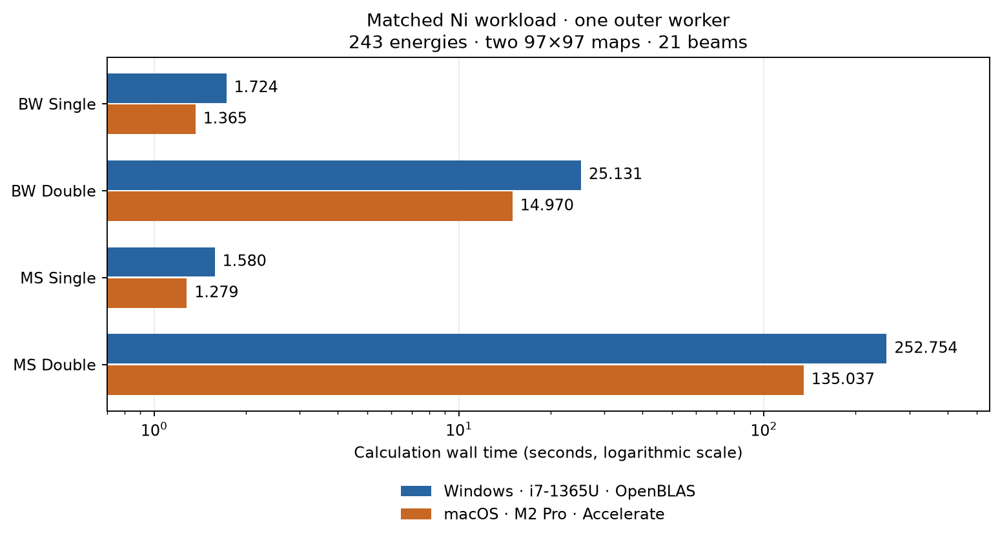

# EMCD-Sim

Research software for electron magnetic circular dichroism (EMCD), core-loss EELS and dynamical electron diffraction in transmission electron microscopy. Developed by Ding Peng; distributed under the MIT License.

## Download — Research Beta

| Platform | Version and package | Installation | First calculation | Release notes |
| --- | --- | --- | --- | --- |
| Windows x64 | **v0.9.0-beta.2** — [release assets](https://github.com/dingpengem/EMCD-Sim/releases) | [Windows installation](docs/INSTALL_WINDOWS.md) | [Windows Quick Start](docs/QUICK_START.md) | [Windows beta.2](docs/RELEASE_NOTES_0_9_0_BETA_2.md) |
| macOS Apple Silicon | [v0.9.0-beta.1-macos-arm64.1 ZIP](https://github.com/dingpengem/EMCD-Sim/releases/download/v0.9.0-beta.1-macos-arm64.1/EMCD-Sim-v0.9.0-beta.1-macos-arm64.1-macOS-ARM64.zip) | [macOS installation](docs/INSTALL_MACOS.md) | [macOS Quick Start](docs/QUICK_START_MACOS.md) | [macOS ARM64 notes](https://github.com/dingpengem/EMCD-Sim/blob/v0.9.0-beta.1-macos-arm64.1/docs/RELEASE_NOTES_MACOS_ARM64_1.md) |

Download and **extract the complete folder**, then launch the EXE/app. Packaged use requires neither Python nor Conda, nor manual BLAS environment variables. Windows requires the documented external Microsoft x64 VC++ v14 runtime. The macOS app is ad-hoc signed, not notarized; follow its first-launch guide.

Windows and macOS packages have **different source revisions**. Each package's build information and matching corresponding-source asset identify its exact source. [Earlier releases](https://github.com/dingpengem/EMCD-Sim/releases), including Windows beta.1, remain available unchanged.

## Capabilities

| Area | Implemented scope |
| --- | --- |
| Structure | ASE/CIF import, interactive 3D viewer, crystallographic group suggestions with original atom indices/Wyckoff provenance, manual magnetic subgroups. Ordinary CIFs infer neither magnetic order nor MDFF. |
| Elastic scattering | Neutral-atom Adaptive Dirac–Padé Z=1–118; historical Ni Lobato compatibility; explicit finite diffraction support and geometry. |
| Inelastic response | Independent element/site-group XMCD-constrained, synthetic Atomic Ionization and Manual tensor providers; validated magnetic reversal pairs; independent modeled energy windows. |
| Propagation | Bloch-wave (BW) and FFT Multislice (MS), Single and Double Channeling. Elastic paths within a localized event remain coherent; independent ionization events sum incoherently. |
| Results | Shared Global/Local Total, Element, Group Mean, additive Group Contribution and comparison views; spectra, selected angular maps, CSV/NPZ and PNG/SVG exports. |
| Projects and resources | Multiple calculations, Save/Open and two-run comparison; hardware-aware Auto/Manual workers and memory admission, bounded tasks and automatic BLAS safeguards. |

## Performance Benchmarks

Existing completed **one-worker calculation wall times**, excluding launch, rendering, saving and export:

| Backend | Windows (s) | macOS (s) |
| --- | ---: | ---: |
| BW Single | 1.724 | 1.365 |
| BW Double | 25.131 | 14.970 |
| MS Single | 1.580 | 1.279 |
| MS Double | 252.754 | 135.037 |

Windows: Intel Core i7-1365U, Windows 11 x64, 32 GiB, NumPy/SciPy OpenBLAS. macOS: Apple M2 Pro (6P+4E), 16 GiB, Accelerate. Matched inputs: FCC Ni **3.520 Å**, 200 kV, 10 nm, [017]/(200), full finite ZOLZ/21 beams, identical XMCD declarations, **243 energies**, two **97×97** maps, 64 depth nodes/subpixels, matched Thales detectors and MS FFT/depth schedule. These use recorded development sources, not a new timing claim for every package.

| Double Channeling | Windows 1 / 2 / 4 workers (s) | macOS 1 / 2 / 4 workers (s) |
| --- | --- | --- |
| BW | 25.131 / 24.916 / 34.095 | 14.970 / 14.576 / 20.775 |
| MS | 252.754 / 136.062 / 140.395 | 135.037 / 92.910 / 78.065 |

More workers are not always faster: BW Double scaled weakly; MS Double benefited more. Auto is resource-aware, not a measured optimum. Equal-worker timings and Auto allocations are separate comparisons.

Estimated **working arrays**, estimated **process peak**, measured process **RSS**, incremental calculation RSS and the **memory budget** differ. SC working arrays were smaller than DC here; application baseline, residency and allocators can reverse total-RSS ordering. A budget is not consumption.

See the [Windows report and matched comparison](docs/WINDOWS_SC_DC_RESOURCE_BENCHMARK.md), [pinned macOS report](https://github.com/dingpengem/EMCD-Sim/blob/6475afed8d133fe39773c08701b216312cd455d5/docs/MACOS_SC_DC_RESOURCE_BENCHMARK.md), and [per-array numerical evidence](docs/WINDOWS_MACOS_NUMERICAL_EQUIVALENCE.md). Hardware, BLAS and OS accounting differ; thermal/statistical repeatability is limited. The obsolete 93.4 s Mac timing was controller overhead; corrected BW Single is **1.365 s**, without a kernel change. BW Single direct numerical comparison passed; direct BW Double/MS Single/MS Double raw-array comparisons remain **INCOMPLETE**. Timing is not numerical equivalence, convergence or calibration.

## Quick Start and Documentation

**Import CIF → set Material M → configure MDFF → geometry/sampling/resources → Run → Results → Save/Open → export.**

1. **Material → Open CIF… → 3D Structure Viewer… → Site groups**. Inspect original indices; create magnetic subgroups explicitly when structural equivalence does not imply magnetic equivalence.
2. Select **Global Magnetization Mode** or **Local Site Magnetization Mode**. Material owns M; Local mode locks Global M. Exclude non-ionizing groups without deleting their atoms from the elastic structure.
3. **Configure MDFF…** in the explicit Global/group context. Validate source, conventions, frames and coverage; finish **Done → Apply and Close**. Cancel discards drafts; failed Apply preserves accepted settings. Preview alone does not accept a provider.
4. Configure geometry, propagation, energy/map sampling, detectors and **Compute Resources**. Auto never silently reduces scientific sampling. **Run EMCD / EELS**, inspect spectra/maps, save the full project folder and export from Results.

The [Windows Quick Start](docs/QUICK_START.md) covers the packaged, verified 243-energy/97×97 Ni example. [Complete Tutorial](docs/TUTORIAL.md) includes Local groups and exclusions. Also see [macOS Quick Start](docs/QUICK_START_MACOS.md), [User Guide](docs/USER_GUIDE.md), [MDFF workflows](docs/MDFF_WORKFLOWS.md) and [documentation index](docs/INDEX.md).

## Scientific References

EMCD-Sim implements and integrates established scattering methods; it does not claim to originate Bloch waves, multislice, MDFF or EMCD. Key sources include [Rusz, Rubino & Schattschneider (2007)](https://doi.org/10.1103/PhysRevB.75.214425), [Negi, Idrobo & Rusz (2018)](https://doi.org/10.1038/s41598-018-22234-8), [Dwyer (2005)](https://doi.org/10.1016/j.ultramic.2005.03.005), [Lobato & Van Dyck (2014)](https://doi.org/10.1107/S205327331401643X), and the [Adaptive Dirac–Padé preprint](https://arxiv.org/abs/2608.14934v1).

The [scientific bibliography and implementation map](docs/SCIENTIFIC_REFERENCES.md) distinguishes foundations, consulted background, alternative methods, historical providers and third-party data, including access limits and approximations. A paper describing a theory does not validate this implementation.

## Citation and Attribution

**If you use EMCD-Sim in your research, please cite the original software in any resulting publications, presentations, or technical reports.**

Peng, D. (2026). *EMCD-Sim: Electron Magnetic Circular Dichroism Simulation Software* (version used). https://github.com/dingpengem/EMCD-Sim. Report the version or exact source commit; Windows and macOS packages are not the same source revision.

This citation request extends to software derived from EMCD-Sim, including forks, modifications, adaptations, ports, source-based reimplementations, and AI-assisted derivative implementations. Using AI coding tools to rewrite, translate, adapt, or regenerate code derived from EMCD-Sim does not eliminate applicable original copyright and license notice obligations. This includes source-based work with ChatGPT, OpenAI Codex, GitHub Copilot, Claude or other assistants; [citation guidance](docs/CITATION.md) gives examples.

Academic citation is strongly requested, **not an added MIT license condition**. Independently developed software is not legally required to cite EMCD-Sim merely for implementing similar published physics, and resemblance alone does not establish that AI-generated code is derivative.

**Citing the scientific theories and methods underlying EMCD-Sim does not replace citing EMCD-Sim software when it is used. Citing EMCD-Sim does not replace appropriate citation of the original scientific literature.** [CITATION.cff](CITATION.cff), [BibTeX](CITATION.bib) and [detailed guidance](docs/CITATION.md) provide the software citation; the bibliography covers the science.

## Scientific Limitations

Research Beta, not calibrated quantitative spectroscopy. Finite ZOLZ, finite beam/FFT/depth support and continuous-depth localized ionization limit the model. General convergence is unestablished. The Ni 2.0 Å⁻¹ potential cutoff omits the first off-row harmonic near 2.029 Å⁻¹. Synthetic/effective MDFF do not establish absolute cross sections, calibrated Fe₃O₄/NiFe₂O₄ spectra or magnetic moments. Reversal-odd intensity and conventional detector A−B are distinct signals. Unsupported source-frame changes remain rejected; general tensor rotation and magCIF remain future work.

Historical failed/incomplete regression and source-guard records remain unchanged; focused release checks are not a new full regression. Independent clean-PC/VM validation and code signing are not claimed. [Release notes](docs/RELEASE_NOTES_0_9_0_BETA_2.md) state the evidence and limits.

## License

[MIT](LICENSE), unchanged. Retain applicable copyright and permission notices in copies or substantial portions. Third-party dependencies and data retain their own licenses, notices and corresponding-source requirements. See package notices and the [Windows installation guide](docs/INSTALL_WINDOWS.md).
