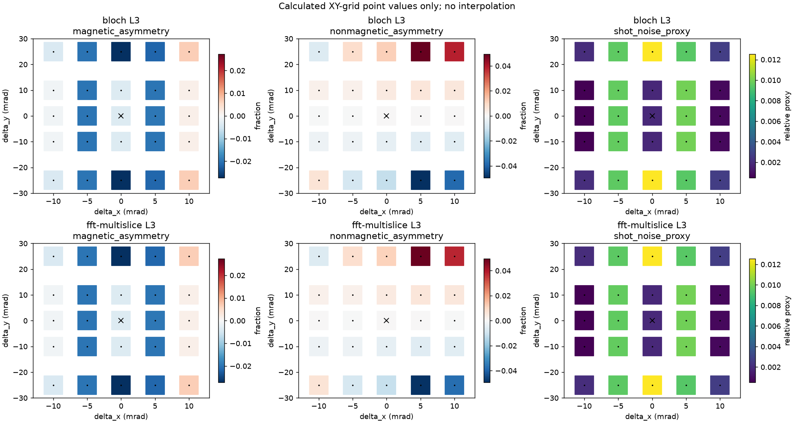
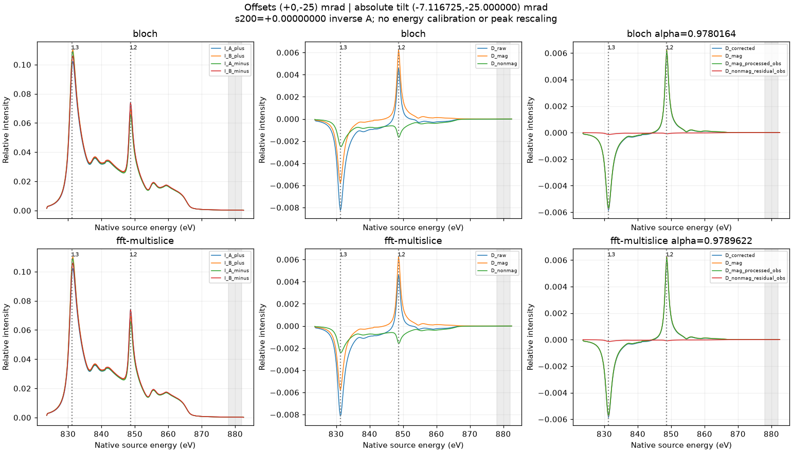

# EMCD-Sim

EMCD-Sim is a research simulation tool for **electron magnetic circular dichroism (EMCD)** using Bloch-wave (BW) and independent FFT multislice (MS) propagation. It combines dynamical electron diffraction, approximate core-loss scattering tensors and virtual-detector EELS/EMCD analysis, with fcc Ni as the principal validated material.

**Current Windows research prerelease: v0.6.1-beta.1.**
[Release and download](https://github.com/dingpengem/EMCD-Sim/releases/tag/v0.6.1-beta.1) · [Windows installation](docs/INSTALL_WINDOWS.md) · [Quick Start](docs/QUICK_START.md) · [User Manual](docs/USER_GUIDE.md) · [Acceptance](docs/V061_BETA_ACCEPTANCE.md).

## Main capabilities

- Single Channeling (entrance-only) and Double Channeling (incoming diffraction, depth-distributed ionization and post-loss outgoing diffraction).
- Bloch-wave, FFT Multislice and matched **Both (BW / MS comparison)** calculations.
- Virtual Detector EELS, selected L3/L2 samples or full native energy-resolved spectra, and magnetization reversal.
- **Full-field EMCD Angular Maps** over actual calculated reciprocal-space samples, independently of detector-circle overlays.
- Signed magnetic/nonmagnetic decomposition, raw differences, total EMCD Asymmetry and Advanced Diagnostics.
- Checksummed projects, Results Browser, PNG/SVG figures and CSV/NPZ scientific exports.
- Checkpointed research thickness workflows, configurable memory admission and cooperative cancellation.

## Supported physical models

Elastic propagation uses an oriented **projected independent-atom-model (IAM) potential**. Single retains entrance channeling; Double also propagates the outgoing electron at its reduced post-loss energy. BW and MS are independent numerical implementations within matched physical approximations.

The principal Ni MDFF is an **XMCD-constrained effective Hermitian tensor**. An approximate atomic-ionization model is also available. A complete DFT-derived MDFF from complex core-to-band transition matrix elements is **not implemented**. CIF import supports structural inspection; it does not validate arbitrary materials for magnetic EELS. The verified GUI FFT geometries are Ni [017] full finite ZOLZ and the explicitly restricted [001] (200) systematic row.

## Installation

### Windows portable application

1. Open [v0.6.1-beta.1 Releases](https://github.com/dingpengem/EMCD-Sim/releases/tag/v0.6.1-beta.1).
2. Download [EMCD-Sim-0.6.1-beta.1-Windows-RC.zip](https://github.com/dingpengem/EMCD-Sim/releases/download/v0.6.1-beta.1/EMCD-Sim-0.6.1-beta.1-Windows-RC.zip) and `SHA256SUMS.txt`.
3. Verify SHA256, then **Extract All** into a normal writable folder.
4. Open the extracted **`EMCD-Sim/EMCD-Sim.exe`**. Keep `_internal` and all other application files beside it; do not run inside the ZIP or copy only the EXE.

```powershell
Get-FileHash "$HOME/Downloads/EMCD-Sim-0.6.1-beta.1-Windows-RC.zip" -Algorithm SHA256
```

Expected SHA256:

```text
9fd5e71437d2c26d4595abb7adde9436e4c333ce18f3a57cf381b0c541bfd94f
```

The package bundles its Python runtime and is intended to run without a separate Python/Conda/WIEN2k installation. Same-host standalone testing passed; **independent clean-machine installation remains NOT TESTED**. This Windows x64 Beta is unsigned. See [installation and troubleshooting](docs/INSTALL_WINDOWS.md), including saved-project reopening. The original validated ZIP is retained unchanged despite its `RC` filename.

### From Python source

With a suitable Python environment (tested with Python 3.11), clone this repository, open its directory, then run:

```powershell
python -m pip install -e ".[gui]"
python -m emcd_sim.gui
```

Source installation is a separate workflow; the portable EXE does not require this step. Linux/macOS source support does not establish standalone binary acceptance on those platforms.

## Quick Start

Choose **File → New**, **FCC Ni default**, nominal zone `0 1 7` and target `2 0 0`. Keep 200 kV and use **Reset to reference geometry** for Tilt X approximately -7.11672544 mrad and Tilt Y = 0. Click **Preview diffraction**; exact (200) Bragg alignment is not zero-tilt zone-axis incidence or an isolated two-beam wavefield.

Select and validate the bundled five-column XMCD source, inspect its native energy assignments and explicitly declare the magnetization/polarization convention. Choose **Channeling Model**, **Propagation Method** and **Spectral coverage**. For a faster selected-energy workflow choose **Selected L3/L2 samples only (not full EELS)**. Click **Run EMCD / EELS** once. **Cancel** cooperatively stops the worker while preserving the last completed result. Do not start duplicate jobs while initialization or cancellation is pending.

## GUI workflow

1. Set structure, zone/target, voltage, thickness, absolute incident tilt and diffraction settings.
2. Choose the MDFF and crystal-frame magnetization, then Single/Double and BW/MS/Both.
3. Configure angular grid, independent FFT mesh, aperture boundary subpixels, physical detectors and memory budget.
4. View **BW/MS Diffraction**, **Virtual Detector EELS** and **EMCD Angular Maps**. **Signal Display** offers **Raw (a.u.)** or **EMCD Asymmetry (%)**; Advanced Diagnostics retains magnetic-only/even percentages and corrected contrasts.
5. Save with **File → Save Project As...**. Reopen the complete project folder with **Open Project** or **Results Browser → View Selected**; viewing does not rerun physics. **Use These Settings** restores inputs separately.

**Angular Map Resolution:** Quick Preview 33 x 33, Standard **97 x 97 (default)**, High 193 x 193, or supported odd Custom sizes. It adds actual reciprocal-space samples; it is separate from the FFT propagation mesh and aperture boundary subpixels. Angular maps and detector-EELS quadrature currently share the angular grid.

**Estimated process memory budget:** 512, 1024, **2048 (default)**, 4096 or 8192 MiB. This is a ceiling, not a reserved allocation. Available RAM and estimated process peak are checked; High does not necessarily fit 2048 MiB. Existing explicit saved settings are preserved; New Project resets angular grid/budget to 97/2048. See [sampling and memory](docs/ANGULAR_MAP_RESOLUTION.md).

## Example simulations

The preferred reference is **fcc Ni [017], exact (200) Bragg, 200 kV, 8 nm, Double Channeling, Bloch-wave**. Use Tilt X = -7.116725439974256 mrad, Tilt Y = 0, crystal magnetization [001], eta = beta = 1, and the physical Thales A/B apertures. The [reproducible GUI example](docs/USER_GUIDE.md#validated-ni-017-8-nm-double-example) gives source hashes, actual detector coordinates, energies and all numerical settings, using Standard 97 and a 2048 MiB budget. MS or full-energy spectra may take substantially longer; a selected L3/L2 calculation is not a fabricated full spectrum.

The completed **200 kV, 0–100 nm at 2 nm steps** study covers BW/MS, Single/Double, L3/L2 and [017] full finite ZOLZ / [001] restricted row: **204 checkpoints, 426 regression passes**. Maximum BW/MS detector asymmetry discrepancy is **0.009656 pp**; maximum relative raw-intensity error is **0.015097%**, within unchanged 0.01 pp / 0.1% gates. These certify the tested matched profile, not global physical convergence. See [scientific analysis](docs/NI_EMCD_THICKNESS_SCIENTIFIC_ANALYSIS.md) and [representative angular convergence](docs/ANGULAR_MAP_CONVERGENCE.md).

![Verified Ni [017] X/Y survey](docs/images/ni017/xy_overview.png)

Actual historical 200 kV, 30 nm BW/MS calculations; this existing survey image is not the new 8 nm/97-grid example. Its colorbar fractions are not percentages. The [case-study gallery](docs/NI_017_CASE_STUDY_GUIDE.md) retains angular/EELS plots and raw/corrected interpretation.

## Output formats and interpretation

Projects retain settings, native energies, source hashes and original arrays in JSON/CIF/NPZ files. CSV/NPZ exports retain raw magnetic and nonmagnetic differences and explicit percentage definitions; PNG/SVG exports include display metadata. Keep each project folder complete. The [User Manual](docs/USER_GUIDE.md#export-figures-and-data) explains original versus derived exports.

For detector J, `N_J=[I_J(+M)+I_J(-M)]/2` and `M_J=[I_J(+M)-I_J(-M)]/2`. Thus `D_mag=M_A-M_B`, `D_nonmag=N_A-N_B`, and `D_raw=D_mag+D_nonmag`. Raw detector EMCD Asymmetry is `100*[I_A(+M)-I_B(+M)]/[I_A(+M)+I_B(+M)]`; it can contain reversal-even diffraction contributions.

The angular Asymmetry uses actual `q=(qx,qy)` and `q'=(qx,-qy)` samples: `100*[I_plus(q)-I_plus(q')]/[I_plus(q)+I_plus(q')]`. Detector circles are overlays. Integrate **raw intensities before taking a detector ratio**; never average local percentages. Invalid/near-zero denominators remain NaN. Post-edge-corrected contrast is not intrinsic magnetic EMCD. See [signal definitions](docs/USER_GUIDE.md#signal-definitions-in-061).

<a id="known-limitations"></a>

## Scientific limitations

- XMCD-constrained approximate MDFF, not complete DFT transition matrix elements.
- Projected IAM elastic potential, not genuine atomic-3D electrostatic multislice; longitudinal transfer uses the documented approximation.
- BW/MS agreement is numerical cross-validation within shared approximations. Full physical-parameter convergence has not been demonstrated globally.
- Absolute EELS intensities, native calculated energy calibration and experimental counting statistics are uncalibrated. Arbitrary units and percentages are not electron counts or experimental SNR.
- Raw EMCD Asymmetry can contain nonmagnetic contributions. Sampled thickness maxima are not globally converged optima.
- [001] restricted systematic-row results are not validated full-ZOLZ exact two-beam geometry. [017] remains the preferred reference.
- Independent clean-machine Windows installation is **NOT TESTED**. The app is unsigned; local acceptance is not signing or SmartScreen certification.

## Documentation

[Windows installation](docs/INSTALL_WINDOWS.md) · [Quick Start](docs/QUICK_START.md) · [Complete User Manual](docs/USER_GUIDE.md) · [GUI technical/milestone reference](docs/EMCD_GUI.md) · [Ni [017] case study](docs/NI_017_CASE_STUDY_GUIDE.md) · [Scientific analysis](docs/NI_EMCD_THICKNESS_SCIENTIFIC_ANALYSIS.md) · [Angular resolution](docs/ANGULAR_MAP_RESOLUTION.md) · [Angular convergence](docs/ANGULAR_MAP_CONVERGENCE.md) · [Release notes](docs/RELEASE_NOTES_0_6_1_BETA_1.md) · [Acceptance/provenance](docs/V061_BETA_ACCEPTANCE.md) · [Changelog](docs/CHANGELOG.md).

## Citation and license

For reproducibility, cite the repository and exact release/commit, and report source hashes, geometry, MDFF, detectors, grid/basis/cutoff/depth settings and signal definitions. The theoretical normalization reference is Rusz et al., Physical Review B 75, 214425 (2007); normalization agreement alone is not complete physical equivalence. No software paper or DOI is claimed here. Code is distributed under the [MIT License](LICENSE); third-party runtime licenses remain with the Windows distribution.

Previous [v0.6.0-beta.1](https://github.com/dingpengem/EMCD-Sim/releases/tag/v0.6.0-beta.1) and [v0.4.5-beta.1](https://github.com/dingpengem/EMCD-Sim/releases/tag/v0.4.5-beta.1) releases/assets remain preserved. Their documentation and the detailed research history follow below.

## Historical research and CLI reference

<details>
<summary>Earlier research milestones, examples and command-line workflows</summary>

The following records describe their original versions and models. Statements
about entrance-only propagation, incomplete outgoing channeling or unresolved
low-cutoff studies apply to those historical calculations, not the current
Double-Channeling GUI. Their results and original assumptions are preserved.

## Historical oriented research: oriented Ni [017] EMCD / X-Y mistilt study (post-v0.4.5)

The **`main` branch now includes the completed Ni [710] and Ni [017] oriented projected-IAM benchmarks and the 43-orientation Ni [017] high-mistilt X/Y survey**. The original v0.4.5-era research record is retained below; the current Windows research Beta is **v0.6.1-beta.1**.

**Start here: [Ni [017] case-study guide — native WIEN2k L3/L2 edge assignment, minor-zone / (200) exact Bragg, mistilt coordinates and which figures to inspect](docs/NI_017_CASE_STUDY_GUIDE.md).** Detailed numerical results: [Ni [017] high-mistilt technical report](docs/NI_017_HIGH_MISTILT_XY.md) and [Ni [017] oriented diffraction report](docs/NI_017_MINORZONE.md).

- **Native magnetic spectral samples**, not absolute experimental calibration: L3 **831.271 eV** and L2 **848.698 eV** on the unshifted WIEN2k axis. XAS maxima: 831.421 and 848.752 eV. Earlier 852.7/870 eV nominal reference selections are **not** the native calculated peak energies.
- **Geometry:** genuine Ni [017] minor-zone axis (approximately 8.13° from the source's cubic-[001] magnetization), target **(200)**, exact paraxial Bragg reference `theta_x=-7.11672544 mrad`, `theta_y=0`. The local magnetization tensor is rotated from cubic [001], rather than reassigned to the electron-beam direction. This is **two-beam-like, not isolated two-beam**: competing diffraction channels can be populated inside the foil.
- **Mistilt:** `theta_x=theta_Bragg200+delta_x`, `theta_y=delta_y` in local [017] coordinates. X and Y series plus a calculated 5×5 grid include **43 unique orientations**, with BW/FFT-multislice angular maps and **individual full virtual-detector EELS** for every case.
- **Inspect actual simulation previews on GitHub:** the [case-study results gallery](docs/NI_017_CASE_STUDY_GUIDE.md#41-hosted-overview-magnetic-even-and-rawcorrected-contrast) includes XY maps, raw/corrected contrast, the Y-mirror check, and representative angular/EELS figures. Full original images and numerical NPZ files remain local under `outputs/ni_017_high_mistilt_xy/`; the hosted previews do not replace that numerical dataset.

**Limitations:** XMCD-*constrained* effective MDFF (not a full DFT Cartesian complex MDFF), z-independent projected Ni elastic potential, incoming-only depth-integrated ionization and no outgoing channeling, unresolved physical Fourier-potential convergence, uncalibrated absolute cross sections and sample dose. BW–FFT agreement does not establish fully quantitative Ni EMCD. Older `emcd-ni` / [001] / Gaussian examples below remain separate legacy/reference workflows.

### Ni [017] results gallery

Actual saved **200 kV, 30 nm** simulations, losslessly optimized for browsing. Click a preview to enlarge; the [nine-figure guide](docs/NI_017_CASE_STUDY_GUIDE.md#41-hosted-overview-magnetic-even-and-rawcorrected-contrast) explains geometry, components and caveats.

| L3 X/Y survey: BW above FFT multislice | Full EELS at `(0,-25)` mrad Bragg offset |
| --- | --- |
| [](docs/images/ni017/xy_overview.png) | [](docs/images/ni017/y_minus25_eels.png) |
| Magnetic asymmetry, even imbalance and relative shot-noise proxy at calculated points only; no interpolation. Colorbar fractions are not percentages. | Raw contrast combines magnetic-odd and reversal-even terms. Post-edge-corrected contrast contains a scaled magnetic term **and an even residual**, and is not the intrinsic magnetic signal. |

Native L3/L2 samples are **831.271/848.698 eV**, without experimental energy calibration. Larger asymmetry does not guarantee better detectability; potential-cutoff changes can reorder candidate orientations. These are relative model outputs with the limitations stated above, not experimental Ni measurements.

```powershell
$env:PYTHONPATH='src'
python -m emcd_sim.ni_017_high_mistilt_xy --scan all
python -m emcd_sim.ni_017_high_mistilt_xy --scan all --plot-only
```


Independent, modular **electron magnetic circular dichroism (EMCD)** simulation project, initially benchmarked on ferromagnetic **FCC Ni**. 

> **Historical v0.4.5-era note: packaged release version was v0.4.5; then-current `main` includes subsequent [017] research-stage implementations, still not quantitative Ni EMCD.** The default elastic channel uses a **Ni scattering-factor-derived multi-beam Bloch-wave propagator**. The **inelastic Ni L₂,₃ spectra and outgoing channeling are still qualitative/incomplete**; do not interpret this as a quantitatively validated EMCD calculation. See [physical elastic derivation](docs/PHYSICAL_ELASTIC.md) and [physics limitations](docs/PHYSICS.md).


## WIEN2k Ni XMCD-constrained effective MDFF (v0.4.5)

The `xmcd-effective` mode now accepts the native 5-column `Ni_fm.xmcd` spectrum, constructs a Hermitian positive-semidefinite axisymmetric *dipole proxy*, and passes it to the existing **entrance-only** channeling engine:

```bash
python -m emcd_sim --mdff-model xmcd-effective \
  --xmcd-file data/wien2k_ni/Ni_fm.xmcd \
  --xmcd-eta 1 --xmcd-beta 1 \
  --diffraction-condition near-2bc --output outputs/ni_xmcd_2bc
```

The original 4,329-point WIEN2k spectrum is now committed at `data/wien2k_ni/Ni_fm.xmcd`. The entire WIEN2k project archive is not committed (only the XMCD spectrum used here). No WIEN2k source-code modifications are necessary for the proxy path. See [XMCD technical pathway and future full DFT MDFF migration](docs/WIEN2K_XMCD_MDFF_ROADMAP.md). The existing audited `ni-metal-external` remains reserved for actual complex core-to-band transition amplitudes. **Neither model nor its output is a quantitatively validated metallic-Ni EMCD cross section.**


### Generate diffraction-condition-indexed XMCD EMCD maps

```bash
python -m emcd_sim.xmcd_indexed_maps \
  --xmcd-file data/wien2k_ni/Ni_fm.xmcd \
  --output examples/ni_emcd_dft_constrained \
  --thickness-nm 30 --grid 65 --steps 64
```

Generates `zone-axis`, `two-beam`, `near-2bc`, and `symmetric-3bc` outputs. Each folder contains `diffraction_pattern.png`, `diffraction_spots.csv` with **(h,k,l), g_x, g_y, signed s_g, intensity**, `emcd_L23_indexed.png` (indexed L3/L2 nonmagnetic and chiral maps), `emcd_L3_map.npz`, `emcd_L2_map.npz`, detector spectra and `metadata.json`. The automatic workflow `.github/workflows/ni-xmcd-maps.yml` is configured to commit the generated example outputs to Git when its calculation and write permissions succeed. Do not infer that images have already been calculated from the presence of the workflow.

The ZOLZ and systematic-row bases are different **finite approximations**: 2BC is a truncated two-beam model, near-2BC retains the 7-beam row, and symmetric-3BC is a nominal symmetric systematic row with off-zone tilt. Gaussian-looking diffraction spots are plot rendering, not CBED disks. All EMCD maps are entrance-only **relative intensities** using an XMCD-constrained proxy, not fully quantitative EMCD.

## P2 — Complex MDFF in single-channeling EMCD (v0.4.3)

The real-complex `DipoleTensor` can now be contracted with the Ni incident
Bloch-wave to generate **L₂/L₃ reciprocal maps, spectra and apertures** without
the Gaussian `magnetic_fraction=0.12`. Use a deliberately non-DFT local atomic
model, or import complex transition dipoles calculated elsewhere:

```bash
python -m emcd_sim --mdff-model ni-local --diffraction-condition near-2bc --output outputs/ni_local_emcd
python -m emcd_sim --mdff-model transitions --mdff-transitions path/to/transitions.npz --diffraction-condition symmetric-3bc --output outputs/ni_imported_emcd
```

Both are **entrance-only relative-intensity calculations**, not quantitative Ni predictions.
The original `--mdff-model gaussian` remains the default for older examples.
The tensor path rejects voltage-to-moment scaling. See
[full coupling equations, site phases, Coulomb factors, units and limitations](docs/SINGLE_CHANNELING_TENSOR.md).

## P2 — Complex transition-derived dipole MDFF (v0.4.0)

The new [MDFF tensor API](docs/MDFF_TENSOR.md) constructs complex Hermitian spectral tensors from externally supplied core-to-unoccupied-state transition dipoles. It **does not compute DFT wavefunctions**. Run a synthetic-only demonstration on Windows/macOS/Linux:

```bash
python -m emcd_sim.mdff_reference --toy --output outputs/mdff_toy
```

Supply a compatible real transition dataset via `--transitions path/to/transitions.npz` instead of `--toy`. The generated `mdff_tensor.npz` is a spectral *dipole tensor*; it does **not** include Coulomb denominators or experimental cross-section calibration. The original Gaussian-MDFF EMCD CLI remains the default for compatibility; the tensor-to-channeling backend is separately selectable from v0.4.3.

References: [abTEM core-loss source](https://github.com/abTEM/abTEM/blob/main/abtem/inelastic/core_loss.py) for transition-potential/channeling design and [Elk elnes.f90](https://elk.sourceforge.io/doxygen/html/elnes_8f90_source.html) for complex electronic excitation matrix elements. These are references **not copied source code**, and neither automatically supplies a quantitative Ni magnetic MDFF.

## What works

- FCC Ni (`a=3.524 Å`), structure-factor extinction checks, reciprocal lattice without 2π.
- 200-kV relativistic electron wavevector and Ni [001] `(000),(200),(-200)` systematic-row geometry.
- **Physical multi-beam elastic Ni scattering:** Lobato–Van Dyck atomic electron factors, FCC electron structure factors, occupancy and optional Debye–Waller B, relativistically corrected diffraction coupling, seven-beam [001] baseline (or auto-generated 2D ZOLZ set).
- Hermitian Bloch-wave elastic propagation and depth-averaged coherence (incident wave); optional original surrogate backend for comparison.
- Cubic dipole-MDFF geometry `N(E) q·q′ + i M(E) m·(q×q′)` and energy-resolved diffraction map.
- 2BC Thales-circle apertures and 3BC four-quadrant **double difference**; detector coordinates match the 000-centered diffraction map. Other geometries retain illustrative A/B detectors.
- **Pluggable core-loss line-shapes** (`LEdgeSpectrum` or `TabulatedEdgeSpectrum` using measured/DFT arrays).
- **Pluggable sample-bias-to-moment models**: constant (default) or user-supplied `V,µB` table; fictional demo data clearly marked.
- Lightweight numerical tests and reproducible PNG / NPZ / JSON output.

## Windows, macOS and Linux

EMCD-Sim supports source installation with Python 3.11 on Windows, macOS and Linux.
The same cross-platform module command works on all three: `python -m emcd_sim`.
See [platform setup and Windows PowerShell instructions](docs/CROSS_PLATFORM.md).
Tests run in GitHub Actions on all three platforms.

## Install and run (Mac with Conda or Python 3.10+)

```bash
cd ~/EM_code/EMCD-Sim
conda activate emcd-python
python -m pip install -e '.[dev]'
python -m pytest -q
emcd-ni --output outputs/ni_baseline
```

Outputs: `diffraction_pattern.png/.npz`, `diffraction_spots.csv`, `ni_elastic_diffraction.png/.npz`, `ni_emcd.png/.npz`, `metadata.json`.

The **default** command uses Ni physical elastic scattering (seven selected beams). Switch options:

```bash
# Physical 7-beam Ni systematic row (default)
emcd-ni --elastic-backend physical --beam-order 3 --output outputs/ni_physical
# Physical [001] ZOLZ 2D set
emcd-ni --zone2d-max-g 1.0 --max-beams 13 --output outputs/ni_zolz
# Optional measured/reference isotropic B; never silently assumed
emcd-ni --b-factor 0.4 --tilt-x-mrad -7 --output outputs/ni_tilted
# Former empirical model remains available for comparison
emcd-ni --elastic-backend surrogate --xi-nm 55 --output outputs/ni_surrogate
# Elastic-only sensitivity to number of diffracted beams
python examples/ni_elastic_convergence.py --max-order 6
```

For indexed diffraction patterns without MDFF/EELS (fast):

```bash
emcd-ni --diffraction-condition zone-axis --max-beams 13 --diffraction-only --output outputs/ni_zone_axis
emcd-ni --diffraction-condition near-2bc --diffraction-only --output outputs/ni_near_2bc
emcd-ni --diffraction-condition symmetric-3bc --diffraction-only --output outputs/ni_3bc
emcd-ni --diffraction-condition two-beam --diffraction-only --output outputs/ni_two_beam
```

See [Diffraction conditions](docs/DIFFRACTION_CONDITIONS.md) (including **corrected v0.3.1 apertures**) for definition of the nominal [001] zone axis, signed excitation errors, finite-beam caveats and comparison between 2BC and symmetric 3BC. The rendered Bragg spot width is **not** a calculated CBED disk or instrumental resolution.

`--xi-nm` affects only the `surrogate` backend; physical `ξ₂₀₀` is computed from Ni scattering factors. `--voltage-v` is **sample bias**, not microscope accelerating voltage (`--acceleration-kv`). The elastic backend is physical but the EMCD MDFF remains illustrative, and no outgoing channeling has been added.

For an **illustrative** voltage workflow (the CSV values are invented, not measured and must not be interpreted as Ni data):

```bash
emcd-ni --voltage-table examples/ni_voltage_example.csv --voltage-v 2 \
    --output outputs/ni_bias_demo
python examples/compare_voltage.py
```

For real voltage-dependent studies, replace the example CSV with measured or independently simulated magnetic moments before comparing against data. A pure Ni slab under arbitrary applied bias does not imply a predictable change in magnetization.

## Project structure

```text
src/emcd_sim/
  crystal.py       FCC structural model, reciprocal lattice, extinction
  geometry.py      electron optics, qz, reciprocal detectors
  diffraction.py   indexed diffraction geometries, s_g and elastic plots
  scattering.py    Ni Lobato elastic factors and F_G, Debye-Waller, occupancies
  physical_elastic.py  physical finite-basis Bloch-wave propagation
  elastic.py       legacy surrogate, beam selection and coherence integration
  inelastic.py     cubic dipole MDFF & illustrative Ni edge model
  voltage.py       voltage-to-moment interface and tabulated values
  simulation.py    depth coherence, diffraction map, detector integration
  benchmark.py     FCC Ni [001] reference setup
  cli.py           reproducible command-line benchmark
examples/           illustrative sample-bias control
scripts/            local GitHub publishing workflow
tests/              focused validation tests
docs/               physics assumptions and upgrade roadmap
```


## Tilt × thickness scans (v0.3.3)

Use `python -m emcd_sim.scan` or `emcd-scan` to compare a seven-beam systematic row and a finite 2D ZOLZ basis under identical tilts. The script produces complete `(tilt_x, tilt_y, thickness)` L3 difference/asymmetry arrays, fixed-color-scale reciprocal maps, indexed basis metadata and CSV outputs. See [the scan guide](docs/TILT_THICKNESS_SCAN.md). The current MDFF is still **illustrative**, not quantitative Ni.

## What is deliberately not claimed

V0.2 **does** use tabulated neutral-Ni scattering factors to derive a real, nonabsorptive independent-atom potential. However it is **not parameter-free** in the ab-initio electronic-structure sense. It does **not** include calibrated Ni EMCD matrix elements, ab-initio ELNES/MDFF, outgoing dynamical propagation, absolute cross sections, quantitative sum rules, experimental validation or voltage-driven magnetic theory. [Details](docs/PHYSICAL_ELASTIC.md).

## GitHub / Mac deployment

The initial project can be unpacked at `~/EM_code/EMCD-Sim`. From inside the folder, run `bash scripts/publish_on_mac.sh` (requires `gh` and GitHub authentication). The script creates the **separate public** `dingpengem/EMCD-Sim` repository on GitHub and publishes a curated source-code commit. Generated outputs and local environment files are excluded by `.gitignore`. This research-stage simulator does not yet provide quantitative Ni EMCD predictions.

## Compare EMCD maps across diffraction conditions

For the **same FCC Ni L3 energy (852.7 eV)**, generate a 2-row × 4-column reciprocal-space comparison of ideal 2BC, near-2BC, symmetric-3BC and [001] zone-axis:


```bash
python -m emcd_sim.compare_conditions --output outputs/ni_emcd_gaussian
# or: emcd-compare --output outputs/ni_emcd_gaussian
```

The comparison includes shared-color-range magnetic and local M/N maps, indexed diffraction spots, virtual apertures, condition-specific tilts, metadata and NPZ arrays. A fixed global color scale intentionally reveals differences in magnitudes; nearly blank panels do **not** prove zero EMCD. These results use **entrance-only channeling and illustrative Gaussian MDFF**, not quantitative Ni predictions. Reproducibility notes and a checked-in preview are in [examples/ni_emcd_gaussian](examples/ni_emcd_gaussian/README.md).

## FCC Ni Bloch-wave basis convergence (v0.3.5)

To diagnose whether finite 2D ZOLZ diffraction and **illustrative** EMCD depend on the number of retained elastic beams, run:

```bash
python -m emcd_sim.convergence --output outputs/ni_convergence
```

The command compares **5, 13, 21 and 37 beams** for [001] zone-axis and symmetric-3BC tilt presets at 10, 30 and 50 nm. It saves `basis_convergence.png`, `convergence_results.csv/.npz`, and `convergence_metadata.json`. This is a *sensitivity/convergence diagnostic*, not evidence that the largest set is converged or that the illustrative Ni MDFF is quantitative. See [the basis-convergence guide](docs/BLOCH_CONVERGENCE.md). Python/Conda commands work on Windows, macOS and Linux.

## Independent elastic multislice reference (v0.3.6, P1)

To independently cross-check the **incoming elastic Bloch-wave** propagator against a **real-space Fourier split-step multislice** implementation, with deliberately matched *Fourier-truncated* FCC Ni [001] crystal potentials:

```bash
python -m emcd_sim.elastic_reference --output outputs/ni_elastic_reference
```

The command saves a labeled comparison PNG, CSV diffraction intensities and full reference metadata. See [elastic FFT reference methodology, convergence warnings and observed results](docs/ELASTIC_FFT_REFERENCE.md). It **does not** compute an EMCD spectrum, use 3D atom-resolved potentials, or certify physical/MDFF convergence. Both propagation algorithms can agree while the underlying high-order Ni potential is still cutoff-sensitive.

## P2 — Ni 2p angular core-SOC reference and external transition import (v0.4.1)

The new [Ni transition pipeline](docs/NI_TRANSITION_PIPELINE.md) provides
exact 2p j,mj Clebsch-Gordan **angular** coupling to 3d orbitals and a portable
complex-dipole CSV -> NPZ adapter. This is **not** Ni DFT: band states, 3d holes,
core energies and radial matrix elements remain illustrative inputs. The
existing EMCD maps still use the original Gaussian `magnetic_fraction=0.12`.

```bash
python -m emcd_sim.ni_atomic_reference --output outputs/ni_atomic_reference
python -m emcd_sim.transition_csv --help
```

A future validated Elk/all-electron 2p-to-band matrix-element export can feed
these interfaces on Windows, macOS or Linux without requiring the DFT solver
on the EMCD machine.

## P2 — Non-DFT local MDFF (v0.4.2)

The new [non-DFT MDFF guide](docs/NONDFT_MDFF.md) and
`src/emcd_sim/ni_local_mdff.py` calculate complex Ni 2p→3d dipoles from
normalized screened-hydrogenic radial orbitals (or externally supplied
atomic Hartree-Fock radial tables), cubic 3d orbitals, SOC core angular states,
and **user-supplied** hole occupations, crystal field and exchange splitting.

```bash
python -m emcd_sim.ni_local_mdff --output outputs/ni_local_non_dft
```

This is **not** self-consistent DFT, not a full charge-transfer/atomic multiplet
solver, and not a quantitative prediction for metallic FCC Ni. The existing
`emcd-ni` reciprocal maps still use the Gaussian illustrative MDFF.
Atomic multiplet providers (for example Quanty) and periodic DFT will remain
independent, optional inputs to the same complex tensor interface.

## Ni metallic complex transition-data audit (v0.4.4)

A literature/open-data audit **did not identify a verified, downloadable FCC metallic Ni L2/L3 complex transition-amplitude dataset**. The project therefore does **not** silently substitute NiO spectra, ordinary XAS intensity or made-up DFT transitions. `--mdff-model ni-metal-external` now requires phase/SOC/complex-phase provenance and checks source consistency before use. **This is an input/schema audit, not independent physical validation.**

See [Ni metallic transition data sources and audit](docs/NI_L23_EXTERNAL_DATA.md). Existing Gaussian and non-DFT models are retained and clearly labeled.

## Magnetic-reversal parity diagnostics (v0.4.6 candidate)

The new `python -m emcd_sim.xmcd_reversal` command separates reversal-odd
magnetic response from reversal-even detector/diffraction asymmetry using
the unchanged entrance-only XMCD-effective model. See the
[diagnostic guide](docs/XMCD_MAGNETIC_REVERSAL_DIAGNOSTICS.md) for equations,
source-hash provenance, output definitions and cross-platform commands.
These relative-intensity diagnostics are not quantitative Ni predictions.

The [matched systematic-row/2D ZOLZ guide](docs/XMCD_BASIS_CONVERGENCE.md)
describes `python -m emcd_sim.xmcd_basis_convergence`, which compares parity
signals at fixed near-2BC geometry while varying beam cutoff and y tilt.
Its largest finite basis is a comparison point, not a validated reference.

The [diffraction-resolved magnetic decomposition guide](docs/XMCD_GEOMETRY_MAGNETIC_DECOMPOSITION.md)
describes `python -m emcd_sim.xmcd_geometry_decomposition`: matched 2D
geometry comparisons, a separate two-beam truncation reference, magnetic/even
contrast metrics and a lightweight aperture-grid sensitivity check. Results
remain entrance-only relative intensities without quantitative Ni validation.

The [independent multislice EMCD reference](docs/MULTISLICE_EMCD_REFERENCE.md)
compares complex FFT/Bloch incident waves, coherence and magnetic/even EMCD
using a shared Fourier-truncated potential and inelastic kernel. Run
`python -m emcd_sim.multislice_emcd_reference --help` for the small benchmark.
This validates numerical propagation within shared approximations, not the
XMCD-effective MDFF, outgoing channeling or quantitative Ni accuracy.

The [fractional-aperture guide](docs/FRACTIONAL_APERTURE_INTEGRATION.md)
describes optional shared circular-area weights for tensor Bloch-wave and
FFT-multislice EMCD (`--integration-mode fractional`). Binary center masks
remain the default. A small validation compares aperture area and Ni contrast
grid sensitivity without changing the underlying propagation or MDFF.

The [post-edge normalization guide](docs/XMCD_POSTEDGE_NORMALIZATION.md)
describes `python -m emcd_sim.xmcd_postedge_normalization`: experimental-style
constant scaling, an oracle nonmagnetic comparison, and exact magnetic/even
residual diagnostics. Cleaner detector differences can still have biased
magnetic amplitudes; the limited, nonzero-magnetic Ni post-edge is retained.

The [post-edge robustness validation](docs/XMCD_POSTEDGE_ROBUSTNESS.md) compares
matched diffraction bases and separate detector/depth refinements, retaining
raw spectra and diagnostic normalization-bias terms.

The [spatial post-edge map comparison](docs/POSTEDGE_EMCD_MAP_COMPARISON.md)
compares paired raw/corrected aperture maps using matched independent Bloch
and FFT multislice incident propagation, with intrinsic parity maps retained.

The [Ni angular-map and EELS guide](docs/NI_EMCD_ANGULAR_COMPARISON.md)
adds indexed L3/L2 intrinsic magnetic/even/total maps and full-source virtual
detector spectra via `--angular-output --full-source-range`.

The desktop GUI supports [EMCD percentage visualization](docs/EMCD_GUI.md#emcd-signal-normalization-and-percentage-conventions-stage-f) from saved projects: common-even asymmetry, fixed L3/L2 EELS peaks, and distinct local/paired angular percentages. See [Stage F acceptance](docs/EMCD_GUI_STAGE_F_ACCEPTANCE.md).


</details>
