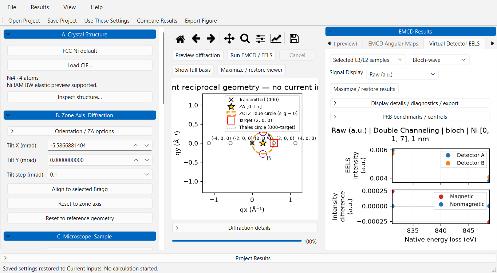
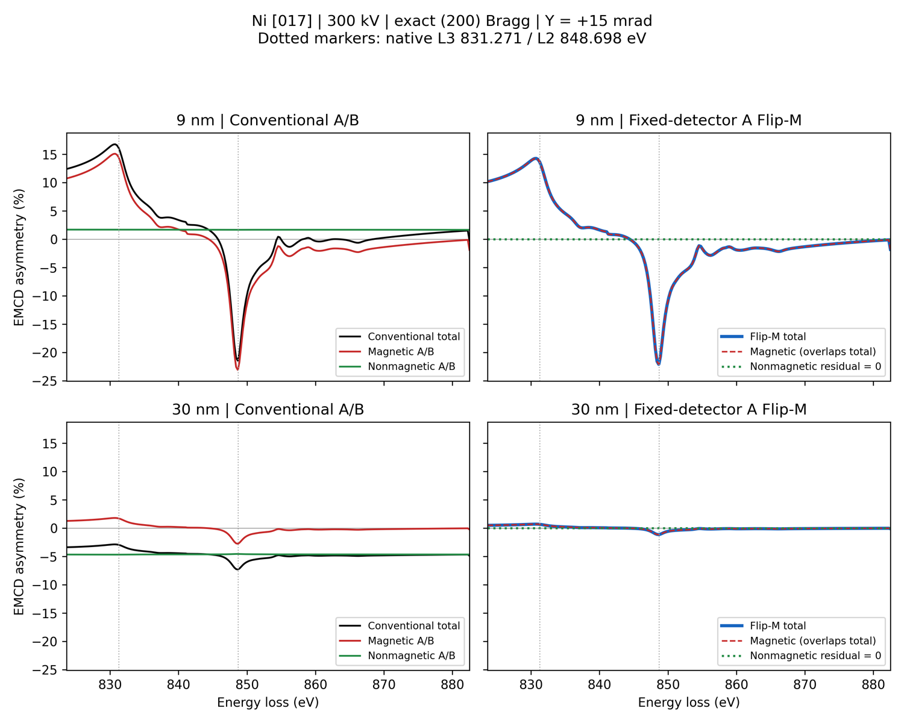

# EMCD-Sim

A research simulation tool for **electron magnetic circular dichroism (EMCD)** in transmission electron microscopy.

**[Download v0.7.0-beta.1 — Windows Research Beta](https://github.com/dingpengem/EMCD-Sim/releases/tag/v0.7.0-beta.1)** · [Installation](docs/INSTALL_WINDOWS.md) · [Quick Start](docs/QUICK_START.md) · [Tutorial](docs/TUTORIAL.md) · [User Manual](docs/USER_GUIDE.md)

> **Magnetic-sign compatibility:** earlier released v0.6.1 Windows betas used a superseded Born/MDFF convention. Their signed magnetic EMCD results require revalidation before comparison with corrected results. Preserve original arrays and provenance; do not silently flip or relabel old data. Missing convention metadata means unknown or legacy-unverified. Absolute experimental magnetic handedness remains uncalibrated.

## Overview

EMCD-Sim combines dynamical electron diffraction, approximate core-loss scattering tensors and virtual detectors to calculate EELS and EMCD. It helps researchers examine how orientation, tilt, thickness, detectors and incoming/outgoing channeling affect magnetic contrast and nonmagnetic diffraction imbalance. Conventional FCC Ni is the principal inelastic reference material.

This is **beta research software**, not a generally converged or experimentally calibrated EMCD predictor. The Windows package passed native automated acceptance; independent installation on a separate clean PC or VM has **not been tested**.

## Features

|Area|Implemented in the released Windows application|
|---|---|
|Structure and orientation|CIF import through ASE, structure inspection, signed zone/reflection indexing and target-aligned crystal frames. Arbitrary CIF import does **not** imply an inelastic model for arbitrary materials.|
|Diffraction geometry|Exact target Bragg alignment; full finite ZOLZ, explicit systematic-row and ideal 000 + target approximations; interactive beam selection and detector A/B placement.|
|Live viewer|Projected-ZA dragging, distinct Thales and ZOLZ Laue circles, stale-preview invalidation, pan/zoom and reversible full-basis view.|
|Propagation|Bloch-wave, FFT Multislice and Both-method comparison; Single and Double Channeling.|
|Inelastic models|XMCD-constrained effective Hermitian MDFF and a non-DFT Ni atomic-transition approximation; crystal-frame magnetization and reversal.|
|Signals|Selected L3/L2 samples or full energy-dependent EELS; angular maps; raw magnetic/nonmagnetic differences and conventional A/B asymmetry.|
|Research workflow|Change thickness or diffraction conditions, save separate runs and compare them. There is no one-click general thickness/mistilt survey in the GUI.|
|Results and safety|Checksummed projects, Results Browser, CSV/NPZ and PNG/SVG exports, cooperative cancellation, numerical preflight and worker/memory controls.|

Five representative orientations—[001], [017], [117], [111] and [710]—have bounded packaged-runtime checks. This is functional support, **not quantitative convergence certification** for every configuration. Non-Ni structures can be inspected, but the current EELS/EMCD GUI requires the verified conventional FCC Ni cell. See [capabilities and limitations](docs/USER_GUIDE.md#scientific-limitations-and-responsible-interpretation).



*Actual packaged EXE capture. This 1 nm, selected-energy acceptance case uses deliberately coarse sampling; the two EELS points are not a full spectrum.*

## Download and installation

1. Download [EMCD-Sim-v0.7.0-beta.1-Windows.zip](https://github.com/dingpengem/EMCD-Sim/releases/download/v0.7.0-beta.1/EMCD-Sim-v0.7.0-beta.1-Windows.zip) and [SHA256SUMS.txt](https://github.com/dingpengem/EMCD-Sim/releases/download/v0.7.0-beta.1/SHA256SUMS.txt).
2. Verify SHA256, then extract the **complete** portable ZIP into a writable folder.
3. Open `EMCD-Sim/EMCD-Sim.exe`. Keep `_internal` and all accompanying files beside it.

The portable package includes Python and runtime dependencies; a separate Python, Conda or WIEN2k installation is unnecessary. GitHub's source archives and the outer Actions artifact wrapper are **not** the portable Windows application. Follow the [Installation Guide](docs/INSTALL_WINDOWS.md) for verification, updates, logs and troubleshooting.

The accepted ZIP SHA256 is:

```text
8d157d8b62fb6570d201360cdae85f44aa4cea2c1478f1949eb4336a135e17bc
```

## Quick Start

1. Launch the application; select **FCC Ni default**.
2. Use nominal zone **0 1 7**, target **2 0 0**, then **Apply orientation / target**.
3. Set voltage/thickness explicitly and **Reset to reference geometry**; **Restore Thales A/B**.
4. Validate the bundled XMCD source and declare its magnetic axis and edge assignments.
5. Start with **Single Channeling**, **Bloch-wave** and the small Manual demonstration profile in the [Quick Start](docs/QUICK_START.md).
6. **Preview diffraction**, then **Run EMCD / EELS**; inspect EELS, maps and calculation information.
7. Save the completed project and export figures/data.

The [5–10 minute Quick Start](docs/QUICK_START.md) is a small functional demonstration, not a timing or convergence guarantee. The [complete tutorial](docs/TUTORIAL.md) explains the physical choices and then examines a verified advanced Ni case without requiring its expensive recalculation.

## Scientific methods

**Bloch-wave** diagonalizes a finite reciprocal-beam elastic generator. **FFT Multislice** propagates waves through a sampled projected IAM potential. Their beam support, FFT sampling and depth/step errors must be checked separately. Agreement between them tests a matched model; it does not remove shared physical approximations.

**Single Channeling** retains incoming elastic channeling but omits outgoing elastic diffraction after the inelastic event. **Double Channeling** includes incoming propagation, depth-distributed localized transitions and outgoing propagation at the reduced electron energy. “Double” does not mean two inelastic events.

The default Ni spectral model constructs an **effective MDFF constrained by XMCD intensities**. It is not a full complex DFT-derived core-to-band transition tensor. Magnetization reversal changes the tensor in the crystal frame before rotation; magnetization is not implicitly aligned with the incident beam. The corrected convention is `forward_born_dagger_g_minus_h_v1`, with intensity `Re Tr(RT)`. Read the [physics reference](docs/PHYSICS.md) and [unit conventions](docs/PHYSICAL_UNITS.md).

## Example results



*Ni [017], 300 kV, exact (200) Bragg, Y = +15 mrad, Bloch-wave Double Channeling; newly recalculated at both thicknesses. Dotted lines mark native L3/L2 energies.*

Conventional A/B EMCD includes nonmagnetic diffraction imbalance. Ideal magnetization reversal at fixed detector A cancels that reversal-even contribution, while the underlying nonmagnetic EELS remains nonzero. Magnetic-only A/B (`M_A-M_B`) and Flip-M (`2M_A`) measure different magnetic combinations and use different percentage denominators. Both retain diffraction dependence. Thickness changes the magnetic response and contamination: at 30 nm L3 the imbalance reverses the conventional sign. These two thicknesses establish no universal trend.

See the [raw a.u. comparison](docs/images/ni017_flipm_recomputed/summary_raw.png), [full tutorial and native-energy values](docs/TUTORIAL.md#part-vii-practical-ni-017-case-study), and [figure provenance](docs/images/ni017_flipm_recomputed/README.md). These research plots are derived from saved spectra, not a new GUI plotting mode.

## Scientific limitations

Source-checkout development on `feat/neutral-atomic-elastic-local` includes an opt-in [neutral-atom elastic provider for Z=1–98](docs/ELASTIC_ATOMIC_FACTORS.md) using a separately supplied local table. Only Ni factors are bundled; all-Ni studies retain the original Lobato default. Ni-specific MDFF/EMCD eligibility is unchanged. The table's redistribution terms remain unverified, and this feature is absent from the published Windows binary.

- Effective XMCD and atomic-transition MDFF approximations; no complete complex DFT Ni MDFF or DFT calculation is supplied.
- Projected independent-atom potential and finite ZOLZ support; no genuine atomic-3D multislice, complete HOLZ, comprehensive TDS/absorptive or convergent-probe/CBED model.
- Numerical convergence depends on basis, potential, FFT mesh, depth, slice step and detector sampling. [111] lower-support convergence remains uncertified; accurate elastic intensities alone do not certify EMCD.
- Native source energies and absolute magnetic handedness are not experimentally calibrated. A prescribed crystal magnetization vector does not determine the specimen surface normal or equilibrium magnetic state.
- Arbitrary-unit intensities are not electron counts. Percentages alone do not establish detectability or shot-noise SNR. Conventional A/B and post-edge-corrected contrast may contain nonmagnetic contributions.
- Windows native acceptance passed within tested cases. Independent clean-machine acceptance is untested; Linux CI has outstanding hash/line-ending and interpreter-shutdown issues, and macOS is not certified by this release.

## Documentation

|Start here|Purpose|
|---|---|
|[Installation](docs/INSTALL_WINDOWS.md)|Download, checksum, extract, launch and troubleshoot|
|[Quick Start](docs/QUICK_START.md)|Small first calculation|
|[Complete Tutorial](docs/TUTORIAL.md)|Crystal → diffraction → MDFF → EELS/EMCD interpretation|
|[User Manual](docs/USER_GUIDE.md)|Controls, settings, projects and exports|
|[Physics and numerics](docs/PHYSICS.md)|Current equations, model boundaries and source map|
|[Scientific limitations](docs/USER_GUIDE.md#scientific-limitations-and-responsible-interpretation)|Convergence and interpretation limits|
|[Documentation index](docs/INDEX.md)|Technical references and historical records|
|[Public release notes](https://github.com/dingpengem/EMCD-Sim/releases/tag/v0.7.0-beta.1)|Published prerelease scope and downloads|
|[Milestone release notes](docs/RELEASE_NOTES_0_7_0_BETA_1.md) / [Changelog](docs/CHANGELOG.md)|Preserved development history|

**Provenance:** release tag/documentation commit `481fed14b78f5439bb417bdc53d38d845a6b2592`; Windows binary source `97b2220e5329dad6f98eedec61f58a6cf07d9da8`; [validated Actions run 41516996056](https://github.com/dingpengem/EMCD-Sim/actions/runs/41516996056). Later documentation commits do not rebuild or change that binary. The [acceptance record](docs/WINDOWS_ZOLZ_97B2220_CANDIDATE_ACCEPTANCE.md) preserves its prepublication context. Experimental/planned architecture is listed separately in the [index](docs/INDEX.md#experimental-and-planned-work).

## Citation and license

Cite this repository and the exact release/commit, model source and numerical configuration used. No software-paper citation or DOI is claimed. Existing theory/normalization references are linked in the [physics documentation](docs/PHYSICS.md#references-and-historical-records); matching a literature normalization does not establish physical equivalence. EMCD-Sim is distributed under the [MIT License](LICENSE); bundled dependencies retain their own notices.
