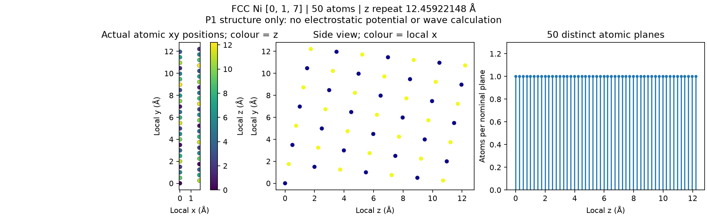
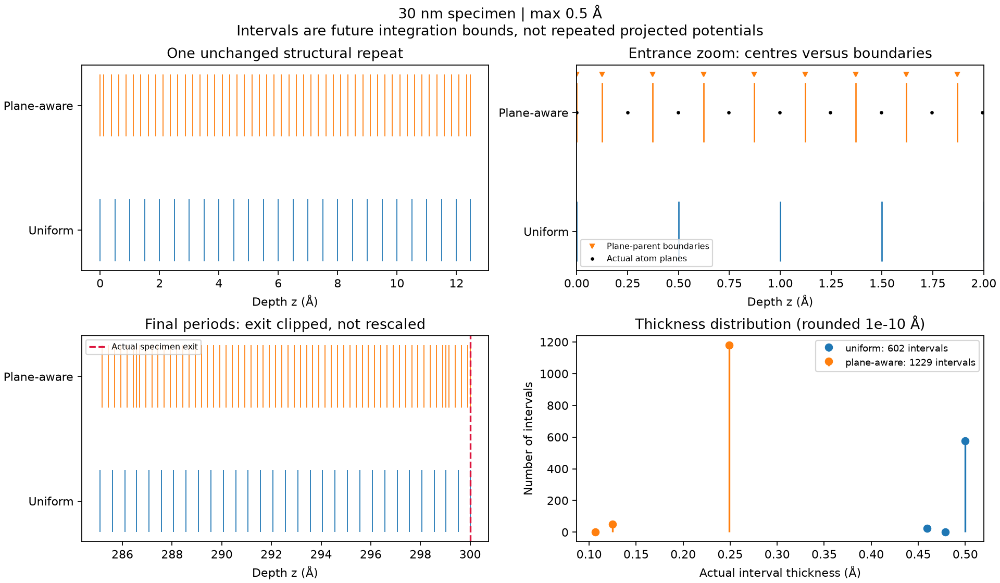

# Atomic 3D multislice — P1 structural geometry and subslicing

Branch: `feat/atomic-3d-multislice`, based on latest fetched main
`d819a6f9ca007e2bc1b5eb8ac46cfb9eab2669dc` (including GUI A–G).

**P1 is complete: structure and integration boundaries only.** No atomic
potential, transmission function, new multislice propagation, HOLZ diffraction,
EMCD coupling or GUI potential selector is implemented here. Existing projected
2D calculations, package version 0.4.5, saved projects and Windows candidates
are unchanged. The following geometry prepares P2; it is not a 3D scattering result.

## Construction and verified Ni [017] result

The input is ASE's conventional FCC Ni cell, a=3.524 Å, with its four actual
FCC sites. The local frame is exactly the existing GUI/Bloch convention:

```text
R rows: x=[1,0,0], y=[0,7,-1]/sqrt(50), z=[0,1,7]/sqrt(50)
r_local = r_crystal R^T
```

No incident mistilt is applied to this structural frame. The established
paraxial convention will handle incident tilt separately when propagation is
implemented; P1 has no electron energy or scattering calculation.

An explicitly verified monatomic F-centred motif permits the primitive
translation basis below, in units of the supplied conventional lattice:

```text
B = [[0, 1/2, 1/2], [1/2, 0, 1/2], [1/2, 1/2, 0]]
M = [[-1, 1, 1], [3, -4, 4], [4, 3, -3]]     det(M)=50
```

ASE `make_supercell` uses the integer M on that primitive cell. M B gives:

| Translation | Conventional-lattice coordinates | Local length (Å) |
| --- | --- | --- |
| x | [1,0,0] | 3.524 |
| y | [0,7,−1]/2 | 12.459221484506966 |
| z | [0,1,7]/2 | 12.459221484506966 |

The cell is right-handed, orthogonal, periodic and **unstrained**. It contains
**50 Ni atoms**, with density 4/a³ and volume 12.5a³. The smaller half-index
translations really are FCC Bravais translations, not fractional translations
of an arbitrary decorated cell. Each permutes the original four-site motif.
Periodic uniqueness and independent direct enumeration of rotated cubic sites
agree with all 50 output positions.

There are **50 unique z planes**, one atom per plane within this transverse cell:

```text
z_n = n a/(2 sqrt(50)),   n=0,...,49
spacing = 0.249184429690139 Å
z_last = 12.2100370548168 Å
```

The nominal-plane grouping tolerance is **1e-8 Å**, with periodic seam handling.
Grouping retains every atom and does not move/merge atomic positions. [001]
instead gives planes at 0 and 1.762 Å in its conventional repeat, demonstrating
that the new depths follow the actual [017] orientation.



These are computed ASE coordinates and plane counts, not potential images.
The long transverse repeat is a real 3D lattice repeat; it need not equal the
smaller transverse period available after averaging a crystal along z.
Future FFT indexing must not label all full-cell harmonics as ZOLZ beams.

## Physical interval policies

`max_slice_thickness_angstrom` defaults to **0.5 Å** as a controllable
geometric choice, not a converged physical parameter. Both modes anchor a
template at each **unchanged structural repeat**, enabling later slice caching.
They repeat those integration bounds and clip the last partial period.

- **Uniform:** maximum-sized intervals within each repeat, retaining its
  shorter terminal interval. This is uniform within a repeat, not a global
  0.5 Å lattice stretching over structural-period boundaries.
- **Plane-aware:** periodic nearest-plane midpoints define parent intervals.
  Cutting the periodic parent crossing z=0 yields two half-parents at the
  entrance/exit of a repeat. Every parent wider than the permitted maximum is
  subdivided at new physical boundaries, with a retained shorter remainder.

For default Ni [017], the parents are already thinner than 0.5 Å, so
plane-aware mode needs no further parent subdivision. Tests use [001] and a
smaller maximum to verify that thicker parents actually split. At the default:

| Quantity | Uniform | Plane-aware |
| --- | --- | --- |
| Intervals per complete repeat | 25 | 51 |
| Repeat thicknesses (Å) | 24×0.5 + 0.459221484507 | 2×0.124592214845 + 49×0.249184429690 |
| Intervals in 30 nm | 602 | 1,229 |
| Minimum/maximum thickness in 30 nm (Å) | 0.459221484507 / 0.5 | 0.106538867917 / 0.249184429690 |
| Final interval thickness (Å) | 0.478684371833 | 0.106538867917 |
| Empty atom-centre intervals in 30 nm | 0 | 25 |

The 51 cut intervals do not mean 51 planes: there are 50 cyclic plane parents,
one split by the repeat boundary. A 300 Å specimen contains **24 complete
repeats plus 0.978684371833 Å**, with **1,204 atom centres**. Its boundaries
cover exactly [0,300] without gaps/overlap. No final repeat is stretched.
The full specimen is periodic transversely and structurally terminated along z.

Centres use **[start,end)** intervals: an internal-boundary centre belongs to
the right interval, entrance centres are retained, and exit centres excluded.
All 1,204 centres are assigned once in each mode. Empty-centre intervals are
retained: finite atomic potentials can have tails in those intervals. This
diagnostic centre assignment is **not** a finite-projection potential rule.



## General geometry support and limits

`atomic_multislice_geometry.oriented_atomic_cell()` accepts periodic ASE
structures. [uvw] is expressed in the supplied cell's direct-lattice basis.
It reuses the existing frame and uses bounded rational reconstruction to find
integer lattice translations along each axis. Parallelism/orthogonality must
agree to floating-point roundoff, additionally capped by the geometric 1e-8 Å
tolerance. Nearly commensurate cells are rejected instead of strained, and
small real atomic displacements are not idealized into the monatomic FCC
motif. There is no affine strain operation.

The F-centred primitive reduction is restricted to a verified four-site,
single-species motif. General decorated structures keep their full input
cell; a Ni/Cu test requires 200 atoms rather than incorrectly reducing to
50. Other tested FCC directions include [001], [011], [111] and [710]. This
is geometric support, not a claim of scattering factors/MDFF validity for
arbitrary elements or orientations.

If no exact commensurate cell is found within the bounded search, a
`GeometryCapabilityError` reports that limitation; it is not proof that no
larger mathematical supercell exists. Defaults cap translation coefficients
at 256, supercell atoms at 100,000, specimen centres at 1,000,000 and generated
intervals at 200,000 (including the full repeat template). Large/high-index
or very fine requests fail before large allocations where possible. No
physical plane/site is removed to fit a budget. Duplicate input sites,
partial/disordered occupancies and invalid/nonperiodic cells fail explicitly.

## Outputs and reproduction

In the existing ASE/NumPy/Matplotlib environment:

```powershell
python scripts/research/atomic_slicing_diagnostics.py --output outputs/ni_017_atomic_3d/p1_final
```

Use a **new** output folder on a repeat run. ASE is already part of the GUI
extra; abTEM is not imported or installed. The final local P1 diagnostics are
under `outputs/ni_017_atomic_3d/p1_final/`; initial exploratory diagnostics
in the same output tree were retained.

| File | Contents |
| --- | --- |
| `crystal_oriented.cif` | Actual 50-site orthogonal periodic cell |
| `atomic_positions.csv` | Per-repeat Cartesian sites/species/plane indices |
| `atomic_depths.csv` | Plane index, depth, count, species, next spacing including wrap, period |
| `specimen_atomic_positions.csv` | 1,204 actual centres in the 30 nm half-open slab |
| `slice_boundaries.csv` | Both modes' interval start/end/width, repeat/parent indices and centre counts |
| `geometry_arrays.npz` | Pickle-free coordinates, translations, frame, planes and complete/parent/repeat bounds |
| `atomic_planes.png` | Actual projected/side atomic views and depth distribution |
| `slice_geometry_overview.png` | Repeat/entrance/exit boundaries and actual thickness distributions |
| `metadata.json` | Structure/code hashes, generation base commit, frame, modes, numerical policy/limits and file hashes |
| `legacy_validation.json` | Separate unchanged projected-solver comparison against Stage C |
| `delivery_provenance.json` | Delivered P1 Git commit and verification that implementation hashes match committed blobs |

Diagnostics were generated before the P1 commit, so metadata records the
reviewed base commit plus the exact new module SHA256 values, with a dirty
source flag. Those implementation hashes identify the actual generator;
the P1 delivery commit is recorded separately after committing and verified
against committed source bytes. No potential-array file or
3D diffraction file is created or mislabeled in this milestone.

## Validation

**24 focused tests passed** (6.36 s): 20 P1 geometry/export cases and four
existing FFT history/phase/norm cases. Coverage includes orientation, integer
translations/periodicity, independent atom enumeration, density/duplicates,
plane spacing and periodic grouping, thick-parent subdivision, exact coverage,
partial final periods, boundary assignment, retained empty intervals, alternate
orientations, decorated structures, resource/capability errors, pickle-free
exports, CIF roundtrip, retained real displacements and rejection of nearly
commensurate cells without strain. Propagation entry points were guarded
against invocation during diagnostic generation.

A separate legacy Ni [017] check reproduced the saved Stage C full FFT
complex amplitudes at **64 depths × 1,024 harmonics byte-for-byte**, and its
exit intensities byte-for-byte. Norm error remains **1.70974346e-14**. This
checks the old projected solver; there is no new 3D wavefield to compare yet.
The full GUI acceptance suite and high-mistilt survey were not run. Existing
engine/GUI/project files were not modified and prior outputs were preserved.

## Official reference review and P2 boundary

The official [abTEM potential walkthrough](https://abtem.github.io/doc/user_guide/walkthrough/potentials.html)
distinguishes finite interval integration from assigning each atom's infinite
projection to one slice. Empty-centre intervals can therefore still have a
finite integrated potential. P1 only supplies the bounds; P2 must integrate
the actual potential over each bound, including neighbouring atomic tails.

The [Potential API](https://abtem.github.io/doc/reference/api/_autosummary/abtem.potentials.iam.Potential.html)
separates transformed atoms, slice grouping and generated potential arrays;
`exit_planes` identifies measurement depths. These concepts inform the P1
separation of structures/planes/bounds, without copying abTEM implementation.
P3 will have to split intervals at requested interior wave-depth nodes.

The [orthogonalize_cell API](https://abtem.github.io/doc/reference/api/_autosummary/abtem.atoms.orthogonalize_cell.html)
can apply residual strain. Our constructor deliberately rejects unmatched
geometry instead. The [multislice walkthrough](https://abtem.github.io/doc/user_guide/walkthrough/multislice.html)
and [convergence guide](https://abtem.github.io/doc/user_guide/appendix/convergence.html)
motivate separate integration/propagation and sampling checks in later patches;
0.5 Å is not assumed converged.

This is original geometry/slicing code using ASE, not copied GPL source.
abTEM remains an optional future independent validator, outside the GUI build.
Existing Lobato factors/volt Fourier coefficients and the project's
`+i U dz` transmission convention were inspected but left unchanged. P2 must
establish integrated-potential units and phase conversion before propagation;
the integrated potential must not be multiplied by thickness twice.

**Stop after P1.** Finite-z potentials, cache evaluation, longitudinal-harmonic
scattering, elastic convergence, preliminary depth-averaged EMCD and GUI
integration require their respective subsequent instructions and validation.
