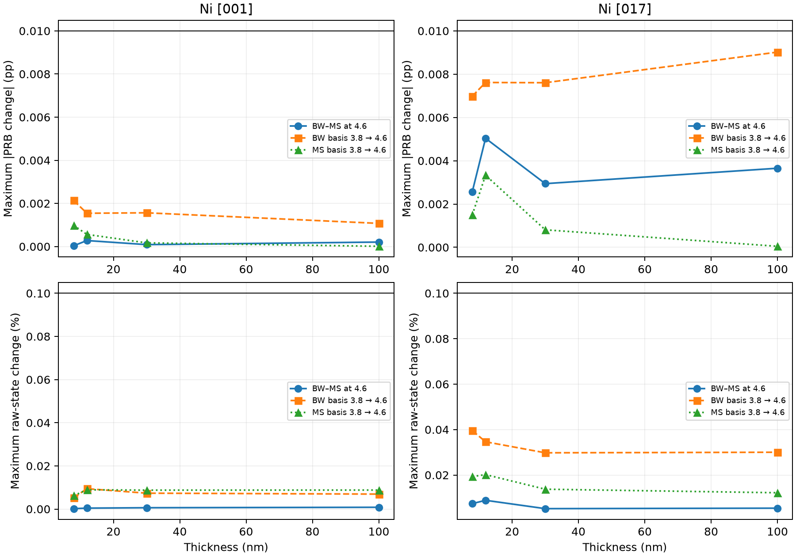

# Uniform enlarged-basis validation

Tested thicknesses: [8.0, 12.0, 30.0, 100.0] nm. Uniform gate: **PASS**.

Both edges, both reversal states, entrance and double channeling are included. Thresholds remain 0.01 percentage points in PRB dichroism and 0.1% in each raw detector state. Independent basis changes and BW/MS differences are separate tests.

|Geometry|Comparison|Maximum PRB change (pp)|Maximum raw change (%)|Worst PRB point|
|---|---|---:|---:|---|
|[001]|BW-MS 4.6|0.00027859|0.0008236|12 nm, double, L2|
|[001]|independent_basis bw|0.00213826|0.0094336|8 nm, entrance, L2|
|[001]|independent_basis ms|0.00098333|0.0089254|8 nm, entrance, L2|
|[017]|BW-MS 4.6|0.00503654|0.0088736|12 nm, double, L2|
|[017]|independent_basis bw|0.00901932|0.0395635|100 nm, entrance, L2|
|[017]|independent_basis ms|0.00333009|0.0201721|12 nm, double, L2|

## Sampled L3 ordering at beam cutoff 4.6

|Geometry|Engine|Thickness (nm)|Entrance PRB (%)|Double PRB (%)|
|---|---|---:|---:|---:|
|[001]|BW|8|-10.27434475|-13.22777304|
|[001]|BW|12|-11.85726490|-9.91703349|
|[001]|BW|30|-0.36825634|-3.00948692|
|[001]|BW|100|-0.05150621|-0.48107822|
|[001]|MS|8|-10.27436572|-13.22778653|
|[001]|MS|12|-11.85719451|-9.91686891|
|[001]|MS|30|-0.36823897|-3.00943447|
|[001]|MS|100|-0.05154932|-0.48095582|
|[017]|BW|8|-10.17824720|-13.06008297|
|[017]|BW|12|-11.65564115|-9.69179071|
|[017]|BW|30|-0.26820240|-3.00858302|
|[017]|BW|100|-0.13924418|-0.48892444|
|[017]|MS|8|-10.17971861|-13.06103222|
|[017]|MS|12|-11.65543241|-9.68889403|
|[017]|MS|30|-0.26646952|-3.00945044|
|[017]|MS|100|-0.14139718|-0.48928073|

The entrance signal is strongest at 12 nm and the double-channeling signal at 8 nm among these sampled points, in both methods and geometries. The 8 nm double-channeling L3 magnitude remains about 13.06–13.23%. Outgoing channeling therefore preserves the observed redistribution of thickness dependence; these are not globally established maxima.

Recommended tested profile, conditional on the gate passing: potential cutoff 6.2, incoming/outgoing beam cutoff 4.6 cycles/angstrom, FFT 48, depth 257 and maximum split step 0.04 nm. This supports subsequent controlled validation using this profile, rather than certification of an existing full thickness or voltage series.



Markers show the four tested thicknesses; joining lines guide the eye. Each ordinate is the maximum over both edges and both channeling treatments. Black lines mark the unchanged acceptance limits.

Raw states, magnetic differences, magnetic-only asymmetries and reversal-even imbalances are retained in observables.csv; signed changes are in comparisons.csv. No post-edge normalization or amplitude fitting is applied. The raw-state relative error is the maximum of abs(B-A)/max(abs(A),abs(B)) over A+/B+/A-/B-.

FFT support is checked by exact hkl lookup and reciprocal-coordinate equality for both incoming and outgoing event bases. MS propagation retains its full FFT modes; it is not artificially projected to the BW basis. populations.csv reports the populations outside the event basis without renormalization; incoming MS tails are inferred from unit norm minus the selected-basis populations, while outgoing tails are summed directly over the full FFT.

Settings: potential 6.2 cycles/angstrom, beam cutoffs 3.8 and 4.6, FFT 48 (the [001] invariant row uses its verified 1D reduction), 257 depth nodes, maximum split step 0.04 nm, 200 kV, original detectors and native 831.4778/848.698 eV energies. All tensors, phases, normalization and solver files are unchanged. Prior cutoff/FFT/slice/depth checks are inherited; they were not repeated at the enlarged basis.

This is a representative-point validation, not certification of the full 0–100 nm curve or global extrema. The 12 nm entrance and 8 nm double maxima are sampled observations. Absolute energy calibration, XMCD-effective rather than complete complex DFT MDFF, and the projected potential approximation remain unchanged limitations.

The 5.4 profile has 81 beams for [017]: the existing BW dense-memory estimate alone is 3284.2 MiB, before RSS, allocation margin and worker reserve, exceeding the unchanged 2048 MiB budget. No numerical settings or guards were reduced. No 5.4 calculation is needed if the requested 3.8-to-4.6 increment passes.

provenance.json records source SHA256, starting software commit, preserved prior-output hashes and thresholds; checkpoint_manifest.json identifies every reused/new checkpoint and its SHA256. comparison.npz retains full float64 raw states.

## Reproducibility and focused tests

Starting software commit: `8f8a9bfa4ca61bb3ff76e4dc0757cc7d1da7a64c`.
Ni source SHA256: `a0e28ea6423b6c7832bb3cce6d69d71aa59336a221baeee3d2556b49ba501283`.

Of the 32 matched engine/profile/thickness cases, 28 were reused and four
missing MS cases were calculated (30/100 nm, both geometries). Exact parameter
and source hashes are required for reuse. All earlier cutoff-study outputs
were verified byte-for-byte unchanged. No solver physics or GUI code changed.

Run from the repository root with the existing EMCD Python environment:

```powershell
python scripts/ni_double_channeling_uniform_basis.py --include-long
python scripts/ni_double_channeling_uniform_basis_report.py
```

Completed cases are loaded without propagation. Results, full checkpoint
provenance, compact CSV/NPZ and PNG/SVG are saved separately under
`outputs/ni_double_channeling_uniform_basis_validation/` (local generated files).
The raw NPZ axes are case, channel (entrance/double), edge (L3/L2),
and state (A+/B+/A-/B-); keys identify geometry, thickness, basis and engine.

**33 focused tests passed** across the uniform-basis and cutoff checks,
BW double-channeling, multislice double-channeling and foundations. Checks
include unchanged gates, independent-basis rejection, exact FFT beam mapping,
checkpoint reuse without propagation, parity, populations and float64 retention.
No full thickness or voltage scan was run. Numerical controls inherited from
the preceding study are not a joint convergence proof at every enlarged-basis
thickness. Subsequent controlled studies can use this tested profile, with
memory admission and representative controls retained.
