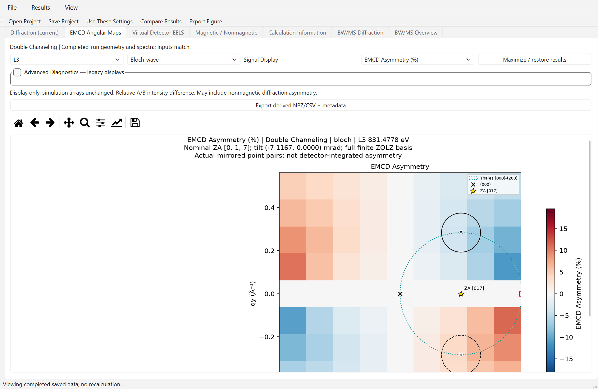
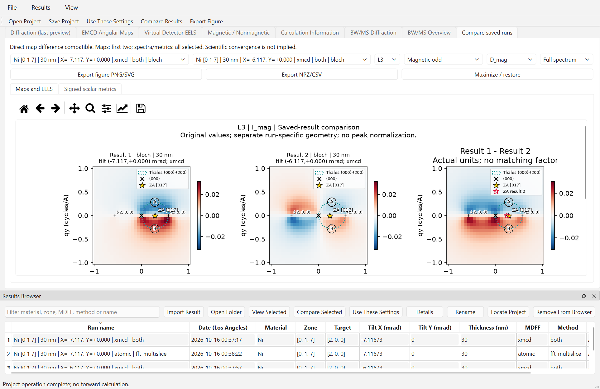
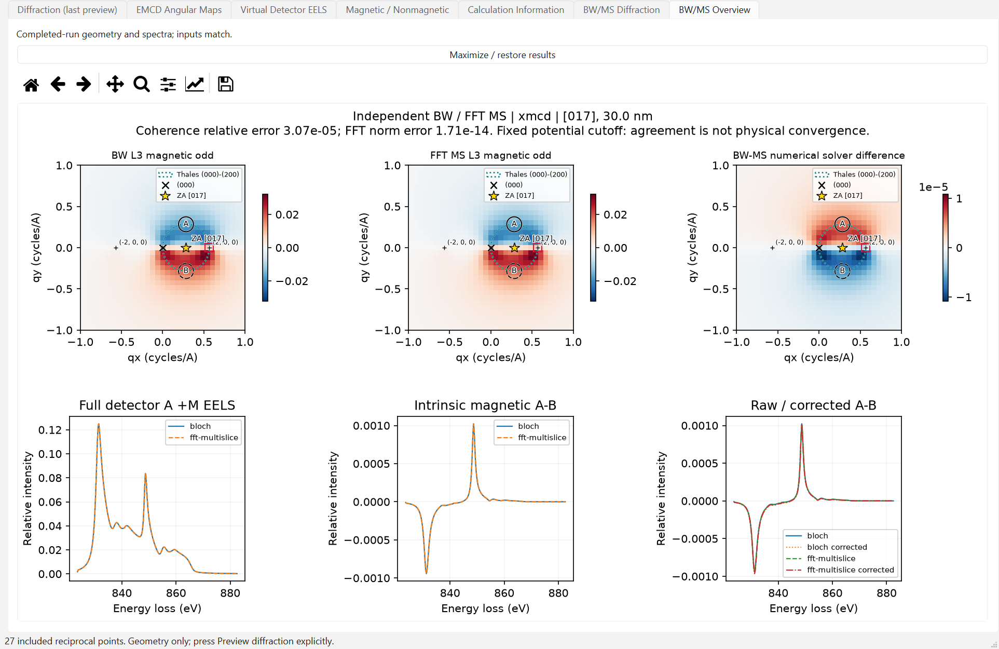
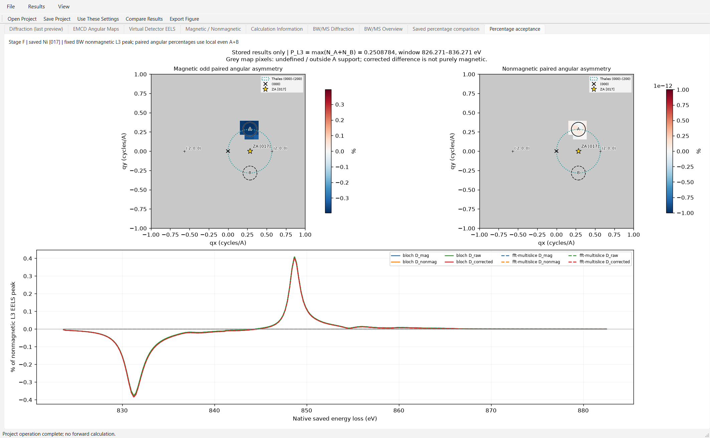
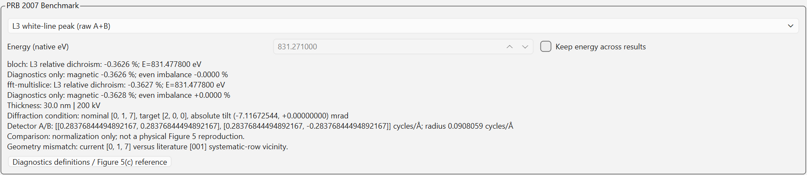

# EMCD-Sim desktop GUI — technical reference and milestone record

## v0.6.1-beta.1 Windows Beta

Use the [current User Manual](USER_GUIDE.md), [installation guide](INSTALL_WINDOWS.md), [release notes](RELEASE_NOTES_0_6_1_BETA_1.md) and [acceptance report](V061_BETA_ACCEPTANCE.md). Full-field maps use actual saved mirrored reciprocal points with nearest-sample rendering and actual grid/spacing metadata. **Angular Map Resolution** provides Quick Preview 33, Standard 97 (default), High 193 and odd Custom grids. **Estimated process memory budget** defaults to 2048 MiB, with 512/1024/2048/4096/8192 choices and available-RAM checks. High is not guaranteed to fit 2048 MiB. FFT grid and aperture boundary subpixels are independent of the shared angular/EELS grid. New Project resets 97/2048; explicit saved settings are preserved.

The final package supports BW/MS Single/Double, Virtual Detector EELS and Full-field EMCD Angular Maps, with the existing Raw/Asymmetry/Advanced distinctions. Source and frozen saved-project acceptance passed; the 426-test regression and 204-checkpoint audit passed. Independent clean-machine installation remains **NOT TESTED**. The [8 nm Ni [017] tutorial](USER_GUIDE.md#validated-ni-017-8-nm-double-example) specifies all parameters and native energies. Current source GUI control labels are used there; the detailed historical milestone record below is retained with its original captions.

## Historical 0.6.0 Windows Beta: Single and Double Channeling


**0.6.0 Windows research Beta - Double-Channeling EMCD Simulation.**
The [release acceptance report](WINDOWS_V060_BETA_ACCEPTANCE.md) identifies the
build, checksums and tested scope. Double Channeling already existed in 0.4.5;
0.6.0 consolidates its framework and improves Raw / EMCD Asymmetry interpretation.
For the preserved old executable use the
[0.4.5 manual](https://github.com/dingpengem/EMCD-Sim/blob/v0.4.5-beta.1/docs/USER_GUIDE.md).


The source GUI provides **Channeling Model** alongside **Propagation
Method**. Single Channeling retains the existing entrance-only approximation.
Double Channeling uses the actual incoming/outgoing BW or independent FFT
solver, including the outgoing electron's post-loss energy. **Both** runs both
solvers with the same selected model; it does not substitute one model for
another. Old projects lacking a channeling-model field load as Single.

The [full-spectrum validation](DOUBLE_CHANNELING_FULL_SPECTRA.md) documents
genuine native-energy Double Channeling spectra. The 200 kV [001] row-reference
BW/MS comparison checks 242 actual energies over 823.625–882.521 eV; these
spectra are not reconstructed from the two older benchmark samples. Fresh
GUI-worker tests also exercise full-range Single/Double spectra with Both
solvers at a separately documented manageable numerical profile. Production
sampling and selected-energy controls have distinct validation scopes.

The verified FFT geometries are full-2D FCC Ni [017] and the explicitly selected
[001] (200) systematic-row approximation. The row checkbox is an explicit
physical approximation; it is never applied to [017]. The Results Browser,
saved project and numerical metadata identify the model and solver. Comparisons
of Single and Double are physical-model comparisons, distinct from BW/MS
numerical discrepancies.

Spectral figure titles state the nominal zone axis, actual absolute tilt and
whether the saved basis is systematic-row-restricted or full finite ZOLZ.
The nominal [001] direction is a major zone axis. Exact (200) Bragg alignment
does not establish physical two-beam isolation. A row-restricted result cannot
measure omitted off-row scattering; see the
[elastic geometry comparison](NI_TWO_BEAM_GEOMETRY_COMPARISON.md). The GUI
interactive 121-beam preview cap is reported explicitly and does not silently
truncate a larger requested basis.

**Spectral coverage** distinguishes an actual native energy-resolved spectrum
from a calculation at only the selected L3/L2 energies. The latter contains
two samples, not a reconstructed white-line shape. Disabling **Calculate angular
maps** evaluates only nonzero fractional-detector support on the unchanged
grid; it does not coarsen the grid or change the apertures, MDFF, beams,
precision or propagation. The result records that angular maps are unavailable.

Explicit pilot grids covering only part of the saved native source range are
labelled **Calculated energy subset**, even when they contain more than two
samples. This label is derived from saved energy coordinates and source bounds;
displaying a project does not reopen the source or calculate missing samples.

RAM budgets remain 512, 1024, 2048 (default), 4096 and 8192 MiB. Admission checks
estimate total process peak separately from the dense kernel, including
concurrent detector workers, retained results and available physical RAM.
Rejected jobs explain the limit; they do not silently change settings.

The [final 200 kV benchmark](DOUBLE_CHANNELING_FINAL_200KV.md) documents the
validated profile, native energy convention, component definitions and limits
of representative numerical convergence. The milestone screenshots and
historical workflows below describe their original versions; they are not the
current release acceptance. Use the [0.6.0 release notes](RELEASE_0_6_0_BETA.md)
and [Windows acceptance report](WINDOWS_V060_BETA_ACCEPTANCE.md) for that historical
executable and provenance. The preserved [0.4.5 notes](RELEASE_0_4_5_BETA.md)
identify the earlier cancellation-fixed build.



Actual 150% frozen capture of the small Ni [017] Double dispatch profile.
The map is a total mirrored-point asymmetry, not finite-aperture EELS or
purely magnetic response. Use scrollbars for full axes in a limited-height
window; complete exported figures and equations are in the User Manual.

### Primary spectra and exports

The primary EELS and angular selectors each offer **Raw (a.u.)** and
**EMCD Asymmetry (%)**, default Raw. EELS retains original +M A/B spectra above;
Raw displays D_mag and D_nonmag below, while total Asymmetry displays exactly
one 100*(A_plus-B_plus)/(A_plus+B_plus) curve. The renamed **EMCD Asymmetry**
scalar group retains native L3/L2 readouts, evaluation energy and lock.

Primary **Full-field mirrored-point EMCD** Raw maps show M(q)-M(q') and
N(q)-N(q') over the complete calculated grid on one zero-centered signed scale.
Total map Asymmetry uses the +M difference divided by the +M sum at actual
validated (qx,qy)/(qx,-qy) samples. Invalid denominators remain NaN; mirror
validation checks actual saved reciprocal coordinates and complete intensity
support. Physical detector apertures are independent overlays; nonmirrored
manual A/B positions do not disable mathematical full-field point pairs.
Legacy Advanced paired maps still require physical aperture matching.
000, actual ZA, hkl, target, Thales circle and A/B outlines are retained.
These are point-pair densities, not finite-aperture EELS. Integrate intensities
before taking a detector ratio; never average percentage pixels.

Advanced Diagnostics retains the former Relative components explicitly as
**Magnetic-only / Nonmagnetic Asymmetry (%)**, with common N_A+N_B denominator,
plus reversal spectra, corrected/residual signals, legacy peak scaling,
intrinsic/local maps and BW/MS comparisons. The total primary ratio can include
nonmagnetic diffraction imbalance and must not be labelled purely magnetic.
See the [full equations and compatibility rules](USER_GUIDE.md#signal-definitions-in-060).

**Beam cutoff |g|max (Å⁻¹)** selects included elastic beams; its approximate
angular equivalent λ|g|max is shown at the selected voltage and is not the
EELS collection angle. **Potential Fourier cutoff |g−g′|max (Å⁻¹)** selects
elastic couplings via U_(g−g′) or V_(g−g′), with |g−g′| ≤ cutoff. It is not an
ionization momentum-transfer, detector-range or excitation-error cutoff.
Crystallographic g=1/d is numerically the old cycles/Å convention: stored
parameters and internal required angular-wavevector conversions are unchanged.

Default completed-result export writes one checksummed project bundle with
PNG/SVG figures and CSV/NPZ numerical data. Per-method CSV and NPZ spectra retain
all original reversal intensities, signed raw components, common denominator,
both component percentages and legacy PRB percentages **in either display mode**.
Supplemental `signal_display.npz`, `*_signal_display.csv` and
`figure_display.json` add explicit total/magnetic/even aliases and denominators,
without changing original project key sets. Old Relative preferences migrate
to the explicit advanced component view, never to total Asymmetry.
Metadata records solver, channeling model, MDFF/source hash, native energies,
geometry, numerical settings and calculation commit. Large arrays are stored
once under explicit method prefixes. Redundant independently normalized figures
and BW/MS difference maps are not default exports; advanced derived exports
remain available. Zoom, maximize/restore and saved-project viewing remain.

The saved-results scalar comparison retains |D_mag|/sqrt(N_A+N_B), labelled an
**arbitrary-scale detectability proxy, not experimental SNR**. Compare only
consistent intensity scales and sampling. No arbitrary units are converted to
electron counts. Physical shot-noise SNR requires dose, efficiency, energy-bin
width, background and other noise calibration; four independent reversal
measurements require variance propagation through their magnetic-odd estimator.

For current use, start with [Windows installation](INSTALL_WINDOWS.md),
[Quick Start](QUICK_START.md) and the [complete User Manual](USER_GUIDE.md).
[Stage G readiness](STAGE_G_RELEASE_READINESS.md) reviews the accepted Stage F
portable candidate, final acceptance, pending distribution checks and the
proposed integration plan. The following sections retain A–F development
evidence and screenshots; they are not separate current applications.

The desktop is now a **persistent scientific workspace**: save complete
projects, reopen numerical results without recomputation, browse previous runs,
compare saved conditions and restore inputs for an explicit new calculation.
Stage A-C geometry, MDFF and independent BW/FFT physics are retained. Package
historical version was 0.4.5; current development is 0.6.0. Stage D added persistence; Stage E/F later added the
portable Windows candidate and percentage visualization described below.



The screenshot shows three registered real projects and an L3 magnetic
comparison between the exact-Bragg reference and a +1 mrad x mistilt. Each
physical panel uses its saved ZA, target and detectors; the difference panel
also distinguishes the second ZA. The following Stage A-C material retains
its milestone screenshots and numerical reports. The final Stage D section
explains current project/browser/comparison workflows.



The Stage C screenshot shows actual default [017] magnetic maps, numerical
solver differences and full EELS overlays. The following Stage B/A sections
retain their original workflows and milestone screenshots; the final Stage C
section explains the new propagation and comparison controls.

![Actual Windows GUI after a default Ni [017] BW EMCD calculation](images/gui/stage_b_windows.png)

The screenshot shows computed A/B ?M EELS, reversal-odd/even differences and
raw/corrected contrast. **Maximize / restore results** expands the scientific
figures; it does not rerun or rescale the calculation. The earlier elastic
preview is retained below as a Stage A reference.

![Actual Windows Qt application after a numerical Ni [017] elastic preview](images/gui/stage_a_windows.png)

The screenshot is an actual PySide6 window on Windows, after the existing
Bloch-wave solver calculated the default Ni [017] exit intensities. The
central view is zoomed to the systematic-row region; **Show full basis**
reveals off-row points. All 27 included beams remain in propagation and
in the result table even when some fall outside the current view.

## Windows setup and launch

In PowerShell from the repository:

```powershell
conda activate emcd-python
python -m pip install -e ".[gui]"
python -m emcd_sim.gui
# Equivalent installed entry point:
emcd-gui
```

Only PySide6 and ASE are added as direct optional GUI dependencies;
Matplotlib/numpy are already core dependencies. A CLI-only installation
does not import Qt or require the GUI extra. No executable or installer
is built. For small previews, optionally set OPENBLAS_NUM_THREADS=1 and
OMP_NUM_THREADS=1 before launching.

For an automated **real default elastic preview**, screenshot and clean exit:

```powershell
python -m emcd_sim.gui --smoke-screenshot outputs/gui_stage_a/stage_a_windows.png
```

Normal launch does not automatically calculate intensities. A geometry-only
view uses open reciprocal reference markers until **Preview diffraction**
is pressed. Screenshot mode explicitly runs that preview. Qt offscreen
testing is supported through QT_QPA_PLATFORM=offscreen; a bundled Matplotlib
font is loaded if that platform exposes no system fonts. The committed
screenshot was captured using the native Windows platform.

## Stage A workflow

1. Start with built-in FCC Ni (a=3.524 angstrom), zone [017], target (200),
   200 kV and 30 nm. Initial absolute tilt is approximately
   (-7.116725439974256,0) mrad: exact paraxial (200) Bragg, **not** zone-axis
   incidence. Preview uses beam cutoff3.2, potential cutoff2.2 cycles/angstrom,
   27 beams, and B=0. Exit intensities use the existing physical BW solver.
2. **Preview diffraction** starts a worker thread. Inputs and scientific
   click edits are disabled during its calculation. The plot/table report
   actual exit intensities and excitation errors, without Gaussian CBED
   disks or fitted peak widths. Scatter marker area/color is a visualization
   of discrete beam intensity, not a physical disk size.
3. In **Select reflection** mode, click within 16 display pixels of an indexed
   nonzero spot. Its hkl becomes the target. Selection alone does not change
   zone axis or incident tilt. It restores the symmetric Thales A/B centers
   for that selected reflection. The bottom readout shows reciprocal position,
   magnitude, excitation error, and a calculated intensity only when the
   saved preview matches current physical inputs.
4. **Align to selected Bragg** solves s_g=0 using the existing paraxial
   excitation-error convention. With no locked component it applies the
   minimum-norm transverse tilt correction. Lock X or Y to retain that
   component. An incompatible lock produces an error instead of silently
   unlocking it. **Reset to zone axis** sets both incident tilts to zero;
   **Reset to reference geometry** restores nominal [017], target200, y=0
   and its exact Bragg x tilt at the currently selected voltage.
5. In **Set projected ZA** mode, click any reciprocal-space coordinate.
   This sets tilt=-1000*lambda*q_ZA in mrad, with the existing relativistic
   wavelength in angstrom. Conversely, editing absolute Tilt X/Y updates
   q_ZA=-tilt*0.001/lambda. These edits never change the nominal zone axis.
   The numerical q and tilt fields are linked using blocked Qt signals to
   avoid recursive updates. Direct keyboard entry and 0.01/0.1/1 mrad steps
   are available. The GUI range is +/-100 mrad, not a claim of physical
   paraxial accuracy out to that limit.
6. Zoom/pan with the Matplotlib toolbar. Scientific clicks use the event's
   data coordinates after the current axes transformation, so zooming and
   resizing do not change the physical mapping. Selection is suspended
   while toolbar pan/zoom is active. **Maximize / restore viewer** collapses
   and restores the side panels without replacing the canvas.

Changing physical inputs updates geometry but never starts another numerical
preview automatically. Completed values remain explicitly labeled **last
preview** on the right when inputs become stale; central markers revert to
unweighted references. The calculation-information tab records the current
structure, orientation and settings, and whether they match the last result.
The diffraction preview is elastic only; the separate Stage B run uses source
magnetization to calculate the ionization tensor and magnetic signal.

## CIF import, orientation and capability boundaries

**Load CIF...** uses ASE and opens a structure-inspection window containing
formula, cell lengths/angles, species, atom count, fractional positions,
source path/SHA256, import warnings and any space group supplied by the CIF.
Space group is not independently inferred or validated. CIF Miller and zone
indices refer to the actual imported cell, not an automatically standardized
conventional FCC cell.

Enter integer [u v w] and target h k l with spaces; [017] compact notation
also works. Integer directions are reduced by their common divisor without
reversing their sign. The local z direction is constructed from [uvw] in
the ASE direct cell; Gram-Schmidt and a cross product construct a proper
orthonormal frame. The [017]/[001]/[710] choices match the established cubic
frame conventions. The cell itself is rotated, not merely its labels.
The full finite ZOLZ set satisfies h*u+k*v+l*w=0 and the radial cutoff.
For Ni, actual structure-factor extinctions are applied. No arbitrary
two-beam truncation is used. Targets outside that basis must be replaced
by typing/clicking an included reflection before a preview is enabled.

Only Ni elastic factors are bundled in the core. Fully occupied ordered
Ni CIFs can use BW with their actual oriented cell and fractional positions;
they are not silently replaced by the built-in FCC geometry. Other materials
and partial/disordered occupancies are **inspection/reciprocal-geometry only**.
Their markers do not represent calculated intensities or reliable atomic
extinction rules, and elastic preview is disabled with an explanation.
This is not material-general magnetic EELS support.

An interactive preview is limited to 121 included beams and a bounded hkl
search. Excessive requests produce an actionable error; the code does not
drop beams to fit the limit. General-orientation FFT potentials and arbitrary
material MDFFs are not substituted for unsupported models.

## Detectors and scientific overlays

The (000) origin, real hkl spots, target reflection, Thales circle and physical
A/B outlines use transmitted-beam-centered **cycles/angstrom** coordinates.
Only the projected ZA moves when incident tilt changes. Its correct location
can lie outside a zoomed view; use the numerical ZA readout or zoom out.
The left panel also exposes radius and center coordinates, show/hide,
**Move detector A/B** click modes and **Restore Thales A/B**. The latter puts
centers at g/2 +/- the transverse perpendicular g/2 for the current target.
Manual centers stay fixed during subsequent tilt edits. A status label
distinguishes an exact y-mirrored pair from a manual/non-y-mirrored pair.
The lightweight elastic preview does not integrate EELS. Stage B uses shared
fractional-aperture weights and validates physical reflection pairing before
enabling mirrored pixel maps. Direct EELS integrates the actual manual A/B
apertures even when mirror pairing fails.

## Progress, cancellation and exports

The expensive eigenproblem runs in a QThread. Cancellation is cooperative
before/after the current elastic stage; an eigensolve is not forcibly killed.
Cancelled and failed runs are not registered as completed previews. Closing
while busy requests cancellation and keeps the window alive until the worker
stops; close again afterward. The worker uses an isolated structure/settings
snapshot. Progress is indeterminate during the elastic stage, then complete
only on success. This is not fabricated percentage progress.

**Export current plot PNG/SVG** exports the currently labeled viewer, including
geometry-only or stale-state labeling. **Save elastic preview** writes the
last completed elastic result into a new timestamped subdirectory:

```text
elastic_YYYYMMDD_HHMMSS_microseconds/
    diffraction_pattern.npz
    metadata.json
```

The NPZ contains real hkl, reciprocal positions, excitation errors, sampled
depths [0,t], complex amplitudes, exit intensities and orientation matrix;
it loads with allow_pickle=False. JSON records the computed input snapshot,
source hash/description and elastic-model scope. Plot export and result export
are separate so a changed current geometry cannot be silently saved as the
last calculation's image. Stage D adds complete project saving/reopening,
a registered-results browser and an exported numeric crystal/CIF snapshot.

## Validation and next milestones

Six focused tests cover default Ni [017] frame/Hamiltonian/exit-wave agreement
with the established engine; arbitrary proper ZOLZ orientations; tilt/ZA
round trips, Bragg locks; ASE Ni/Cu CIF import and occupancy/material gating;
reflection/ZA events after zooming; fixed detectors; cancellation and failures.
The native Windows smoke preview verifies launch, a real worker result and
window capture. No broad regression suite or previous EMCD sweep was run.

```powershell
python -m unittest discover -s tests -p test_gui_stage_a.py
```

The prior QCBED desktop source was not identified in the checked sibling,
source/repos, PycharmProjects, python_script, anaconda_projects, Desktop,
Documents and Downloads locations. The local qem Matplotlib/Tk helper was
inspected but is not that desktop application; no code was copied from it.
This standalone interface follows the requested left-input / center-viewer /
right-results organization, with no QCBED dependency.

Stages A-D are implemented. Current project/browser controls are described
in the Stage D section below; no installer or new scattering model is included.

The EMCD GUI retains projected IAM, entrance-only ionization,
XMCD-effective rather than complete DFT-derived MDFF, no outgoing channeling,
HOLZ/TDS/absorption, uncalibrated absolute cross sections/energies and unresolved
potential-cutoff convergence. An attractive preview or BW agreement cannot
establish quantitative experimental accuracy. See the [case-study guide](NI_017_CASE_STUDY_GUIDE.md).

Implementation references: [Qt threads](https://doc.qt.io/qtforpython-6/PySide6/QtCore/QThread.html),
[Matplotlib Qt canvas](https://matplotlib.org/stable/gallery/user_interfaces/embedding_in_qt_sgskip.html).

## Stage B: MDFF selection and source preview

Expand **D. MDFF Model**. Switching models leaves the crystal, tilt and
physical detector positions unchanged.

**XMCD-constrained (WIEN2k):** select a compatible five-column file
`energy, RP, LP, XMCD, XAS`, then **Validate source / native features**.
Validation checks positivity, ascending energies, XMCD=RP−LP and XAS=RP+LP.
The preview displays those original sums/differences with full/L3/L2 zoom;
there is no source energy shift. For the bundled audited Ni source the
selected magnetic features are **831.271 / 848.698 eV**. They are native
calculated L3/L2 features, not calibrated experimental edge energies.

When the original Ni companion files exist, the existing energy/core and
magnetic-axis audit runs. Independent five-column imports do not require
those files. The GUI distinguishes format validation from provenance,
suggests two separated source-dependent magnetic features when possible,
and allows explicit L3/L2 selection. For an ambiguous assignment the user
must select the energies and declare them. The declaration checkbox covers
the crystal Cartesian magnetic axis, RP/LP handedness and edge identity;
independent files are never silently assigned verified [001] provenance.

The effective tensor has Txy=+i eta (RP−LP)/2, transverse response proportional
to (RP+LP)/2, and longitudinal response beta times that response. It uses the
existing source-maximum normalization, not experimental absolute units.
Eta/beta and the declared axis must satisfy positivity. This is an
XMCD-constrained effective tensor, **not** a full complex DFT MDFF.

**Atomic ionization:** L3/L2 default independently to 852.7/870.0 eV.
Controls expose Gaussian sigma (default 0.8 eV), 10Dq, exchange and eg/t2g
spin holes. Advanced controls expose effective nuclear charges and an
optional explicit radial dipole in angstrom; otherwise the existing
normalized screened-hydrogenic radial functions are used. The preview shows
Re Tr(T)/3, Im Txy and Re Tzz. This is an **atomic 2p–3d approximation,
non-DFT, not quantitative metallic Ni**, without multiplets, core-hole or
band dispersion. Atomic magnetization is currently restricted to crystal
[001], preserving the existing cubic orbital conventions.

Atomic reversal is performed **before tensor construction**: spin-up/down
holes swap and the exchange-energy shift reverses for each fixed spin
channel. The complex 2p core-SOC amplitudes remain in their established basis.
For the supported real cubic orbital model this gives T(−M)=conj(T(+M));
real even response is invariant and imaginary odd response changes sign.
Nonzero-exchange tests check occupations, transition energies, Hermiticity,
PSD and nonnegative EELS. A failed reversal-symmetry check rejects the run.
For both models the final transformation is **R T_crystal R^T**, using the
actual Stage A orientation. Default [017] local M is
(0, −0.1414213562, 0.9899494937), rather than the local beam axis.

## Stage B: run, inspect and interpret

1. Choose the verified conventional FCC Ni cell (a=3.524 angstrom). Other
   zone directions/finite ZOLZ bases of this same cell are supported; arbitrary
   Ni-containing CIFs are not given a bulk-Ni MDFF automatically. An equivalent
   conventional Ni CIF may pass the conservative cell/site gate; other cells
   retain Stage A inspection and supported elastic previews.
2. Set geometry and physical A/B apertures. **Preview diffraction** remains
   separate and lightweight. **Run EMCD / EELS** snapshots structure,
   orientation, MDFF, tilt, detectors and numerics in a QThread. It propagates
   depth amplitudes once (64 nodes by default), constructs the existing
   trapezoidal coherence and reuses `run_tensor_with_coherence` for all
   energies, both edges and reversal states. Full spectra include the exact
   selected map energies. Progress reports actual stages, not fitted timing
   percentages. Cancellation is checked between contraction calls; an active
   eigensolve/contraction finishes before stopping. Failed/cancelled runs
   never replace the last completed result.
3. Numerical controls default to 241 uniform energy samples plus selected
   energies, 33×33 reciprocal pixels and 64×64 boundary subpixels. Energy,
   grid, depth and subpixel counts are bounded. The existing dense kernel
   estimate is shown; configurations above 512 MiB are rejected. Apertures
   must be fully covered by the map. Beam/potential cutoffs are explicit;
   they are never reduced silently for performance.
4. **EMCD Angular Maps** switches L3/L2 in a 2×3 layout: odd magnetic,
   reversal-even, total +M, raw paired, corrected paired and residual even.
   Signed fields use shared absolute scales across edges for each field;
   no per-map peak normalization is applied. Every available map uses its
   completed-run 000/hkl/target/ZA/Thales/A/B geometry. Out-of-view ZA is
   reported by coordinates. Use the toolbar or maximize results for detailed
   inspection. Edits mark retained results **STALE** until recalculation.
5. **Virtual Detector EELS** shows A/B ±M, odd/even differences and
   raw/corrected/intrinsic magnetic contrasts. Choose full/L3/L2 zoom and click
   legend entries to toggle curves. Markers show the selected energies and a
   shaded band shows a valid correction window. Intensities are not peak
   normalized. **Magnetic / Nonmagnetic** gives signed edge metrics; negligible
   denominators display `undefined`.

For each physical detector, N=(I_plus+I_minus)/2 and
M=(I_plus−I_minus)/2. Then D_mag=M_A−M_B, D_nonmag=N_A−N_B and
D_raw=I_A_plus−I_B_plus=D_mag+D_nonmag. Nonmagnetic/even **intensity** is not
its A/B **imbalance**. Direct integration uses each actual aperture even
when manually moved. Only exactly validated y-reflection pairs receive
pixelwise paired maps; otherwise those panels explain why they are disabled,
while intrinsic angular maps and integrated spectral decomposition remain.

Post-edge correction is optional. For the audited XMCD source, 878–882 eV is
the established default. Other sources/atomic mode default to correction
off until a scientifically suitable window is chosen. An invalid/out-of-range
or insufficiently sampled/zero-signal window disables correction with an
explanation and preserves all original spectra. Alpha is obtained from the
observed +M A/B integral ratio. Corrected contrast is
I_A_plus−alpha I_B_plus = (M_A−alpha M_B)+(N_A−alpha N_B).
The latter term is residual even contamination; correction also changes the
magnetic term. Neither corrected contrast nor its improved visual symmetry
establishes an intrinsic magnetic signal. The comparison tab reports alpha,
magnetic bias and residual even signal separately.

## Stage B: explicit export and validation

**Export completed EMCD / EELS** writes a new timestamped subdirectory:

```text
input_parameters.json
metadata.json
angular_maps.npz
virtual_detector_eels.npz
L3_angular_maps.png
L2_angular_maps.png
virtual_detector_eels.png
```

NPZs load with `allow_pickle=False`; they include original ±M spectra,
odd/even decomposition, valid corrected fields, detector weights, coherence,
depths and amplitudes. JSON records source path/hash and optional companion
audit, atomic parameters, native energy grid, R, cubic/local M, reversal,
actual tilt, target excitation error, hkl, detector positions/areas,
wavelength/ZA/000, thickness, cutoffs, sampling, solver, software commit,
worktree state and adapter hashes. Plots use the completed snapshot even
after live input edits. These Stage B explicit exports remain supported;
Stage D projects add a manifest, numeric structure and reopening. Previous
elastic/[017] output files are preserved.

Focused validation on Windows in `emcd-python`:

```powershell
python -m unittest discover -s tests -p 'test_gui_stage_*.py'
python -m pytest tests/test_ni_local_mdff.py -q
python scripts/gui_stage_b_validation.py
# Optional direct check of a completed native default [017] XMCD GUI export:
python scripts/gui_stage_b_validation.py --gui-export outputs/gui_stage_b/<xmcd_run_folder>
python -m emcd_sim.gui --smoke-emcd-screenshot docs/images/gui/stage_b_windows.png
python -m emcd_sim.gui --smoke-emcd-screenshot outputs/gui_stage_b/stage_b_atomic_windows.png --smoke-atomic
```

The 16 focused GUI tests pass (6 Stage A, 10 Stage B), including real-worker
manual-detector recalculation and cancelled/failed result rejection. All eight
existing local-atomic MDFF tests also pass, including radial/CLI round trips
and the historical default construction. Native
Windows XMCD and atomic runs both calculated full default 243-energy,
27-beam, 33×33, 64-depth-node results. A separate established CLI [017] model,
rotation and depth coherence produced **bitwise-identical full A/B ±M
spectra and coherence** with matched source/energies/numerics. The same check
against the native Windows export, using its saved spinbox tilt and apertures,
also gave exactly zero differences for all four spectra and coherence. Alpha was
1.0001764206684876. Local artifacts are in `outputs/gui_stage_b/`; the
repeatable comparison writes `default_cli_validation/cli_comparison.json`.

| Model / selected feature | Sigma_ref | D_mag | A_mag |
| --- | ---: | ---: | ---: |
| XMCD L3, 831.271 eV | 0.2481701746 | −9.422031175e−4 | −0.00379660094 |
| XMCD L2, 848.698 eV | 0.1662582163 | +1.022746402e−3 | +0.00615155404 |
| Atomic L3, 852.7 eV | 1.463431066e−5 | +2.456363271e−8 | +0.00167849605 |
| Atomic L2, 870.0 eV | 7.299292676e−6 | −2.445000509e−8 | −0.00334964032 |

These two models have different spectral/operator approximations and scales;
the table is not a quantitative intermodel comparison. At symmetric default
A/B the reversal-even imbalance is numerical roundoff. Nevertheless XMCD
post-edge correction creates residual even terms of −2.189117405e−5 (L3)
and −1.466569283e−5 (L2), demonstrating why corrected is not pure magnetic.

Research limitations remain: projected independent-atom elastic potential,
depth-integrated localized single-ionization approximation, entrance-only
channeling, no outgoing/double channeling, no complete DFT-derived MDFF,
nonquantitative atomic model, no experimental absolute EELS cross-section
normalization, uncertain experimental energy calibration and unresolved
global physical-potential Fourier-cutoff convergence. No broad regression
suite, multislice GUI integration or 43-orientation sweep was performed.

## Stage C: independent incoming multislice and comparison

Select **E. Propagation Method**:

- **Bloch-wave** preserves Stage B propagation and numerical results for
  identical settings. Other supported pure-Ni orientations remain available,
  subject to the original finite-basis and memory gates.
- **FFT Multislice** executes the existing real-space split-step propagator;
  it does not evaluate a BW Hamiltonian as a substitute.
- **Both (BW / MS comparison)** computes independent BW and FFT wavefields on
  identical depth nodes, then applies the same already-constructed ±M tensors,
  fractional apertures and EELS/parity/post-edge contraction to each coherence.

Expand **Multislice numerical settings** for FFT size (default **32**, even
12–128) and maximum slice step (default **0.04 nm**, 0.001–1 nm). The existing
64 depth nodes, voltage, thickness, tilt, beam cutoff, physical potential
cutoff and Debye–Waller B are shared. Switching solvers does not change those
physical parameters or move detectors. Runs exceeding 200000 split steps are
rejected rather than silently coarsened.

**Verified FFT orientation: FCC Ni [017] only.** The existing oriented cell
has local x=[100], y=[0,7,−1]/sqrt(50), z=[0,1,7]/sqrt(50). The projected mesh
maps FFT indices (m,n) to actual cubic hkl=(m,7n,−n), includes FCC selection
rules, and uses the same IAM Fourier coefficients, cutoff and B as BW. It is
not the old even-only [001] projected potential. The complete requested finite
2D BW basis remains in propagation; exact (200) Bragg does not imply an
isolated two-beam wavefield. Both MDFF models retain crystal-[001] magnetization
and their existing crystal-to-local tensor rotation and reversal rules.

[001], [710], arbitrary zone axes and general CIF FFT meshes are not enabled
in this milestone. Unsupported requests give an explicit explanation; there
is no automatic BW fallback or cutoff alteration. The conservative Stage B
material/site gate still applies. Exact common hkl inclusion, reciprocal
coordinates and potential coverage below the FFT boundary are checked before
propagation. The GUI shows common beam count, full FFT harmonic count and
nonzero physical-potential harmonic count.

FFT coefficients are the raw complex `fft2(wave)/N²` values projected by exact
integer hkl lookup. No conjugation, sign reversal, amplitude renormalization
or matching factor is applied. Excluded population is the sum over FFT modes
outside the common basis, recorded at every depth. Consequently the projected
FFT coherence need not have unit trace. Each propagator runs once per run and
its trapezoidal depth coherence is reused across the full spectrum, both edges
and both magnetic states. Methods contract sequentially, retaining only
selected L3/L2 maps and full detector spectra.

### Stage C result views

- **EMCD Angular Maps:** select BW, MS or **BW−MS numerical difference**, L3/L2,
  and either the six-field layout or one field. Physical BW/MS maps share
  signed color limits across methods and edges for each field. Difference
  maps retain actual intensity units and are explicitly numerical differences.
- **Virtual Detector EELS:** choose BW, MS or an overlay; BW is solid, MS dashed,
  with corresponding curves in matching colors. Full/L3/L2 views, curve
  toggles, native source axis, selected-energy markers and correction-window
  shading remain. Neither solver is peak-normalized or refitted. Alpha is
  obtained separately from each method's observed +M A/B spectra; it is not
  optimized to match methods. Raw magnetic and even signals remain available.
- **BW/MS Diffraction:** switch methods or BW−MS differences, and exit
  intensity versus depth-averaged intensity `diag(C)`. Indexed spots use the
  exact common hkl basis. Full FFT indexing/exit intensities and excluded
  population are also exported. Marker size visualizes discrete intensity;
  it is not a physical CBED disk. Exit diffraction alone does not describe the
  internal depth-dependent wavefield.
- **BW/MS Overview:** displays magnetic L3 BW/MS maps and their numerical
  difference alongside full detector EELS, intrinsic magnetic difference and
  raw/corrected A−B overlays. The difference colorbar may use its own actual
  signed scale to resolve small errors; the two physical maps share limits.
- **Magnetic / Nonmagnetic:** retains signed edge metrics for each method and
  adds amplitude, coherence, elastic, spectral and selected-map discrepancies,
  FFT norm error and common-basis leakage. Absolute errors accompany relative
  errors. Near-cancelled magnetic/even references give `null`/undefined relative
  errors, not a fabricated zero. Complex global-phase alignment is reported
  only as a diagnostic and is never applied to propagated amplitudes or C.

All reciprocal views preserve (000), indexed hkl, target, projected ZA, Thales
circle and physical A/B apertures using the completed snapshot. Results become
stale when inputs change. Manual nonmirrored detectors still give direct EELS
and reversal decomposition; mirrored paired maps require the original exact
physical-pair check. Post-edge correction remains processed magnetic plus
residual even contamination, not a pure magnetic signal.

The worker reports propagation, projection, coherence and per-method EELS
stages with indeterminate progress. Cancellation is cooperative between stages
and contraction calls; it waits for an active FFT propagation/kernel call to
finish. A cancelled/failed Both run never replaces the previous completed
result with a partial BW result. No numerical stage mutates live inputs.

### Stage C memory, export and validation

The GUI reports one complex pixel×beam×beam array separately from the
conservative dense working estimate (four such arrays), FFT storage/scratch,
coherence temporaries and an aggregate array estimate. Dense working estimates
above **512 MiB** or aggregate estimates above **1024 MiB** are rejected. These
are array estimates, **not a complete peak process/RSS measurement**. The
physical potential is never simplified silently to pass a memory check.

The Stage B top-level result keys remain a primary-method view: BW when present,
otherwise MS. `methods['bloch']` and `methods['fft-multislice']` contain explicit
independent maps, spectra, coherence and complex amplitudes. Diagnostics live
in `comparison`; method results do not recursively contain the collection.

Export retains the Stage B files and adds:

```text
diffraction_pattern.npz
comparison_metadata.json
bw_ms_comparison.png                 # Both only
L3_bw_minus_ms.png, L2_bw_minus_ms.png
bloch/, fft-multislice/               # Both: separate method PNG/NPZ/metadata
```

Top-level angular/EELS NPZs preserve unprefixed primary-method arrays and add
explicit `method_labels`, `method__field` / `method__edge__field` names. Maps
are (qy,qx), spectra (energy), amplitudes (depth,ordered common beam). Diffraction
NPZ includes full FFT amplitudes, hkl, reciprocal vectors, exit intensity,
norm/excluded-population histories, common-method exit/depth-average intensities
and complex-wave diagnostic arrays. All NPZs load without pickle. Comparison
JSON records the schema, actual solver settings, source/model/geometry provenance
and signed edge metrics. Primary and per-method outputs are unambiguous;
Both-mode physical map PNGs use shared color limits. Exports are explicit new
folders. Stage D adds manifest-based projects and a path-index browser;
there is no database or installer.

Focused checks and native Windows milestone:

```powershell
python -m unittest discover -s tests -p 'test_gui_stage_*.py'
# Normal native Qt platform, not QT_QPA_PLATFORM=offscreen:
python scripts/gui_stage_c_validation.py
```

The native script runs both MDFF selections with BW-only, MS-only and Both at
200 kV, 30 nm, default exact (200) Bragg, crystal-[001] M, beam cutoff 3.2,
potential cutoff 2.2 cycles/angstrom, FFT32, depth64, maximum step 0.04 nm,
33×33 detector grid and 243 sampled energies. It saves actual window captures,
exports and matched standalone numerical checks under `outputs/gui_stage_c/`.
It verifies identical spectra between each standalone GUI choice and its
Both-mode counterpart, then independently runs the established standalone
[017] FFT/complex projection and BW numerical paths with identical controls.
No 43-orientation sweep or broad regression suite is run.

**Scientific scope:** this is depth-resolved propagation through a
z-independent projected potential followed by localized incoming-channeling
ionization. The post-ionization electron is not propagated through the
remaining specimen. There is no atom-layer-resolved 3D potential, outgoing
channeling, double channeling, new DFT tensor or calibrated absolute cross
section. Excellent BW/MS agreement at one fixed cutoff demonstrates numerical
agreement of incoming propagators; unresolved physical Fourier-potential
cutoff sensitivity and MDFF/energy-calibration limitations remain. It does
not establish physical convergence or quantitative experimental Ni EMCD.

### Stage C measured default results

All **25 focused GUI tests pass** (Stage A: 6, B: 10, C: 9). They cover the
actual [017] IAM coefficient correspondence, exact complex FFT hkl projection,
no forced normalization, Hermitian/PSD coherences, one tensor construction per
comparison, unchanged BW output, both MDFF paths, parity and aperture-integral
identities, manual detectors, shared scales, pickle-free exports, unsupported
geometry/mesh/memory rejection, method switching, and preservation of the last
completed result on failure/cancellation. The existing atomic transition-level
hole/exchange reversal is unchanged. Small calculations are used for these
checks; native acceptance uses the full default numerical controls above.

The six native Windows runs and independent standalone checks passed. All
four A/B ±M spectra were **bitwise identical** to their corresponding
standalone numerical path for both MDFF models. BW-only and MS-only results
were also bitwise identical to the corresponding method in Both. The actual
Stage C BW default spectra match the previous Stage B native run exactly.

| MDFF / edge | Method | Sigma_ref | D_mag | A_mag |
| --- | --- | ---: | ---: | ---: |
| XMCD L3, 831.271 eV | BW | 0.2481701746 | −9.422031175e−4 | −0.00379660094 |
| XMCD L3 | MS | 0.2481709356 | −9.425438672e−4 | −0.00379796234 |
| XMCD L2, 848.698 eV | BW | 0.1662582163 | +1.022746402e−3 | +0.00615155404 |
| XMCD L2 | MS | 0.1662587268 | +1.023116340e−3 | +0.00615376023 |
| Atomic L3, 852.7 eV | BW | 1.463431066e−5 | +2.456363271e−8 | +0.00167849605 |
| Atomic L3 | MS | 1.463435561e−5 | +2.457251799e−8 | +0.00167909805 |
| Atomic L2, 870.0 eV | BW | 7.299292676e−6 | −2.445000509e−8 | −0.00334964032 |
| Atomic L2 | MS | 7.299315123e−6 | −2.445885073e−8 | −0.00335084187 |

The models have different physical approximations and intensity scales; their
rows are not an absolute intermodel comparison. Default even detector imbalance
is roundoff-level, so its relative BW/MS discrepancy is undefined. XMCD alpha
is **1.0001764206684878 (BW)** and **1.0001764839635159 (MS)**. Atomic correction
is disabled by default; no XMCD post-edge window is imposed on it.

For these default runs, common elastic/coherence diagnostics are identical
between MDFF choices because propagation is reused independently of the tensor:

- Maximum raw complex-amplitude discrepancy: **6.2740e−5**.
- Coherence Frobenius absolute/relative discrepancy: **2.1216e−5 / 3.0737e−5**.
- Exit elastic-intensity maximum absolute / relative L2 discrepancy:
  **1.9941e−5 / 2.8484e−5**.
- Largest L3/L2 magnetic-map relative L2 discrepancy across both models:
  **3.7063e−4 (0.0371%)**.
- Largest magnetic detector-difference relative discrepancy:
  **3.6165e−4 (0.0362%)**.
- FFT norm error: **1.7097e−14**; maximum excluded common-basis population:
  **1.4443e−7** (exit **1.9117e−8**). Projection is not renormalized.

Detailed default reports and numerical exports remain local at
`outputs/gui_stage_c/windows_20261016_000116/validation.json` and its six case
folders. The committed screenshot is a genuine native Qt view of those
completed numerical results. Layout-only recapture uses the saved arrays;
it does not rerun or change scattering calculations. All previous [017]
results are preserved. These discrepancies characterize matched numerical
methods at the stated potential cutoff, not a new physical convergence claim.

## Stage D: persistent projects and Results Browser

The File menu now provides **New**, **Open Project**, **Save Project** and
**Save Project As**; Save/Open are also visible in the main toolbar. The left
parameter panel is **Current Inputs**. The right tabs show the **Selected
Completed Result**. Merely selecting a browser result never changes the input
controls and never launches a solver. When they differ, the viewer says
“Viewing saved result — current inputs differ.” All plotted overlays remain
bound to the saved result, including its actual tilt and ZA.

**Save Project** saves the selected completed result, not the currently edited
inputs. Save As chooses a new named folder. Replacing an existing EMCD project
requires explicit approval through Save As; ordinary Save updates that selected
project. An unrelated existing folder or legacy validation folder cannot be
replaced as a project. The data are written to a temporary sibling directory,
checksummed, loaded for validation, then installed. An interrupted/failed save
before installation leaves the prior project untouched; a failed final rename
restores the old project. User notes and figure attachments in an updated
project are preserved; linked attachments require saving to a new folder.
Short Windows sharing/access errors receive bounded
retries; persistent errors remain failures. A cancelled operation does not
register an incomplete project.

Project schema **1** extends the Stage C JSON/NPZ conventions:

```text
project.json                     # version, completeness, checksums, shapes/units
structure.json                   # original Cartesian cell/species/fractional sites
structure.cif                    # reconstructed actual structure, when available
input_parameters.json
metadata.json
comparison_metadata.json
validity.json
angular_maps.npz
virtual_detector_eels.npz
diffraction_pattern.npz
```

The numeric snapshot includes species, lattice vectors, fractional coordinates,
pbc, supported occupancies, original source/hash and import warnings. It is not
just a material name or a link to a CIF. JSON retains R, hkl, reciprocal vectors,
absolute tilt, target, voltage, wavelength/ZA/000, detectors, tensor/reversal and
MDFF controls, physical cutoffs, propagation sampling, software provenance and
BW/MS diagnostics. Diffraction NPZ adds the full excitation-error array and
saved frame/ZA positions. `validity.json` explicitly records available fields,
valid correction/pairing and defined/undefined scalar metrics.

Maps, EELS, complex coherences and amplitudes retain exact NumPy values.
`method_labels`, `method__field` and `method__edge__field` preserve the Stage C
explicit method convention. Maps are (qy,qx), spectra (energy), amplitudes
(depth,ordered beam); the common primary-method view is reconstructed in memory.
Project files store each method's scientific arrays once, without duplicated
unprefixed primary arrays or full energy-resolved angular cubes. All NPZs use
`allow_pickle=False`. Shapes/dtypes and SHA256 file checksums are checked on
open. JSON/NPZ data are authoritative; figures can be regenerated from those
stored values without recomputing scattering. No pickle, SQLite, server or
project revision database is used.

Open Project reads/validates the manifest and arrays in a background QThread,
then reconstructs lightweight **saved plotting geometry** from stored R/hkl/g,
ZA and apertures. It does not construct a new physical potential, call an MDFF
forward model, diagonalize a BW Hamiltonian or propagate FFT waves. The original
XMCD/CIF is not needed for viewing completed data. Corrupt/missing required
files or unsupported schema versions produce an error while preserving the
previous selected result. Cancellation is cooperative between file stages;
an active compressed-array read/write finishes before interruption is handled.

### Browser, source relocation and restoring inputs

The dockable/collapsible **Results Browser** lists name, Los Angeles date/time,
material, zone, target, tilt X/Y, thickness, MDFF, propagation and status.
Use the filter to match material/zone/model/method/name and click column headers
to sort; numerical thickness/tilt columns sort numerically. Completed runs
register automatically in the session. Saved project registrations persist in
a lightweight JSON index. Unsaved session results remain in memory and must
be saved before closing if they are needed later.

- Select a single row to view its stored result; **View Selected** and double
  click also open it. Multi-select rows for **Compare Selected**.
- **Open Folder** opens its directory; **Details** shows immutable scientific
  provenance, external source status and import limitations.
- **Rename** changes the display name in the browser index only; it does not
  alter scientific data, project checksums or model parameters.
- **Remove From Browser** removes the registration, never project files.
- Missing project paths remain listed as unavailable. **Locate Project**
  reconnects an accessible project after validation rather than dropping it.
- **Clear Current Selection** hides the selected result without deleting its
  registration. **Restore Default Layout** restores the three main areas and
  browser; maximize/pan/zoom remain available. A QSettings INI stores window,
  splitter and dock preferences separately from physical metadata.

The default workspace index and UI preferences are local to the repository at
`outputs/gui_workspace/results_index.json` and `ui.ini`. Set
`EMCD_GUI_WORKSPACE` to use another workspace directory. This index contains
paths, display names and optional verified source relocations, not a second
copy of the numerical results.

If the original XMCD/CIF is absent or changed, completed numerical data remain
available. Details retains its original path and SHA256. **Locate Original
Source** accepts only a hash-matching file; the same filename is insufficient.
The new location is a workspace override, preserving original scientific
provenance. **Use These Settings** restores the numeric crystal, geometry,
detectors, MDFF and numerical controls, without starting a calculation. A
missing/mismatched source disables a rerun until it is reconnected and verified.
The user must click **Run EMCD / EELS** explicitly. Atomic calculations do not
require the unused XMCD file; their numeric crystal and model parameters are
self-contained unless original CIF provenance requires reconnection.

**Import Existing Result** supports the existing Stage B/C exports read-only.
It retains their methods, arrays and available plotting context without changing
any old file. No manifest means no original integrity guarantee. A missing
numeric crystal snapshot is reported; the importer does not invent a cell or
claim full reproducibility. Such data remain viewable/comparable but **Use
These Settings** and rerun are unavailable. They may be archived to a new
project with those limitations preserved; this does not recreate missing
provenance. Earlier Stage A elastic previews retain their existing separate
export format and are not interpreted as full EMCD projects.

### Scientific comparison and publication exports

Select two or more completed rows and **Compare Selected Results**. For each
run, choose its stored BW or MS method. The comparison uses the first two runs
for side-by-side maps plus Result 1−Result 2; spectra and the signed metric table
include all selected runs. Choose L3/L2, magnetic odd, nonmagnetic even, total,
raw or corrected paired maps. Physical panels share actual signed color limits;
the difference uses a zero-centered diverging scale. Full names and physical
identities stay in selectors, spectral legends and exported metadata. Each
physical panel uses its own saved ZA and diffraction/detector context; the
common-coordinate difference distinguishes both ZA positions.

Before pointwise subtraction the code checks the actual qx/qy coordinates,
selected native energy, Cartesian frame, intensity normalization/source hash,
magnetization axis/reversal/sign convention and field availability. Paired
fields also require compatible physical supports/integration; corrected maps
require the same normalization-window definition. Equal array shapes alone are
not sufficient. Incompatible grids/energies/models still allow side-by-side
viewing, with a reason that direct subtraction is disabled. There is no silent
spatial interpolation, energy shift, sign adjustment or matching factor.

EELS overlays preserve each original native energy axis and intensity. Select
A/B +M, magnetic odd, even, raw or corrected A−B; choose full/L3/L2 view. Run
line styles and labels retain tilt, thickness, MDFF and method. Cross-model
atomic/XMCD overlays are explicitly **qualitative**, with different native
relative scales; no unqualified absolute intensity difference or ratio is
presented. The scalar tab retains signed values and `undefined` denominators.
It shows A_mag/A_nonmag using Sigma_ref, raw asymmetry using the +M detector sum,
corrected D/Sigma_ref, alpha and the relative detectability proxy
`|D_mag|/sqrt(Sigma_ref)`. The latter is not a calibrated SNR, dose estimate or
cross-model ratio. Applicable BW/MS coherence diagnostics remain separate.
Corrected contrast remains processed magnetic plus residual even contamination.

Use **Export Current Figure**, the Matplotlib toolbar or comparison export to
save the displayed scientific plot as **300 dpi PNG or SVG**, without rerunning
physics. Comparison figure exports preserve shared scales, run labels, indexing
and both saved ZA positions. **Export Selected NPZ/CSV** or the comparison's
**Export NPZ/CSV** writes untouched original spectra/maps, per-run spectra CSV,
a signed scalar CSV and provenance JSON to a new directory. No display offsets
or per-run peak normalization are written over the original spectra. In smaller
windows scroll the scientific figure or collapse the browser/maximize results;
the full PNG/SVG export includes the entire maps/EELS figure.

### Stage D validation and limits

All **39 focused GUI tests pass** (Stage A-C: 25, Stage D: 14). Stage D
checks use compact **real** BW/MS XMCD and atomic fixtures reused across tests. Round trips cover BW-only, MS-only, Both and atomic; arrays and complex
phases are identical after serialization. Checks cover missing external XMCD
and CIF, hash-verified reconnection, corruption/schema detection, save failure,
rollback/cancellation, persistent rename/remove/missing registrations, input
separation/restoration, compatible/incompatible map comparison, unchanged EELS
values, legacy read-only import and forward-solver guards. Stage A-C interaction
and numerical tests remain in the focused GUI suite.

```powershell
python -m unittest discover -s tests -p 'test_gui_stage_*.py'
# Native Windows acceptance in two separate processes:
python scripts/gui_stage_d_validation.py --phase calculate --output outputs/gui_stage_d/windows_20261016
python scripts/gui_stage_d_validation.py --phase reopen --output outputs/gui_stage_d/windows_20261016
```

Use a fresh output folder for another calculation-phase acceptance run. The
reopen phase can be repeated on the saved projects without simulation. The
milestone saved default Ni [017], 200 kV, 30 nm, native XMCD Both; a +1 mrad x
mistilt Both case; and a default atomic MS-only case. After closing/relaunching,
**three projects** remained registered and **two tilt cases** were compared.
Every saved map/spectral/coherence/amplitude fingerprint matched the original.
BW/FFT/MDFF forward calls were blocked during reopen, comparison and settings
restoration. The reference/mistilt ZA qx values were respectively
**0.28376844495** and **0.24389498807 cycles/angstrom** (qy=0). PNG/SVG comparison
exports and the actual Windows screenshot succeeded. Detailed reports are at
`outputs/gui_stage_d/windows_20261016/acceptance.json` and
`calculated_fingerprints.json`. The Stage D reference also matches the prior
Stage C BW/MS spectra, amplitudes and coherences bit-for-bit. A preservation
manifest verified **827 prior Stage B/C and Ni-study files unchanged**.

Stage D does not change scattering physics. Projected IAM, entrance-only
depth-integrated single ionization, no outgoing/double channeling or atom-layer
3D propagation, incomplete complex DFT MDFF, approximate XMCD conventions,
nonquantitative atomic Ni, uncalibrated absolute cross sections/dose and unresolved
physical Fourier-potential cutoff convergence remain. Browser persistence and
visually good comparisons do not add physical validation. Stage D did not
include executable packaging or a new solver.

## Historical Windows release candidate (Stage E)

The Stage E portable one-folder candidate was **unreleased**, with package version
0.4.5. Extract the entire ZIP, keep `_internal` beside `EMCD-Sim.exe`, and
launch the EXE without Conda activation. Do not run directly inside the ZIP.
See [acceptance and limitations](EMCD_WINDOWS_RC_ACCEPTANCE.md) and
[reproducible build instructions](../packaging/README.md).

The bundled Ni spectrum is the repository-tracked five-column example, with
its SHA256 in build metadata. No original WIEN2k companions, proprietary code,
executables or user simulation outputs are included. The package does not
claim a companion audit. Select an external source with **Browse XMCD**,
validate it and explicitly declare the magnetic-axis/RP-LP/edge conventions.
The native energy axis is retained. Native Ni magnetic features are
831.271/848.698 eV; atomic-model defaults are 852.7/870 eV. They are separate
models, with no fitted normalization or energy shift between them.

Use the built-in Ni [017] reference and exact (200) alignment, choose BW,
FFT Multislice or Both, then explicitly Run. Save completed projects with
Save Project; open them or select them in Results Browser to inspect maps,
EELS and comparisons without recalculation. **Use These Settings** restores
inputs separately. Missing original XMCD/CIF does not prevent viewing or
export, but rerunning requires hash-verified reconnection. Figure exports
support PNG/SVG, with numerical NPZ/CSV exports retained.

Default workspace/index/preferences live under
`%LOCALAPPDATA%/EMCD-Sim/workspace`; logs are under
`%LOCALAPPDATA%/EMCD-Sim/logs`. `EMCD_GUI_WORKSPACE` still overrides the workspace.
The program directory and current working directory need not be writable.
About / build displays the source commit and build timestamp without Git.

For launch failures, check that the full folder was extracted and review the
runtime log. Missing source and hash errors require the original file, not a
same-named substitute. Unsupported FFT orientations, odd/insufficient meshes
and excessive contraction memory are blocked rather than silently altered.
Use Maximize / restore results for readable scientific plots at high display
scaling; the canvas remains scrollable. This candidate is unsigned; no clean
machine or SmartScreen trust is implied by a successful development-machine test.


## EMCD signal normalization and percentage conventions (Stage F)

Percentage normalization changes only the displayed derived quantities. It does not modify the simulated cross section, MDFF, dynamical scattering or underlying numerical data.

In **Virtual Detector EELS**, select **Intensity Display**:

| Display | Definition for every difference curve D |
| --- | --- |
| Raw (a.u.) | D in the original saved relative-intensity units |
| Asymmetry (%) | 100 D(E) / Sigma_ref(E), where Sigma_ref = N_A + N_B |
| EELS Peak (%) | 100 D(E) / P_edge, where P_edge = max in the selected window of (N_A + N_B) |

N_A and N_B are magnetization-reversal-even detector spectra. The peak is of
their **sum**, never their mean or independent detector maxima. Magnetic,
nonmagnetic, raw, corrected, processed and bias curves share this reference;
signs are preserved. A/B spectra use the same denominator. The historical
plus-state raw asymmetry uses I_A_plus + I_B_plus and is listed separately.
Relative detectability |D_mag|/sqrt(Sigma_ref) remains unchanged.

**Auto** uses one fixed L3 peak throughout Full spectrum and L3 zoom, and one
fixed L2 peak for L2 zoom. Explicit L3/L2 selection overrides it. The denominator
never changes partway through a spectrum. Expand **Peak windows (native eV)**
to edit bounds, detect the maximum or reset. Defaults are selected saved edge
energy +/- min(5 eV, edge separation / 3), clipped to the saved range. Windows
must remain in their respective half of the L3/L2 region, contain at least two
finite saved samples and have a positive finite maximum. Peaks use saved
sampling without interpolation. Native WIEN2k and atomic energy axes remain
distinct: no experimental shift, background subtraction or assumption of
852.7/870 eV for native Ni is applied.

BW/MS uses a shared BW peak by default, including when viewing MS alone.
Independent method peaks are presentation-only and can hide intensity changes.
Solver discrepancy values always use raw data. Saved-run comparisons default
to a selected common run peak. Per-run peaks permit qualitative overlays but
cannot establish absolute cross-model calibration. Shared peaks are blocked
across incompatible models, source hashes or intensity conventions. Existing
grid, frame, energy, magnetic-sign and model gates still govern map differences.

Angular maps separately offer **Raw**, **Local magnetic fraction (%)** and
**Paired angular asymmetry (%)**. Local fraction is
100 I_mag(q,E)/I_nonmag(q,E), not detector A/B contrast. Paired percentages use
100 D(q,E)/[N(q,E)+N(reflect_y(q),E)], for magnetic, even, raw and corrected
paired maps. Validated mirror apertures are required; only original A support
is retained. Invalid pairing disables the mode with an explanation. Integrated
EELS peaks are not divided into angular densities because the units differ.
Signed maps use zero-centered diverging colors, shared BW/MS scales by default,
and optional independent scales.

Denominators must be positive and finite, exceeding 1e-8 (spectra) or 1e-6
(maps) times their positive finite 95th percentile. Undefined divisions remain
NaN and appear grey, including outside paired A support; grey is not zero.
PNG/SVG exports include metadata and a JSON sidecar. Derived CSV/NPZ exports
record denominator, window, reference identity, masks and source hash, alongside
original raw spectra/maps, coordinates and weights. They create new folders;
original projects and schema are unchanged. Legacy B/C exports remain read-only;
unsupported missing quantities are explained.

D_mag is magnetic-odd under reversal; D_nonmag is reversal-even imbalance.
D_raw combines both. Post-edge-corrected A-B can retain even contamination and
magnetic processing bias: corrected contrast is not intrinsically magnetic.
Percentages do not resolve absolute energy calibration, incomplete DFT-derived
MDFF, omitted outgoing channeling or finite-potential-cutoff convergence.



Actual source GUI capture at 150% Windows scaling. The opt-in acceptance tab
combines saved L3 magnetic/even paired maps and full-range BW/MS spectra,
with fixed BW L3 peak P=0.2508784247. Grey retains A-only support; the even
reference case is numerical zero. The full-range L2 feature uses this same L3
denominator. Normal EELS/map tabs provide the controls.
See [Stage F acceptance](EMCD_GUI_STAGE_F_ACCEPTANCE.md) for values and scope.

## Historical PRB 2007 benchmark readout (pre-0.6 terminology)

The calculation controls also provide an **Estimated process memory budget**:
512, 1024, 2048 (default), 4096 or 8192 MiB. This replaces the fixed 512 MiB
dense-kernel ceiling. Dense-kernel storage is shown separately from estimated
array storage and total process peak. The latter includes current process RSS
(including loaded results), FFT/depth and retained method arrays, active
calculation reservations, 25% allocation headroom and a 128 MiB process reserve.
Admission requires this estimate to fit both the chosen budget and **50% of
currently available physical RAM**. These are conservative estimates, not a
guaranteed RSS bound. Swap is not counted as available RAM.

RAM is read during preflight and again at calculation admission. Concurrent
EMCD calculations in one process share atomic reservations; the normal GUI
already runs one worker at a time. Other processes are reflected in available
RAM, but changes after admission remain possible. Unavailable RAM measurement,
budget excess or an allocation failure produces an explicit diagnostic;
sampling, precision and physics parameters are never reduced automatically.
Budget selection is stored with project settings. Older settings without this
field use the 2048 MiB default; 512 MiB remains selectable and now constrains
the estimated total process peak, rather than only dense kernel storage.

Earlier Virtual Detector EELS included **PRB 2007 Benchmark**, a post-processing
readout independent of Raw, Asymmetry and EELS Peak display settings. Its signed
primary percentage is exactly

`100 * (I_A_plus(E) - I_B_plus(E)) / (I_A_plus(E) + I_B_plus(E))`.

Both spectra are the original simulated **+M** arrays, at one common sample.
There is no factor of two, independent spectrum scaling, white-line division,
post-edge correction or fitting. Positive means A exceeds B. The denominator
must satisfy the existing spectral validity policy described above; undefined
values display explicitly and export as null scalars / NaN curves, never zero.

**L3 white-line peak** defaults to the maximum of the original +M detector
**sum** inside the configured native L3 window. This differs from the
reversal-even sum used by EELS Peak display normalization. **Current selected
energy** evaluates the requested native energy at the nearest saved sample
(lower sample at a tie), reporting the actual sampled energy. Neither option
maximizes dichroism or shifts the spectrum to an experimental energy.

For loaded thickness comparisons, select **Keep energy across results**. This
captures the currently evaluated energy and keeps that requested energy when
loading another result. The actual sample is reported for each result; compare
sampling before interpreting a thickness trend. Export each condition at this
fixed energy. No automatic thickness sweep is added.

Two secondary **diagnostics only** use the original magnetization reversals:
`N_J=(I_J_plus+I_J_minus)/2` and `M_J=(I_J_plus-I_J_minus)/2`.
Magnetic-only is `100*(M_A-M_B)/(N_A+N_B)`; nonmagnetic imbalance is
`100*(N_A-N_B)/(N_A+N_B)`. These have a reversal-even denominator and cannot
replace the primary raw paired percentage. Raw A-B combines magnetic-odd and
reversal-even differences. Post-edge-corrected contrast can retain even
contamination and magnetic processing bias; it is not intrinsic magnetic EMCD.



Actual Windows widget capture using the existing saved project
`outputs/gui_stage_d/windows_20261016/reference_project`; no new simulation.
The default common L3 sample is **831.4778 eV**, selected from the original
+M summed intensity, on the unchanged native WIEN2k axis:

| Solver | Raw PRB (%) | Magnetic-only diagnostic (%) | Even imbalance (%) |
| --- | ---: | ---: | ---: |
| Bloch wave | -0.36256678 | -0.36263454 | approximately 0 |
| FFT multislice | -0.36269676 | -0.36276457 | 0 |

This example is FCC Ni **[017]**, 200 kV, **30 nm**, target (200), absolute
local tilt (-7.11672544, 0) mrad. A/B centres are
(0.283768445, +0.283768445) and (0.283768445, -0.283768445) cycles/Angstrom;
circular aperture radius is 0.0908059024 cycles/Angstrom (paraxial collection
half-angle 2.27735214 mrad). It uses the XMCD-effective approximate MDFF,
eta=beta=1, crystal magnetization [001], and the legacy projected 2D IAM
potential. Selecting **831.271 eV** instead gives -0.37958584% (BW) and
-0.37972193% (MS), demonstrating why the exact energy must accompany a value.
Exact Bragg alignment alone does not establish an isolated two-beam wavefield.

[Rusz, Rubino and Schattschneider, PRB 75, 214425 (2007)](https://arxiv.org/abs/0704.1407),
DOI 10.1103/PhysRevB.75.214425, Figure 5 defines difference over sum. Its Ni
reference uses the [001] vicinity, a (200) two-beam systematic row and opposite
Thales-circle positions, with optimal thickness roughly 6-10 nm. Approximately
18% is a visual estimate from the published curve, not a digitized value or
test target. The current [017] example is **not** a matched physical
reproduction. Electron energy, finite collection aperture, diffraction state,
thickness, source and energy selection must be matched for that claim; neither
geometry nor eta/beta is adjusted to chase the literature percentage.

> PRB-compatible normalization does not imply full physical equivalence to Rusz et al. (2007). The current EMCD-Sim uses an approximate MDFF and may omit outgoing-electron channeling and other effects included in the reference theory.

Existing absolute-energy calibration, incomplete DFT-derived MDFF, outgoing
channeling and potential-cutoff convergence caveats remain in force. Arbitrary
intensities are not absolute experimental cross sections.

The EELS **derived-data export** now adds `prb_2007_benchmark.csv`, per-run
`runN_prb2007_spectrum.csv`, PRB curves in `derived_and_raw.npz` and a benchmark
record in `normalization_metadata.json`. Records include signed values,
requested/actual evaluation energy, definitions and denominator, aperture and
collection angle, saved diffraction condition, thickness, MDFF/solver, source
hash, saved/new origin and comparison limitations. Original arrays accompany
the derived values unchanged; original projects are not rewritten. Figure
exports include the currently displayed benchmark records in their JSON
sidecars. The saved-data example and full exports are under
`outputs/prb2007_benchmark/native/` locally; this documentation includes the
small preview rather than duplicating numerical project files in Git.


### Local v0.6.1-beta.1 candidate

Full-field angular maps use physical qy-reflected point pairs independently of detector overlays. Total asymmetry can contain reversal-even diffraction. Detector-integrated EELS remains a separate observable. See [200 kV scientific audit](NI_EMCD_THICKNESS_SCIENTIFIC_ANALYSIS.md) for raw magnetic intensity, contamination, explicit denominator definitions and the full saved thickness study. Original checkpoints are not bundled.
