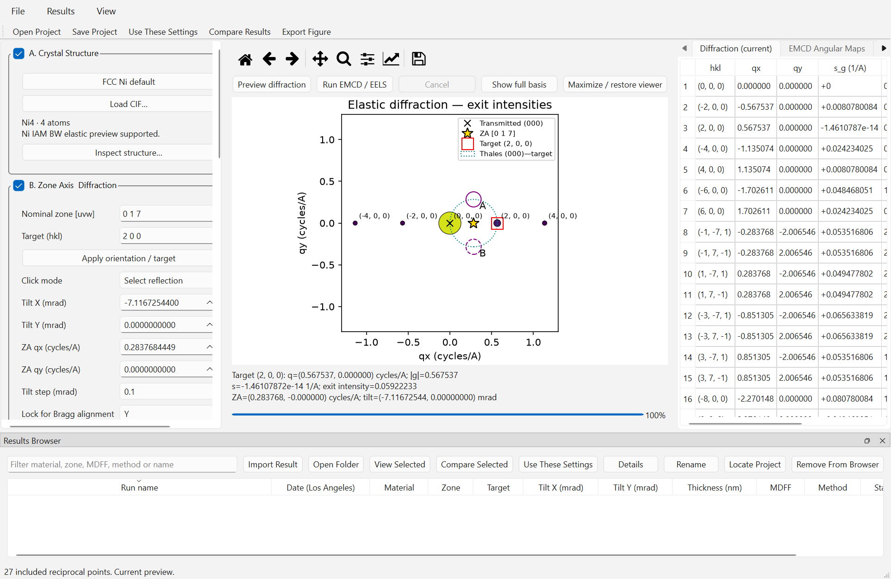
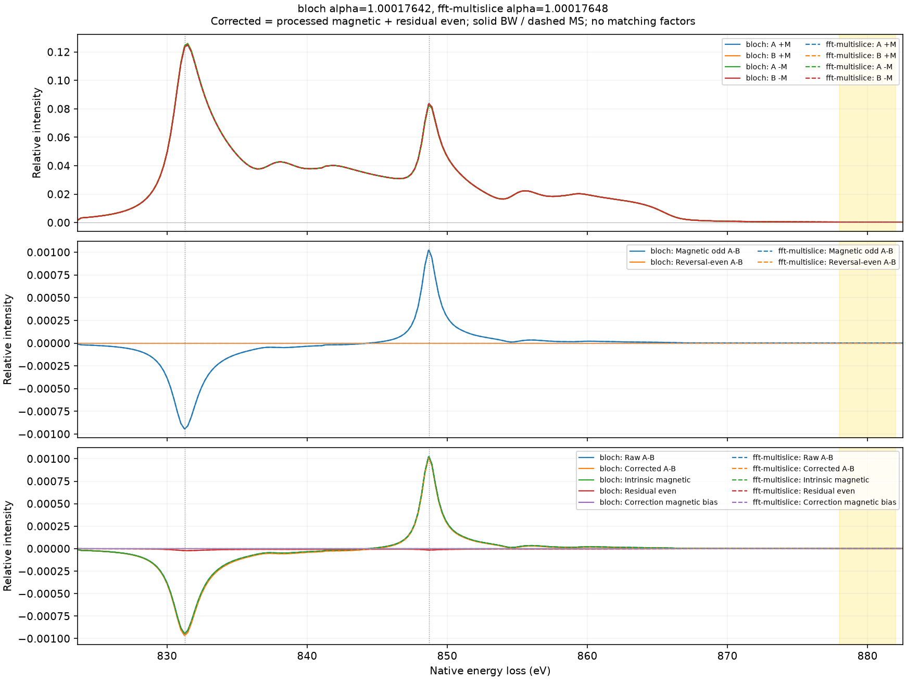
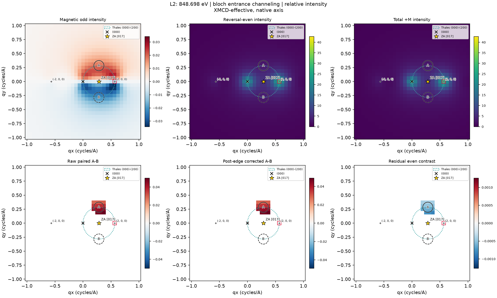

# Windows GUI RC acceptance — unreleased

This is a local one-folder candidate, not an approved public or quantitatively
validated scientific release. Package version remains **0.4.5**. There is no
installer, signature, release tag or merge to main.

## Build and environment

Build source: `3d063d8be3bbb6cfdcd6298019ffc4816c9d7335`, on
`feat/emcd-desktop-gui`, following Stage D `4fea87e4`. Build timestamp:
2026-10-16 15:33:38 UTC. The worktree was dirty because of documentation and
preexisting local data/scripts; individual GUI source hashes are recorded in
`_internal/build_info.json`. The build deliberately takes the tracked Ni
spectrum from Git, not the modified working copy.

Test host is Windows 11 Enterprise `10.0.26200` (desktop build 26200.9457),
x64, Intel Core i7-1365U, 31.58 GiB reported RAM, Python 3.11.17.
Versions: NumPy 2.4.6, SciPy 1.17.1, Matplotlib 3.11.2,
PySide6 6.12.0, ASE 3.29.0, PyInstaller 6.22.3 with hooks 2026.8.
Native display scaling was 150%, with a 1920×1280 desktop. Separate native
100% and 125% Windows settings were not tested. Scientific plots have
scrollable canvases and an existing maximize control.

The separate packaging venv shares the established scientific packages;
PyInstaller and its helper packages were installed only into that venv.
The existing `emcd-python` package set was not changed for packaging.

```powershell
build/windows-rc/venv/Scripts/python.exe -m PyInstaller --noconfirm `
  --distpath build/windows-rc/dist --workpath build/windows-rc/work `
  packaging/emcd_gui.spec
```

See [build script and setup](../packaging/README.md). The distribution contains
the EXE, `_internal`, NumPy/SciPy DLLs, Qt platform plugins, Agg/QtAgg,
Matplotlib fonts/resources, ASE CIF imports and space-group table, required modules, licenses and
build metadata. Collection follows dependency hooks and explicit dynamic
imports. No environment-wide blanket collection is used. Conda's base
OpenSSL/Expat DLLs are supplied explicitly for the venv-backed build. An early
candidate failed frozen SVG export because Matplotlib dynamically imports its
SVG backend; the corrected spec explicitly includes that backend. A subsequent
actual CIF import exposed the missing ASE `spacegroup.dat`; the spec now
includes that specific table as well, without collecting unrelated ASE data.

The 608-file application is 261,756,337 bytes before compression. The ZIP is
108,447,636 bytes, with 608 file entries. ZIP CRC validation
passed. Its only Ni resource is the tracked five-column example, SHA256
`4fd517af3e54db94588a76b7a6ed9c2f9a1b745cd8fe52b9fca0f87fc4938db3`.
The repository distributes this calculated example under its MIT license;
this is numerical output, not licensed WIEN2k code. No companion audit is
claimed inside the package. External audited input remains selectable.
No user results, WIEN2k companions/source/binaries, CUDA or unrelated model
packages are included. Bundled dependency license files are retained.

Resources resolve from the source tree or frozen `_MEIPASS`. Frozen metadata
does not invoke Git or read Python source files. Workspace/preferences/index
default to `%LOCALAPPDATA%/EMCD-Sim/workspace`, with the existing
`EMCD_GUI_WORKSPACE` override. Rotating local logs under
`%LOCALAPPDATA%/EMCD-Sim/logs` record builds, requested methods, source paths
and hashes, errors and tracebacks, without input contents or uploads.

## Scientific acceptance

Reference: conventional FCC Ni a=3.524 Å, [017], target (200), 200 kV,
30 nm, tilt (-7.11672544,0) mrad, cubic M=[001], beam cutoff 3.2 and
potential cutoff 2.2 cycles/Å, FFT32, maximum step 0.04 nm, depth64,
detector33, fractional apertures with 64 boundary subpixels.

Both native XMCD-effective L3/L2 features (831.271/848.698 eV) and the
independent atomic model (852.7/870 eV defaults) were run through actual
Qt workers in BW-only, MS-only and Both modes. No source shift, fit or
rescaling was applied. Post-edge correction is a separate observable,
not a definition of intrinsic magnetic signal.

The external acceptance spectrum is an exact copy of the previously audited
working source, SHA256
`a0e28ea6423b6c7832bb3cce6d69d71aa59336a221baeee3d2556b49ba501283`.
Its header differs from the tracked bundled example; numerical columns are
unchanged. The packaged import performs five-column validation and an
explicit convention declaration, without pretending to rerun the absent
companion audit. Reconnection requires the saved hash, not just a filename.

Magnetic-odd means half the difference between magnetization reversals;
reversal-even means half their sum. The raw single-state detector difference
contains both components. Post-edge scaling changes the measured A/B
combination and can retain or introduce even-component bias; it does not
isolate the intrinsic magnetic tensor contribution by definition.

Source GUI comparisons against Stage C cover **682 numerical arrays** across
six cases: complete EELS/decomposition/alpha, angular maps, weights,
coherences, complex amplitudes, elastic intensities and full FFT diagnostics.
Every compared array is bitwise identical; maximum absolute error is zero.
The extracted standalone GUI also matches the source and Stage C bit-for-bit
for all 682 arrays, in each of the six cases (BW and MS separately).
Comparisons use `allow_pickle=False`, matching NaN support, and a fallback
acceptance tolerance rtol=1e-12, atol=1e-15. BW and MS are compared separately,
including their individual entries in Both exports.

At fixed settings, BW/MS coherence relative Frobenius discrepancy remains
3.0737e-5; maximum magnetic-map relative L2 discrepancy is about 0.0371%,
and selected-edge magnetic detector differences differ by about 0.0362%.
FFT norm error is 1.71e-14, maximum excluded population 1.44e-7.
These are numerical propagation diagnostics, not physical-potential convergence.

All GUI A–D tests plus Stage E resource tests and relevant fractional
aperture, tensor, contraction, multislice, atomic and XMCD-effective tests
passed: **80 tests**, including 44 GUI tests. The five runtime tests were
repeated after final runtime changes. Another 25 geometry/persistence/runtime
tests passed after the SVG packaging and title fixes. Existing Qt deprecation and hidden
small-canvas layout warnings remain; they did not change arrays. No historical
43-orientation sweep was run. A preservation manifest confirms all 827 prior
Stage B/C and Ni study files unchanged.

## Independent-environment scope

The complete ZIP was extracted to
`C:/EMCD-Sim-RC-Test/stage-e-rc-20261016/EMCD-Sim/`.
The application ran from Windows System32 with PATH restricted to Windows
directories and Conda/Python environment variables removed. Actual native Qt
widgets and workers were driven by the opt-in `--rc-acceptance` command.
This is **development-machine standalone acceptance**. No second Windows
installation or clean VM was available; clean-machine and human interactive
acceptance remain outstanding.

Source-side separate-process reopen verified saved fingerprints, settings
restoration without a worker, comparison of the reference and +1 mrad x
mistilt, and PNG/SVG/NPZ/CSV exports. An isolated saved copy with unavailable
original XMCD/CIF remained viewable/exportable; rerunning was blocked.
The user's original inputs were never renamed or removed. Existing Stage D
tests additionally guard propagation/tensor calls during loading and verify
hash-based relocation, corrupt projects, atomic rollback, stale inputs and
legacy read-only exports.

The extracted calculation process exited successfully after seven actual
calculations. Unsupported orientation/odd FFT settings were blocked; a real
cancelled worker preserved the prior completed result. Reference alignment,
tilt changes, ZA/indexing/Thales overlays and physical detector positions were
exercised through the GUI's existing controls and plotted real results.

## Measured performance

Times below are seconds on this development machine, not benchmark promises.
Calculation timings run from the Run action through completed GUI rendering;
they exclude subsequent export. Source runs overlapped tests/building, so
their spread is not evidence of a solver speed change. Packaged runs used
single-thread OpenBLAS/OMP and had no concurrent build; native GUI export
acceptance overlapped part of the final run. Earlier standalone runs of the
same scientific payload measured XMCD 13.69/14.73/27.42 s and atomic
14.48/14.33/28.89 s. This large timing variation has not been isolated to a
specific host or GUI cost. Performance profiling remains a review item;
there is no change in scientific arrays or algorithmic settings.

| Operation | Source GUI | Extracted GUI |
|---|---:|---:|
| Window setup after imports | 3.36 | 1.73 |
| Default diffraction preview | 2.52 | 3.88 |
| XMCD BW | 40.00 | 49.02 |
| XMCD MS | 49.04 | 62.18 |
| XMCD Both | 32.36 | 118.52 |
| Atomic BW | 22.17 | 48.47 |
| Atomic MS | 14.34 | 48.75 |
| Atomic Both | 79.73 | 100.32 |
| XMCD Both project save | 0.69 | 0.52 |
| Project reopen (array load/validation) | 0.46 | 0.29 |

External process monitoring measured **40.82 s** from launch to the first
native window on the first extracted run, including imports. This is distinct
from the in-app window-setup timer. The subsequent standalone relaunch took
23.71 s to show its window; project array load/validation itself took 0.29 s.
Cold import/loading overhead was not
isolated from filesystem/security effects; startup remains a review point.
Peak process working set was **297.30 MiB**, measured by PowerShell's process
counters across calculation/export. The optional in-app ctypes counter
initially returned zero because of a Windows handle-width declaration. That
was corrected; the final in-app and external counters agree at 297.30 MiB.

Local evidence: `outputs/gui_stage_e/numerical_regression.json`,
`source_numerical_regression.json`, `archive_audit.json`, `preservation.json`,
`source/acceptance.json`, `source/reopen.json`, `native_csv_validation.json`,
`stage_d_compatibility.json`, `native_legacy_validation.json`,
`packaged_acceptance.json`, `packaged_reopen.json`, and the external test folder's
`validation/` and `process_*.json`. Reproduce comparisons with
`scripts/gui_stage_e_compare.py` and the acceptance commands in the build guide.

## Actual standalone captures



Actual default diffraction preview, with (000), (200), projected ZA [017],
Thales circle and physical A/B apertures. The three-area layout and browser
are retained.


Actual completed BW/MS overview at native 150% scaling. The scientific canvas
is scrollable; full exported panels below avoid cropping the spectral axes.



Full native-energy detector spectra, intrinsic magnetic-odd and reversal-even
differences, and separately reported post-edge correction. Corrected contrast
is not identical to intrinsic magnetic EMCD.




Actual standalone-exported selected-edge maps at 831.271 and 848.698 eV,
with unshifted source energies and physical overlays. Map and detector values
match the source and Stage C exports exactly.


Actual standalone reopening/comparison of saved reference and mistilt results.
The original Stage D projects also passed standalone loading with exact
fingerprints, settings restoration without a worker, PNG/SVG exports and
missing-source viewing with rerun blocked. Original Stage B and C exports were also imported read-only through the
final normal GUI using its native Import Result control. The final normal
GUI selected two saved runs, compared them and exported NPZ/CSV. Each of the
243-point, 17-column CSV spectra exactly matches its NPZ counterpart; scalar
metrics CSV was generated too. The external test workspace index confirms
both legacy imports. Source regression tests additionally guard read-only
behavior and array integrity.

## Local artifacts and review limits

Executable: `build/windows-rc/dist/EMCD-Sim/EMCD-Sim.exe`.
Archive: `build/windows-rc/EMCD-Sim-Windows-RC.zip`.
SHA256:
`2c679fcedb59c3eebcbb5718b509eb28d15cc5419eb3f00f5f034fb385460648`.
Build outputs and validation data remain local and ignored by Git.

Scientific limitations remain projected IAM, entrance-only depth-integrated
ionization, no outgoing/double channeling, no atom-layer-resolved 3D multislice,
XMCD-effective rather than full complex DFT MDFF, approximate non-DFT atomic
ionization, no calibrated absolute cross sections or experimental dose/noise,
and unresolved physical potential Fourier-cutoff convergence. Numerical
agreement and packaging do not resolve these limitations.

## Remaining review items

No functional or numerical failures remain in the exercised acceptance cases.
Clean-machine/VM testing, human usability review at 100%/125% scaling, and
profiling the observed startup/timing variability remain outstanding. The
candidate is unsigned and unreleased. No public scientific-release readiness
is asserted.
