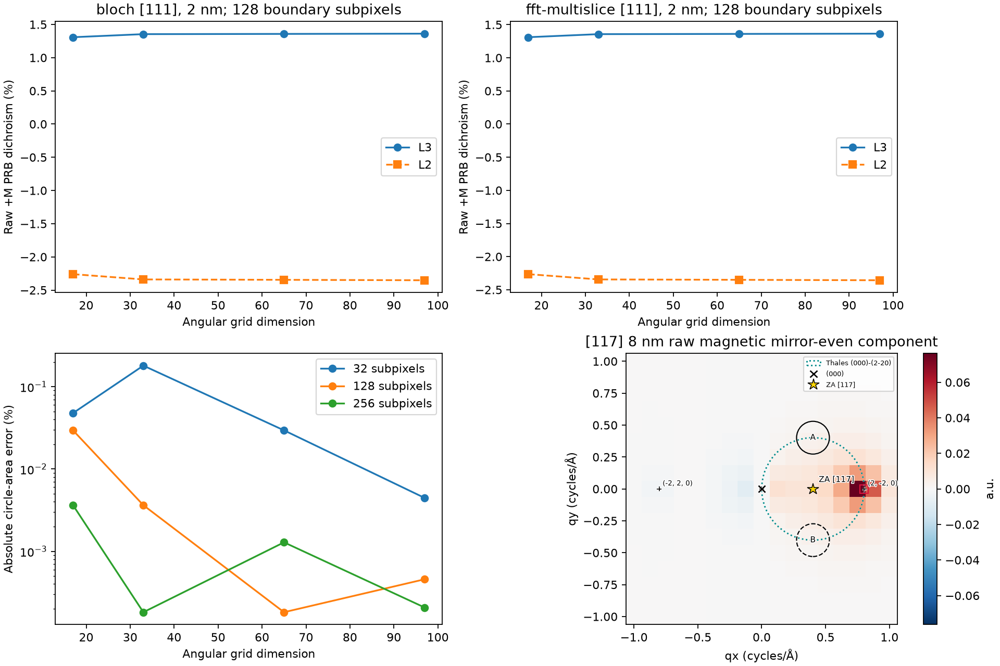
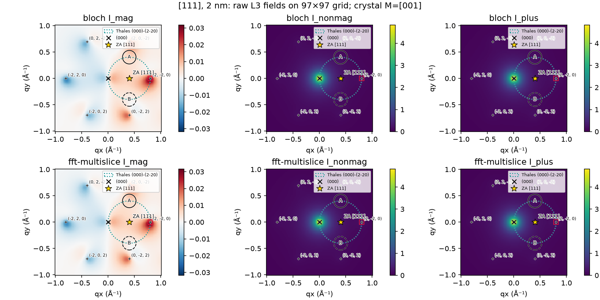
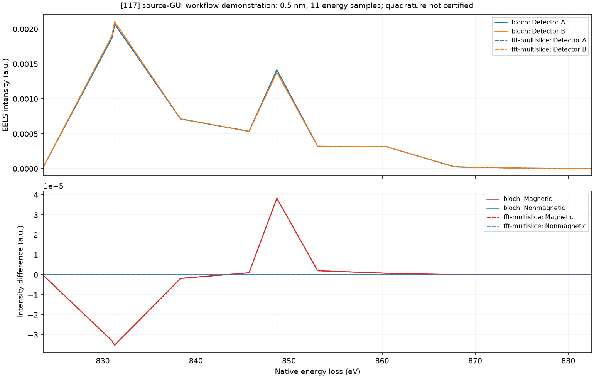

# Generalized Projected ZOLZ EMCD — end-to-end validation

Branch: `feat/generalized-multislice`, following Milestone A
`9469e23345bfeb5bbadb9f6094d6c062e044401c`.

**End-to-end integration: PASS for the representative supported workflows.**
**Unrestricted quantitative convergence: NOT certified.** A [111] joint-refinement
raw-intensity check still fails the existing threshold. Atomic 3D has not begun.
No merge, publication, version change or Windows EXE rebuild is included.

## Subsequent final review

The [merge-readiness review](GENERALIZED_MULTISLICE_MERGE_READINESS.md) isolates
the original 0.1094% raw change to potential/beam support, adds five minimal
detector-only controls, and records passing final enlarged-MS increments. The
original lower-profile failure and incomplete enlarged-BW certification remain
explicit. The historical end-to-end evidence below is retained unchanged.

## Audit: already integrated and changes made

Milestone A already connected general geometry, coherent FFT incoming waves,
Single/Double MDFF response, magnetic reversal, detectors and result processing.
This task does not duplicate those components or replace the BW solver.

| Path | Verified behavior / action |
|---|---|
| `crystallography.py`, `projected_geometry.py` | Shared structure-derived orientation, integer reciprocal plane, metric and FFT mapping; no zone-specific algorithms |
| `projected_potential.py` | Actual oriented IAM coefficients, source-cell volume, Fourier bandwidth and sampling checks |
| `gui/geometry.py`, `gui/propagation.py` | Actual oriented common hkl support; same geometry used for both backends |
| `gui/channeling.py`, `gui/emcd_forward.py` | Shared tensor construction, explicit ±M response, raw maps/spectra and detector integration; both Single and Double already connected |
| `multislice_double_channeling.py` | Fixed a remaining implicit `(200)` row selection: use the declared target, or infer the positive local-x row from actual oriented support for historical callers. No hard-coded hkl fallback remains in that algorithm |
| `gui/app.py` | Removed stale “[017]-only entrance channeling / no outgoing channeling” text |
| `gui/results.py` | Ideal two-beam results now identify their actual truncated basis instead of being labeled full multibeam |
| `gui/results_browser.py` | Default Save As name uses the saved nominal zone instead of a fixed `Ni017` prefix |
| `gui/project_io.py` | Existing explicit FFT-cell persistence and legacy-frame guards pass; no reinterpretation or new migration needed |
| `tests/test_memory_budget.py` | Replaced an obsolete synthetic 100-beam probe with a real large [001] basis; retained an explicit fake-index rejection check |

No production/GUI import of `ni_017_geometry.py`, `ni_117_geometry.py` or another
orientation-specific geometry provider remains. Their original sources are
unchanged frozen fixtures under `tests/fixtures/reviewed_geometry/`.
`ProjectedNiFFT` remains an API name alias for the single generic `ProjectedFFT`.

Remaining orientation names have specific non-algorithmic purposes: released
[017] defaults and a calibrated Automatic starting profile; an empirical [117]
sampling warning; the [001] literature benchmark; and the actual crystal-[001]
Ni magnetic-source definition. They do not select propagation physics or a
different FFT potential. Automatic is not an orientation convergence certificate.

## Coordinates, potentials and coherent calculations

Nominal structural z follows `[uvw] @ cell`; a nonzero ZOLZ target defines
positive local x, and y completes the right-handed frame. Incident tilt remains
independent of crystal orientation. Miller indices remain signed integers.
The exact ZOLZ condition is `h*u+k*v+l*w=0`; FCC allowed indices have common
parity. Neither signed targets nor off-row terms are replaced by `(200)`.

The frame R acts as `g_local = R @ g_crystal` and
`T_local = R @ T_crystal @ R.T`. Crystal Cartesian magnetization remains [001]
in these Ni source tests; it is not aligned to the local beam. The same source
tensor is reversed in the crystal frame and rotated once for both solvers.

Reciprocal generators may be oblique. FFT harmonics are exact integer linear
combinations of them; the kinetic operator uses actual Cartesian G and retains
the metric cross terms. Potential coefficients retain
`U_G = 10*gamma*lambda*F_G/source_cell_volume` in radians/nm, with U000 removed.
Transmission is `exp(i U dz)` and coefficients are `fft(wave)/number_of_samples`.
No fitted amplitude, phase alignment or truncated-wave renormalization is used.

Single uses complex incoming amplitudes at the requested physical depth nodes,
their full off-diagonal coherence, and the existing Cartesian MDFF/Coulomb
contraction. Depth-averaged coherence is multiplied by thickness once. It does
not substitute elastic beam populations for coherent waves.

Double uses incoming fields at each event depth and outgoing adjoint fields at
`E_out = E_in - loss`. The outgoing wavelength and interaction scaling change
with loss. Momentum transfer includes `q_xy + h_out - g_in` and the existing
negative longitudinal characteristic-q convention. Equivalent-site phases and
depth-distributed event weights are retained. Double's response already contains
depth integration; it is not a scaled Single result. Existing direct/adjoint,
phase, reversal and finite-loss tests remain applicable.

Both backends share energy handling, tensor construction, aperture quadrature,
decomposition, map algebra, PRB readout and exports. The FFT propagator remains
independent of BW eigenmodes. Dedicated MS-only tests for [117], [111], [710],
both channeling models, fail if a BW wavefield is requested.

## Reference orientations and reused results

| Zone | Target | Rationale |
|---|---|---|
| [001] | (200) | Legacy restricted systematic-row reference; full finite-ZOLZ controls also retained |
| [017] | (200) | Validated minor-zone reference |
| [117] | (2,-2,0) | Signed ZOLZ/FCC-allowed target; validated raw asymmetry |
| [111] | (2,-2,0) | Shortest allowed ZOLZ family, perpendicular to [111], with signed-index coverage |
| [710] | (002) | Shortest allowed row along cubic z, perpendicular to [710] |

The ten accepted Milestone-A Single/Double matched comparisons across these
five orientations are reused with verified array hashes. Complex fields, exit
intensities, coherences, raw maps, magnetic/nonmagnetic spectra, reversal states
and detector asymmetries remain available. No old production scan was restarted.
The parent [001] references include enlarged bases; the low-basis failures are
not reclassified as passing. See the [original A evidence](GENERAL_ZOLZ_MULTISLICE_VALIDATION.md).

One new, explicitly matched [117] 8 nm control uses the exact historical full
b=3.8, p=6.2 Å⁻¹, FFT32, 65 depths, grid17, 32-subpixel configuration. Comparing
directly with `baseline_full_double_t8`:

| Quantity | BW max absolute change | MS max absolute change |
|---|---:|---:|
| Complex wave amplitudes | 0 | 8.44e-16 |
| Coherence | 0 | 5.55e-16 |
| Raw L3/L2 magnetic, nonmagnetic and ±M maps | 0 | 2.49e-14 |
| Saved spectra | 0 | 6.75e-14 |

The raw L3 magnetic mirror-even L2 fraction is **0.17457910 BW / 0.17457686 MS**.
It is retained before detector differencing/normalization. This coarse-grid
number is not a replacement for the refined [117] report's fractions or a new
convergence claim. The previously established physically allowed mirror-even
component survives generalization. Thales-circle point-pair relations, row
antisymmetry and variation around the circle remain distinct questions.

## [111] angular and aperture investigation

All new numerical controls use FCC Ni a=3.524 Å, 200 kV, 2 nm, exact target Bragg,
zero local y tilt, eta=beta=1, crystal M=[001], native L3/L2 831.271/848.698 eV.
Detectors remain `(g/2,±g/2)`, radius `0.16*g`. No post-edge correction is used
for convergence measurements. Baseline b=2.6, p=3.0 Å⁻¹, FFT32, depth33 and
maximum slice step 0.02 nm remain fixed for angular controls.

New full-field 65×65 and 97×97 results supplement immutable 17×17/33×33 maps.
Reintegration varies boundary subpixels without resimulating any field.
At common physical points, raw maps agree **exactly** across those grids.
Grid changes therefore affect sampling/integration here, not the underlying
point response or a coordinate transformation.

The gates remain **0.01 percentage points** for PRB/magnetic asymmetries and
**0.001 relative** raw A/B ±M intensity. Comparisons take the maximum over L3/L2
and both methods; raw denominators are `max(abs(first),abs(second))`.

| Independent change | PRB change (pp) | Magnetic change (pp) | Raw relative | Gate |
|---|---:|---:|---:|---|
| Angular 17→33, fixed 128 boundary subpixels | 0.0796038 | 0.0768282 | 0.00250162 | FAIL retained |
| Angular 33→65, same subpixels | 0.00592094 | 0.00562682 | 0.000248270 | PASS |
| Angular 65→97, same subpixels | 0.00650986 | 0.00624264 | 0.000520687 | PASS |
| Boundary 32→64 at grid97 | 0.0000229378 | 0.0000229816 | 0.0000780350 | PASS |
| Boundary 64→128 at grid97 | 0.000101101 | 0.0000946860 | 0.00000405792 | PASS |
| Boundary 128→256 at grid97 | 0.0000401257 | 0.0000378945 | 0.0000119048 | PASS |

At grid97/sub128 the aperture-area error is about **−0.0004573%**. Small area
error does not certify integration of a varying intensity field. At grid17,
near-accurate area coexists with a failing field-integral comparison. The coarse
Milestone-A discrepancy is substantially a field-quadrature issue, not missing
FFT geometry or solely a hard-circle area error. Refinement is nonmonotonic;
the two final passing increments certify only the tested representative changes.

The independent parent controls are retained: beam 2.6→3.2 and potential
3.0→3.8 increments individually pass at the baseline, as do FFT32→48, depth33→65
and slice-step refinements. The parent p=3.8/b=2.6 BW/MS pair's 0.0104051 pp
failure remains recorded, illustrating coupled beam/potential requirements.

### Joint and outgoing-support controls — remaining limitations

The joint case uses b=3.2, p=3.8 Å⁻¹, FFT48, depth65, maximum step 0.01 nm,
grid65/sub128. It does **not** change detectors, tensor or geometry.

| Matched BW/MS pair | PRB discrepancy (pp) | Magnetic (pp) | Raw relative | Gate |
|---|---:|---:|---:|---|
| Baseline, grid65 | 0.00501641 | 0.00436843 | 0.000625857 | PASS |
| Baseline, grid97 | 0.00503208 | 0.00438214 | 0.000626018 | PASS |
| Joint refinement, grid65 | 0.00372495 | 0.00327190 | 0.000284687 | PASS |

However, joint versus baseline at the *same* grid65/sub128 changes PRB by
0.00813813 pp, magnetic asymmetry by 0.00622863 pp, and raw intensities by
**0.00109402 relative (0.109402%)**. The raw gate fails. BW/MS agreement does
not remove that failure.

Four independent point controls hold p=3.8, FFT48, depth65 and step0.01 fixed
while choosing incoming/outgoing cutoffs independently from {2.6,3.2}. They use
two mirror-related point pairs, not aperture-integrated EELS. Increasing outgoing
support alone changes raw points by up to 0.0989687%; increasing incoming alone
changes them by 0.128996%; increasing both changes them by 0.0946865%.
Their BW/MS raw discrepancies range from 0.0288734% to 0.0656273%.
Full PRB/magnetic point checks and incoming/outgoing hkl tables are exported.
The residual beam-support/joint sensitivity prevents a general production
convergence certificate; it cannot be attributed to aperture boundaries alone.

A reasonable *next validation starting point*, not a released preset, is the
joint profile with angular97/sub128, followed by independently larger support
and joint checks under memory admission. That combined grid97/profile has not
been run here. No default, threshold or worker count is raised globally.

Top: raw +M detector PRB contrast versus grid size, using fixed 128-subpixel
weights. Bottom left: absolute detector-area error; its nonmonotonic reduction
does not bound field-integral error. Bottom right: the raw MS [117] 8 nm magnetic
mirror-even component, with unchanged beam, ZA and physical detector coordinates.

Actual [111] 97×97 raw magnetic, reversal-even and total +M fields, with shared
BW/MS color ranges per component. These are coherent calculated fields; no
interpolation from coarser grids or imposed mirror parity is used. (000), the
signed target, projected ZA, Thales circle and actual detectors use the same frame.

## Normal GUI acceptance and usage

Ten real Qt control/QThread workflows cover all five orientations, each Single
and Double, using Both plus checks that solver-only choices remain available.
They preview indexed diffraction, align the target, restore Thales detectors,
run native-energy EELS, switch raw/relative displays, render maps, save/reopen
projects and restore settings. Fingerprints confirm display/persistence do not
modify results. Additional tests prevent BW wavefields from being used in MS-only
jobs and exercise CSV/NPZ/PNG exports from a reopened [117] project.

These are Windows Python/PySide6 **source-GUI**, offscreen-platform tests, not
a rebuilt EXE or clean-machine installation. The lightweight acceptance jobs
use 0.5 nm, grid9, nine uniform energy nodes plus exact edges (11 samples total).
An explicit sampled window 866–882.521 eV exercises post-edge scaling. It is
a workflow test, not quantitative post-edge recovery or spectrum convergence.
An initial test using the default narrow window correctly reported insufficient
samples; the physical routine was not weakened to force a correction.

For a manual representative [111] run: choose FCC Ni and Manual numerical
settings; enter zone `1 1 1` and target `2 -2 0`; set voltage/thickness, beam and
potential cutoffs explicitly. Apply orientation, set y tilt, lock Y and align
Bragg. Restore Thales detectors, set radius, then choose Single/Double and
BW/MS/Both. Validate the native source and crystal magnetization declaration.
Use full spectra with adequate energy sampling for post-edge operations.
Inspect numerical warnings before Run; Automatic does not prove convergence.
The visible local coordinate frame changes with the target, so re-enter local
tilt/detector values deliberately when changing it.

Raw mode displays signed `M_A-M_B` and `N_A-N_B` in a.u.; relative mode divides
both by the common `N_A+N_B` and multiplies by 100. PRB remains a separate raw
+M difference/sum benchmark. Corrected contrast is not intrinsically magnetic,
and neither relative percentage nor arbitrary-unit intensity is calibrated SNR.
All original raw and percentage arrays remain exported regardless of display.

Coarsely sampled, full-range [117] source-GUI workflow demonstration. It shows
actual A/B EELS and signed raw components for both methods; it is not a
high-resolution or quadrature-converged spectrum. The corresponding
[relative-mode figure](images/generalized_emcd/gui_eels_relative.png) uses the
same underlying arrays and common denominator.

Saved projects retain explicit FFT generators and structural frame. Legacy
incompatible frames or ambiguous recipes remain viewable and block automatic
input reuse. No silent orientation or potential fallback is introduced.

## Regression, preservation and review disposition

Final tracked regression plus new end-to-end tests: **524 passed in 389.15 s**,
with 986 Qt/Matplotlib deprecation/headless-layout warnings and no failures.
The independent focused follow-up also passed **24 tests in 26.60 s** (overlapping
coverage, not added to 524). All ten normal-GUI orientation/channeling cases
passed; MS-only independence, scientific export, raw/relative immutability,
legacy sampling/frame guards, cancellation and memory checks are included.
Compile checks, GUI `--help`, embedded file links and frozen-source identity
checks passed. No EXE build or installation acceptance was performed.

The first broad run had one failure in the obsolete fake-hkl memory test, not
in memory admission or propagation. After replacing that fixture with a real
large [001] basis and retaining fake-index rejection, the complete suite above
passed. Both logs remain available; no numerical gate was changed.

A final driver-resume check exposed tuple/list differences after JSON
serialization. Canonicalizing the configuration representation fixed reuse
without weakening source/setting hashes. All four completed new numerical cases
then reported REUSE, with no calculation. The post-review integration/resume
suite passed **14 tests in 9.78 s**, overlapping the broader run and adding one
resume-specific test. A changed source still rejects checkpoint reuse.

The [Milestone-A 224/29 baselines](GENERAL_ZOLZ_MULTISLICE_VALIDATION.md) are
included in the broader tracked suite; their logs and original evidence remain
intact. A final SHA256 audit checks all 323 protected files, including 204
production checkpoints and historical [117] outputs. Source data, reports and
frozen fixtures are not regenerated to pass tests. The user's pre-existing XMCD
formatting change and private companions remain outside this commit.

Local evidence is under `outputs/generalized_multislice_emcd_validation/`:
four new complete projects, independent outgoing responses, ten GUI acceptance
artifacts per successful run, compact comparison/quadrature CSV and NPZ, PNG/SVG
figures, hashes, per-case source provenance, logs and analysis JSON. Reused parent
results are identified in `reference_reuse.json`. Numerical scripts checkpoint
before advancing; the analysis script reads saved fields without simulations.

Code review found no change to the BW Hamiltonian, MDFF, Coulomb kernel, dipole
tensor construction, split-step mathematics, outgoing energy convention or
detector definitions. The production patch is confined to general row selection
and truthful GUI labels/naming. Explicit target/inferred-row tests preserve
legacy behavior and cover all five orientations.

**Ready for scientific/code review of end-to-end integration; not an unqualified
production-convergence approval.** [111] support/joint failures remain open.
No full thickness/voltage study or universal high-index certification follows.
Resource-bounded periodic geometry, Ni IAM factors and the Ni magnetic-material
gate remain in force. There is no Atomic 3D potential/HOLZ, absorption/TDS,
complete DFT-derived MDFF, absolute experimental energy calibration or calibrated
electron-count detectability. Double includes outgoing channeling only within
the existing projected-ZOLZ model. Atomic 3D remains deferred; main and Windows
packages remain unchanged.
