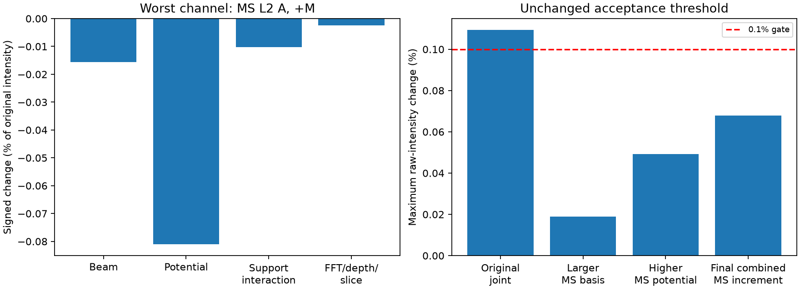

# Generalized Projected ZOLZ Multislice — final merge-readiness review

Review base: `feat/generalized-multislice` at
`51c8310658e6a48fe402230e88c2ccd9a7ce0163`.

**Recommendation: GO for merging the bounded research implementation, including
this review's safety corrections, visible warnings and documented limits.**
There are no remaining identified blocking implementation defects after these
corrections and tests. This is **not** approval to present [111] defaults, the
lower-support baseline, or arbitrary orientations/thicknesses as quantitatively
certified. The original [111] raw-intensity gate remains a recorded **FAIL**.
No merge, release, tag, version change or Windows rebuild was performed.

## 1. Diagnosis of the 0.1094% sensitivity

The failing observable is **MS L2 detector A at +M**, at Ni [111], 200 kV,
2 nm, native edges 831.271/848.698 eV, crystal M=[001], eta=beta=1 and exact
(2,-2,0) Bragg. Detector coordinates, radius and source tensor are unchanged.
All comparisons below use grid65 and 128 boundary subpixels. Existing full maps
are reintegrated at that setting; new controls evaluate only nonzero detector
support on the same grid, with no field interpolation.

The original baseline uses b=2.6, p=3.0 Å⁻¹, FFT32, 33 depth nodes and maximum
step 0.02 nm. The saved joint case uses b=3.2, p=3.8 Å⁻¹, FFT48, 65 nodes and
maximum step 0.01 nm. Three new bridge controls vary only beam support, only
potential cutoff, then both supports while retaining baseline propagation
sampling. Two further MS-only controls enlarge the basis and then the potential.
Only five new detector-only cases were run; completed full-field studies were
not restarted.

| Change | PRB (pp) | Magnetic (pp) | Raw change (%) | Gate |
|---|---:|---:|---:|---|
| base → joint | 0.008138133 | 0.006228633 | 0.109402 | FAIL |
| base → beam_only | 0.006284216 | 0.00483527 | 0.08183626 | PASS |
| base → potential_only | 0.005995006 | 0.00519143 | 0.08105957 | PASS |
| base → support_only | 0.008129717 | 0.006223305 | 0.106892 | FAIL |
| support_only → joint | 4.696787e-05 | 4.079831e-05 | 0.002512694 | PASS |
| joint → higher_basis_ms | 0.0004608843 | 0.0005522515 | 0.0189075 | PASS |
| higher_basis_ms → higher_potential_ms | 0.00313937 | 0.002704806 | 0.04927195 | PASS |
| joint → higher_potential_ms | 0.002981753 | 0.002152555 | 0.06785494 | PASS |

Here `support_only` is b=3.2/p=3.8 with baseline FFT/depth/step settings;
`higher_basis_ms` is b=3.8/p=3.8 with joint sampling, and
`higher_potential_ms` is b=3.8/p=4.6 with the same sampling. The first five
comparisons take the maximum over BW/MS and L3/L2. The last three are **MS-only**.
Raw errors use `abs(first-second)/max(abs(first),abs(second))` over A/B and ±M;
the unchanged gates are 0.1% raw and 0.01 percentage points PRB/magnetic contrast.

Enlarging supports alone reproduces **97.7057%** of the original worst-channel
change. The combined FFT/depth/slice refinement contributes only **0.00251269%**
maximum relative raw change after supports are fixed. It is not the dominant
source. Prior independent FFT, slice, depth and aperture checks remain relevant;
there is no indication here of a normalization, geometry or MDFF defect.

For the specific worst channel, an additive finite-difference budget, normalized
to its original intensity, is:

| Contribution | Signed change (%) |
|---|---:|
| Beam support alone | −0.0155758 |
| Potential cutoff alone | −0.0810596 |
| Non-additivity of the two support refinements | −0.0102567 |
| FFT/depth/slice refinement after support enlargement | −0.00251001 |
| Total | −0.109402 |

Potential bandwidth is the largest isolated contribution in that channel;
finite beam support and its interaction with bandwidth also matter. The
interaction row is the non-additivity of numerical refinements, not a new MDFF
term or a unique physical error decomposition. In MS, changing retained beam
support at fixed FFT/potential changes the incoming/outgoing paths used in the
inelastic contraction; it does not crop or renormalize the full propagated field.
BW support also changes its finite elastic Hamiltonian.

The subsequent enlarged-MS increments approach a more stable result: **0.0189075%**
for 55→85 retained beams at p=3.8, **0.0492719%** for p=3.8→4.6 at 85 beams,
and **0.0678549%** combined relative to the saved joint MS result. Their PRB and
magnetic increments pass too. This supports a finite-support/cutoff diagnosis.
It does not erase the lower-profile failure or prove an asymptotic limit for
all configurations.

An independently enlarged **85-beam BW** calculation was not run in this minimal
review. Its dense n⁴ kernel alone is about 4 GiB before process overhead; the
MS-only controls avoid that allocation. Thus the enlarged-MS checks are not
an independent convergence certificate for enlarged BW or for a full thickness
curve. No production preset is promoted automatically.

Left: signed contributions in the original worst raw-intensity channel. Right:
the original failed comparison and subsequent passing enlarged-MS increments.
All plotted changes derive from actual saved detector intensities, not adjusted
or antisymmetrized maps. Numerical CSV/NPZ and detailed JSON accompany the figure.

### BW/MS agreement remains distinct

The baseline and saved joint cases pass matched BW/MS raw and contrast tests.
The new `support_only` case passes (PRB discrepancy 0.00368640 pp; raw 0.0286476%).
The `beam_only` case passes (0.000873104 pp; raw 0.0298742%).
The under-supported `potential_only` case **fails** PRB BW/MS agreement at
**0.0109199 pp**, despite raw error 0.0644376% being within its gate. This is
retained, not suppressed. Increasing potential bandwidth without sufficient
common beam support is not a certified configuration.

## 2. Production and scientific audit

| Area | Finding |
|---|---|
| Orientation dependencies | AST inspection finds zero production imports of the legacy [017]/[117] modules. Their unchanged sources remain frozen test fixtures. No orientation provider is selected inside Single/Double propagation |
| General geometry | Exact signed hkl indexing, integer ZOLZ constraints, decorated translations, reciprocal metric and right-handed target-aligned frame are shared. No [001] potential or (200) fallback is used for other axes |
| Incoming MS | Full complex FFT coefficients at fixed physical depth nodes; no BW wavefield substitution and no retained-beam renormalization |
| Outgoing MS | Reduced post-loss energy, existing interaction scaling, q-dependent carrier and reverse/adjoint depth sequence; consistent exact incoming/outgoing indexing |
| Momentum transfer | Existing transverse `q + h_out − g_in`, negative characteristic longitudinal transfer, Coulomb kernel and equivalent-site phases are unchanged |
| Magnetic tensor | Crystal-frame magnetization and reversal precede one R T Rᵀ transformation. No beam-aligned substitution or artificial mirror parity |
| Detector analysis | Same physical apertures and fractional weights for BW/MS and ±M; integrate signed physical intensities before forming ratios |
| Display/export | Raw and common-denominator relative components remain separate, with PRB as a distinct readout. Display switching and project I/O preserve array fingerprints |
| Historical [117] behavior | Existing exact-BW / roundoff-MS reference recovery and raw mirror-even magnetic component remain intact; no assertion of uniform Thales-circle intensity |

The BW Hamiltonian, MDFF tensor model, Coulomb factors and split-step mathematics
were not changed. Longitudinal transfer remains the existing projected-model
approximation; branch/HOLZ corrections are not introduced under a review task.

The remaining zone-specific conditions are **evidence or configuration data**:
the released [017] default and its narrowly matched Automatic starting profile,
[117] empirical grid/cutoff warnings, [111] certification warning, the [001]
literature benchmark and the actual [001] Ni source magnetic axis. None is an
orientation-specific scattering algorithm. Equivalent integer zone multiples
are normalized for the empirical warning lookup. Bounded historical exception
classification in Automatic setup does not select another geometry or silently
reduce physical/numerical settings.

## 3. Reviewed corrections and closed blocking issues

| Finding | Evidence and correction | Status |
|---|---|---|
| Cached MS grid could be used with another microscope | A 200 kV cached grid was accepted for a 300 kV elastic model. `_validate_grid_context` now checks energy, incident carrier, available frame metadata and reciprocal coordinates for both supports | Fixed, tested |
| Prepared depth data could silently supply inconsistent quadrature | Explicit checks now require the requested depth positions, trapezoidal weights and split steps spanning each physical interval | Fixed, tested |
| Large-cell work bound could overflow | int64 preview-search products became negative for large finite CIF cells. The bound is now checked in floating point before integer conversion | Fixed, tested; normal indexing unchanged |
| Live ideal two-beam preview still said “full radial ZOLZ” | General basis-state description now labels the actual ideal truncation, without running a solver or altering settings | Fixed, tested |
| [111] support could be mistaken for quantitative certification | A non-blocking warning is visible and exported for all solvers, including equivalent [222] input. It states the measured failure and directs users to this review | Fixed, tested |

These are defensive validation/resource/presentation corrections, not changes
to valid wave propagation or inelastic physics. Archived matched-sampling buffer,
complex response and scientific regression tests protect valid results. External
hand-constructed prepared arrays must still describe the declared potential;
normal GUI workflows prepare them within the same job and do not use a global
cross-configuration wavefield cache.

## 4. GUI, errors and project compatibility

The five tested orientations remain [001]/(200), [017]/(200), [117]/(2,-2,0),
[111]/(2,-2,0) and [710]/(002). Normal source-GUI workflows cover Single and
Double, BW/MS/Both, indexed preview, exact target Bragg alignment, physical
Thales detectors, maps/EELS, raw/relative modes and saved projects. Frames,
signed reciprocal positions, M and ZA coordinates remain consistent.

Unsupported non-ZOLZ targets, missing target/basis support, unavailable Ni MDFF
material inputs, Nyquist violations, excessive basis/search sizes, memory/RAM
limits and invalid cached contexts produce explicit errors. Resource checks do
not silently reduce cutoffs, grids, precision, slice count or physical settings.
The general low-level FFT bounds and GUI bounds remain unchanged.

Saved explicit FFT generators and crystal frame remain authoritative. Old
incompatible frames or ambiguous FFT recipes remain viewable but block automatic
input reuse. The [017] historical rectangular sampling cell is not silently
replaced by its primitive oblique cell. No project-schema change is required.

No Windows executable was rebuilt. GUI evidence is Windows Python/PySide6
source execution with offscreen Qt, not a new standalone or clean-machine test.

## 5. Tests and preservation

The tracked regression plus review guards passed **534 tests in 310.77 s**,
with 977 Qt/Matplotlib deprecation/headless-layout warnings, no failures.
An initial focused propagation/resource run passed **89 tests in 22.56 s**.
After the final live-preview label and equivalent-zone warning refinements,
**83 focused tests passed in 54.16 s**, with 24 Qt deprecation warnings.
This includes the new no-solver preview-label test, [222] warning aliases,
view-state toggling, GUI geometry, Automatic settings and [117] compatibility.
Compile, GUI startup/help, report links and preview-image integrity checks passed.

Test counts overlap and are not summed. The prior 524-test feature baseline and
the earlier Milestone-A 224/29 scopes are covered by the tracked suite.

Final SHA256 checks confirm **all 323 protected files unchanged**, including
**204 production checkpoints**. Historical numerical arrays, scientific reports,
source data and frozen reference geometry are not regenerated to make tests pass.
The user's pre-existing XMCD formatting difference/private companion files remain
outside this commit. No existing numerical threshold or default was changed.

Evidence: `outputs/generalized_multislice_merge_review/` contains five completed
new case projects, per-case settings/source/code provenance and fingerprints,
raw comparison CSV/NPZ, analysis JSON, PNG/SVG, audit results and test logs.
The earlier baseline/joint maps are read-only references. The numerical cases
were computed before the defensive corrections; their original provenance is
retained. Regression reference tests verify unchanged valid computations after
the corrections. Analysis never reruns a scattering calculation.

## 6. Merge disposition and limitations

**Blocking implementation findings: closed. GO for the bounded research feature.**
The merge must retain the warnings and limitations in this commit. This review
does not execute that merge.

**Configuration-specific NO-GO for quantitative certification:** the original
[111] baseline-to-joint raw test remains failed, and b=2.6/p=3.8 remains failed
for matched PRB agreement. The new passing enlarged-MS increments apply only to
the tested 200 kV, 2 nm, native-edge detector observables. Enlarged BW, arbitrary
mistilt, full-spectrum and 0–100 nm convergence are not certified by them.
Automatic starting settings are not a convergence guarantee.

Required warnings retained: [111] unestablished quantitative certification;
[117] insufficient off-row potential support at small cutoff and coarse-grid
sensitivity; finite retained inelastic support and independent beam/grid/depth
requirements generally. Explicit Bragg alignment does not isolate two beams
unless the user deliberately selects the ideal truncation.

Non-blocking physical limitations: depth-averaged projected IAM, finite ZOLZ
support, no absorption/TDS or HOLZ/atomic-3D potential, approximate XMCD-effective
Hermitian MDFF rather than complete complex-transition DFT MDFF, native calculated
energies without a new absolute experimental calibration, and no calibrated
electron-count/SNR scale. Double includes outgoing propagation within this
existing approximation. Corrected paired contrast is not intrinsically magnetic.

No Atomic 3D development, new orientation, MDFF refit, full voltage/thickness
sweep, packaging, release, tag or main-branch modification forms part of this
review. Existing Windows artifacts and the public version remain unchanged.
