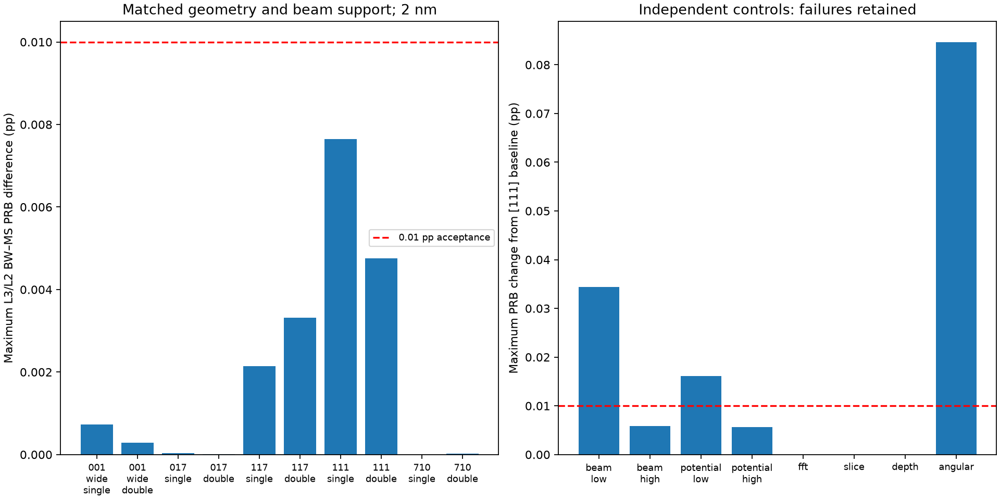

# Generalized Projected ZOLZ — Milestone A validation

**Architectural/legacy-equivalence gate: PASS. General production convergence:
not certified.** This branch stops before Atomic 3D B1.

One generalized engine replaces the production orientation-specific geometry
modules. Reviewed legacy algorithms remain frozen test fixtures. The numerical
study contains 24 new, independently checkpointed Both-method cases; no historical
production or [117] study was restarted. All 323 files in the existing protected
manifest, including the 204 production checkpoints, passed unchanged SHA256 checks.

## Test evidence and review

The focused final suite passed **224 tests in 105.61 s**, with 27 Qt deprecation/
headless layout warnings and no failures. It covers geometry, legacy references,
Single/Double physics, tensor reversal, GUI geometry, project save/open, energy
checkpoints, cancellation, resource controls and optional profiling compatibility.
No full thickness/voltage sweep or Windows build was run. A final
compatibility rerun after adding reduced-row and invalid-target guards passed
**29 tests in 25.58 s** (2 headless layout warnings); this overlaps the larger
suite and adds two new guard tests. Compile checks, GUI `--help`, documentation
links and unchanged frozen-source checks also passed.

- Exact integer kernels and brute-force FCC sets agree for signed/nonprimitive
  directions; [001], [017], [117], [111], [710] have proper target-aligned frames.
- Noncubic metrics, source/local position covariance, reciprocal lengths and
  exact target Bragg excitation errors are tested.
- Reviewed [001]/[017]/[117] Fourier coefficients, integer ordering, complex
  amplitudes, diffraction and Double response agree at matched FFT sampling.
  Coordinates allow 3e-14 Å⁻¹ roundoff; fields allow 2e-13 absolute, and responses
  2e-12 relative/2e-13 absolute. The unchanged FFT advance remains bitwise tested.
  These are arithmetic tolerances, not relaxed physical convergence thresholds.
- Existing Single contraction and tensor covariance tests preserve magnetic
  odd/even identities, spectra, raw maps and detector integration. No fitted
  factor, magnetic-axis replacement or artificial map antisymmetrization is used.
- [123] with an integer unimodular FFT-cell change reproduces the same retained
  complex fields within 2e-13 and conserves total elastic norm within 1e-13.
- Rectangular/oblique Fourier normalization, occupancy-broken translations,
  missing Nyquist support, bounded high indices, cancellation and memory rejection
  are covered. No arbitrary-material magnetic MDFF claim follows.
- Production/GUI AST inspection finds no imports of `ni_017_geometry` or
  `ni_117_geometry`; those files no longer exist in the production package.
- Old FFT tables reconstruct sampling from data, not zone-specific adapters.
  Missing/incompatible frames or ambiguous sampling block automatic input reuse
  while retaining saved viewing. Existing atomic save/integrity guards pass.

Review found no change to the BW Hamiltonian, Coulomb factors, MDFF equations,
source spectrum, tensor rotation or FFT split-step mathematics. The substantive
changes are integer/metric geometry, potential preparation, explicit sampling
metadata and resource/compatibility guards. Direct mirror evaluation replaces
the former orientation-dependent mirror-reuse optimization. Defaults/version and
existing Windows artifacts remain unchanged.

## Reproducible numerical setup

All new cases: conventional FCC Ni a=3.524 Å, 200 kV, 2 nm, eta=beta=1,
crystal Cartesian M=[001], exact target Bragg tilt with zero local y tilt.
Native, unshifted L3/L2 selected energies are 831.271/848.698 eV. Detectors are
at `(g/2,+g/2)` and `(g/2,-g/2)`, radius `0.16*g`, with unchanged fractional
aperture integration and raw reversal signals. There is no post-edge correction
in these selected-edge comparisons.

The base grid is 17×17, 32 boundary subpixels, 33 physical depth nodes, 32×32
FFT and maximum slice step 0.02 nm. [001] accepted controls use 0.005 nm maximum
step and enlarged beam support. No array is renormalized after beam selection.

| Zone / target | Beam cutoff (Single / Double), Å⁻¹ | Potential cutoff, Å⁻¹ |
|---|---:|---:|
| [001] / (200) accepted controls | 3.2 / 2.6 | 2.2 |
| [017] / (200) | 3.2 / 3.2 | 2.2 |
| [117] / (2,-2,0) | 3.2 / 3.2 | 3.8 |
| [111] / (2,-2,0) | 2.6 / 2.6 | 3.0 |
| [710] / (002) | 3.2 / 3.2 | 2.2 |

The [001] Double control explicitly selects a 4096 MiB budget and passes memory
admission; other cases use 2048 MiB. Every pair uses identical BW/MS physical
support. Different accepted Single/Double beam cutoffs are reported explicitly.
These are representative validation settings, not recommended universal presets.

## BW/MS agreement and independent convergence

Raw relative error is the maximum over A/B, ±M and L3/L2 of
`abs(BW-MS)/max(abs(BW),abs(MS))`. PRB percentage is the existing signed raw
`100*(A_plus-B_plus)/(A_plus+B_plus)`; magnetic percentage uses reversal-odd
differences over the common nonmagnetic sum. Acceptance retains 0.01 pp and
0.001 relative raw intensity. Independent controls use the same limits and take
the larger change across both methods and both edges.

| Case | BW/MS PRB (pp) | Magnetic (pp) | Raw relative | Gate |
|---|---:|---:|---:|---|
| 001_wide_single | 0.000724835 | 0.000724835 | 0.000118117 | PASS |
| 001_wide_double | 0.00028328 | 0.00028328 | 0.000933221 | PASS |
| 017_single | 3.44993e-05 | 3.43164e-05 | 6.75941e-07 | PASS |
| 017_double | 7.14401e-06 | 7.46666e-06 | 8.87325e-07 | PASS |
| 117_single | 0.00214062 | 0.0021332 | 3.32835e-05 | PASS |
| 117_double | 0.00331509 | 0.00329439 | 6.21436e-05 | PASS |
| 111_single | 0.00764353 | 0.00749355 | 0.000235569 | PASS |
| 111_double | 0.00475974 | 0.0041389 | 0.000629081 | PASS |
| 710_single | 1.15216e-06 | 1.15216e-06 | 3.39803e-07 | PASS |
| 710_double | 2.5128e-05 | 2.5128e-05 | 1.03207e-06 | PASS |

| [111] control vs baseline | PRB change (pp) | Raw relative | Gate |
|---|---:|---:|---|
| beam_low | 0.0343767 | 0.00443444 | FAIL |
| beam_high | 0.00590421 | 0.000828132 | PASS |
| potential_low | 0.0160927 | 0.00295176 | FAIL |
| potential_high | 0.005695 | 0.000800209 | PASS |
| fft | 6.43929e-14 | 3.50538e-14 | PASS |
| slice | 2.53876e-05 | 2.35228e-06 | PASS |
| depth | 1.26201e-05 | 2.09931e-05 | PASS |
| angular | 0.0846807 | 0.00373524 | FAIL |

Left: selected matched comparisons pass at all five orientations, for both
channeling models. Right: failures in independent [111] controls remain visible.
The figure shows PRB differences; the tables and NPZ also retain magnetic-only
and raw-intensity checks. Near-zero signals are not interpreted using arbitrary
relative magnetic errors.

The [111] baseline is b=2.6, p=3.0 Å⁻¹. Beam controls are 1.8 and 3.2; potential
controls are 2.2 and 3.8; FFT control is 48×48; slice maximum 0.01 nm; depth 65;
angular/aperture control 33×33 with 64 boundary subpixels. Beam and potential
final increments pass at this representative thickness, as do FFT, slice and
depth checks. The angular/aperture increment **fails** (0.0846807 pp and
0.373524% raw). It changes field sampling and boundary quadrature together;
it is not evidence that detector area alone caused the difference.

Earlier insufficient settings are retained: [001] b=1.8 Single differs by
0.0582523 pp; b=2.2 Single still differs by 0.0523464 pp. Reducing slice step
alone leaves 0.0522973 pp. Enlarging Single support to b=3.2 reduces it to
0.000724835 pp. [001] Double b=2.2 raw error is 0.220642%; b=2.6 reduces it
to 0.0933221%. This identifies finite beam support as important here, but does
not independently certify the larger basis as converged.

The [111] p=3.8 control itself has a 0.0104051 pp BW/MS discrepancy at the
unchanged b=2.6 basis. It is a retained failed pair, not hidden by selecting
the passing p=3.0 baseline. Combined higher-potential/larger-basis validation
and finer angular quadrature are still required for quantitative production.
No full thickness, mistilt, universal orientation or global-peak convergence
claim is made from this 2 nm architecture study.

## Files, provenance and reproduction

Local results: `outputs/general_zolz_multislice_validation/`:

- Each case contains atomic-written `arrays.npz` and `case.json`: raw spectra,
  magnetic/nonmagnetic/total maps, complex fields, coherences, physical settings,
  source SHA256, reviewed parent commit and per-file
  source hashes, timings, checksums and BW/MS diagnostics.
- `comparison.csv`, `comparison.npz`, `summary.json`, `validation.png/.svg`,
  `focused_tests.log` and `preservation.json` summarize the evidence.
  `sampling_metadata.json` reconstructs the actual FFT generators, dual cell and
  frame from the saved inputs without propagation; original case files are not
  rewritten. New driver writes also retain the fully resolved configuration.
- Parent commit is `56526357264b2d576ae559ba85cf6bda55e4a4e3`; per-case hashes
  identify the actual development source. Subsequent compatibility/resource
  guards are covered by the final tests. Original case provenance is not rewritten.

`scripts/validate_general_zolz.py` checks identities/checksums and checkpoints
each completed new case. `--only PREFIX` limits work to explicitly missing
controls. Changed source/settings produce a different identity; do not request
a new all-case run merely to refresh provenance. `scripts/summarize_general_zolz.py`
only reads completed arrays and regenerates summaries/figures. It refuses
ambiguous duplicate case versions. Historical studies require their recorded
revision and are not silently relabeled as generalized calculations.

## Remaining limitations and milestone gate

The projected model omits longitudinal atomic modulation/HOLZ, absorption/TDS
and site-resolved atomic ionization. Double includes outgoing diffraction only
within its existing depth-averaged projected model. The XMCD-constrained tensor
is not a complete complex-transition DFT MDFF. Native source energies have no
new absolute experimental calibration. Default potential cutoffs and numerical
profiles are not certified for every zone; [117] needs off-row support and [111]
still needs quadrature refinement. BW/MS agreement alone cannot establish
physical accuracy or experimental detectability.

Milestone A's single-engine and legacy-equivalence requirements are met within
the documented resource limits. Quantitative production convergence remains
conditional on the explicit failures above. Atomic B1 has not begun; its
[specific integration plan](ATOMIC_3D_MULTISLICE_DEVELOPMENT.md) uses the shared
crystallographic engine directly and preserves a separate atomic geometry layer.
