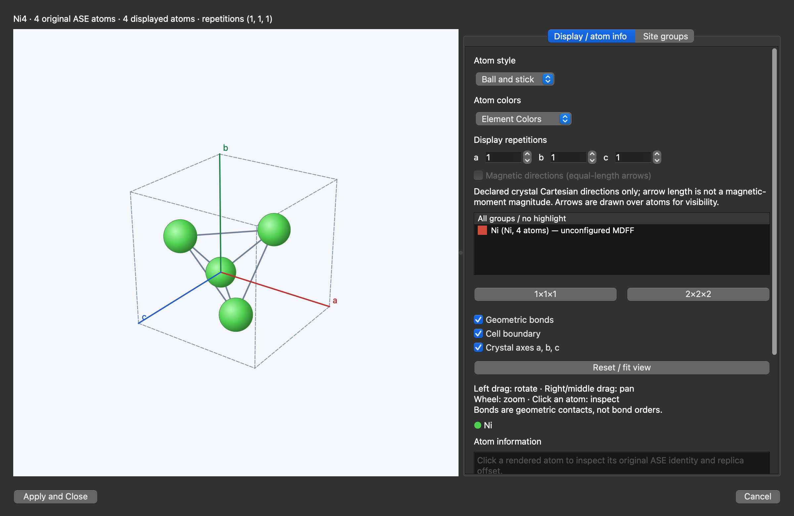
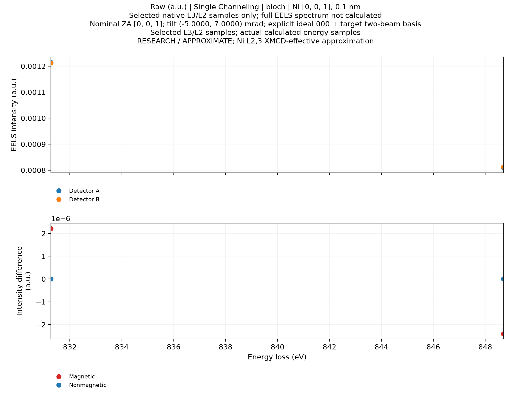

# Install EMCD-Sim on an Apple Silicon Mac

EMCD-Sim is a desktop application. You do not need programming experience, Terminal, Python, Conda or developer tools to use the packaged app.

Use the published **v0.9.0-beta.1-macos-arm64.1** Research Beta on the [official releases page](https://github.com/dingpengem/EMCD-Sim/releases/tag/v0.9.0-beta.1-macos-arm64.1). Download the macOS application ZIP from its **Assets** list. Do not download a Windows ZIP or GitHub's **Source code** ZIP as a Mac application. After installing, follow the [normal Ni spectrum + 97×97 momentum-map Quick Start](QUICK_START_MACOS.md). The smaller two-energy example below is retained only as an optional packaged diagnostic.

## 1. Check your Mac

1. Click the **Apple menu  → About This Mac**.
2. Check **Chip**. It must say **Apple M…**, such as Apple M1, M2, M3 or M4. This package is for Apple Silicon, not Intel Macs.
3. Check your macOS version. The candidate requires **macOS 15 or later**. Native testing has been performed on an **Apple M2 Pro with 16 GB memory, running macOS 26.3.1**. Other models and macOS versions have not all been tested.

Research Beta means that the app is still being evaluated. The example below demonstrates operation; it does not establish scientific convergence or quantitative calibration.

## 2. Download and install using Finder

For the published macOS ARM64 Research Beta:

1. Open the [official releases page](https://github.com/dingpengem/EMCD-Sim/releases) in Safari or your usual browser.
2. Find **macOS ARM64 Research Beta**. Expand **Assets** if the download list is collapsed.
3. Download the file ending in **macOS-ARM64.zip**. The published file is `EMCD-Sim-v0.9.0-beta.1-macos-arm64.1-macOS-ARM64.zip`.
4. Open **Finder** by clicking its blue face icon in the Dock. Click **Downloads** in the sidebar.
5. Double-click the ZIP and wait for extraction to finish. Safari may already have extracted it; in that case, open the extracted folder.
6. Find **EMCD-Sim.app**. Finder may show it simply as **EMCD-Sim** with an application icon. Keep the entire application together.
7. Drag **EMCD-Sim.app** onto **Applications** in Finder's sidebar. Follow any normal Finder permission prompt. If your account cannot install there, keep the complete app in a folder you own and open it there.
8. Open **Applications**, then double-click **EMCD-Sim**. Keep the downloaded README and license notices for reference.

Do not open the app from a browser's ZIP preview. You can keep the ZIP as a backup. Store projects in **Documents**, not inside the application.

## 3. First launch and troubleshooting

**Signing status: ad-hoc signed; not Apple notarized.** It is not Developer ID signed. A successful local launch does not prove an Internet-downloaded copy will pass macOS security checks. This Research Beta may be blocked on first launch; if so, stop and report the alert as described below. A normal, security-override-free launch from an Internet download is not guaranteed.

| What you see | What to do |
|---|---|
| A normal confirmation that the app was downloaded from the Internet | Check that you obtained it from the official release page. Click **Open** if macOS offers the normal confirmation. |
| “Developer cannot be verified,” “Apple cannot check…,” or another security block | Stop and report the exact alert on the [project's issue page](https://github.com/dingpengem/EMCD-Sim/issues). The current signing status can cause this. No security override is part of these instructions. |
| “Damaged,” “will damage your computer,” or a malware warning | Do not continue opening that copy. Follow the alert and report it. A fresh official download may help with an incomplete download, but do not assume a security warning is harmless. |
| A Dock icon but no visible window | Allow the first launch time to prepare its fonts. Click the Dock icon, check the app's **Window** menu and look behind other windows. If needed, quit and reopen once. |
| The app cannot run on this Mac | Recheck **About This Mac**, the ARM64 download and the macOS requirement. Intel Macs are not supported by this package. |
| Controls or labels seem missing | Enlarge the window, expand the section's disclosure arrow and scroll inside Settings. A toolbar's **»** button may hold additional actions. |
| A request to access Documents or Downloads | Allow access to a location you want to use for inputs, projects or exports, or choose another accessible location. Full Disk Access is not a normal requirement. |

See Apple's [Safely open apps on your Mac](https://support.apple.com/en-us/102445) for explanations of launch alerts. These instructions do not require changing Gatekeeper settings or removing download protection.

When reporting a problem, include a screenshot of the alert, your chip and macOS version from **About This Mac**, and the downloaded filename. Avoid including private scientific data.

## 4. Copy the two example files with Finder

The current bundle stores examples inside the app. **Copy** them to Documents without changing the application:

1. In Finder, open **Documents**. Choose **File → New Folder** and name it **EMCD-Sim Examples**.
2. Return to **Applications**. Control-click **EMCD-Sim** and choose **Show Package Contents**. This is a Finder viewing action, not a security override.
3. Open **Contents → Resources → examples**.
4. Select **Ni_FCC_a3.52.cif**. Choose **Edit → Copy**, return to **Documents → EMCD-Sim Examples**, and choose **Edit → Paste Item**.
5. Return to the app's **Contents → Resources**, then open **data → wien2k_ni**. Copy **Ni_fm.xmcd** into the same Documents folder using **Copy** and **Paste Item**.
6. Close the package-contents window. Leave the original files inside the app untouched. Use your Documents copies below.

The CIF file describes the crystal's atoms and cell. The XMCD file supplies the example magnetic spectroscopy input.

## 5. Optional minimal packaged Ni diagnostic

**This is a minimal software-check example, not the recommended normal Quick Start.** For sampled spectra and 97×97 momentum maps, use the [normal macOS Quick Start](QUICK_START_MACOS.md). The minimal recipe below matches **Ni_global_BW_single**, which passed packaged-app acceptance including export. It deliberately computes only two energies on a 9×9 grid and uses a 0.1 nm thickness to check basic functionality.

### Open the crystal

1. Open EMCD-Sim and choose **File → New Project**. Save any existing unsaved work first.
2. Expand **Material** in Settings. Click **Open CIF…**, browse to **Documents → EMCD-Sim Examples**, select **Ni_FCC_a3.52.cif**, then click **Open**.
3. Click **Inspect structure…**. Check for **four Ni atoms** and a cubic cell of **3.520 Å**. Close the information window.
4. Click **3D Structure Viewer…**. The four green atoms should resemble this captured Mac example:

The screenshot shows the initial unconfigured state. **Site groups** is the tab at the upper right.

### Set the magnetic model

1. In the Viewer, select **Site groups**, then **Global Magnetization Mode**.
2. Enter `0 0 1` in **Global Material M (x y z)**: three numbers separated by spaces.
3. Click **Configure MDFF…**. MDFF is the model used for the inelastic scattering calculation. Check that the context says **Global Material configuration**.
4. Choose **XMCD-constrained MDFF**. Click **Browse XMCD…** and open your Documents copy of **Ni_fm.xmcd**.
5. Click **Validate source / native features**. Confirm **L3 = 831.271 eV**, **L2 = 848.698 eV**, **eta = 1** and **beta = 1**. These selections belong to this particular file.
6. Complete the example declarations below. Review them before checking the convention acknowledgement.

| Field | Example value |
|---|---|
| Declared source element | `Ni` |
| Declared core-loss edge | `L2,3` |
| Source / provenance | `Ni_fm.xmcd; supplied five-column Ni source` |
| Physical assumptions / limits | `Effective axisymmetric XMCD-derived Ni diagnostic; not quantitatively calibrated` |
| Relative tensor reference | `1` |
| Scientific status | `physical_source_unvalidated` |
| Convention acknowledgement | Check **I declare M axis, RP/LP convention and edge assignments** for this supplied example. |

7. Click **Done**. You should return to the 3D Viewer. Then click the Viewer's **Apply and Close** to accept the complete configuration. Closing only the MDFF window does not complete this step.

### Enter the small calculation settings

Expand the named Settings sections. Click inside a number field to replace its value. Keep these settings together; choosing a sampling preset afterward can change them.

| Section | Setting | Value |
|---|---|---|
| Material | Elastic scattering provider | **Adaptive Dirac-Pade 2026 (default; neutral Z=1-118)** |
| Material | Debye–Waller B | `0` |
| Microscope & Sample | Voltage; thickness | `200` kV; `0.1` nm |
| Zone Axis & Diffraction → Orientation / ZA options | Nominal zone; target reflection | `0 0 1`; `2 0 0` |
| Same orientation controls | Diffraction basis | **Ideal 000 + target**, then **Apply orientation / target** |
| Zone Axis & Diffraction | Tilt X; Tilt Y | `−5`; `7` mrad |
| Propagation Method | Channeling; propagation | **Single Channeling**; **Bloch-wave** |
| Propagation Method | Explicit target systematic-row approximation | Unchecked |
| Shared Calculation Settings | Numerical Settings | **General settings (editable)** |
| Elastic Potential and Beam Support | Beam / MDFF cutoff; potential cutoff | `0.6`; `1.2` Å⁻¹ |
| Inelastic and Angular Sampling | Angular / detector grid points; depth nodes | `9`; `3` |
| Same sampling section | Aperture boundary subpixels; map halfwidth | `4`; `0.7` Å⁻¹ |
| Same sampling section | Energy sampling | **Selected energies only** |
| Same sampling section | Full angular maps at selected energies | Checked; leave the all-energy advanced field off |
| Compute Resources | CPU workers | **Manual**, requested workers `1` |
| Compute Resources | Memory budget | **Manual**, requested budget `2048` MiB |
| Virtual Detectors | A qx; A qy; B qx; B qy | `0.2`; `0.2`; `0.2`; `−0.2` Å⁻¹ |
| Virtual Detectors | Radius | `0.12` Å⁻¹ |

Leave post-edge correction off. FFT-specific settings do not affect this Bloch-wave example. A **Custom – 9×9** caption is expected. Do not click **Restore Thales A/B** for this recipe: it would change the detector positions above.

### Run and recognize success

1. Check **Compute Resources → Admission**. It should say **Ready**. If resources are insufficient, close other large applications and read the explanation; do not increase the budget just to dismiss the warning.
2. Click **Run EMCD / EELS**. **Preview diffraction** is a separate, optional calculation.
3. Wait for completion, then open **EMCD Angular Maps** and **Virtual Detector EELS** in Results. Expand a collapsed view or enlarge the window if needed.
4. Expect two selected energy samples near **831.271** and **848.698 eV**, rather than a continuous spectrum. This is intentional. The exported example below shows the verified result; display options can change its appearance.

If Run is unavailable, check that you used both **Done** and **Apply and Close**, and read the admission or MDFF explanation. Do not substitute another spectroscopy file to clear a validation message.

## 6. Save, reopen and export

1. Choose **File → Save As…**. Select **Documents**, name the project **My First Ni Calculation**, then save. Projects are folders: keep each entire project folder together.
2. Choose **File → Close Project**, then **File → Open Project…** and select the saved project folder. Saved results should return without another calculation.
3. For numerical files, use **Results → Export Results…** or **Output Settings → Export completed EMCD / EELS…** and choose a new folder in Documents.
4. For a picture, open the result view's **Display details / diagnostics / export** section and its **Export Figure…** action. Check the toolbar's **»** overflow if hidden. Choose PNG for an ordinary image or SVG for a vector figure.
5. If a later run triggers a retention prompt, choose **Keep as New Calculation** to preserve the earlier calculation.

## 7. Auto CPU and memory for later work

For everyday use, **Compute Resources → CPU workers → Auto** and **Memory budget → Auto** let the app choose resources for your request. The detected chip, core counts and RAM come from your Mac. Auto values can change with the calculation and available memory.

**Effective budget** is the allowed process memory; **Estimated peak memory** predicts the current request's use. **Pending** means configuration needs more information: read the reason. **Insufficient resources** means the request cannot currently be admitted.

At Run, memory is checked again and changes from the preview are reported. Manual values are retained when switching to Auto. The Quick Start uses Manual 1 / 2048 MiB to match its recorded case; try Auto afterward as a separate run.

To stop a calculation, click **Cancel** and wait for stopping to finish before starting another. Earlier completed results should remain available.

## Validation scope and known limits

The Quick Start settings and result image come from the previously completed native Mac packaged case **Ni_global_BW_single**. Its saved settings, export and expected two-energy output were checked when preparing this guide. The Viewer image is also an actual native Mac capture. No Finder installation or security-alert screenshot has been fabricated.

The Compute Resources controls were separately checked on the `d528b98` application source. The final release's packaged checks and source identity are reported on its release page. Human download → Finder installation → Quick Start acceptance, trackpad/GUI inspection and authentic matched Windows numerical comparisons remain incomplete. Compact windows can still clip some diffraction titles; enlarge the window and report inaccessible controls.

See [MDFF workflows](MDFF_WORKFLOWS.md) and the [User Guide](USER_GUIDE.md) for scientific explanations. Some shared tutorials have Windows installation paths; use the Mac instructions above instead. See [Mac acceptance](https://github.com/dingpengem/EMCD-Sim/blob/v0.9.0-beta.1-macos-arm64.1/docs/MACOS_ACCEPTANCE.md), the [macOS release notes](https://github.com/dingpengem/EMCD-Sim/blob/v0.9.0-beta.1-macos-arm64.1/docs/RELEASE_NOTES_MACOS_ARM64_1.md) and the release page's attached acceptance report for validation details.
