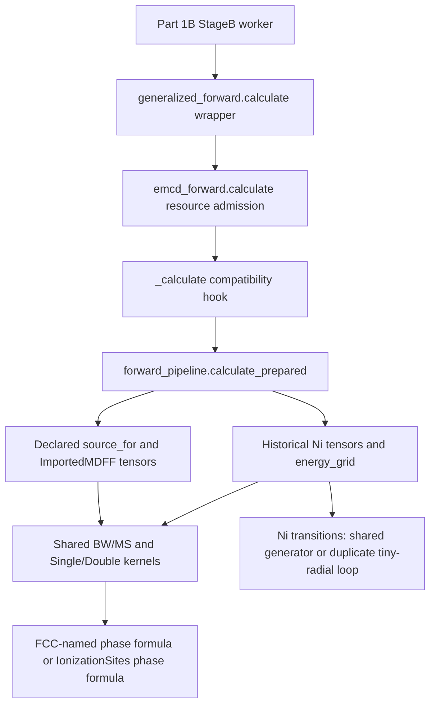
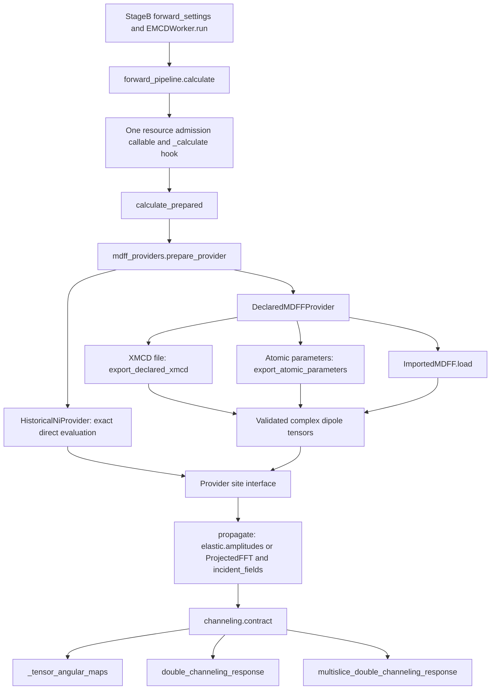

# v0.8.1 Part 1C local acceptance ? 2026-11-04

**PART 1C LOCAL ACCEPTANCE: GO.** Local source, isolated merge, fresh extracted Windows EXE,
protected numerical controls, packaging and original-root synchronization passed. Nothing was
pushed, tagged or published; version remains `0.8.1b1` / `v0.8.1-beta.1`.

## Source and recovery identities

| Role | Path / branch | Commit |
| --- | --- | --- |
| Accepted Part 1B scientific source | Historical reference | `98570c62cc205fa82f855a4033a4d683faf80837` |
| Root/main at recovery | `C:/Users/peng863/EMCD-Sim`, main | `133c3da6e69d633b0e1ea61a4de8005820885bbb` |
| Feature and former regression checkout | `build/v081-part1c-refactor`, feat/v081-part1c-refactor | `451a1f083346c951e8057f7656b7c35f27e9e306` |
| Separate module cleanup/corrected adapters | `build/v081-part1c-module-retirement`, detached | `451a1f083346c951e8057f7656b7c35f27e9e306` |
| Normal --no-ff integration / candidate source | `build/v081-part1c-main-integration`, integration/v081-part1c-main | `cdd5dc3efa43e4f3874e011aa1cfc98f80cf46dd` |

The former full run tested `2e8c7d71bb890b4144f573d4d446a2a290f9a5b5`, not the later corrected
checkout. It completed **787 passed / 54 skipped / 10 failed**, and was never represented
as acceptance. No test process was active when this continuation recovered state. Existing
runs, logs, commits and intermediate artifacts were preserved. Four small feature commits
performed atomic/site consolidation, provider preparation, obsolete-module retirement and
naming migration; no implementation was restarted.

The final report is committed as a documentation-only child of the scientific merge. The
merge above is the exact EXE build source; later documentation does not change the 176
verified source/test/packaging identities. Final main HEAD is recorded in the delivery
message rather than embedded recursively in its own commit.

## Before and after architecture

Part 1B already shared propagation/contraction kernels and one orchestration. Its remaining
duplication was the reachable historical tiny-radial atomic event loop, Single site-phase
arithmetic, legacy/declared preparation dispatch and misleading numerical aliases.

`forward_pipeline.calculate`, `generalized_forward.calculate` and the maintained
`emcd_forward.calculate` entry are aliases of the same callable, not parallel orchestration.
All three MDFF choices use common preparation and the same response kernels. The menu is
identical for Ni/Fe/Co/Cr. Undeclared historical Ni settings select a named numerical
compatibility adapter; declared Ni and non-Ni sources use the same validation interface.
The XMCD file path remains the primary external XMCD input. Source checksum, convention,
frame, element/edge, explicit reversal and stale-generation checks remain active.

### Eliminated implementations and names

- One shared `atomic_ionization.transitions_for_material` event loop replaces the entire
  duplicate `_historical_ni_local_transitions`. Its explicit `historical_drop` policy keeps
  old tiny-amplitude omission; strict declared generation still rejects unsupported scales.
- `atomic_dipole` owns unchanged angular/radial algebra; generic `dipole_2p_to_3d` replaces
  the misleading `ni_2p_to_3d_dipole` API. Event order, complex amplitudes, weights,
  magnetization reversal, broadening and Ni provenance are preserved.
- `ionization_sites.single_site_phase_matrix` is the single Single Channeling phase formula.
  The old `fcc_site_phase_matrix` name is removed; the remaining genuine historical Ni gate
  is named `historical_ni_site_phase_matrix`. Double `equivalent_site_phases` is unchanged.
- `ProjectedNiFFT` is removed; maintained callers use the existing generic `ProjectedFFT`.
  No second FFT implementation was created. The response changes only its class binding.
- `ni_local_mdff.py` is removed completely, not hidden behind an import shim. Ni defaults,
  metadata and direct-evaluation compatibility live in `historical_ni`; no duplicate
  transition enumeration lives there. The intermediate `gui/legacy_ni_provider.py` was
  also removed during development and is absent from the final tree.
- Generic magnetic-axis construction lives in `mdff_orientation`. Four old forward
  functions are direct aliases rather than wrapper implementations.

The old `emcd_sim.ni_local_mdff` import/module-run path and the three obsolete numerical
aliases are intentionally discontinued. The documented `emcd-ni-local-mdff` console
command remains supported through `emcd_sim.historical_ni:main` with the same inputs and
scientific output. Maintained tests/scripts and archived-source import bindings were
migrated. Original archived numerical statements and fixture data remain independent.

See [the full module/symbol retirement audit](PART1C_MODULE_RETIREMENT.md). Genuine Ni
configurations, coefficients, crystal factories, benchmark data and independent Ni FFT
reference functions retain truthful Ni names. The old Ni [017]/[117] production geometry
modules were already absent from Part 1B; their removal is not claimed as new Part 1C work.

## Source changes

| Production file | Change |
| --- | --- |
| `src/emcd_sim/atomic_dipole.py` | Added |
| `src/emcd_sim/atomic_ionization.py` | Modified |
| `src/emcd_sim/generalized_xmcd.py` | Modified |
| `src/emcd_sim/gui/channeling.py` | Modified |
| `src/emcd_sim/gui/emcd_forward.py` | Modified |
| `src/emcd_sim/gui/forward_pipeline.py` | Modified |
| `src/emcd_sim/gui/generalized_forward.py` | Modified |
| `src/emcd_sim/gui/project_io.py` | Modified |
| `src/emcd_sim/gui/provider_preparation.py` | Added |
| `src/emcd_sim/gui/stage_b.py` | Modified |
| `src/emcd_sim/historical_ni.py` | Added |
| `src/emcd_sim/ionization_sites.py` | Modified |
| `src/emcd_sim/mdff_orientation.py` | Added |
| `src/emcd_sim/mdff_providers.py` | Modified |
| `src/emcd_sim/multislice_double_channeling.py` | Modified |
| `src/emcd_sim/ni_local_mdff.py` | Removed |
| `src/emcd_sim/single_channeling_tensor.py` | Modified |

Additional changes are maintained script/test imports and reference adapters, the supported
CLI target and developer documentation. The only added fixture is the additive Part 1C
source-identity manifest; historical reference manifests, arrays, datasets, images and
scientific defaults were not rewritten. The immutable AST/file review passed 23 checks:
Single contraction, BW response/contraction/phases, FFT class/stepping/incoming/event
amplitudes, direct historical grids/tensors, axis frame and Ni parameters remain unchanged.
MS response differs only by direct generic class binding. Corrected Born/MDFF conjugation,
Coulomb factors, depth integration and elastic defaults are unchanged. The shared
physical contraction remains `I(E) = Re Tr[R(E) T(E)]`, with the accepted Born/MDFF
index and conjugation convention.

## Failed-run recovery and coverage

| Former failure group | Count | Correction |
| --- | --- | --- |
| Archived cancellation solvers reject new site argument | 3 | Test adapter certifies original Ni positions, then removes only the new argument for the independent archived API |
| Zero-signal injection hits old forward hook | 1 | Inject into the provider tensor interface; retain original zero-signal and NaN assertions |
| Tensor-reuse instrumentation hits old hook | 1 | Instrument actual historical provider evaluation; retain one-preparation and exact BW assertions |
| Archived full Ni contraction rejects site argument | 4 | Certify historical site identity and adapt call boundary; keep all original bitwise array assertions |
| AST guard expects former function location | 1 | Compare relocated bodies against original AST, with only the explicit local import accounted for |

All ten passed in the 45-check frozen focused run and the complete final suite. No archived
solver was replaced by production calls, no numerical tolerance/reference array was updated,
and no scientific test was deleted. Naming-related loader corrections bind imports only.

The 54 versus 39 skips were fully investigated: 13 required the external legacy table,
one the genuine historical Ni project and one the saved 160-array unit comparison. Their
existing inputs were recovered and SHA256-pinned, without copying the unlicensed table into
Git. Restoring three environment variables recovered all 15 tests. All **818 Part 1B cases
remain**, **35 checks were added**, and the **39 skipped test identities exactly match
Part 1B**. There is no lost baseline test coverage.

| Final validation | Result |
| --- | --- |
| Frozen focused revision | 45 passed; zero failures |
| Full Windows source suite, exact frozen `451a1f0` | **814 passed, 39 skipped, zero failed/errors; exit 0** |
| Source identity through merge | 176 canonical source/test/packaging identities matched |
| Post-merge checks, exact `cdd5dc3efa43e4f3874e011aa1cfc98f80cf46dd` | 46 passed, 1 optional fixture skipped; zero failed/errors; exit 0 |
| Native extracted EXE | 14/14 real workflows; frozen=true; native windows Qt; exit 0 |
| Ordinary GUI startup/default diffraction/shutdown | PASS; exit 0; screenshot visually inspected |

The post-merge optional skip is the same unavailable legacy project fixture covered by the
baseline skips; the separately configured genuine historical Lobato project passed. Full
logs/XML, including the earlier failed/sandbox-limited attempts, remain under the Part 1C
worktrees. Warnings are retained in the logs; no warning/failure suppression or artificial
success exit was used.

### Final full-suite skip reasons

| Existing optional evidence unavailable | Count |
| --- | --- |
| Optional stored GUI reference | 1 |
| Saved project fixture unavailable | 3 |
| Full benchmark outputs are not complete | 3 |
| Optional saved angular references unavailable | 6 |
| Full checkpointed thickness calculation still incomplete | 3 |
| Local legacy reference project unavailable | 1 |
| Saved BW/MS fixture not available; never run a fallback simulation | 1 |
| Optional GUI and existing real Stage D results required | 8 |
| Optional saved benchmark unavailable | 1 |
| Requires original local WIEN2k audit companions; not distributed | 1 |
| Optional local WIEN2k companion audit; original files are not distributed with the package | 1 |
| Local four-point benchmark not generated | 2 |
| Local MS validation outputs not generated | 3 |
| Optional saved result fixture unavailable | 1 |
| Optional real saved Ni project unavailable | 1 |
| Optional saved GUI reference unavailable | 1 |
| Pinned offline HDF5 inputs unavailable | 1 |
| Optional historical saved project is unavailable | 1 |

## Numerical compatibility and native workflows

| Comparison of actual new EXE output | Arrays bitwise equal | Maximum absolute difference |
| --- | --- | --- |
| Original Part 1 release controls, 8 cases | 1,080 / 1,080 | 0 |
| Accepted Part 1B controls, 14 cases | 1,758 / 1,758 | 0 |
| Saved Part 1C source controls, 14 cases | 1,758 / 1,758 | 0 |

The reusable source controls were generated at `75845f9db063b8fcadc49a0fba38f0d7805479fe`
before the final naming-only retirement. They are not relabeled as final-source execution:
the complete final source suite ran at `451a1f0`, and the actual EXE was rebuilt from the
exact merge `cdd5dc3efa43e4f3874e011aa1cfc98f80cf46dd`. Direct comparisons against immutable Part 1 and Part 1B controls
independently establish final native numerical compatibility.

| Actual frozen workflow | Coverage | Propagation | Result |
| --- | --- | --- | --- |
| Ni_xmcd_single | edges | BW + MS | PASS |
| Ni_xmcd_double | edges | BW + MS | PASS |
| Ni_ni-atomic_single | edges | BW + MS | PASS |
| Ni_ni-atomic_double | edges | BW + MS | PASS |
| Fe_imported_single | edges | BW + MS | PASS |
| Fe_imported_double | edges | BW + MS | PASS |
| Fe_atomic_single | edges | BW + MS | PASS |
| Fe_atomic_double | edges | BW + MS | PASS |
| Fe_declared-xmcd_single | edges | BW + MS | PASS |
| Fe_declared-xmcd_double | edges | BW + MS | PASS |
| O_declared-xmcd_single | edges | BW + MS | PASS |
| O_declared-xmcd_double | edges | BW + MS | PASS |
| O_declared-xmcd_single | full | BW + MS | PASS |
| O_declared-xmcd_double | full | BW + MS | PASS |

The EXE additionally checked genuine historical Lobato project loading/archived elastic
control, project save/reopen, nonmagnetic import, wrong-element eligibility, changed checksum,
partial atomic provenance rejection, failed generation clearing stale GUI state, exports
and correct K labels. Source Python/Conda paths and external-table configuration were
removed, with PATH restricted to Windows directories. No EXE process remained afterward.

These are selected consistency controls, not broad convergence: the Fe Single/Double
BW/MS relative differences are approximately **0.064% / 0.128%**, unchanged from Part 1B.
Ni controls are approximately 0.033% / 0.066%. Synthetic Fe and O K datasets are software
research demonstrations, not physically validated material predictions.

## Windows package, SHA256 and redistribution

Fresh candidate (relative to the original repository root):

`build/v081-part1c-main-integration/build/windows-v081b1-part1c/EMCD-Sim-v0.8.1-beta.1-Windows.zip`

- ZIP bytes: **108736655**.
- ZIP SHA256: `6f43834b138089cbade14c39374da5b38b128c95ad075ba2d732d1f1cf23de23`.
- EXE SHA256: `69c0869379c590839909275876de9df9bba6ee761a88171bfa16abe63e266886`.
- Manifest SHA256: `f588c0dc713704cf355374b30ab4afb64ccfb7579d768310e77d3a39e14d8bdd`.
- **614 files** checked against manifest and per-file SHA256, including no unexpected files.
- **71 runtime-source identities**, **17 third-party license groups**, ASE CIF data and
  synthetic atomic example checked; coefficient subset has all 118 elements.
- Apache-2.0 coefficient LICENSE/NOTICE are byte-identical to source. MIT Ni example
  remains the tracked dataset. The unlicensed legacy table remains external and is not
  bundled; no permission is inferred to redistribute it. Upstream raw HDF5 is not bundled.
- Version stays `0.8.1b1`; Windows file/product versions remain `0.8.1.1` / `v0.8.1-beta.1`.
- Accepted Part 1B ZIP remains unchanged at SHA256
  `292421848efbfb0464fa3d61b342c4360c7e834f2c0e9804bbe81ce4dd0003e8`.

## Original-root synchronization and preservation

Original root is on **main**, advanced normally through the accepted integration. Its
tracked source is clean and all **71 runtime source files** match the accepted EXE source
under the repository's UTF-8/LF canonical comparison. Eleven unchanged files retain LF in
the old root versus CRLF in the fresh checkout; no numerical/source-content differences
exist and no manual source copying/normalization was performed.

All **18 existing untracked user files** remain byte-for-byte unchanged; they intentionally
remain visible to git status, so root tracked cleanliness is distinguished from a completely
empty porcelain status. The tracked XMCD SHA256 remains `bb9bdd478d54cc8de60403409f4d90e63deb11a64891bbac6754f867be14deda`;
existing stash references, other historical branch tips, worktrees, outputs and earlier
release artifacts are preserved. No reset-hard, forced checkout, clean, source-file copying,
push, tag or publication was used. The independent integration worktree is clean.

## Scientific limits and remaining technical debt

Numerical compatibility, selected BW/MS consistency, quantitative physical accuracy and
Windows application functionality are separate claims. This acceptance establishes the
first, selected controls for the second, and same-host functionality for the fourth.
It does **not** establish quantitative experimental accuracy or broad convergence.

- Atomic ionization remains approximate independent-electron cubic 2p-to-3d L2,3, with
  declared radial/occupation/exchange inputs, local axis convention and rigid rotations.
  It is not arbitrary-edge, general-symmetry, full DFT or multiplet spectroscopy.
- XMCD remains an effective tensor approximation; imported tensor provenance/PSD do not
  certify physical material accuracy. Shared propagation is element-independent with valid
  crystal/sites/tensor, not globally restricted to 3d elements.
- Single-element, supported equivalent sites only; no multi-element/site-resolved,
  inequivalent-site, AFM/SDW or complex magnetic model was introduced.
- Approximately **1.6% detector-refinement sensitivity** remains documented. Finite ZOLZ,
  projected neutral IAM and relative-intensity/uncalibrated-cross-section limits remain.
- Historical direct energy evaluation and validation policies remain explicit because
  replacing them by imported-grid interpolation has not been proven exactly equivalent.
  The common settings/project schema retains unused historical fields, identified in
  declared-provider metadata; future schema simplification needs its own migration gates.
- Independent Ni benchmark/reference implementations remain deliberately separate from
  production. Thin public/resource-admission hooks remain where maintained callers use them.
- Native checks are same-host Windows, not clean-PC/VM or Linux/macOS certification.

There are **no outstanding essential Part 1C local-acceptance blockers**. Publication,
release tagging and any further material-accuracy/convergence work remain separate tasks.

Detailed machine-readable results and evidence hashes:
[LOCAL_ACCEPTANCE.json](acceptance/unified-mdff-part1c-2026-11-04/LOCAL_ACCEPTANCE.json).
