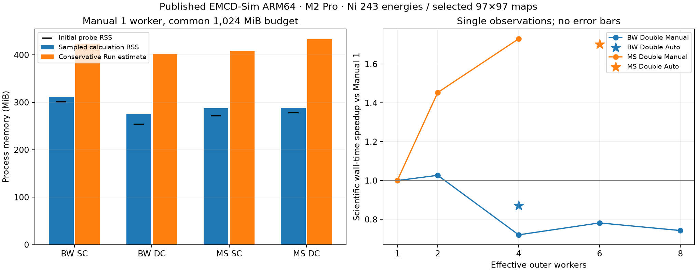

# Native macOS Single/Double Channeling resource benchmark

11 November 2026 · [Compact evidence](benchmarks/macos-sc-dc-20261111/README.md) · [External reproduction tools](../tools/benchmarks)

**The four full one-worker baselines PASS.** There are **14 completed full cases**, including the four baselines, meaningful Manual scaling and separate Auto runs. These are measurements of the unchanged published ARM64 app, not a development build. Accepted comparisons use 243 real energies and selected 97×97 maps. Direct Windows numerical/timing comparison is **INCOMPLETE** because the specified branch, commit and report were unavailable. This is automated native Qt benchmarking, not human GUI acceptance.

## Source, runtime and comparison contract

Published app: **v0.9.0-beta.1-macos-arm64.1**, source **`03dc8f8d1f0374984c9fc81866eaa32ce48008d0`**, clean embedded identity; bundle `org.emcd-sim.desktop`, build `0.9.0.2`, native Mach-O ARM64. ZIP size **68,956,384 bytes**, SHA256 **`1d791f8c2bdce2abee5456f91ffad08013b9dbb847b9ef4a5279ae5d336ac6bc`**. The scientific implementation and app were not changed or rebuilt. This benchmark branch starts at that exact release source; later unrelated main changes are not substituted.

Hardware verified locally: **Apple M2 Pro / Mac14,9, 10 logical cores (6 performance + 4 efficiency), 16 GiB unified memory**. OS **macOS 26.3.1, build 25D2128**. Published Python 3.11.16, NumPy 2.4.6, SciPy 1.17.1 and PySide6 6.12.0. NumPy `_multiarray_umath` and SciPy `_fblas`/`_flapack` Mach-O dependencies point to **Apple Accelerate**, also confirmed by packaged runtime introspection. Both production calculation-thread and detector-thread guards set, verify and restore **single-thread BLAS mode**. GUI-thread default mode is Automatic, so the default API report is not a fixed thread count and does not mean uncontrolled calculation BLAS.

The exact common configuration is in [benchmark_results.json](benchmarks/macos-sc-dc-20261111/benchmark_results.json), identifier `ni-fcc-3p520-017-200kV-10nm-e243-q97-d64-b2p5-p2p0`. This is an explicit comparison key for this dataset, not a claim that an unavailable Windows report used that identifier.

| Shared input | Value |
| --- | --- |
| Material / source | Bundled `Ni_FCC_a3.52.cif`, FCC Ni, four atoms, 3.520 Å; bundled `Ni_fm.xmcd` |
| MDFF | Global M=(0,0,1), XMCD; eta=beta=1; L3=831.271 eV, L2=848.698 eV; relative tensor reference 1; `physical_source_unvalidated` |
| Geometry | 200 kV, 10 nm; zone [017], target (200), full finite ZOLZ; tilt (−7.124812628, 0) mrad |
| Elastic | Adaptive Dirac–Padé 2026; beam cutoff 2.5 Å⁻¹, potential cutoff 2.0 Å⁻¹, B=0; 21 common beams |
| Integration / detectors | 64 depth nodes; 64 aperture boundary subpixels; Thales A/B centres (0.2840909090909091, ±0.2840909090909091) Å⁻¹; radius 0.09 Å⁻¹ |
| Energy | 241 uniform points over 823.625–882.521 eV plus the two exact selected features = 243 unique energies |
| Momentum | Physical q grid 97×97 over ±1 Å⁻¹; spacing 1/48 Å⁻¹; full maps only at L3/L2; other 241 energies use the same 162 detector-support pixels |
| FFT MS | Existing supported 32×32 FFT mesh; projected generators (200), (1,7,−1); requested maximum slice step 2.0 nm |
| Actual depth / split schedule | z_i=10i/63 nm, i=0…63; trapezoid endpoint weights 5/63 nm, interior 10/63 nm; one split substep per interval, actual step 10/63=0.15873015873015872 nm, 63 forward steps; outgoing adjoints traverse the same depth schedule in reverse |
| Experimental variables | Propagation backend, channeling model and separately requested resource modes/workers; no systematic-row approximation or post-edge correction |

The CIF SHA256 is `ad8372ef427a95957a6182d5a7b7f5aaea5899e1464eb0afa8e540ff2f47d67d`; XMCD SHA256 is `bb9bdd478d54cc8de60403409f4d90e63deb11a64891bbac6754f867be14deda`. Every case is checked against the same inputs/settings. FFT mesh, physical angular grid, depth nodes and aperture subpixels are separate controls.

**Scientific limits retained:** potential cutoff 2.0 Å⁻¹ excludes the first off-row ZOLZ potential harmonic (~2.029 Å⁻¹), although Full finite ZOLZ is the selected basis. Actual MS step 0.1587 nm exceeds the app's advisory 0.04 nm reference. Neither limitation was changed to improve timings or to force BW/MS agreement. This is not convergence certification, quantitative calibration or experimental energy resolution.

## Measurement method and corrected harness

Each accepted case launches a fresh instance of the exact published app in its own workspace. The already accepted Ni project supplies the common declared inputs. Initial runs opened it without saving to it; the final controller opens a dedicated copy for additional isolation. All writes use new benchmark output/project folders, and the original seed manifest remains unchanged. Resource/backend controls are changed through native Qt widgets, then the normal Run entry point starts the production calculation. File actions save, close and reopen a new local project. No accepted-state injection is represented as a new MDFF user-acceptance test; the earlier raw-input transaction is separate. All completed energy diagnostics assert no checkpoint reuse.

An external ARM64 dylib schedules the controller and starts a native pthread probe; it is not installed inside the app. No scientific function, numerical result, runtime library or admission policy is patched. Only personal UI preference writes are suppressed. The GUI remains active under a native `QEventLoop`.

Two measurement problems were found and corrected **in the external harness**:

1. `proc_pid_rusage` CPU counters on this ARM64 system are Mach absolute ticks. `mach_timebase_info` gives 125/3 ns per tick. Calibration agrees with `getrusage`: 0.200258 s versus 0.200537 s. The committed harness queries the timebase rather than assuming the ratio on other machines.
2. Repeated `QtTest.qWait` held up Python worker execution. In a 0.5 s check, the worker received ~0.167 s CPU under qWait and ~0.483 s under a normal Qt event loop. Those initial trials are excluded from performance comparisons. BW Single changed from 98.548 s under the throttled controller to 1.365 s under the corrected controller, with all 24 saved arrays **bit-for-bit identical**. They are also identical to the accepted published-app Quick Start exports. **The earlier 93.4 s Quick Start timing is an instrumented workflow observation, not a valid scientific performance baseline.** No application speedup is claimed.

The native probe samples RSS, physical footprint and aggregate user/system CPU at a 20 ms target interval, independently of Python's GIL. Calculation duration is the app's scientific-worker metadata, excluding startup, display and project saving. The calculation-window sample selection uses a direct worker-result timestamp minus that duration; reconstructed start offsets agree with Run admission/start within a few milliseconds in the primary baselines. Signal and sampling latency still limit boundary precision. A separate Run/display window includes admission and result display. Native lifetime RSS high-water values include startup/configuration and can exceed both sampled windows.

Estimates are captured before Run and again at finalized admission. A sampled peak can miss short allocations and is not a guaranteed instantaneous maximum. Physical footprint includes charged/compressed memory and is not interchangeable with resident RSS. Fresh processes reduce accumulated caches but do not produce identical RSS baselines; memory pressure/compression and restored result/view state remain relevant. Negative measured increments are retained, not clamped into invented allocations.

## Controlled one-worker baseline

All four use **Manual 1 worker and the same Manual 1,024 MiB budget**. That budget is a cap, not a 1 GiB reservation: finalized estimates also had to pass the current RAM safety limit. No budget or sampling was silently adjusted.

| Backend | Workers | Memory Estimate at Run | Actual sampled calculation-window peak RSS | Calculation Time | Status |
| --- | ---: | ---: | ---: | ---: | --- |
| BW Single | 1 | 423.9 MiB | 311.2 MiB | 1.365 s | PASS |
| BW Double | 1 | 401.6 MiB | 275.2 MiB | 14.970 s | PASS |
| FFT MS Single | 1 | 408.3 MiB | 287.2 MiB | 1.279 s | PASS |
| FFT MS Double | 1 | 432.9 MiB | 288.0 MiB | 135.037 s | PASS |

Additional memory scopes, all MiB:

| Backend | Initial probe RSS | Calculation-window increment | Run/display peak RSS | Calculation-window peak footprint | Lifetime high-water RSS |
| --- | ---: | ---: | ---: | ---: | ---: |
| BW Single | 301.1 | 10.1 | 356.5 | 313.8 | 382.3 |
| BW Double | 253.7 | 21.5 | 328.2 | 278.9 | 374.9 |
| FFT MS Single | 271.8 | 15.4 | 352.0 | 331.5 | 380.7 |
| FFT MS Double | 278.4 | 9.6 | 328.0 | 304.0 | 382.4 |

The [CSV/JSON](benchmarks/macos-sc-dc-20261111/README.md) also record preview estimates, exact budgets, sample counts/intervals, before/after pressure/swap and admission/start overhead for every case. The machine reported **Warning** pressure during the primary baselines, about 3 GiB available RAM and roughly 4 GiB swap already in use. Existing swap is not evidence that these small calculations exhausted memory. The workstation was not quiesced into an isolated performance lab; one short harness calibration overlapped the longer MS feasibility/replacement work. Treat timings as single observations, not statistical rankings.

The initial 180 s MS Double feasibility run was explicitly cancelled at energy 202/243 and returned idle at 198.764 s. It remains **INCOMPLETE**, not a completed runtime or a numerical reference. A justified 600 s bound was then used for the successful 135.037 s replacement. No smaller diagnostic replaces the full baseline. Time caps are cancellation-request bounds, not guaranteed hard process deadlines.

## Does Single Channeling actually use more memory?

**A higher whole-process total can occur; this is not evidence that SC intrinsically requires more calculation memory.** In these one-worker runs, BW SC/DC sampled calculation-window RSS ratio is **1.131**, while MS SC/DC is **0.997**. Thus the observed answer depends on backend, baseline and memory definition. These ratios are single measurements, not a universal ordering.

BW began at 301.1 MiB (SC) versus 253.7 MiB (DC), a 47.4 MiB baseline difference. SC's calculation-window increase was **10.1 MiB**, versus **21.5 MiB** for DC. The higher SC total is dominated by its starting resident set. MS increases were **15.4 MiB** (SC) and **9.6 MiB** (DC) with different starting sets; residency changes and process-wide activity prevent interpreting either increment as an isolated live-array ledger. Footprint measurements also sometimes put SC above DC. Allocation-stack attribution of those process/cache/compression differences is **INCOMPLETE**; this report does not claim a proven kernel-level cause from RSS alone.

The estimator's **working-array** bounds instead put DC above SC:

| Estimator term, MiB | BW SC | BW DC, 1 worker | MS SC | MS DC, 1 worker |
| --- | ---: | ---: | ---: | ---: |
| Estimated working arrays | 5.185 | 16.185 | 6.842 | 23.360 |
| SC/DC working-bound ratio | 0.320 | — | 0.293 | — |

Total-process estimates can reverse that ordering because they add the **current process RSS**, which differs between assessments:

`estimated process peak = current RSS + 128 MiB reserve + 1.25 × (working arrays + concurrent reservations)`

For example, BW SC's finalized estimate is 423.9 MiB versus DC's 401.6 MiB even though its working bound is smaller. This follows directly from different admission RSS values (289.4 versus 253.4 MiB), not an imposed SC/DC inequality. Preview, finalized admission and initial native-probe RSS are separate timestamps.

Final estimates exceed the sampled calculation-window RSS by about **113–145 MiB** in the four primary baselines. This is consistent with the explicit 128 MiB process reserve plus allocation margin/baseline differences, not proof that the raw allocation terms are accurate to that amount. All sampled Run/display RSS peaks also remained below the finalized total-process estimates. Large safety reserves can hide imperfect term-by-term predictions; these measurements establish admission headroom for this workload, not a universal upper bound.

## Allocation-path audit

[Estimator](../src/emcd_sim/gui/propagation.py) · [Admission/reservations](../src/emcd_sim/gui/memory_budget.py) · [Production orchestration](../src/emcd_sim/gui/forward_pipeline.py) · [Detector scheduler](../src/emcd_sim/gui/channeling.py)

| Path | Actual allocation/lifetime and estimator treatment |
| --- | --- |
| BW Single | Incoming eigensystem/amplitudes once; depth coherence once. Tensor contraction batches at most 64 q pixels per energy/state. Denominators/MDFF temporaries are batch-sized, not all 243 full angular fields. The model includes dense contraction, depth-coherence temporaries and retained results. |
| BW Double | Shared incoming fields and loss-dependent outgoing reference preparation; query split among detector workers. Numerical depth integration uses depth×(n_in×n_out) fields and at most eight site phases per contraction. It does not allocate the analytic n⁴ integral tensor in this non-systematic-row case. Per-task bounds include output responses/eigensystems/site phases and an 8 MiB native workspace reserve; concurrent scratch scales with effective workers. |
| MS Single | One incoming 32×32 FFT propagation/depth stack, projected common-beam coherence, then the same bounded SC tensor loop. FFT storage is added to the SC bound; outgoing depth stacks are absent. |
| MS Double | Shared incoming FFT/depth stack; outgoing waves streamed in 32-pixel batches through the 64-node reverse depth schedule. Each worker owns FFT/kernel scratch, norm/leakage diagnostics and retained-coefficient gathers. Four equivalent Ni sites are combined through the existing incoherent site-phase weighting; no events are removed. The estimator separates shared storage from concurrent task scratch. |
| Results / scheduling | Both paths retain 243 detector-spectrum samples and only two selected maps. Other energies evaluate 162 supported pixels. Retained arrays are admitted/reserved at the outer layer; DC tasks make their own reservations and release them on join/failure/cancel. Group/multisite alternatives were inspected where shared helpers are used, but this benchmark measures the requested Global Ni path, not a local/group scaling matrix. |

Code-level working bounds explain why an intrinsic SC>DC rule is unjustified. In the Global BW estimator, each worker response is conservatively bounded using the full query size even though the scheduler splits it; this is an intentional overbound, not evidence of that many simultaneously live response pixels. The 8 MiB per-worker native allowance is likewise a reserve, not a measured allocation. BW's diagnostic breakdown contains both `per_worker_scratch` and `concurrent_scratch`; they must not both be summed as additive components. The actual total uses the concurrent term once. DC preparation peak and task scratch are bounded with `max`, while shared retained storage is added. No measured admission failure, missing concurrency factor or demonstrable production double-counting defect was established here. Conservative terms/reserves are not an allocation trace; no artificial correction was made to force DC>SC.

## Worker scaling and CPU observations



Plot generated from the committed measurements. Memory bars use the primary one-worker baselines; Auto stars are separate runs with dynamic budgets. Connecting measured Manual points does not establish a fitted scaling law.

| Backend | Requested / effective | Calculation seconds | Speedup vs Manual 1 | Max overlapping detector tasks | Avg process logical CPUs, calculation window | Status |
| --- | --- | ---: | ---: | ---: | ---: | --- |
| BW Double | 1 / 1 | 14.970 | 1.000× | 1 | 1.07 | PASS |
| BW Double | 2 / 2 | 14.576 | 1.027× | 2 | 1.46 | PASS |
| BW Double | 4 / 4 | 20.775 | 0.721× | 4 | 1.68 | PASS |
| BW Double | 6 / 6 | 19.145 | 0.782× | 6 | 1.90 | PASS |
| BW Double | 8 / 8 | 20.155 | 0.743× | 8 | 1.89 | PASS |
| FFT MS Double | 1 / 1 | 135.037 | 1.000× | 1 | 1.06 | PASS |
| FFT MS Double | 2 / 2 | 92.910 | 1.453× | 2 | 1.69 | PASS |
| FFT MS Double | 4 / 4 | 78.065 | 1.730× | 4 | 2.36 | PASS |

**SC Manual 2/4/6/8 is blocked by the packaged policy**, with a candidate effective count of 1; no calculation is started. SC Manual 1 and Auto execute one outer calculation worker and no parallel detector tasks. Those blocked requests are policy checks, not invented scaling measurements.

Overlap is taken from the app's actual executor counters, not the requested count. It means overlapping task lifetimes, not that all threads simultaneously ran on cores. Aggregate process CPU includes GUI/probe activity as well as scientific workers. BLAS is verified single-threaded in calculation/detector threads; an average above one process CPU is not proof that BLAS violated that limit. No CPU affinity was set or inferred. The 6/8-worker BW tests exercise larger requested pools; they cannot prove which work ran on P versus E cores or isolate an efficiency-core benefit.

Primary one-worker timing decomposition (seconds):

| Backend | Incoming propagation | Outgoing response + executor | MDFF contraction | Executor wall sum | Detector thread CPU sum |
| --- | ---: | ---: | ---: | ---: | ---: |
| BW Single | 0.0103 | 0.000 | 1.220 | 0.000 | 0.000 |
| BW Double | 0.0078 | 14.729 | 0.031 | 14.716 | 13.756 |
| FFT MS Single | 0.0212 | 0.000 | 1.130 | 0.000 | 0.000 |
| FFT MS Double | 0.0180 | 134.793 | 0.034 | 134.769 | 130.322 |

SC is dominated by its tensor contractions; DC by outgoing responses, with MS adding depth-dependent outgoing FFT work. These are the app's existing phase/energy timers, not a new intrusive profiler. FFT arithmetic and depth integration are not separately timed, so a more detailed split remains unverified. Executor timers include BLAS guard, dispatch and joining; summed queue seconds measure accumulated latency, not additive wall time or pure overhead. Increased overlap/CPU need not yield a corresponding speedup because Python coordination, small linear algebra/FFT batches and scheduling can limit throughput. Specific GIL/cache/core-placement attribution inside production kernels is a hypothesis without further profiling.

## Auto allocation

Auto is evaluated separately from equal-budget Manual comparisons:

| Backend | Effective workers | Effective budget MiB | Estimate / sampled calculation RSS MiB | Calculation seconds | Time / Manual 1 | Status |
| --- | ---: | ---: | ---: | ---: | ---: | --- |
| BW Double | 4 | 793 | 493.3 / 318.2 | 17.176 | 1.147 | PASS |
| BW Single | 1 | 699 | 405.3 / 297.3 | 1.219 | 0.893 | PASS |
| FFT MS Double | 6 | 765 | 536.4 / 315.3 | 79.339 | 0.588 | PASS |
| FFT MS Single | 1 | 699 | 445.3 / 341.2 | 1.242 | 0.971 | PASS |

The packaged policy detects topology dynamically, starts from available performance-core capacity when known, estimates independent backend tasks and can reduce Auto workers for memory admission. It does not pin work to performance cores or promise a benchmark-optimal count. Auto budgets refresh against current available RAM/pressure/reserve; they are not fixed fractions of the installed 16 GiB.

**PASS: observed admission, bounded concurrency, numerical results and restoration for all four Auto cases. Performance caution:** BW Auto chose 4 workers and took 17.176 s, about 14.7% longer than Manual 1 in these observations. MS Auto chose 6 and took 79.339 s, about 1.70× faster than Manual 1, but not faster than the 78.065 s Manual 4 observation. This supports a general non-optimality warning, not a Mac-model-specific rule. Optimal allocation and repeatable performance ranking remain INCOMPLETE; no production correctness defect is established merely because a conservative cost model does not select the fastest single observation.

No numerical or admission problem is concealed by changing cutoffs, sampling, precision or a Manual budget. No Mac-model-specific scheduler tuning or production resource-manager replacement was made from this one-machine dataset.

## Numerical validation and remaining boundaries

Every completed full case asserts the correct bundled input identities, exact merged energy grid (243 increasing energies), finite 243-element spectra, nonnegative raw detector intensities, correct 97×97 selected full fields and coordinates, and no checkpoint reuse. Nonnegative full intensity maps are also checked during summarization. Selected-map integrations reproduce A/B spectral samples for both reversal states at rtol 1e−11 and an absolute floor of 1e−13 times the maximum detector intensity. Parity identities use rtol 1e−12 / raw-scale atol 1e−14; D_raw=D_mag+D_nonmag uses 1e−10 / 1e−13. Exported aperture-supported paired contrasts may intentionally mask outside-support values with NaN; they are not the full raw intensity fields.

Across worker counts and Auto, comparisons stay **within the same propagation/channeling backend**, with exact energy coordinates and rtol 1e−10 plus atol 1e−12 times a common raw-intensity scale (100 percentage points for percentage quantities). This floor avoids treating roundoff in a nominally zero nonmagnetic difference as a meaningful relative error. No reference arrays are altered. 10 completed non-baseline worker/Auto comparisons pass; 10 are bitwise identical across all 24 saved spectrum/full-map arrays. Self-reference baseline checks are not counted as independent comparisons.

Each completed case passes project Save As → Close → Open with scientific configuration/declarations and all fingerprinted numerical arrays preserved; persisted worker/memory modes are independently checked in the saved project. Runtime UI modes are also asserted by the final controller. BW/MS agreement is not required under these finite, unconverged discretizations; no backend is used to force another's values.

## Windows comparison readiness

Requested Windows reference: branch `feat/windows-adaptive-compute`, source `527a29063c0f2d76c67fba7117303bcd7f16e7f4`; supplied hardware description i7-1365U / 32 GiB / Windows 11 x64 is **not locally verified**. Remote branch lookup returned no matching branch. Fetching that exact commit returned `upload-pack: not our ref`. `docs/WINDOWS_SC_DC_RESOURCE_BENCHMARK.md` was absent from fetched main. No authentic matching Windows arrays/timings were available.

| Comparison class | Status |
| --- | --- |
| Same configuration, same effective workers | Mac records ready; Windows comparison INCOMPLETE |
| Same configuration, Auto on each platform | Mac Auto recorded separately; Windows comparison INCOMPLETE |
| Full workload versus bounded diagnostic/attempt | Explicit status/run IDs; stopped attempt is never substituted for full results |
| Historical source/settings | Excluded from matched performance and numerical claims |

The supplied task configuration is the comparison contract. Shared input identities, method, effective workers, energy/q/depth/FFT sampling, scientific time, estimate, RSS baseline/sample peak/increment, lifetime peak, pressure and swap are recorded in compatible named fields. Actual Windows FFT settings, source/provider identity and measurement scopes must still be verified before matching. Mac physical footprint is an additional OS-specific metric, not a substitute for Windows working set.

For future matched completed cases, **Time ratio = T_Mac / T_Windows**; below 1 means Mac completed that matched calculation faster. No value is reported without a real Windows measurement. No platform superiority/equivalence is claimed.

## Reproduce and scope of changes

Create/save the Ni input project using the [verified Quick Start on main](https://github.com/dingpengem/EMCD-Sim/blob/main/docs/QUICK_START_MACOS.md), then use a separate output directory. These are developer benchmark instructions, not normal installation requirements. With command-line build tools, compile the external probe:

```sh
clang -dynamiclib -arch arm64 -fblocks tools/benchmarks/macos_native_probe.c   -o /private/tmp/emcd-native-probe.dylib -framework Foundation
```

Run one fresh app case (replace the three example paths with your extracted published app, saved Ni project and a new output folder):

```sh
python3 tools/benchmarks/run_macos_native.py   --app '/path/to/EMCD-Sim.app' --project '/path/to/Ni-project'   --probe /private/tmp/emcd-native-probe.dylib --output '/path/to/new/bw-sc-1'   --case bw-sc --workers 1 --budget 1024 --limit 150
```

Use cases `bw-sc`, `bw-dc`, `ms-sc`, `ms-dc`; workers 1/2/4, optional BW 6/8, or `auto`. Use `--preflight --matrix` for the 24 policy assessments without scientific runs. `--diagnostic` is a separately labeled selected-energy detector-only diagnostic and must never be substituted for full results; no completed primary result here uses that flag. Fresh-workspace launches isolate projects/caches; normal app logs still use the standard app log directory. The runner refuses an existing output folder and does not edit the app.

For calibration, run `check_macos_probe.py` with a Python environment containing PySide6. For summarization, `summarize_macos_resources.py INPUT_ROOT OUTPUT_DIR` needs NumPy; it does not run kernels. Benchmark command-line tooling is optional developer infrastructure and does not change Finder-based installation requirements.

Local raw evidence: `outputs/macos-sc-dc-resource-benchmark-20261111/`. The primary MS DC run is `ms-dc-manual-1-v3`; other accepted runs use `*-v2`. Initial qWait trials and the cancelled MS feasibility attempt are retained with their distinct statuses. Raw numerical arrays, full projects, launch logs and native samples stay local; compact path-free records and the report/tools are committed.

**Application corrections: none.** Confirmed corrections are confined to benchmark CPU-unit conversion and GIL-safe event-loop control. No scientific kernel, physics convention, default, trusted reference, release binary, Windows EXE, tag or release asset changed. Direct human acceptance, quantified allocation-stack attribution, statistical/thermal repeatability, larger materials and matched Windows measurements remain INCOMPLETE. This branch is pushed for review; it is not merged into main and does not publish a release.
