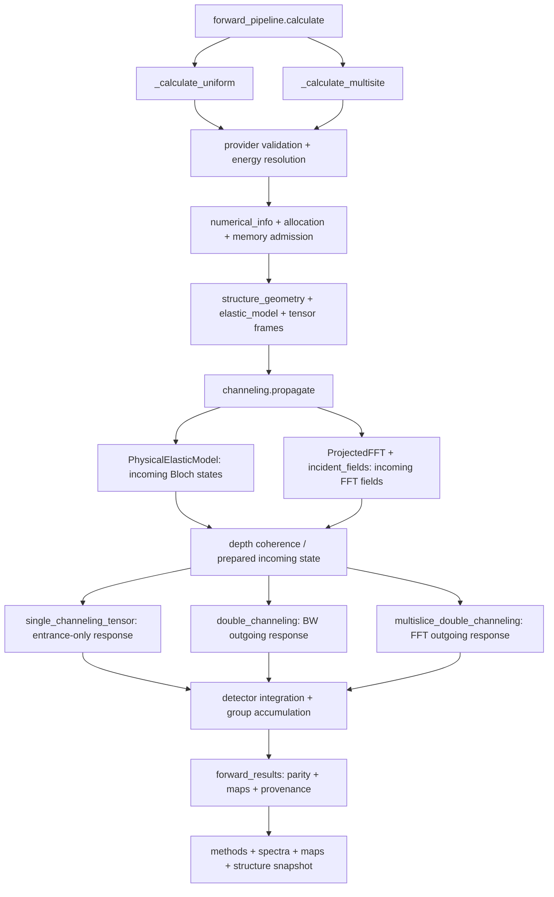

# Next-Gen A: scientific architecture readiness

Date: 2026-11-21. Decision: **GO for the Next-Gen A audit/design deliverables**.
This is not acceptance of a new depth, probe, STEM, GPU or experimental model.
The companion [physics design](NEXTGEN_A_DEPTH_STEM_PHYSICS_DESIGN.md),
[measurements](NEXTGEN_A_PERFORMANCE_BASELINE.md) and
[implementation specification](NEXTGEN_A_IMPLEMENTATION_ROADMAP.md) define those boundaries.

## Source identity and scope

| Item | Exact identity |
|---|---|
| Preserved Phase 3 worktree | `C:/Users/peng863/EMCD-Sim/.worktrees/windows-adaptive-compute` |
| Preserved branch | `refactor/physics-readability` |
| Audit base / preserved HEAD | `a97ccf14e890b9e52fc57d47261117717825f5ba` |
| Frozen Phase 3F-2 source/build commit | `473ac666592e11fc962ecb64d27354ccb18d4ba0` |
| Phase 3F-2 implementation commit | `41e376c3b891df2ef225c43a5db0e1f6bc1794b8` |
| Independent source for established 22-case equivalence | `cdb8836388c5ccc5ae7a614b47894c0ab158a824` |
| New worktree / working directory | `C:/Users/peng863/EMCD-Sim/.worktrees/nextgen-a` |
| New branch | `design/nextgen-architecture-readiness` |
| Recorded benchmark tooling commit | `70af53cd763b64fe67af11a9d551b7ad6aa59755` |

All production source, tests, fixtures, project data, packaging and numerical
comparisons remain identical to the audit base. Changes are these four requested
documents and two scripts under `scripts/`; generated artifacts stay under
ignored `build/nextgen-a/`. The benchmark commit includes tooling fixes, not
scientific changes. The subsequent documentation/summary commit is identifiable
with `git log --oneline a97ccf1..HEAD`; it does not redefine the scientific baseline.

Inherited acceptance evidence is from [Phase 3F-2](PHASE3F2_WINDOWS_NATIVE_ACCEPTANCE.md)
and [Phase 3F-1](PHASE3F1_FINAL_REGRESSION_ACCEPTANCE.md), subject to their stated limits:
22 cases / 2,294 arrays source equivalence; 19 projects / 57 NPZ files / 1,763
native arrays exact, including 448 NaN-bearing arrays; combined regression
1,759 passed / 62 skipped; **Conditional Native GO**. The combined regression
record is not a new uninterrupted full-suite run. These checks and the Windows
build were not rerun here. Eight targeted existing mathematical tests passed;
29 actual bounded calculation cases completed. See the measurement report for
commands and scope. Neither result establishes experimental validity.

## Actual production call graph

The entry point is
[`forward_pipeline.calculate`](../src/emcd_sim/forward_pipeline.py), lines 21–44:

```python
calculate(structure, settings, cfg, progress=..., cancelled=..., *,
          sites=None, energy_ev=None, energy_windows=None,
          reverse_magnetization=False, energy_checkpoint=None,
          execution_policy=None)
```

It requires the complete structure, oriented microscope settings and explicit
material/provider plus numerical/detector configuration. A missing multi-site
assignment raises an error. It does not infer Ni or a substitute material.



Uniform preparation is at lines 89–156; multi-site orchestration at 182–372.
They have different scheduling/accumulation needs, but call common scientific
kernels, not material-specific solvers. Uniform detector scheduling is
`channeling.calculate_detector_signals` (148–277); multi-site integration is
`multisite_integration.integrate_single_channeling_spectrum` (41–121) and
`integrate_double_channeling_spectrum` (124–184). Double responses are reused
across compatible groups before tensor contraction. Solver selection remains
explicit; a numerical method is not silently substituted when unsupported.

## Responsibility and source evidence

Line ranges refer to the unchanged audit-base source. Each path is under
`src/emcd_sim/` unless otherwise shown.

| Responsibility | Actual owner / callable and lines | Contract and dependency boundary |
|---|---|---|
| Neutral request data | `forward_settings.py:ForwardSettings`, `MultiSiteForwardSettings` | Explicit provider and numerical controls; no probe or scan state. Legacy `atomic: NiLocalConfig | None` is still a serialization/input concern; `None` is neutral. Ni examples construct explicit presets outside the engine. |
| Crystal/orientation | `structure_geometry.py:Structure` 32–69, `Settings` 73–83, `geometry` 86–116, `elastic_model` 119–125 | ASE atoms and complete cell; orientation, finite ZOLZ beam basis, target, tilt, energy. ASE-backed structure is mutable; do not share while mutating it. |
| Frame and projection | `crystallography.py:CrystalOrientation` 150–190; `projected_geometry.py:ProjectedGeometry` 24–102 | Crystal Cartesian to nominal microscope frame; reciprocal lattice and real dual cell. No arbitrary 3D slice construction. |
| Elastic potential | `scattering.py:IndependentAtomPotential` / `from_provider`; `elastic_providers.py`; `projected_potential.py:prepare_projected_potential` 48–92 | Neutral IAM structure factors, declared form-factor provider, ZOLZ Fourier potential. Potential prepared once for current specimen; zero Fourier mean removed. |
| Resource preflight | `propagation.py:numerical_info` 69–267, `resolve_fft_configuration` 60–66 | Working arrays plus process reserve/margin; explicit method/worker limits. This is a conservative admission estimate, not measured RSS. |
| Incoming BW | `physical_elastic.py:PhysicalElasticModel` 25–85; `channeling.py:propagate` 23–39 | Hermitian finite elastic Hamiltonian; complex incident coefficients with transmitted `c[0]=1`. |
| Incoming/outgoing FFT | `multislice_double_channeling.py:FFTSplitStep` 32–114, `ProjectedFFT` 149–229, `incident_fields` 232–251 | Full FFT propagation in one repeated projected potential; retained incoming/outgoing Bragg paths for inelastic coupling. |
| Single channeling | `single_channeling_tensor.py:_tensor_angular_maps` 34–62; `multisite_integration.py:_single_channeling_block` 16–38 | Depth-averaged incoming coherence contracted with tensor and site phases; no outgoing elastic propagation. |
| Double BW | `double_channeling.py:prepare_incoming` 62–72, `depth_response` 88–131, `outgoing_states` 134–188, `double_channeling_group_responses` 267–355 | Incoming and post-loss outgoing finite-basis states; analytic depth integral for systematic-row specialization, quadrature otherwise. These distinct methods are useful, not duplicated APIs to delete. |
| Double FFT | `multislice_double_channeling.py:multislice_double_channeling_group_responses` 289–384 | Complex incoming/outgoing overlap at quadrature depths, integrated response `(query,3,3)`, then MDFF contraction. |
| MDFF/source/frame | `mdff_providers.py:prepare_provider` 63–73, `bind_group_direction` 125–147, `DeclaredMDFFProvider` 265–292, `ReversedProviderPair` 295–323; `mdff_source.py` | Validated declared source, tensor pairs, material coverage, energy support and provenance. Source-frame rotation precedes beam-frame rotation. Synthetic fixtures stay explicitly synthetic. |
| Local sites/groups | `ionization_sites.py:IonizationSites`; `multisite.py:IonizationSiteGroup`, `MultiSiteIonization` | Explicit atom selection, source, magnetic state, group weights and normalization. Periodic phases are not physical per-atom depth placement. |
| Detector physics | `geometry.py:VirtualDetector` 48–110, `_cached_circle_weights` 112 onward; `detector_signals.py:integrate_detector_block` 24–48 | Fractional circular aperture weights, sampled reciprocal coordinates, area-weighted integration and reversal parity. |
| Completed results | `forward_results.py:assemble_forward_result` 20–82, `selected_edge_metrics` 85–98, `method_result` 101–108 | Existing dictionary contract; parity/normalization, optional correction, source revalidation and provenance. No elastic propagation here. |
| Native/worker execution | `channeling.py:map_detector_batches` 69–132; `parallel_resources.py`; `memory_budget.py`; `hardware_resources.py` | ThreadPoolExecutor, one native BLAS thread under policy, reservations and cancellation; separate from physical equations. |
| Persistence | `gui/project_io.py:save_project` 233 onward, `load_project` 452 onward, `fingerprints` 583 onward | JSON manifest and three NPZ roles, schema 1, non-pickle arrays and staged saves; saved-file compatibility belongs here. |
| GUI/result adaptation | `gui/calculation_worker.py`, `gui/result_presentation.py`, `gui/result_export.py`, `gui/project_session.py`, `gui/mdff_workspace.py` | Run/selection/state/render/export orchestration consumes the canonical results. No future physical parameter may exist only in widgets. |

`multislice_reference.fft_multislice_ni` (61–128) is an independent historical
reference, not the authoritative production incoming path. Its
`coherence_from_amplitudes` utility (147–156) remains reused. Likewise the
standalone `run_tensor_*` routines are useful mathematical/validation entry
points; the application routes through `calculate`. `benchmark.py` and explicit
Ni radial/analytic references are not generic material solvers. Do not delete
independent scientific references to make the call graph appear smaller.

## Current array and physical contracts

Let `N` be retained beams, `Z` quadrature nodes, `F=Fx*Fy` FFT harmonics, `E`
energy samples and `Q` evaluated outgoing directions. Shapes are not inferred
from a filename or an unlabeled axis.

| Data | Shape / dtype | Units, frame and lifetime |
|---|---|---|
| Structure | cell `(3,3)`, fractional sites `(S,3)`, species | Cell rows in Å; sites in crystal fractional coordinates; caller owns ASE object. |
| Orientation | `R(3,3)`, reciprocal `g(N,3)` | Proper crystal-Cartesian-to-beam rotation; `g` cycles/Å; ZOLZ `g_z=0`. |
| Tensor pairs | `T_plus,T_minus(E,3,3)`, complex128 | Declared length-gauge source normalization, commonly Ų/eV; rotated into common microscope Cartesian frame. Effective XMCD retains its documented normalization. |
| Incoming retained coefficients | `psi(Z,N)`, complex128 | Relative elastic amplitudes, plane-wave entrance, `depth_nm(Z)`; not intensity. Stored in current results. |
| Incoming coherence | `C(N,N)`, complex128 | Depth-averaged `psi_g psi_h*`; thickness measure is applied by the single-channeling calculation. |
| Full FFT incoming state | `(Z,F)`, complex128 | Temporary prepared state; coefficient normalization `sum(abs(c)**2)=1` for entrance plane wave. Current output keeps projected amplitudes and exit/norm diagnostics, not a public full-depth field cube. |
| Double response | `(Q,3,3)`, complex128, grouped when needed | Depth-integrated Cartesian response before MDFF contraction; current public result does not expose its depth integrand. |
| Spectra | dictionary of `(E,)`, float64 | Energy eV; raw detector signals and signed differences arbitrary units; percentages explicitly labeled. Invalid denominator-derived ratios are NaN. |
| Angular maps | selected-edge dictionary of `(Nqy,Nqx)`, float64 | `qx,qy` in cycles/Å, `meshgrid` xy convention; grid is not an incident-probe axis. |
| Aperture weights | `A,B(Nqy,Nqx)`, float64 | Fractional pixel coverage; integration includes reciprocal pixel area. |
| Multi-method result | `methods[method]`, `comparison`, snapshot | Each method has spectra/maps/coherence/depth/amplitudes; top-level arrays mirror primary method. Groups are keyed records, not an implicit dense axis. |
| Multi-site reduction | per-group plus total | `weighted_sum` and mean per selected site have distinct meanings; preserve occupancy/multiplicity and normalization metadata. |

There is no public probe-position axis, per-atom interaction-depth axis, arbitrary
slice-potential stack, coherent illumination spectrum or scan scheduler. One
scalar thickness per calculation and its integration nodes are not an ensemble
of independent thickness outputs. `simulation.SimulationResult` is not the
authoritative current multi-method result type.

## Assumptions, state and coupling risks

The current model combines paraxial elastic transport, finite ZOLZ support,
neutral IAM projected potential, dipole/local independent core-loss events and
single inelastic scattering. Single and Double are distinct physical treatments;
BW and FFT are distinct numerical methods. Finite beam/FFT/cutoff/depth controls
and reported excluded populations remain part of the result. Arbitrary cells,
sources or magnetic patterns are supported only within their declared model
and provider coverage; beam counts above the current 121-beam bound, missing
source support, unsupported double/both combinations and invalid geometry must
stay explicit errors. No TDS, absorptive potential, general nonlocal MDFF,
multiple inelastic events or quantitative detector-dose calibration is implied.

| State / cache | Present ownership | Future risk / action |
|---|---|---|
| Declared converted MDFF cache | Bounded `mdff_providers` load cache, source identity and validated immutable tensors | Keep host-side validation/source identity; device upload cache must also identify frame, energy grid and precision. |
| IAM coefficients/potential | Explicit elastic provider and structure-owned preparation | Do not key future slice cache by material label alone; cell, positions, slice bounds, thermal model and frame matter. |
| Fractional aperture weights | Bounded LRU (128), read-only reusable arrays | Future detector frames and sampling belong in cache key. |
| Split-step phase factors | Mutable last-`dz` cache in each `FFTSplitStep` instance | Worker-owned plans; do not share and mutate across concurrent slices/energies. |
| Incoming prepared state | Calculation-owned; shared read-only across compatible groups/detectors | Preserve current reuse; probe/energy/geometry dependencies must be explicit. |
| Memory and native runtime | Process-level reservation lock; native-thread contexts and Windows BW guard | Not a generic multi-device allocator; distributed workers cannot inherit assumptions about process-global reservations. |
| Provenance | `provenance.build_info` 39 onward reads Git identity/status and existing source inventories | End-to-end source runs include this work. Preserve traceability when measuring/caching; never erase safeguards to improve timing. |

The headless engine does not import Qt. A deliberate exception remains:
protected kernels import `gui.memory_budget`, an identity-preserving adapter to
the headless memory service. Eight targeted tests and benchmark import assertions
confirm the scientific path needs no other GUI service. Replacing that import
would change protected whole-file identity; it is not a harmless cleanup in this
phase. Persistence has a GUI namespace but is callable without rendering; future
large-data storage should be a scientific-data service rather than a new widget
dependency. Export/correction/parity are scientific postprocessing, not reasons
to move wave propagation into the GUI.

Existing behavioral/scientific coverage to preserve includes
`test_headless_calculation.py`, `test_headless_settings_resources.py`,
`test_general_projected_equivalence.py`, `test_unified_mdff_providers.py`,
`test_multisite_forward.py`, `test_multisite_scientific_validation.py`,
`test_multislice_double_channeling.py`, `test_double_channeling_foundation.py`,
`test_multisite_result_persistence.py`, `test_project_workflow.py`, cancellation,
resource and parallel-scheduling tests. This is a coverage map, not a claim that
all of those files were executed during Next-Gen A.

## Architecture alternatives

| Criterion | A: retain flat scientific package | B: incremental responsibility packages | C: comprehensive relocation now |
|---|---|---|---|
| Scientific correctness | No equation change; growing discovery burden | New contracts isolate new physics without changing verified kernels | Moves alone add no scientific capability; large review surface |
| Public API | Existing `calculate` stays | Existing `calculate` stays; narrow future adapters | Many import migrations, aliases or breakage decisions |
| Saved-project schema | No forced change | Explicit data version only when new dimensions need it | Package renames can leak into serialized ownership/type assumptions |
| Source authentication | Existing pins unchanged | Leave pinned files and legacy memory bridge intact initially | Whole-file/import changes conflict with existing pins |
| Packaging/native release | No new paths | Add/test one cohesive service when needed | Broad import/resource inventory and frozen-build revalidation |
| Developer productivity | Best for immediate bounded B; poor if every future feature is another peer module | Best growth policy once several implementations share a responsibility | Up-front churn, difficult bisect/review, no measured runtime gain |
| GPU/depth extensibility | Possible with disciplined APIs | Explicit physics/transport/data/execution boundaries | Directory hierarchy does not establish backend semantics |
| Tests/migration cost | Low initially; medium long term | Targeted module and compatibility tests per increment | High; historical validation imports need explicit treatment |

**Recommend B as a growth policy, with A for the first small prototype.** Start
with one experimental CPU orchestration module and a narrow result contract.
Create a package only when there is more than one cohesive implementation to
house. Future responsibilities are scientific inputs/frames, transport,
inelastic operators, detector reductions, result/storage and execution policy.
These are boundaries to enforce in interfaces, not folders to create now.
No bulk relocation, universal backend wrapper or parallel STEM-specific engine
is justified by the source or measurements.

The reusable core is linear complex transport, explicit local transition
operators, tensor/source validation, detector reduction and current resource
services. The missing capabilities are physically resolved specimen/event
placement, coherent probe boundary conditions, full relevant momentum support,
position-aware results and bounded storage. They require independently verified
science and data contracts; renaming modules cannot supply them.

## Source authentication and compatibility

`tests/physics_source_guard.py` pins the existing
`single_channeling_tensor.py`, `double_channeling.py` and
`multislice_double_channeling.py` files, including their import text. Preserve
these safeguards, original references and historical validation archives.
New orchestration may call existing public primitives without changing their
files; an eventual necessary kernel evolution requires a separately reviewed
scientific change and the project's existing authentication process, not an
automatic repin or weakened test.

Preserve `forward_pipeline.calculate`, current GUI workflows, schema-1 project
loading and existing array meanings. A future probe/depth API should be an
explicit additive request or separate experimental entry point until validated.
Lossless legacy loading belongs in the schema layer. Do not manufacture obsolete
function aliases, flatten new depth axes into old keys, or load an unsupported
new model as the nearest historical material. Keep independently useful
reference implementations even when they are not application entry points.

## High-dimensional result and storage boundary

The current dictionary is documented above; a future block needs an explicit
contract rather than more anonymous ndarray axes. Minimal metadata is:

* Physical model and approximation, numerical method, source/provenance,
  incident/outgoing energy convention and specimen/geometry description.
* Per-variable dimension names, shape, dtype, coordinate arrays, units, frame,
  normalization and raw-versus-derived meaning. Distinguish `probe`, `energy`,
  `interaction_depth/event`, `detector_qy`, `detector_qx`, `site/group`, magnetic
  state and method/channel labels. Thickness is a separate specimen parameter.
* Requested/available output selection, completed block extents, cancellation
  status and validity. Missing computation differs from an invalid normalized
  ratio; preserve NaN masks and parent signals, not an invented zero.
* Layout/chunk information and ownership: calculation produces bounded blocks;
  the sink persists them; presentation selects/reduces named coordinates.

For example, raw reduced signals may be `(probe,energy,detector,magnetic_state)`
while selected diffraction is `(probe_subset,energy_subset,qy,qx,magnetic_state)`.
Optional depth/event contributions use their own coordinate. A scalar per-run
thickness is not broadcast into a fictitious dense depth/thickness/probe product.
Ragged event sets can use event IDs and coordinate tables. Complex wavefields
and density operators have different meaning and storage from real intensities.
The [performance report](NEXTGEN_A_PERFORMANCE_BASELINE.md) quantifies why full
dense storage is prohibitive even in lower precision.

| Strategy | Useful role | Limitations / decision |
|---|---|---|
| NumPy arrays + JSON | Small B prototype, named metadata, reduced detector outputs | Entire arrays resident; JSON for metadata, not billions of numbers. Keep existing simple path for small results. |
| Current JSON/NPZ projects | Existing portable completed projects, lossless scientific arrays | NPZ zip members are whole arrays, not a convenient incrementally writable high-dimensional dataset. Keep legacy loader/semantics; do not stretch old map keys into scans. |
| NPY/memmap / incremental blocks | Minimal local bounded prototype without a new dependency | Explicit layout, coordinates and completion metadata needed; no intrinsic named axes, compression or general concurrent writer protocol. [NumPy open_memmap](https://numpy.org/doc/stable/reference/generated/numpy.lib.format.open_memmap.html) supports array-backed file creation/access. |
| HDF5/h5py | Candidate first large local result sink: typed chunked datasets, hyperslab writes, compression and metadata in one file | A single controlled writer is simplest for Windows/local runs. MPI parallel writing requires an MPI-enabled HDF5/h5py build; do not assume ordinary wheels give it. [Dataset documentation](https://docs.h5py.org/en/stable/high/dataset.html), [parallel HDF5 requirements](https://docs.h5py.org/en/stable/mpi.html). |
| Zarr | Candidate later independent chunks/object storage/distributed scans | Many small files and metadata/concurrency costs matter. With v3 sharding, read chunks and write shards are different ownership units; avoid concurrent writes to the same shard. [Official arrays guide](https://zarr.readthedocs.io/en/latest/user-guide/arrays/). |
| xarray | Optional named-coordinate analysis adapter over suitable storage | Useful dimension/coordinate/attribute model, not a physical-units validator, execution engine or mandatory core dependency. [Data structures](https://docs.xarray.dev/en/stable/user-guide/data-structures.html). |

Start B with NumPy result blocks. Before large D, prototype one serial chunked
local sink, preferably HDF5 if a new dependency is justified by measured need;
otherwise NPY/memmap can demonstrate bounded scheduling first. Evaluate Zarr
when independently owned distributed/cloud chunks become a concrete requirement.
No format dependency or migration is introduced in A. A future new-result schema
must coexist with schema-1 projects, explicitly reject unsupported models in old
consumers and save enough information to reproduce the physical meaning.

Choose chunks around the calculation and access pattern: bounded probe/energy
tiles, detector tiles only when full diffraction is requested, and optional
event/depth diagnostics separately. Reduce fixed detector signals during
calculation so ordinary users do not need diffraction cubes. Derive ratios after
summing raw signals. Compression ratios and filesystem throughput are unmeasured;
do not budget memory/disk assuming a favorable compression factor. Use existing
atomic-save principles for completed metadata; partial results must explicitly
record completion instead of masquerading as complete projects.

## CPU/GPU readiness: audit and proposed boundary

The present implementation is CPU NumPy/SciPy coupled. Examples include
`FFTSplitStep.__init__` coercing with `np.asarray(...,float)`, native complex128
allocations, `np.fft.fftn/ifftn`, `np.linalg.eigh`, NumPy `einsum`/matrix products,
Python loops with scalar truth decisions and dictionary result assembly. ASE,
provider parsing, source identity, resource probes and NPZ persistence are host
services. A device ndarray cannot simply replace every input without triggering
incompatible coercions, host synchronization or the wrong memory accounting.
An `xp` alias across all modules would neither define residency nor preserve the
existing source-authentication contracts.

| Layer | Physics/backend/execution responsibility | Future safe boundary |
|---|---|---|
| Structure/provider preparation | Physical inputs and host validation | Explicit validated host arrays/metadata; no device source parser or inferred material |
| Transport | Physical kinetic/potential convention; backend FFT/eigh/matmul | Narrow operations on declared resident arrays; plan and dtype owned by context |
| Local MDFF/event action | Physical tensor, phase and event measure; backend contraction | Keep full complex tensors and mode coherence; upload reusable source tensors once per complete key |
| Detector reduction | Physical aperture/measure; backend reduction | Reduce on device when appropriate; download selected final blocks, not every intermediate scalar |
| Batch scheduler | Execution order, memory, workers, cancellation | No change to event coherence or physical model; batch/order must reproduce CPU scientific assertions |
| Result/provenance/storage | Named data, validity and traceability on host | Explicit final readback/streaming boundary; preserve source and schema semantics |

An eventual backend context would expose only operations required by the new
validated transport/interaction path: allocation, FFT with explicit normalization,
Hermitian eigensolve when needed, matrix/einsum contraction, reductions and
explicit transfer/synchronization. Host-side prepared arrays, device-resident
workspaces and completed host blocks have distinct ownership. Cache keys include
device, dtype, shape/layout, energy, slice/geometry and tensor frame; avoid a
global cache keyed only by Ni/Cr or dimensions. Bound reusable plans/workspaces
and account for allocator-retained memory separately from live arrays.

[CuPy FFT documentation](https://docs.cupy.dev/en/stable/user_guide/fft.html)
and its [memory guide](https://docs.cupy.dev/en/stable/user_guide/memory.html)
describe plan caches and memory pools that must be included in any later device
budget. No GPU package is installed or used here. GPU benefit is a hypothesis
for sufficiently large FFT/batched-response workloads; the small measured
cases include substantial host/provenance work and cannot justify a speedup.
Transfers, kernel warmup, synchronization and both host/device peaks must be
measured separately in E.

Preserve float64/complex128 as the CPU scientific reference. A later lower-
precision path needs its own conditioning/error study: norm/Parseval, PSD,
complex amplitude/adjoint, reversal parity, site/frame covariance, energy/basis
convergence, raw parent-scaled comparisons for cancellation-sensitive EMCD and
unchanged NaN masks. CPU/GPU floating-point reductions need scientifically
justified tolerances, not expected bitwise equality; serialization in a fixed
dtype remains exact. Do not relax existing comparisons or repin protected
kernels as a prerequisite to speculative acceleration. Keep a CPU path and
explicit unsupported-backend errors.

## Final change inventory and acceptance

The local branch contains three benchmark-tool commits followed by the final
documentation/summary commit. Their measured-tool endpoint is the exact hash
in the identity table; use Git history for the final documentation commit's
identity rather than embedding a self-referential hash in its contents.

| Changed path versus audit base | Purpose |
|---|---|
| `scripts/benchmark_nextgen_readiness.py` | Bounded real CPU matrix, owned processes, observed memory/timing/provenance and output fingerprints |
| `scripts/summarize_nextgen_readiness.py` | Validate/read completed observations; generate CSV, arithmetic memory models and plots without recalculating physics |
| `docs/NEXTGEN_A_ARCHITECTURE_READINESS.md` | Actual call graph, contracts, ownership, coupling, alternatives, storage and backend decisions |
| `docs/NEXTGEN_A_DEPTH_STEM_PHYSICS_DESIGN.md` | Present depth limits, localized event model, coherent probe/scan requirements and validation levels |
| `docs/NEXTGEN_A_PERFORMANCE_BASELINE.md` | Exact measured workload, environment, costs, limitations and modeled memory |
| `docs/NEXTGEN_A_IMPLEMENTATION_ROADMAP.md` | Proposed interfaces, bounded independently testable B and later generations |

Generated evidence is local under `build/nextgen-a/`, intentionally outside the
tracked source/release inventory. Final verification checks the complete changed
path list against these six files, unchanged production/test/data/packaging
trees, report links, tooling syntax and clean post-commit Git status. The
completed refactor worktree remains at `a97ccf14e890b9e52fc57d47261117717825f5ba`.
No production code, scientific references, saved projects, release artifacts or
Git history were rewritten; no full regression, EXE rebuild, push, merge, tag or
publication was performed.

All 16 Next-Gen A criteria are addressed by these reports and local observations.
The main scientific limitations remain explicit: no physical 3D slice/event
production interface, no coherent probe/scan API, no new absolute calibration
or experimental validation, and no measured GPU capability. Those are future
scientific/implementation tasks, not missing evidence to conceal with a
directory refactor. **Next-Gen A: GO. Next-Gen B: specified, not implemented or
scientifically accepted.**
