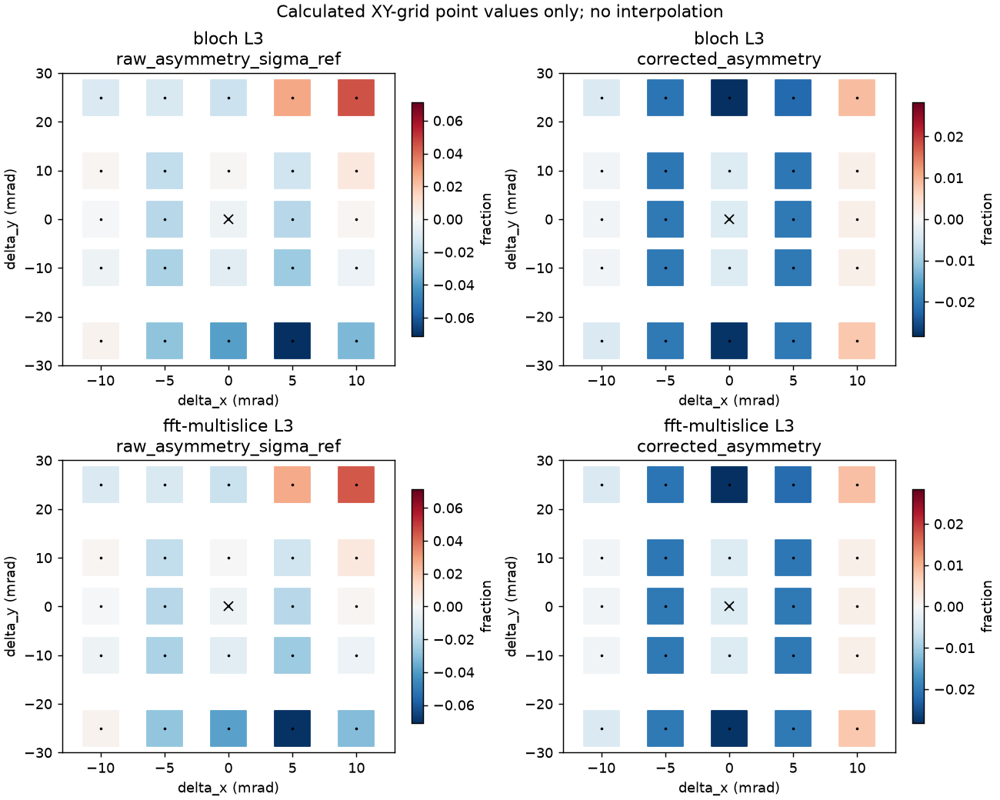
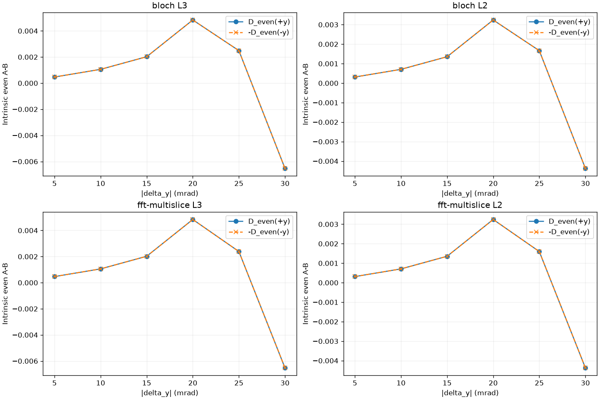
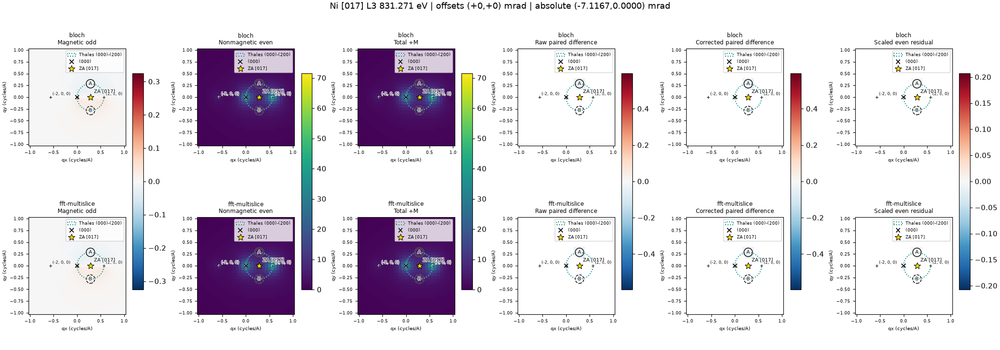
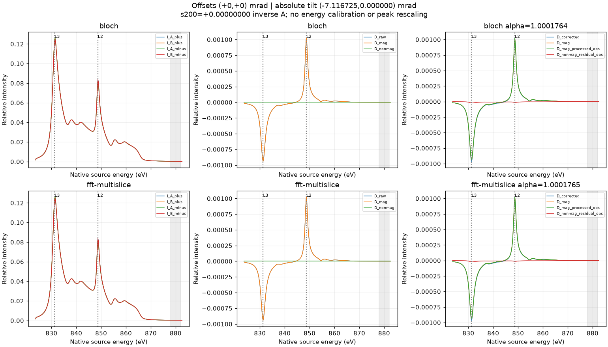
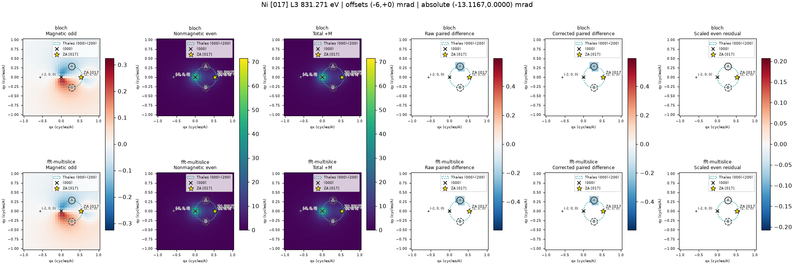
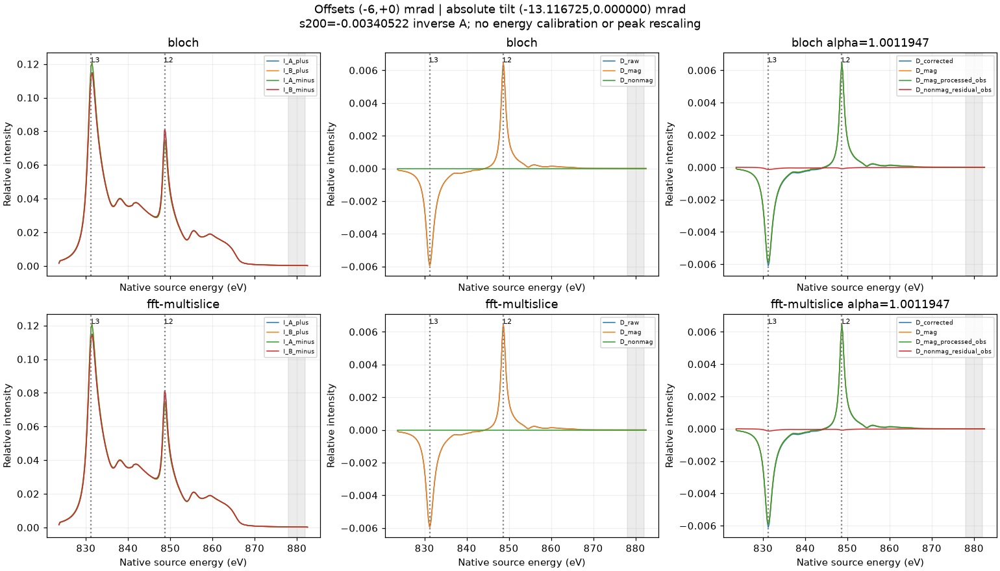

# Ni [017] minor-zone EMCD case study: edge assignment, diffraction geometry, mistilt and figure guide

> **Scope:** Current research code on `main` after the 43-orientation high-mistilt study. This is a **documentation guide**, not a new physical solver, experimental Ni calibration or formal package release. The package metadata still reads v0.4.5. Numerical methods and detailed tables are in [NI_017_MINORZONE.md](NI_017_MINORZONE.md) and [NI_017_HIGH_MISTILT_XY.md](NI_017_HIGH_MISTILT_XY.md).

## 1. What is the WIEN2k Ni L3/L2 energy, and how is it justified?

There are **three distinct energy notions** that must not be interchanged:

1. **Native WIEN2k/JOINT photon-loss axis:** values stored in the five-column `Ni_fm.xmcd` (823.625–882.521 eV). `wien2k_xmcd.py` imports this axis without fitting or shifting it.
2. **Spectral features used to sample EMCD angular maps:** the signed extrema of native magnetic dichroism, chosen from the corresponding edge neighborhoods. These are **not edge onsets** and are not experimental calibration standards.
3. **Experimental/nominal Ni edge energies:** e.g. older map references 852.7/870.0 eV. These are *external reference values*, not peaks of the native computed spectrum; use only after an explicitly documented calibration.

| Edge | Core manifold / WIEN2k edge | Native XAS maximum (eV) | Selected signed XMCD feature for maps (eV) | XMCD sign |
| --- | --- | ---: | ---: | --- |
| L3 | 2p3/2; first raw/broadened edge (`raw1/broad1`) | 831.421 | **831.271** | negative |
| L2 | 2p1/2; second edge (`raw2/broad2`) | 848.752 | **848.698** | positive |

Evidence for the **L3/L2 identification**, as opposed to absolute experimental energy accuracy:

- `Ni_fm.inc` identifies the relativistic 2p1/2 and 2p3/2 core configurations; the WIEN2k optical matrix files label 2p (L3) versus 2ps (L2).
- `Ni_fm.injoint` specifies core energies -60.534300889 Ry (L3) and -61.819104105 Ry (L2); their separation is approximately **17.48 eV**. The combined edge separation is consistent, after the JOINT sampled-grid/broadening convention.
- The checked `raw1/raw2` and `broad1/broad2` magnetic features and their reconstructed sum match the native combined `Ni_fm.xmcd` within printed precision. `ni_017_geometry.energy_audit()` validates this correspondence, original input files and the [001] spin-axis input.
- The two **XAS peak maxima** differ by **17.331 eV**, and their difference from the two older **nominal** map energies is approximately +21.279 eV (L3) / +21.248 eV (L2). This suggests a near-rigid **calibration offset**, **not** evidence of incorrect L3/L2 core assignment or proof of exact absolute excitation energies.
- Using the **magnetic extrema** instead gives 852.7−831.271 = **21.429 eV** and 870.0−848.698 = **21.302 eV**. Do not conflate these feature-specific shifts with the XAS-peak shifts or promise a uniquely determined alignment.

**Limit:** The saved core-energy inputs and JOINT data justify the internal assignment and relative splitting, not the **absolute experimental onset/edge position**. Ground-state/core-hole, screening, many-body terms, Fermi-level conventions, broadening and the experimental reference can affect calibration. The current workflow **does not shift** `Ni_fm.xmcd` and does not claim experimentally accurate absolute binding energies. If experimental alignment is later needed, preserve the raw axis and save an independent, common calibrated axis with reference/source/uncertainty.

**Tensor caveat:** The WIEN2k output provides circular polarization intensities, *not* complex Cartesian 2p-to-band transition dipoles. The `xmcd-effective` dipole tensor uses `N=(RP+LP)/2`, `D=(RP−LP)/2`, transverse `Txx=Tyy=N`, magnetic `Txy=i eta D`, `Tyx=−i eta D`, assumed `Tzz=beta N`, and `eta=beta=1` in this case. It is a **Hermitian XMCD-constrained proxy**, not a full ab initio MDFF or calibrated absolute cross section. [001] crystal magnetization is rotated into the selected experimental frame using `R T R^T`; reversal is applied in the crystal frame before rotation.

## 2. Why select minor-zone [017] and target (200)?

The magnetization of the underlying WIEN2k Ni case is along **cubic [001]**, as specified by `Ni_fm.inso` and corroborated in `Ni_fm.outputopup`. The nominal [017] beam axis makes only **arctan(1/7) ≈ 8.13°** with [001], unlike [710], which is perpendicular to [001]. Thus [017] is a useful **near-magnetization beam-direction geometry** while still tilting off a principal [001] zone axis to suppress many competing reflections.

The genuine oriented local frame is:

```text
x_local = [100]
y_local = [0, 7, -1] / sqrt(50)
z_local = [0, 1,  7] / sqrt(50) = [017]
m_crystal = [001]  ->  m_local = (0, -1/sqrt(50), 7/sqrt(50))
```

The zero-order Laue-zone rule is **k + 7l = 0**, alongside FCC allowed-reflection parity. **(200)** is allowed and perpendicular to [017]: `[017]·(200)=0`. The first off-row projected reflections lie at about **sqrt(51)/a = 2.027 cycles/Å**, so a minor-zone row dominates over some off-row scattering near the reference, although multiple beams remain in the physical model.

At **200 kV**, `a=3.524 Å`, the reference is the **exact paraxial (200) Bragg alignment**:
```text
theta_x = -7.116725439974256 mrad
theta_y = 0 mrad
s_200   = 0
```

This **does not** mean incident-zone-axis alignment, nor mathematically guarantee a pure two-beam wavefield. At 30 nm the `(000)+(200)` **exit** population is about 99.43%, but its **depth-averaged** population is 94.50%; competing modes reach **10.57%** at some depths, failing the documented strict 5% outside-pair criterion. Competing `(-200)` and `(400)` reflections matter. Therefore call it a **minor-zone exact-Bragg two-beam-like reference**, never a certified isolated 2BC.

The [017] project rotates the actual projected Ni IAM lattice/potential for both BW and FFT multislice; it does not simply relabel [001] diffraction. The potential is z-independent/projected rather than an atom-layer-resolved 3D specimen.

## 3. Exactly how the X/Y mistilts are set

Use *local* coordinates with the **fixed crystal [017] frame and fixed crystal [001] magnetization**:
```text
absolute theta_x = theta_Bragg,200 + delta_x
absolute theta_y = delta_y
theta_Bragg,200  = -7.116725439974256 mrad
```

Thus `(delta_x,delta_y)=(0,0)` is the exact-(200)-Bragg reference, **not** [017] zone-axis incidence. The **[017] zone-axis incidence** occurs at `delta_x=+7.11672544, delta_y=0`; a separate `delta_x=-7.11672544,delta_y=0` point is approximately (400) Bragg. The horizontal X scan contains **13** offsets (`−10:2:+10` plus these two special points); the Y scan has **13** (`−30:5:+30` at X=0); the coarse X/Y scan has **25** (`x=[−10,−5,0,5,10]`, `y=[−25,−10,0,10,25]`). Shared coordinates are computed only once, producing **43 distinct incident orientations**.

X mistilt primarily changes `s200`, whereas a local Y tilt leaves `s200` unchanged within the present paraxial convention (`g200,y=0`) but changes excitation of **off-row** reflections and the y-reflection symmetry of the wavefield. The projected zone-axis marker is `q_ZA=-k_incident,perp` in the transmitted-(000)-centered detector frame. The (000)/(200) points, Thales circle, and A/B aperture outlines stay fixed; **only ZA moves with incident tilt**. Thales geometry by itself is not a prediction of the strongest EMCD.

The existing default numerical study is 200 kV, 30 nm, 27 BW beams at cutoff 3.2 cycles/Å, FFT32, potential cutoff 2.2 cycles/Å, depth64, step≤0.04 nm, detector33 and fractional aperture weights. Both propagators use the same projected potential; the same energy-dependent tensor is contracted with each incoming depth coherence. It sums localized single-ionization contributions through specimen thickness but **does not** propagate the inelastic wave through the remaining specimen (no outgoing/double channeling).

## 4. What pictures to look at and how to interpret them

Selected **actual simulation figures are hosted in the gallery below** under [`docs/images/ni017/`](images/ni017/). The complete original images, numerical NPZ files and per-case metadata remain under the local working directory `outputs/ni_017_high_mistilt_xy/`, generally ignored by Git. The table lists those **local source paths**; it does not link to an uploaded numerical dataset. The hosted previews are losslessly optimized PNGs at their original pixel dimensions, with unchanged decoded RGB pixels. They were copied from existing results without rerunning simulations or regenerating plots. [Preview provenance](images/ni017/manifest.json) records source paths, image checksums and the simulation implementation commit.

| Question | Picture (relative to `outputs/ni_017_high_mistilt_xy/`) | What to look for |
| --- | --- | --- |
| How do magnetic and nonmagnetic contrasts vary in the **same** X/Y grid? | **`aggregate/emcd_xy_heatmaps.png`** | Signed magnetic asymmetry, signed nonmagnetic asymmetry, and relative shot-noise proxy on calculated 5×5 grid points (not interpolation) |
| Do raw and postedge-corrected contrasts recover the magnetic signal? | **`aggregate/raw_corrected_xy.png`** | Compare corrected and raw asymmetry **against** intrinsic magnetic/even reference; correction is not the reference itself |
| Where is relative detectability highest? | **`aggregate/detectability_xy.png`** | `abs(D_mag)/sqrt(Sigma_ref)`; relative Poisson-counting proxy, not experimental dose-limited SNR |
| Are trends numerically reproducible? | **`aggregate/bw_ms_xy.png`** | Matched BW–FFT magnetic map differences, rather than magnetic intensity |
| Do candidates survive changing the scattering potential? | **`aggregate/potential_cutoff_controls.png`** | Sensitivity at matched control detector grid (17), **not** proof of convergence |
| How does breaking the vertical mirror symmetry affect even A−B? | **`scan_y/summary_figures/mirror_symmetry.png`** and **`scan_y/summary_figures/emcd_vs_y_mistilt.png`** | ±Y even contrast reverses sign; compare independent ±Y simulations |
| How does horizontal Bragg offset affect EMCD? | **`scan_x/summary_figures/emcd_vs_x_mistilt.png`** | Reference Bragg vs near-(400) / zone-axis incidence and changes in absolute signal and asymmetry |
| Does magnetic signal reverse across L3/L2; what does normalization do? | **`cases/x_p0_y_p0/virtual_detector_eels.png`**, **`cases/x_m6_y_p0/virtual_detector_eels.png`**, **`cases/x_p0_y_m25/virtual_detector_eels.png`** | Side-by-side full BW/MS A/B, reversal-odd/even, raw and corrected spectra (native DFT energy axis) |
| Where are magnetic/even angular features within a specific aperture? | **`cases/x_p0_y_m25/L3_angular_maps.png`** (and `L2_angular_maps.png`) | Local intrinsic odd/even/total maps vs A-supported raw/corrected contrast; note the common color scales and fixed Thales apertures |
| Which additional beams are activated? | **`cases/x_p0_y_m25/diffraction_pattern.png`** | Real hkl, depth-average vs exit intensity; compare `cases/x_p0_y_p0/diffraction_pattern.png` |

**Starting sequence:** open `aggregate/emcd_xy_heatmaps.png`, then `aggregate/raw_corrected_xy.png`, then the three representative `virtual_detector_eels.png` figures, then `scan_y/summary_figures/mirror_symmetry.png` and the diffraction maps. Read `high_mistilt_summary.csv` and `diffraction_summary.csv` for quantitative labels; do not estimate exact values from pixels. These "pictures" are calculated maps and EELS plots, **not experimental diffraction photos**. An experimental evaluation would require a calibrated diffraction image/4D-STEM tilt map, energy-calibrated EELS, reliable aperture centers, dose/background and thickness information.

### 4.1 Hosted overview: magnetic, even and raw/corrected contrast

All previews below come from the **200 kV, 30 nm, potential-cutoff 2.2 cycles/Å** survey with fixed crystal-[001] magnetization. Coordinates `(delta_x,delta_y)` are **Bragg offsets in mrad**, not absolute incidence angles. The map samples are the native **831.271 eV L3 / 848.698 eV L2** magnetic features; the energy axis has not been experimentally calibrated. Click an image to inspect its original-resolution preview.


**Figure 1 — Intrinsic components and relative detectability.** Columns show `D_mag/Sigma_ref`, `D_nonmag/Sigma_ref` and `abs(D_mag)/sqrt(Sigma_ref)` at L3; BW is above FFT multislice. A colorbar value of 0.02 is **2%**, not 0.02%. Only the 25 calculated XY-grid coordinates are colored; white gaps are not interpolated predictions. The cross marks the exact-(200)-Bragg reference `(0,0)`. The odd signal is defined by **magnetization reversal**, whereas the even signal can be nonzero when detector symmetry is broken. The last column is a relative ideal-counting proxy, not calibrated experimental SNR. Additional 1D/special offsets are not plotted in this grid.



**Figure 2 — Raw versus observed post-edge correction.** Left is `(I_A,+ - I_B,+)/Sigma_ref`; right is `(I_A,+ - alpha*I_B,+)/Sigma_ref`, with alpha obtained independently for each case and method over 878–882 eV. **The two columns use different colorbar ranges**: compare their numerical scales, not color saturation alone. Compare the right column against the intrinsic magnetic column of Figure 1; it is not itself an intrinsic-magnetic reference. Scaling changes both the magnetic contribution and the reversal-even residual, as defined in Section 5.

### 4.2 Y-mirror check of the reversal-even signal



**Figure 3 — Even in magnetization, antisymmetric in Y tilt.** At `delta_x=0`, the plotted curves are `D_nonmag(+delta_y)` and **minus** `D_nonmag(-delta_y)`. Their overlap checks the expected Y-mirror relation in the projected-potential, beta=1 model; these are independently calculated orientations, not symmetrized data. The response is nonmonotonic and changes sign near the largest tilts. This spatial-tilt antisymmetry is distinct from being **even under magnetization reversal**, and must not be imposed on the magnetic response with its fixed cubic magnetization.

### 4.3 Reference `(0,0)`: exact (200) Bragg, not ZA incidence



**Figure 4 — Reference L3 angular panels.** Absolute tilt is `(-7.116725,0)` mrad. The six columns are intrinsic magnetic-odd intensity, reversal-even intensity, total `+M` intensity, raw paired difference, corrected paired difference and scaled even residual; rows are BW/MS. Reciprocal axes are **cycles/Å**. The transmitted cross, indexed (200), ZA [017], Thales circle and A/B apertures identify the actual geometry. ZA differs from (000) at this reference. Signed maps retain common comparison scales; weak color is not independently amplified. **Paired-difference maps are A-supported comparisons with reflected B pixels**: white outside that support is masked, not zero contrast over the whole plane. The even intensity map can be strong while its integrated A−B difference is nearly zero.



**Figure 5 — Reference full EELS and normalization artifact.** Left: A/B spectra for both reversal states. Middle: raw, magnetic-odd and reversal-even A−B differences. Right: corrected contrast, the unprocessed intrinsic magnetic signal, its scaled magnetic component and the scaled even residual. Dotted lines mark native L3/L2 samples; shading marks 878–882 eV. Intrinsic even A−B is already at roundoff on `delta_y=0`, so post-edge scaling can **introduce** a residual. Similar-looking corrected and magnetic curves do not establish their equality. The native energy axis and original relative intensity scales are retained.

### 4.4 Horizontal candidate `(-6,0)`: larger absolute magnetic signal



**Figure 6 — Horizontal mistilt with unchanged apertures.** Absolute tilt is `(-13.116725,0)` mrad, toward the separate (400)-Bragg alignment. These are full multibeam maps, not propagation restricted to 000/200. At the survey cutoff this orientation has the largest **sampled absolute magnetic difference**, while the intrinsic even detector imbalance stays near zero on the Y=0 plane. Panel definitions and color scales match Figure 4; do not confuse that absolute-signal criterion with maximizing magnetic asymmetry or relative detectability.



**Figure 7 — Stronger magnetic EELS on the symmetry plane.** Native L3 and L2 odd differences have opposite signs. BW magnetic asymmetries are approximately **−2.553% / +4.147%**, using the reversal-averaged denominator. The small intrinsic even difference explains why raw and intrinsic magnetic spectra nearly coincide; the right-hand scaling can still introduce an artifact. This candidate's absolute-signal ranking against the vertical candidate below changes with potential cutoff, so it is not a converged global optimum.

### 4.5 Vertical candidate `(0,-25)`: enhancement with even contamination


**Figure 8 — Off-row excitation and broken detector symmetry.** Absolute tilt is `(-7.116725,-25)` mrad. Although `s200` remains zero in the paraxial convention, the wavefield is strongly multibeam and A/B reversal-even intensities are unequal. The fixed apertures and Thales circle have not followed the moving ZA marker. At the survey cutoff this point gives the largest **sampled absolute magnetic asymmetry and relative shot-noise proxy**, rather than the largest absolute magnetic difference. The magnetic asymmetries are approximately **−2.724% / +4.416%** at L3/L2.


**Figure 9 — Correction improves contamination but is not magnetic reversal.** At L3 the BW raw difference contains `D_mag≈−0.005759` plus `D_nonmag≈−0.002490` in relative units. Post-edge scaling reduces this discrepancy in the saved case, but the corrected curve remains the **scaled magnetic term plus an even residual**. The independently fitted alpha values are printed for BW and MS; they were not chosen to force agreement. A finite magnetic post-edge tail and energy-dependent scattering prevent interpreting correction as exact magnetic recovery.

These previews retain the study's limitations: **uncalibrated absolute energies and cross sections, an XMCD-effective rather than complete complex DFT-derived MDFF, no outgoing channeling, and unresolved physical-potential-cutoff convergence**. Section 6 details why close BW/MS agreement does not remove those limitations.

## 5. Which signals are magnetic and which are nonmagnetic?

For each aperture `A` or `B`, compute spectra for magnetizations `+M` and `−M` (a model reversal, not a claim that both were measured). Define:

```text
M_A = (I_A,+ - I_A,-)/2       N_A = (I_A,+ + I_A,-)/2
M_B = (I_B,+ - I_B,-)/2       N_B = (I_B,+ + I_B,-)/2

D_mag      = M_A - M_B
D_nonmag   = N_A - N_B
D_raw      = I_A,+ - I_B,+ = D_mag + D_nonmag
D_corrected= I_A,+ - alpha * I_B,+

D_corrected = (M_A - alpha*M_B) + (N_A - alpha*N_B)
```

Here the `alpha` factor comes from the actual +M A/B integrals over **878–882 eV** *separately at each orientation and method*. A small nonmagnetic difference may be created by the correction itself when `D_nonmag≈0`. Thus **corrected EMCD must never be relabeled as intrinsically magnetic**. The intrinsic asymmetry uses the common reversal-averaged `Sigma_ref=N_A+N_B`; reported percentage `100*D_mag/Sigma_ref`. The detectability proxy uses `abs(D_mag)/sqrt(Sigma_ref)`, without experimental noise/dose calibration.

**Observed representative model results (BW, potential cutoff 2.2 cycles/Å, native magnetic features):**

| Offset `(delta_x,delta_y)` mrad | L3 magnetic asymmetry | L2 magnetic asymmetry | Interpretation |
| --- | ---: | ---: | --- |
| `(0,0)` | −0.380% | +0.615% | Exact (200) Bragg; mirror-symmetric intrinsic even difference ≈0 |
| `(−6,0)` | −2.553% | +4.147% | Largest **sampled** absolute magnetic difference, minimal even imbalance on Y=0 |
| `(0,−25)` | −2.724% | +4.416% | Largest **sampled** magnetic asymmetry and relative shot-noise proxy, but appreciable nonmagnetic imbalance |

Across the sampled grid the largest absolute intrinsic nonmagnetic asymmetry is **4.94%** at `(5,−25)` (L3). For `(0,−25)` at L3, `D_mag≈−0.005759` and `D_nonmag≈−0.002490` (relative model units). The nonmagnetic even signal obeys antisymmetry under reversing Y tilt within the projected, mirror-symmetric `beta=1` model; the magnetic signal need not obey the same symmetry because the magnetization direction is held fixed in crystal coordinates.

The observed postedge correction reduces error versus intrinsic magnetic difference at all **112 nonzero-Y method/edge comparisons** in this saved study, but **introduces artifacts on the Y=0 symmetry plane**. It is not universally an unbiased magnetic extraction.

## 6. Scientific limitations and reproducibility

The original data are **model outputs** (relative units), not validated measured Ni cross sections. The model uses a projected (z-independent) IAM elastic potential, single/incoming channeling only, circular-intensity-derived XMCD-effective dipole tensor rather than full complex DFT MDFF, fixed original virtual apertures, and no HOLZ/outgoing channeling/TDS/experimental energy calibration.

A matched BW/FFT difference of up to **0.6025%** across the coarse survey does **not** resolve physical-potential convergence. At exact Bragg, increasing cutoff from 2.2 to 3.2 cycles/Å changes the selected L3 magnetic difference by about **21.8%**; it also **reverses the ordering** of the `(−6,0)` versus `(0,−25)` absolute-signal candidates. These are **candidate orientations**, not a converged global optimum.

Reproduce from the repository root with your validated WIEN2k input files present in `data/wien2k_ni/`:

```powershell
$env:PYTHONPATH='src'
$env:OPENBLAS_NUM_THREADS='1'
$env:OMP_NUM_THREADS='1'
python -m emcd_sim.ni_017_high_mistilt_xy --scan all
python -m emcd_sim.ni_017_high_mistilt_xy --scan all --plot-only
```

Full implementation, controls, file layout, provenance and test outcomes are documented in [NI_017_HIGH_MISTILT_XY.md](NI_017_HIGH_MISTILT_XY.md). See also [NI_017_MINORZONE.md](NI_017_MINORZONE.md) for the native-edge audit and the [710]/[017] orientation comparison.
