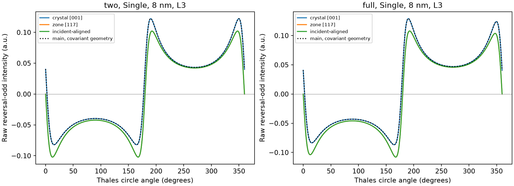
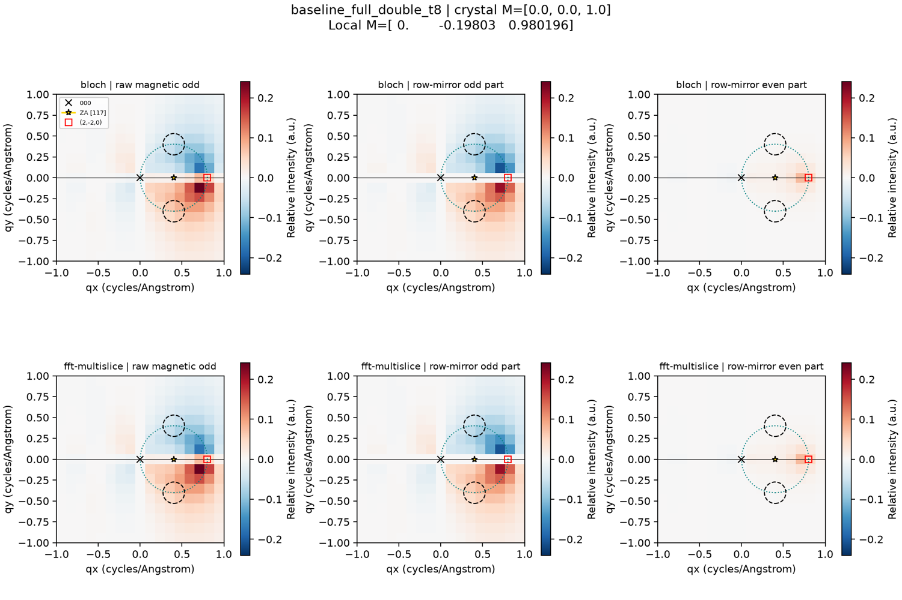

# Ni [117] / (2,-2,0): scientific diagnosis and validation

The [final source-[001] symmetry validation](NI_117_FINAL_SYMMETRY_VALIDATION.md)
extends this preserved audit with direct full-circle BW/MS profiles, combined
parameter checks, refined apertures, small mistilts and an independent depth
probe. Its refined detector values supersede the coarse-grid values for the
tested conditions; the failed coarse gates and historical limitations below
remain part of the record.

Local review branch: `feat/ni-117-emcd`, based on main
`236893392838ab5bc17dcf1848fd127009f2f048`. No release, merge, Windows rebuild,
version change or production-checkpoint regeneration is part of this work.

## Answer to the original question

**The particular historical figure cannot yet be classified: its configuration,
code version and raw output have not been identified.** A search of 5,325
accessible saved JSON files under local `outputs/` found no previous [117]
configuration. Thirteen directories were inaccessible; temporary/test folders,
external user folders and configurations without recognizable zone metadata
are not ruled out. There is no claim of reproducing the original figure.
`root_cause/historical_inventory.json` records this scope and the read failures.

The controlled equivalent demonstrates two distinct facts:

* With the original crystal-frame **M=[001]**, raw magnetic EMCD can fail
  row-mirror antisymmetry even in a genuine two-beam model. This persists after
  consistent geometry transformation and agrees between independently propagated
  BW and MS fields. On the sampled L3 Thales circle at 8 nm, the mirror-even
  fraction is **0.20804** (two-beam Single) and **0.20476** (full ZOLZ Single).
* The old screen frame placed this row at **−44.427°**, not horizontally.
  Testing reflection about screen y=0, or reusing horizontal-row tilt/detector
  coordinates in that frame, tests a different geometry. A deliberately
  untransformed tilt changes the raw magnetic circle signal by **5.94%**
  (two-beam Single) or **10.69%** (full Single), measured as maximum absolute
  change divided by maximum absolute reference signal. This is a demonstrated
  coordinate-misuse mechanism, **not proof that the original user run used it**.

Consequently, “asymmetric on the Thales circle” alone does not establish a
software error. Conversely, the physically allowed component found here does
not retrospectively validate an unidentified old plot. Recovering that figure's
project/raw arrays is the remaining requirement for a definitive historical
attribution.

## Which symmetry is tested?

All primary diagnostics use unnormalized physical fields:

`M(q)=[I(+M,q)−I(−M,q)]/2`, `N(q)=[I(+M,q)+I(−M,q)]/2`,
and total `I(+M,q)=N(q)+M(q)`.

The target-aligned frame makes row reflection `P:(qx,qy)→(qx,−qy)`.
Magnetic mirror antisymmetry means `M(Pq)=−M(q)`; nonmagnetic mirror symmetry
means `N(Pq)=N(q)`. Magnetic **reversal oddness** is a different identity and
does not imply spatial mirror oddness. Total intensity generally has both parts.

On the Thales circle,
`q=(g/2+(g/2)cos θ,(g/2)sin θ)`, mirror positions are `θ` and `−θ`.
Opposite signs/equal magnitudes at these pairs do **not** require uniform signal
around either semicircle, or equality at unrelated circle positions. The
independent analytical control has an upper-arc magnetic range approximately
0.466–2.034 a.u. while satisfying mirror antisymmetry to 3.5e−15.
This is a transverse Thales circle; finite longitudinal transfer also means
that transverse orthogonality is not full three-dimensional transfer-vector
orthogonality.

The diagnostic fraction is `||[M+PM]/2||₂/||M||₂`; it is not a percentage of
collected counts or an experimental SNR. Circle and square-map norms sample
different supports and need not have the same value. Zero fields have undefined
relative residuals rather than evidence of symmetry.

The existing paired contrast `D_mag(q)=M(q)−M(Pq)` has an antisymmetric algebraic
form before its A-aperture display mask. It is **not evidence** that raw M is
antisymmetric. Post-edge correction and detector normalization are not used to
establish physical parity in this study.

## Geometry and audit

Rows of R are `[1,−1,0]/sqrt(2)`, `[7,7,−2]/sqrt(102)`,
`[1,1,7]/sqrt(51)`. Thus `x×y=z`, `det R=+1`, and local vectors are R times
crystal Cartesian vectors. Reciprocal coordinates are cycles/Å, not radians/Å.

The target is FCC-allowed (all even), belongs to `h+k+7l=0`, and has
`g=(sqrt(8)/3.524,0)=(0.80261837,0)` cycles/Å. **(220) is not in this ZOLZ**:
its zone dot product is 4. The primitive reciprocal generators used by FFT are
`(2,−2,0)` and `(8,6,−2)`; the full radial finite basis is generated without
relabeling signed indices or replacing it by the (200) row.

At 200 kV the existing paraxial convention is
`s_g=(λ/2)(|g+k_perp|²−|k_perp|²)`, `k_perp=tilt_rad/λ`.
The reference is `tilt_x=−10.064569636897227 mrad`, `tilt_y=0`,
with `s_target≈0` and `ZA=−k_perp=(0.40130918,0)` cycles/Å.
“Exact Bragg” here means exact under this implemented excitation convention,
not a replacement of the model by a full Ewald-sphere calculation.

| Audited component | Finding and action |
|---|---|
| Signed hkl, FCC rule, radial BW basis, excitation errors | Already supported; no sign or (220)-substitution defect found. Regression coverage added. |
| Old generic [117] rotation | Proper orthogonal frame, but x was projected crystal [100], not the requested target direction. This was an azimuth convention, not intrinsically incorrect physics. Explicit target-aligned frame added. |
| Old target geometry | `g=(0.57318416,−0.56183286,0)` in old frame. Correct transformed tilt is `(−7.18754037,+7.04519875)` mrad; retaining `(−10.06456964,0)` gives `s=0.00230916 Å⁻¹`. |
| Detector pairing | Existing GUI contraction assumes reflection about local y=0. Arbitrary-zone elastic preview did not establish arbitrary-row EMCD support. Actual old Thales A/B coordinates for an oblique row do not meet this horizontal-pair validator. Aligning the requested row resolves that restriction. |
| Thales overlay | Existing GUI uses actual selected signed target vector, center g/2 and radius |g|/2. No overlay sign defect found there. Generic plotting helper defaults to (200) unless callers supply target; new research figures supply the actual target explicitly. |
| FFT orientation/potential | Old GUI rejected [117]; it did not silently fall back to [001]. Implemented actual [117] projected IAM, exact hkl lookup and FFT support checks for Single/Double. |
| Ideal two-beam | Old systematic-row option is a multibeam [001] (200) row, not a two-beam model. New opt-in retains exactly 000 and target in incoming **and outgoing** propagation. |
| Magnetization | Existing adapter already rotates the Hermitian tensor `R Q T Qᵀ Rᵀ` and reverses magnetization before rotation. No missing rotation was found in the inspected main version. Crystal [001] remains the default. |
| Momentum transfers | Existing Single uses `(qx−gx,qy−gy,−E_loss/(hv))` in cycles/Å then multiplies by 2π for the MDFF; Coulomb factors are consistent. Double retains existing branch transfers and fixed outgoing transverse carrier, with reduced outgoing energy. No change to these physical conventions. |
| Saved projects | Saved old frames remain viewable. Reusing old [117] local inputs with the new frame is explicitly refused, avoiding silent reinterpretation. Old [001]/[017] projects retain their defaults. |

The new two-beam MS control uses FFT-sampled Fourier coefficients and split-step
kinetic propagation with `exp(i dz PVP)` inside the retained subspace. This is
not lossy `P exp(i dz V)P`, nor BW eigenvectors disguised as MS, nor norm
renormalization. Its independent outgoing-energy/carrier and second-order split
test compares against an exact small matrix exponential. In full mode MS
continues to propagate the full FFT field; only inelastic incoming/outgoing
support is finite. Agreement with a finite BW basis is a separate question.

Principal audited paths: `gui/geometry.py:orientation/geometry/excitation`,
`gui/app.py:align/restore_detectors/refresh`,
`gui/emcd_forward.py:tensors/_calculate`,
`single_channeling_tensor.py:_tensor_angular_maps`,
`double_channeling.py:outgoing_elastic`, `gui/channeling.py:contract`,
`gui/propagation.py:numerical_info/propagate`, and
`emcd_angular_plots.py:decorate_reciprocal_map/paired_geometry/paired_maps`.
New orientation-specific Fourier mapping is in `ni_117_geometry.py`; raw parity
analysis is in `mirror_parity.py`; opt-in projected propagation is in
`multislice_double_channeling.py:FFTSplitStep/ProjectedNiFFT`.

## Analytical cause and old/current comparison

For two retained incoming beams, `q0=(x,y,qz)` and `qg=(x−g,y,qz)`.
Their cross product is `g(0,−qz,y)`. The imaginary Hermitian dipole tensor
therefore contributes a magnetic term proportional to
`g(M_z y−M_y qz)`, up to the existing phase/sign convention and dynamical factor.
With nonzero loss, qz is nonzero. Crystal [001] rotates to
`M_local=(0,−0.19802951,0.98019606)`: its My term is **mirror-even**.
Changing the MDFF or suppressing qz to force oddness would change the model.

An independent control uses `T=I+0.2i ε(m)` (minimum eigenvalue 0.8), two coherent
beams, actual paraxial incident-aligned m in the row plane, and direct tensor
contraction. Hermiticity, PSD, nonnegative total intensities, reversal oddness,
magnetic mirror oddness and nonmagnetic mirror evenness pass without GUI code,
source-spectrum fitting, detector differencing or normalization.

Direct Single-channeling circle sampling then compares pristine main source
at the base commit with development source at identical **physical** geometries,
for ideal/full support and crystal [001], nominal zone [117], and incident-aligned
magnetization. All raw magnetic relative maximum changes are below **1.57e−14**;
nonmagnetic changes are below **2.18e−15**. Thus a consistent azimuth change
does **not** remove the crystal-[001] asymmetry. The old generic BW tensor/geometry
path can produce it without an orientation defect. An unidentified earlier
version is not assumed identical to inspected main.

At 8 nm and native L3, crystal-[001] signals differ at mirror-related circle
points. Zone-axis and incident-aligned controls overlap nearly and are mirror-odd;
their magnitudes still vary strongly along the circle. Dotted old-source results
overlap corrected-frame results when tilt, q and tensor coordinates are covariant.

## Reused calculations and one-factor controls

All **50 completed Both-method cases** are retained with their original source
hashes, parameters and arrays. Four additional Both cases at 8 nm test actual
paraxial incident-aligned magnetization for ideal/full × Single/Double. They are
separate under `root_cause/`; the original index and cases are not restarted.
Additional old/current controls above are lightweight direct BW circle samples,
not repeated GUI studies.

Common original profile: FCC Ni a=3.524 Å, 200 kV, native unshifted selected
L3=831.271 eV and L2=848.698 eV, eta=beta=1, M_crystal=[001], potential cutoff
6.2 cycles/Å, base beam cutoff 3.8 (21 beams), FFT32, 65 depth nodes,
max slice 0.04 nm, map17×17, fractional apertures/subpixels32, Thales A/B
centers `(g/2,±g/2)`, radius `0.16g`, correction off. Source SHA256 is
`a0e28ea6423b6c7832bb3cce6d69d71aa59336a221baeee3d2556b49ba501283`.
The preexisting local XMCD trailing-newline/line-ending difference is preserved; no spectral
data or axis was shifted. Case JSON records voltage, wavelength, tilt, ZA,
magnetization, actual hkl, excitation errors, raw exit populations, configuration,
software commit/worktree state and physics-file hashes.

| Support / channeling | BW L3 A_mag at 8 / 12 / 30 nm (%) | Magnetic map even fraction at 8 nm |
|---|---|---|
| Two-beam / Single | −7.671394 / −10.437970 / −9.267177 | 0.175237 |
| Two-beam / Double | −7.029099 / −10.046699 / −8.885835 | 0.163430 |
| Full / Single | −7.947878 / −10.744430 / −8.446861 | 0.172601 |
| Full / Double | −8.558709 / −10.081633 / −7.878014 | 0.174579 |

Here `A_mag=100(M_A−M_B)/(N_A+N_B)`; these coarse-aperture values are descriptive,
not final converged cross sections. At these three thicknesses maximum L3
BW/MS discrepancies are below 0.00683 pp (full) and 0.000007 pp (ideal Double).
Nonmagnetic map odd fractions at zero vertical tilt are at roundoff. The
nominal-zone controls and the additional **actual incident-aligned** controls
give magnetic mirror-even fractions at roundoff for both edges, both methods,
both channeling models and both supports (order 1e−15).

Exact target excitation is not an isolated two-beam wavefield. In the finite
full BW basis, 000/target exit populations at 8, 12 and 30 nm are respectively
0.763440/0.224989, 0.538028/0.461014 and 0.085502/0.910041. Remaining population
is approximately 1.157%, 0.0958% and 0.4457%. The principal competitors are
−target and 2target, both with excitation error 0.0161560 Å⁻¹ at reference.
`diffraction.csv` retains all signed hkl, excitations and exit populations;
the comparison export also records incoming/outgoing MS excluded-support
diagnostics. Small exit population outside two beams is not a bound on its
effect on depth-integrated EMCD or outgoing channeling.

At 8 nm full Double, x offsets −0.2/+0.2 mrad change L3 A_mag to
−8.450175/−8.663094%; magnetic even fractions remain about 0.1750/0.1741.
Vertical offsets ±0.2 mrad retain target Bragg alignment but break row-plane
incidence: the nonmagnetic odd fraction becomes 1.81e−5. These tests separate
magnetization geometry from mistilt, multibeam and outgoing-channeling effects.

Raw reversal-odd intensity is shown separately from its row-mirror odd/even
parts, with common scale, 000, target, ZA, actual apertures and Thales circle.
No antisymmetrized paired map is used as evidence. The square-map norm differs
from the circle-sampling norm above.

## Numerical convergence: passes and failures

Unchanged representative gates: dichroism/PRB difference ≤0.01 percentage points
and maximum relative raw A/B reversal-state intensity difference ≤0.001.
Table entries maximize over both methods and L3/L2 for each increment.

| Independent increment | Max ΔA_mag (pp) | Max raw relative error | Result |
|---|---:|---:|---|
| Beam 3.8→4.6, 8 nm Double | 0.0043001 | 0.00010891 | Pass |
| Beam 4.6→5.4, 8 nm Double | 0.0024032 | 0.00005463 | Pass |
| Beam 3.8→4.6, 30 nm Double | 0.0071927 | 0.00019609 | Pass; two levels only |
| Potential 4.6→5.4, fixed beam4.6 | 0.0013090 | 0.00003639 | Pass |
| Potential 5.4→6.2, fixed beam4.6 | 0.0007040 | 0.00000879 | Pass |
| FFT24→32 / 32→48 | <4.3e−10 | <8.3e−12 | Pass |
| Max slice0.08→0.04 / 0.04→0.02 nm | 0.0007635 / 0.0001695 | <0.00002735 | Pass |
| Depth33→65 / 65→129, matched actual slice | 0.0015122 / 0.0003795 | <0.00002075 | Pass |
| Angular17→33, subpixels32 | 0.0201878 | 0.00213823 | **Fail** |
| Boundary subpixels32→128, grid33 | 0.0015624 | 0.00175641 | **Fail raw intensity** |
| Detector33→65, subpixels128 | 0.0027102 | 0.00011487 | Pass |
| Detector65→97, subpixels128 | 0.0040051 | 0.00032675 | Pass |
| Detector97→129, subpixels128 | 0.0021560 | 0.00015973 | Pass |

The original depth33 control changed the actual MS slice as well; it remains
saved but is replaced in the independent comparison by `depth_d33_fixed_slice`.
No thresholds were relaxed. Fine detector-only runs skip zero-weight map pixels
without changing propagation, tensor, precision or detector integration.
Full angular maps at 17 and 33 are **not** a certified high-resolution spatial
convergence study. Area convergence alone cannot certify a varying field.

At 8 nm Double, L3 BW/MS discrepancy decreases from 0.002521 pp (beam3.8) to
0.000982 pp (4.6) and 0.000165 pp (5.4). This agreement does not independently
prove beam convergence. Larger support and potential/depth controls pass for
the tested scalar observables, while coarse detector integration fails.
Controls concentrate on 8 nm Double, with limited basis comparison at 30 nm;
there is no certification of all mistilts, full thickness curves or global maxima.

Provisional settings to validate jointly before production: beam≥4.6,
potential6.2, FFT32–48, depth129, max slice0.02 nm, detector97–129/subpixels128.
These independently tested refinements are not a completed combined-profile
production certification. The default potential cutoff2.5 has no off-row [117]
Fourier terms (first off-row harmonic ≈2.894 cycles/Å); such a potential cannot
establish full-2D [117] physics even if the beam list includes off-row beams.
Defaults are unchanged; the MS preflight warns about absent off-row support.

## Diagnosis categories, tests and limits

**Confirmed limitations/deficiencies corrected:** no verified [117] FFT potential;
no genuine incoming/outgoing two-beam option; target row not aligned with the
GUI's horizontal mirror-pair assumption; no explicit invalidation when an old
[117] frame is reused. These are verified in inspected main, but cannot be
attributed to the unidentified original figure. An input-ownership issue found
during development of the new opt-in projected step was fixed before review;
52 arrays for its reference case remain bit-for-bit equal after that fix.

**Not confirmed as defects:** signed hkl handling, target FCC/ZOLZ membership,
excitation sign, proper rotation, crystal magnetization rotation, outgoing carrier,
and actual-target GUI Thales overlay. The old generic frame is physically valid
when all local quantities are transformed together.

**Physically allowed within this model:** mirror-even magnetic intensity from
crystal-[001] My with finite qz; nonuniform circle intensity; changes from full
multibeam dynamics/outgoing channeling; mirror breaking under off-row mistilt.
Full projected [117] mirror closure does not automatically extend to HOLZ or a
three-dimensional atomic potential. beta=1 isotropic reversal-even tensor was
used; other anisotropies are not certified by these parity controls.

**Unresolved:** the exact historical run and its plotted quantity; absolute
energy calibration; genuine complex DFT-derived Ni MDFF (the source remains
XMCD-effective); absorption/TDS, full longitudinal/branch corrections and
quantitative experimental cross sections. Outgoing channeling is included only
in Double, within the existing projected model. Arbitrary units are not counts
or SNR. No MDFF was modified to enforce a symmetry.

Focused validation: **36 tests passed** for new geometry, existing [017], GUI
settings, project compatibility and reversible diffraction views. A subsequent
input-ownership assertion passed in its focused outgoing split test; the added
independent analytical control also passed (**37 distinct tests total**).
The checkpoint-compatibility guard subsequently passed its focused test
(**38 distinct tests total**) and a solver-disabled audit reused all 50 cases
without any calculation. It only allows the documented ownership-only kernel
hash transition; unrelated physics/configuration changes invalidate reuse.
No broad suite or expensive production scan was run. Original [001]/[017]
Single/Double BW/MS control outputs: **344 arrays bit-for-bit unchanged**.
All **204 protected production checkpoints hash unchanged**.

Artifacts under `outputs/ni_117_emcd_validation/`:

* `comparison.csv/.npz`, `diffraction.csv`, `convergence.csv`,
  `convergence_summary.json`, `cases_index.json`, and per-case raw NPZ/JSON.
* PNG/SVG raw maps, nonmagnetic/total residuals, thickness and numerical controls.
* `root_cause/analytical_control.json`, `analytical_circle.npz`,
  `main_236_circle.npz`, `current_circle.npz`, `old_current_comparison.json`,
  `incident_controls.json`, and the Thales-circle PNG/SVG.
* `legacy_001_017_comparison.json`, `production_preservation.json`,
  `projection_ownership_check.json` for preservation evidence.

Scripts `scripts/ni_117_emcd_validation.py` and `scripts/ni_117_root_cause.py`
record and export this bounded study. `--figures-only` on the first regenerates
tables/figures from the saved index without rerunning physics. Checkpoint source
hashes remain those of the actual calculating implementation, not retroactively
replaced by later analysis-script hashes. Work is local and awaits scientific
review; no merge or Windows release has been performed.
