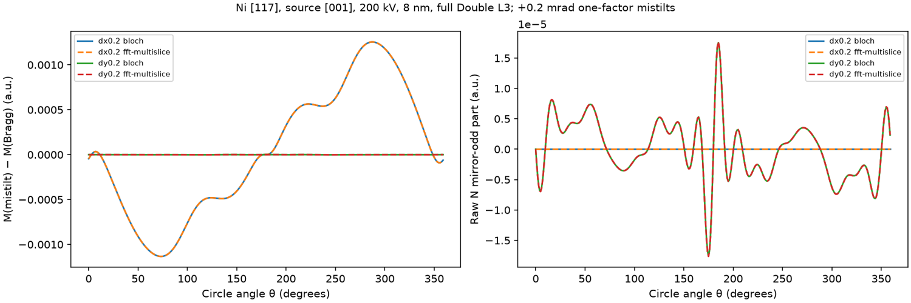
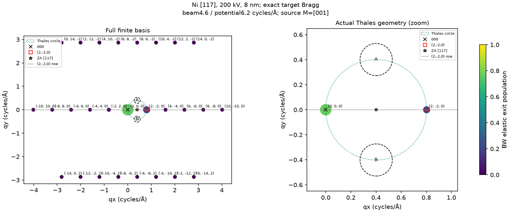
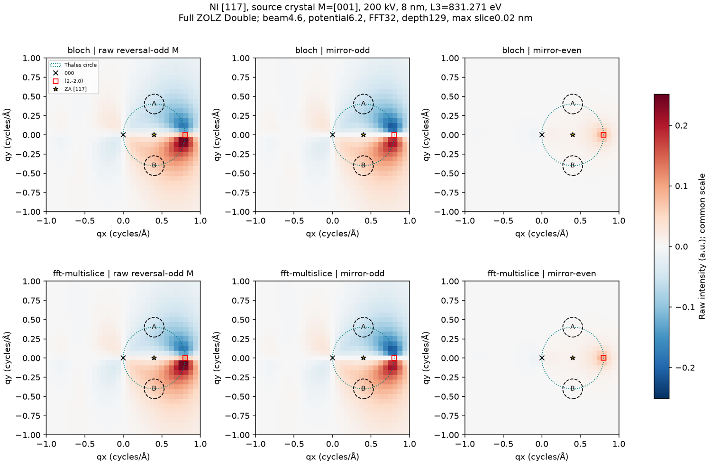
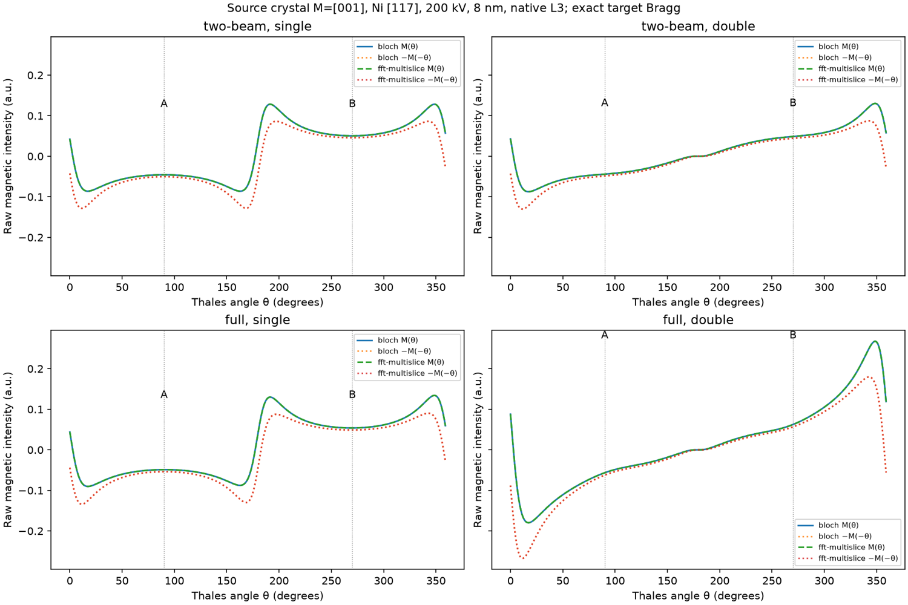
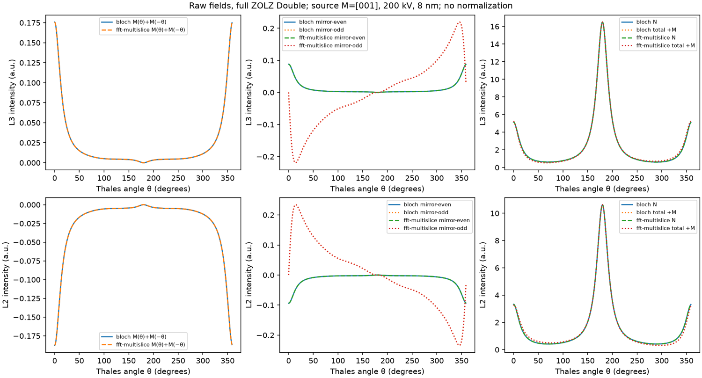
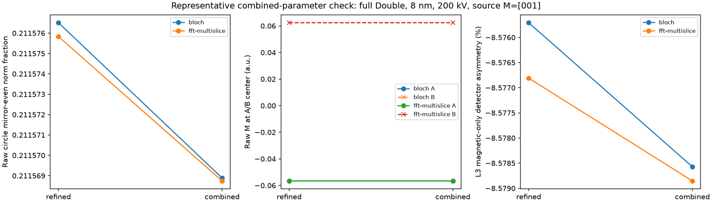

# Ni [117] / (2,-2,0): final source-magnetization symmetry validation

This report extends [the original audit](NI_117_EMCD_VALIDATION.md) on local
branch `feat/ni-117-emcd`, based on main commit
`236893392838ab5bc17dcf1848fd127009f2f048`. It is a scientific validation of the
existing projected, XMCD-constrained model. No simulation physics, numerical
defaults, released program, WIEN2k data or production checkpoints are changed.

The latest task supersedes the intervening proposed [110] comparison. **Only
source crystal [001] magnetization is a physical configuration here.** Actual
incident-aligned magnetization is an explicitly hypothetical symmetry control.
Previously calculated magnetization-independent Cartesian responses are reused;
superseded tensor products in their cache are excluded from all final tables,
NPZ exports and scientific conclusions.

## Source and geometry evidence

`data/wien2k_ni/Ni_fm.inso`, line 4, specifies `0 0 1` as the magnetization
direction. `Ni_fm.outputopup`, line 8, independently reports
`s-o calc. M|| 0.00 0.00 1.00`; its header also identifies Ni L23, RELA and SOC.
This is evidence from calculation companions, **not an inference from a GUI
default**. Companion/source SHA256 values are retained in the output provenance
and preservation manifests. Complete electronic-state/build provenance is not
reconstructed here; no WIEN2k executable is run.

The same unshifted XMCD coefficients, eta=beta=1 and native magnetic samples
L3=831.271 eV / L2=848.698 eV are retained. The proper effective tensor has
`Txx=Tyy=N`, `Tzz=beta*N`, `Txy=i*eta*D`, `Tyx=−i*eta*D` before rotation.
Reversal is applied in the original crystal convention; the Cartesian tensor
is rotated **once** by `R T Rᵀ`. This remains a Hermitian XMCD-constrained proxy,
not complex DFT-derived core-to-band transition amplitudes.

The target-aligned right-handed frame has rows
`[1,−1,0]/sqrt(2)`, `[7,7,−2]/sqrt(102)`, `[1,1,7]/sqrt(51)`.
FCC-allowed target (2,−2,0) satisfies `h+k+7l=0`; (220) does not.
At 200 kV, `g=(0.80261837,0)` cycles/Å and
`tilt=(−10.064569636897227,0)` mrad gives `s_target≈0` under the existing
paraxial excitation convention. ZA is `(0.40130918,0)` cycles/Å, not 000.

Source magnetization is `m_local=(0,−0.19802951,0.98019606)`.
The actual incident direction is computed from the microscope transverse
wavevector as `b=(λ*kx,λ*ky,sqrt(1−λ²*|k_perp|²))`, rather than equating it
with nominal [117]. The analytical expression below uses components in the
fixed **target-aligned frame**; actual beam-longitudinal and transverse
components are separately exported. No second tensor rotation to the beam
frame is applied. The earlier small-slope beam control is preserved; the new
control uses this fixed-wavenumber direction explicitly.

## Signed analytical mechanism

For `q0=(x,y,qz)` and `qg=(x−g,y,qz)`, the implemented convention has
`qz=−E_loss/(h*v_in)` in cycles/Å and angular `Q=2πq` in the MDFF/Coulomb kernel.
Then

`q0×qg = g(0,−qz,y)`, and `(q0×qg)·m = g(mz*y−my*qz)`.

With `T_ab(imaginary)=i*c*epsilon_abk*m_k` and
`C_ij=psi_i*conj(psi_j)` depth-averaged, the **signed** Single contribution is

`M(q)=−2*t*c*Im(C_0g)*g*(mz*y−my*qz) / [(2π)²*|q0|²*|qg|²]`.

This sign was checked against the actual source tensor and contraction, not
chosen to fit a plotted curve. The mirror-odd term is proportional to `mz*y`;
the mirror-even term is proportional to `−my*qz`. Both survive in an incoming
two-beam model. Source [001] has nonzero local my and finite loss gives nonzero
qz, so antisymmetry is **not** required.

Double Channeling uses transfers `q+delta`, where `delta=h_out−g_in`.
In the genuine two-beam subspace all delta_y are zero. Every pair satisfies

`(q+delta)×(q+delta') = (delta_x−delta'_x)*(0,−qz,y)`.

Thus the same magnetic geometrical factor holds in ideal two-beam Double,
with a different dynamical/Coulomb prefactor. For row-plane incidence that
prefactor is even under y reversal. Numerical even/odd component-ratio checks
are saved for both methods and both channeling models.

In full finite ZOLZ, delta_y can be nonzero. The exact cross product is

`(qz*(delta_y−delta'_y), qz*(delta'_x−delta_x),`
` x*(delta'_y−delta_y)+y*(delta_x−delta'_x)+delta_x*delta'_y−delta_y*delta'_x)`.

These extra terms and their coherent weights must be retained; the Single
000/g expression is not substituted for the full Double kernel. The present
model freezes qz across branches at a given loss. These identities do not
validate omitted branch-dependent longitudinal/HOLZ corrections.

## Raw signals and symmetry definitions

`M=[I(+M)−I(−M)]/2`, `N=[I(+M)+I(−M)]/2`, and `I(+M)=N+M` are calculated
before detector differencing, post-edge scaling or normalization. Row reflection
is `P:(qx,qy)→(qx,−qy)`. Define `M_even=(M+PM)/2`, `M_odd=(M−PM)/2`, with
fractions `||M_even||₂/||M||₂` and `||M_odd||₂/||M||₂`. Their squares sum to one
on the symmetric sampling support; these are norm fractions, not count fractions.

The actual transverse Thales circle has center g/2 and radius |g|/2.
`q(θ)=(g/2+(g/2)cos θ,(g/2)sin θ)`; mirror pairs are θ and −θ, **not** arbitrary
diametrically opposite positions. A and B are centered at θ=90°/270°, with
physical radius `0.16g`. Their center-direction intensities and their integrated
finite-aperture signals are reported separately.

Mirror antisymmetry, opposite/equal mirror-pair values and uniform magnitude
along a semicircle are different claims. There is no requirement of circle
uniformity. The transverse circle also does not make the full 3D transfer
vectors orthogonal when qz is finite. Algebraic paired differences
`M(q)−M(Pq)` are never used as evidence of physical parity.

## Numerical experiment and provenance

The refined profile retains potential 6.2 cycles/Å, beam 4.6 cycles/Å (27 full
ZOLZ beams), FFT32, depth 129, maximum slice 0.02 nm, raw maps33×33, 360 unique
circle samples (no duplicate 2π endpoint), detector97×97 and boundary
subpixels128. Ideal support contains exactly 000 and target, including outgoing
propagation. Tests cover 8, 12 and 30 nm, Single/Double and BW/MS.
The earlier direct-circle audit included both 0 and 2π in its 361 samples. Its
discrete norm fractions therefore weight that physical direction twice. In
particular, the old ideal-Single fraction 0.20804 versus the present 0.20740 is
not a new physical asymmetry mechanism; the pointwise formulas and covariant
old/current signals remain consistent. Other profile/numerical differences
must also be considered for full multibeam comparisons.

The combined representative 8 nm full-Double profile uses beam 5.4 (37 beams),
FFT48, depth 257, 720 circle samples and detector129×129/subpixels256. Potential
remains on the previously checked 6.2 plateau and max slice remains0.02 nm;
actual slice sizes are recorded. This is a joint beam/FFT/depth/angle/aperture
check, supplemented by the previous independent potential/slice controls. It
is not a test of every combination or a certified full spatial/thickness curve.

Each Cartesian response is evaluated with the existing solver and contracted
with both reversal tensors. Magnetization does not change elastic propagation,
so responses can be reused without repeating scattering. Responses are saved
atomically in 32-direction chunks, followed by compact case NPZ/JSON files.
No mirrored direction is substituted for a calculated direction. The equivalent
Single Cartesian response is tested against the existing tensor-map kernel.

Final analysis is in `outputs/ni_117_final_symmetry_validation/`; resumable
response provenance points to `outputs/ni_117_magnetization_comparison/`.
The older `outputs/ni_117_emcd_validation/` study is preserved. Code/physical
settings, exact signed hkl, source hashes, tensors, raw maps, circle coordinates,
detector weights/areas, incoming waves and timing are recorded. Existing 2 GiB
admission checks remain active; there is no silent change of numerical settings.

## Confirmed mechanism and model changes

The signed two-beam Single formula agrees with the actual calculated profile
to approximately **1.3e−14** relative maximum error. All actual ideal two-beam
Double branch-pair cross products obey the row expression within **5.6e−17**
absolute error. Predicting the raw even component from the odd component using
`even = odd*(-my*qz)/(mz*y)` away from y=0 agrees to approximately **1.8e−14**
of the full profile scale across the checked ideal cases.

An additional audit contracts the **existing source tensor's linear terms**,
without new physical configurations: its yz-normal magnetic vector term
(encoded by imaginary xz/zx tensor entries, proportional to my) and its
longitudinal term (imaginary xy/yx entries, proportional to mz). At exact
row-plane incidence, even the full-ZOLZ raw mirror-even signal matches the my
term, and the raw mirror-odd signal matches the mz term, to roundoff. The
source-term sum reconstructs raw reversal-odd M to order 1e−14. These signed
components are linear diagnostics, not independent positive cross sections.

This supports transverse magnetization as the **origin of the exact-Bragg
mirror-even component in the tested projected model**. It does not make its
amplitude independent of dynamical diffraction. At 8 nm, native L3, BW:

| Model | Circle even norm fraction | Mirror-even RMS (a.u.) | Magnetic detector asymmetry (%) |
|---|---:|---:|---:|
| Ideal two-beam Single | 0.207400821 | 0.014857963 | −7.741013862 |
| Ideal two-beam Double | 0.193205503 | 0.010740520 | −7.105099412 |
| Full ZOLZ Single | 0.204753786 | 0.015300901 | −8.022632086 |
| Full ZOLZ Double | 0.211576510 | 0.021887762 | −8.575707784 |

Relative to ideal support, full ZOLZ changes even RMS by +2.98% for Single
and +103.79% for Double. Adding outgoing channeling changes even RMS by
−27.71% in ideal support and +43.05% in full support. These are matched
counterfactual model changes, not an additive attribution of percentages of
the asymmetry. Norm fractions and raw RMS amplitudes convey different facts.
The common fixed-spectrum arbitrary-unit scale makes these comparisons
meaningful within this model; it is not an electron-count or SNR calibration.

At actual Thales center directions in 8 nm full Double, BW L3:

| Position | Raw M (a.u.) | Mirror-even (a.u.) | Mirror-odd (a.u.) |
|---|---:|---:|---:|
| A, θ=90° | −0.056581322 | +0.002895864 | −0.059477186 |
| B, θ=270° | +0.062373050 | +0.002895864 | +0.059477186 |

These unequal opposite-sign values precede any A−B calculation or
normalization. The finite detector apertures integrate a neighborhood and are
not point samples; their raw four-state signals are exported separately.
Actual incident-aligned controls give mirror-even fractions of order 1e−15
at exact row-plane incidence. The physical source remains [001], making an
angle **11.4361088°** with the actual incident direction; its actual
longitudinal/transverse components are **0.980146413 / 0.198275085**.

At 12/30 nm, full-Double BW L3 circle even fractions are
0.219102989 / 0.246004642, and detector asymmetries are
−10.139583451% / −8.104333616%. These are representative sampled results;
neither their maxima nor the whole thickness curve is asserted globally
converged. The original coarse-grid values must not be substituted for these
refined detector integrals.

## Historical result: what is and is not established

The exact historical [117] figure, its code version, magnetic axis, detector
definitions and raw arrays remain unidentified. The earlier inventory and its
access limitations are retained. **This is a controlled equivalent study,
not a reproduction of that figure.**

The old generic proper frame places the actual target at
`(0.57318416,−0.56183286)` cycles/Å, angle −44.427° to screen x. Covariant
tilt, q, tensor and detector transformations preserve the physics: earlier
Single checks agree at order 1e−14, and a new 36-direction Double BW check at
8 nm agrees within **1.52e−14** for magnetic and **7.31e−15** for nonmagnetic
signals. Old main did not support [117] FFT propagation; there is no fabricated
historical MS reproduction.

The earlier **5.94%** ideal and **10.69%** full Single profile changes caused
by deliberately retaining an untransformed horizontal tilt are coordinate
misuse controls. They are **separate from intrinsic magnetic asymmetry** and
not evidence that the historical run actually made that mistake. Similarly,
screen-y reflection is the wrong row mirror in the old diagonal frame, and
inconsistent physical detector coordinates could cause artificial contrast.
The actual-target GUI Thales overlay itself was not shown to select (220) or
have an index-sign defect.

## Numerical checks that must not be hidden

Existing acceptance limits remain **0.01 percentage points** for detector
dichroism and **0.001** relative error in raw four-state A/B intensities. They
are not relaxed to accommodate a result. Raw circle-profile errors and changes
in norm fractions are additionally reported directly; a vanishing control even
component is not assigned a meaningful relative error by dividing roundoff by
roundoff.

The previous independent beam, potential, FFT, slice and depth controls remain
available, along with their failed coarse angular/aperture checks. Potential
cutoff 2.5 cannot include the first off-row [117] harmonics (about 2.894 cycles/Å).
Neither using that cutoff with a nominal full basis nor BW/MS agreement alone
establishes full multibeam physics. The present profile uses 6.2 explicitly.

The new **same-field reintegration** is especially informative at 30 nm. It
uses exact cached directions, without interpolation or renewed propagation:

| Full-Double BW L3 aperture sampling | A_mag (%) | Difference from grid97 (pp) | Max raw relative error | Existing gate |
|---|---:|---:|---:|---|
| Grid17, subpixels32 | −7.874752710 | 0.229580906 | 0.008409119 | **FAIL** |
| Grid33, subpixels32 | −8.091212644 | 0.013120972 | 0.001116033 | **FAIL** |
| Grid33, subpixels128 | −8.090562678 | 0.013770938 | 0.000978760 | **FAIL dichroism** |
| Grid97, subpixels128 | −8.104333616 | reference | reference | comparison baseline |

This explains why agreement with earlier coarse detector values would be a bad
acceptance requirement. Refining only the aperture boundary cannot fully
converge a spatially varying intensity field. Conversely, these failures do not
make a directly sampled raw Thales-circle profile an aperture-area artifact.

An additional independent30 nm BW probe uses the existing analytic continuous
depth integral at24 actual circle directions, compared with the cached depth 129
trapezoidal result at precisely those directions. Magnetic relative L2 errors
are **4.101e−5 (L3)** and **4.107e−5 (L2)**; nonmagnetic errors are about1.1e−6.
This is a selected-direction depth check, not certification of every direction,
detector integral or full parameter combination. It supports separating the
large coarse-aperture error above from depth quadrature.

## Completed combined and one-factor controls

For 8 nm full Double, the combined refinement passes the unchanged detector
gates for both BW/MS and both edges, including the separate PRB raw-+M
dichroism readout. Representative **source-[001]** changes are:

| Quantity | BW L3 | MS L3 | Maximum over both methods/edges |
|---|---:|---:|---:|
| Raw circle profile relative L2 change | 6.268e−5 | 8.341e−5 | 8.341e−5 |
| Absolute even norm-fraction change | 7.622e−6 | 7.088e−6 | 7.694e−6 |
| Detector magnetic asymmetry change (pp) | 0.002865 | 0.002044 | 0.004645 |
| Maximum raw four-state intensity error | 0.00016970 | 0.00016348 | 0.00019229 |

Across these source comparisons, the raw **even profile** relative L2 change
is at most 1.017e−4; the A/B center-pair relative error is at most1.661e−4.
Mirror-odd fractions are exported too. At the *same fine propagation profile*,
subsampling 720→360 directions changes circle RMS by at most6.73e−16 relative
and even norm fraction by at most1.50e−16. This isolates angular sampling from
the joint propagation change; it is not an interpolation of a square map.

There are **72 passing matched BW/MS or joint-refinement detector checks**,
including both edges and the control, and **four passing 30 nm aperture checks**
(two methods × two edges). The largest BW/MS dichroism difference, including
controls, is0.005126 pp, below0.01 pp. Raw magnetic circle-profile BW/MS
relative L2 disagreement is at most0.0004144 (0.04144%). These successes do
**not** erase the failed coarse-grid checks above or establish independent
convergence at every thickness.

The additional 30 nm aperture97→129 test varies only detector sampling,
retaining the same beam, potential, FFT, depth, slice, circle and source.
Both methods reuse 2,896 energy-direction responses and calculate only 924
missing ones. BW L3 changes from−8.104333616% to−8.105596877%
(0.0012633 pp); MS changes by0.0012629 pp. BW maximum raw intensity change
is0.00015929. The circle profiles are **bit-for-bit identical**, because their
physical directions and compatible responses are reused. This separates
finite-aperture integration from raw circle symmetry.

At8 nm, additional matched full-Double controls vary only the physical tilt
for their directly calculated 360-point circles and97-grid apertures. Their
optional 9-grid preview maps are not compared to 33-grid spatial norms or used
in circle/detector integration. BW L3 results:

| Bragg offset (mrad) | s_target (Å⁻¹) | Circle even norm fraction | N circle odd norm fraction | A_mag (%) |
|---|---:|---:|---:|---:|
| (0,0) | approximately0 | 0.211576510 | roundoff | −8.575707784 |
| (+0.2,0) | +0.000160524 | 0.210703858 | roundoff | −8.682041979 |
| (0,+0.2) | approximately0 | 0.211573944 | 1.145e−6 | −8.575706485 |

The source axis and physical apertures stay fixed. X mistilt changes the raw
circle profile by0.6851% in relative L2 norm; Y mistilt changes it by9.328e−6.
The Y case introduces `D_nonmag=9.10e−8 a.u.` and additional parity mixing,
so not every off-row residual is assigned to the original my term alone.
These are **physical geometry changes**, not failed numerical-convergence
tests. Earlier ±0.2 mrad coarse controls remain preserved as separate evidence;
only the new positive offsets receive this refined matched-profile check.
Beam alignment is a restoring control only under the stated row-plane
symmetry assumptions; it is not claimed to restore that symmetry for arbitrary
off-row incidence.

The plotted differences are changes between actual calculations at different
tilts, not antisymmetrized detector maps. Both methods reproduce the changes.

## Figures, raw exports and reproducibility

The full finite basis and a physical-coordinate zoom show the signed target,
systematic row, 000, actual ZA and finite detector apertures. Dot color/size
represents BW exit population, not an inelastic magnetic signal.

Raw M, row-mirror-odd and row-mirror-even panels share one intensity scale
across BW/MS. Maps are center-sampled and drawn with cell-edge extents so that
overlays use their actual reciprocal coordinates. This plotting convention
does not alter any numerical map or detector integral. An equivalent L2 figure
is also saved.

Solid/dashed raw signals are compared with minus their mirror partners, with
common units and vertical scale. Dotted A/B angle indicators are physical center
directions, not aperture averages. The curves are not made antisymmetric by
detector subtraction.

The raw symmetry residual is `M(theta)+M(−theta)=2*M_even`, not a normalized
asymmetry. Reversal-even N and total +M remain positive physical intensities and
are distinct from the signed magnetic component. Full circle values are saved
at both native edge energies.

Machine-readable outputs in the same directory include `comparison.csv/.npz`,
`thales_circle.csv`, `source_tensor_components.csv`,
`aperture_sampling_recheck.csv`, `numerical_comparisons.csv`,
`numerical_summary.json`, `raw_circle_convergence.json`,
`bw_ms_circle_agreement.json`, `analytical_sign_validation.json`,
`historical_double_comparison.json`, `exact_depth_t30_stride15.json/.npz`,
`control_comparisons.json`, `preservation.json`,
`cases_index.json` and `provenance.json`. The index links every response cache
to its actual physical/numerical configuration and source-file hashes. PNG/SVG
versions of the figures are retained. Previous checkpoints are never rewritten
to assign them a later calculating code hash.

## Interpretation and limits

**Confirmed within this model:** the fixed source-[001] tensor permits magnetic
mirror-even intensity; it is already present with exactly two beams. The actual
sign, reversal relation and Single/Double transfer conventions support the
finite-qz/transverse-magnetization explanation. Correctly transformed old and
new frames give the same physical result. A hypothetical incident-aligned
control restores the expected row relation at exact row-plane incidence.

**Dynamical changes:** additional beams and outgoing channeling modify the
raw profile, its even amplitude, its norm fraction and detector integrals.
They cannot be dismissed because the target alone has zero excitation error.
At zero vertical tilt, the full source-term decomposition identifies my as the
even component; off-row mistilt can add further spatial parity mixing and
reversal-even detector imbalance. Such comparisons must keep source axis,
apertures, energies and all propagation settings fixed.

**Unresolved model accuracy:** the source constrains circular spectral
coefficients, not a genuine DFT-derived complex Cartesian MDFF. The assumed
longitudinal response beta, frozen branch qz, projected ZOLZ IAM, absence of
absorption/TDS/HOLZ and limited reciprocal support remain physical/numerical
limitations. No absolute experimental energy calibration, calibrated cross
section, dose or electron-count SNR follows from these arbitrary-unit maps.
This study does not change coefficients to enforce parity or establish
magnetocrystalline anisotropy from a rotated effective tensor.

**Historical attribution:** the original unidentified figure cannot be declared
either an implementation artifact or a quantitatively validated prediction.
Its observed type of asymmetry is physically permitted here, while coordinate
and detector misuse could separately have introduced an artificial contribution.
The controlled calculations establish those mechanisms, not the unrecovered
historical configuration.

Focused regression/scientific tests for this phase: **35 passed** across the
[117]/[017] geometry/project tests, source/branch/sign tests, Cartesian-response
and sampling tests, response-reuse guards and the two explicit BW/MS
free-outgoing→Single limit tests. Coverage
includes right-handed orientation, signed indices, target excitation/length,
FCC/ZOLZ membership, tensor Hermiticity/PSD/reversal, actual beam coordinates,
transfer-branch signs, detector symmetry, matched BW/MS, explicit two-beam
propagation and saved-project/[017] compatibility. Prior [001]/[017] control
arrays and protected production/[117] files are checked by hash preservation,
not regenerated to replace their reference outputs. No broad suite, GUI
modification, packaging, publication, tag, push or merge is part of this phase.

Preservation checks confirm **323 protected files unchanged**, including all
50 original [117] case NPZ/JSON pairs, all 204 production checkpoints, source
companions and the saved [001]/[017] bitwise-reference arrays. Four additional
previous [117] beam-control NPZ checksums also remain valid. All32 final case
metadata links resolve. Final CSV/NPZ exports contain only source [001] and
the allowed incident-aligned control.

## Scientific-use and merge assessment

1. **Physically permitted in this model? Yes.** A finite local my combined
   with finite qz produces the observed raw mirror-even magnetic component.
2. **Already in ideal two-beam? Yes.** The signed analytical prediction,
   actual two-beam kernels and Single/Double comparisons agree.
3. **Additional dynamical effects? Substantial amplitude changes.** Full
   multibeam/outgoing propagation modifies the even RMS and profile; exact
   row-plane decomposition still identifies the source my term as mirror-even.
   Off-row mistilt permits additional parity mixing.
4. **Numerically robust? For the tested representative scope.** The8 nm
   combined circle/profile/detector check passes;30 nm has passing finer
   aperture and selected exact-depth controls. Coarse grids demonstrably fail.
   No uniform full-parameter convergence of12/30 nm or of a thickness/tilt
   surface is claimed; BW/MS agreement alone cannot provide it.
5. **Was the old figure an artifact? Not established.** Covariant old/new
   code paths agree. Known coordinate-misuse controls can alter signals, but
   the unidentified historical run cannot be retrospectively classified.
6. **DFT/experimental validity? Still limited.** The current effective tensor
   does not establish a genuine anisotropic complex DFT MDFF or calibrated
   experimental magnitude.
7. **Ready to merge? Ready for scientific/code review toward an opt-in
   research integration with these explicit limits.** No unresolved sign,
   rotation or two-beam-parity defect was found in the tested implementation.
   Do not describe it as generally converged quantitative [117] production
   support, change the default potential cutoff into an implicit validation,
   or broaden the certified scope without additional tests. The default 2.5
   cutoff is not sufficient for off-row [117] physics. Review and acceptance
   of these limits should precede any merge; no merge or release is performed.
