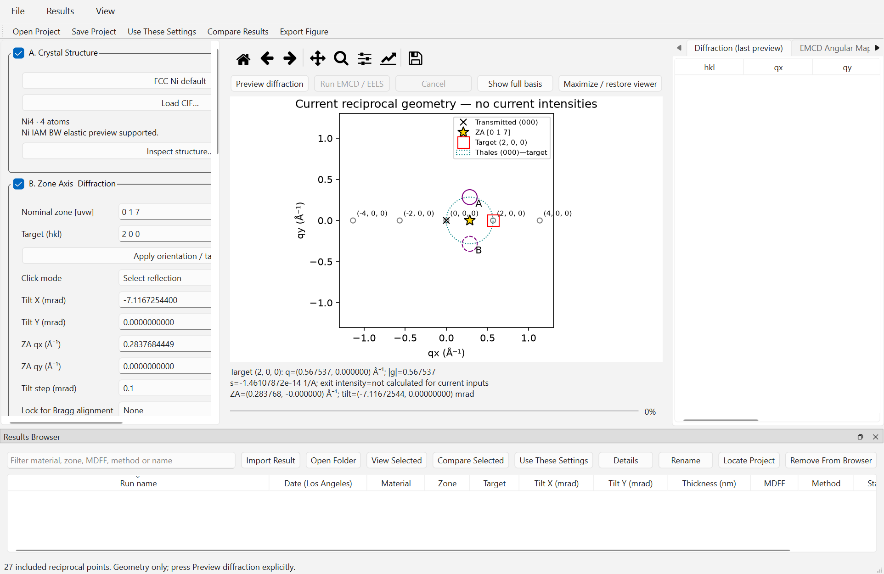

# EMCD-Sim v0.7.0-beta.1 Windows Quick Start

> **Critical scientific compatibility notice:** legacy Windows packages before
> **v0.7.0-beta.1** used a superseded Born/MDFF convention affecting calculated
> magnetic-odd EMCD signs. Historical signed L3/L2 magnetic spectra require
> revalidation or recalculation before interpretation under the corrected
> convention. This does not imply that all historical nonmagnetic EELS,
> diffraction intensities or thickness trends are wrong. Preserve original
> arrays, software/convention and source provenance; never silently flip or
> relabel legacy arrays. Intermediate corrected source commits, including
> `4f578156`, still used the old version label: exact commit/convention metadata
> takes precedence over version alone. Missing convention is unknown or
> legacy-unverified. Absolute experimental magnetic handedness is uncalibrated.

Follow [installation](INSTALL_WINDOWS.md) first. This is a selected-energy Ni [017] example, not a timing guarantee or complete physical-convergence claim. See the [full tutorial and settings](USER_GUIDE.md#validated-ni-017-8-nm-double-example), [acceptance](V061_BETA_ACCEPTANCE.md) and [scientific analysis](NI_EMCD_THICKNESS_SCIENTIFIC_ANALYSIS.md).

## 1. Extract and open

Use the local `EMCD-Sim-v0.7.0-beta.1-Windows.zip` and its new SHA256 from
[candidate acceptance](WINDOWS_0_7_0_BETA_1_ACCEPTANCE.md). No new Actions artifact,
release or tag is published. Extract the complete folder and launch
`EMCD-Sim/EMCD-Sim.exe` with `_internal` beside it. Verify version and physics
convention in About. Settings and Diffraction remain side-by-side; expand
collapsible controls as needed. Source defaults remain 300 kV, beam/potential
3.2/2.5, 97x97, 2048 MiB and max slice step 2 nm. The example below explicitly
selects 200 kV and is not a complete physical-convergence certification.

## 2. Configure Ni [017], exact (200) Bragg

1. **File → New**, then **FCC Ni default** (a = 3.524 Å). Use **View → Restore Default Layout** if needed.
2. Set **Nominal zone [uvw]** `0 1 7`, **Target (hkl)** `2 0 0`, and **Apply orientation / target**. Set **Voltage (kV)** = 200 and **Thickness (nm)** = 8.
3. **Reset to reference geometry** gives **Tilt X (mrad)** = -7.116725439974256 and **Tilt Y (mrad)** = 0. **Preview diffraction** computes elastic intensities. **Select reflection** / **Align to selected Bragg** displays s200 approximately zero. Keep the explicit [001] systematic-row checkbox off.
4. **Restore Thales A/B** sets centers (+0.2837684449489217, ±0.2837684449489217) Å⁻¹, radius 0.0908059024 Å⁻¹. Transmitted (000) is the cross; projected ZA [017] is the star at (+0.2837684449489217, 0), not the origin. The Thales circle spans (000) to (200). Exact Bragg is not an isolated two-beam wavefield.

This is an existing v0.6.0 frozen screenshot showing geometry controls; it is not a screenshot of the new 97-grid preset interface.

## 3. Select the tensor and calculate

1. In **D. MDFF Model**, choose **XMCD-constrained (WIEN2k)**. The bundled source is `EMCD-Sim/_internal/data/wien2k_ni/Ni_fm.xmcd`; use **Browse XMCD...** if needed, then **Validate source / native features**.
2. Keep **Crystal Cartesian M axis** `0 0 1`, eta = beta = 1. Explicitly set **L3 native feature (eV)** = **831.4778** and L2 = **848.698** for this locked benchmark. The source audit's 831.271 eV extremum is different. Do not shift the native energy axis. Inspect and check **I declare M axis, RP/LP convention and edge assignments**.
3. Choose **Channeling Model → Double Channeling**, **Propagation Method → Bloch-wave** and **Spectral coverage → Selected L3/L2 samples only (not full EELS)**. Enable **Calculate angular maps**. Disable **Enable post-edge A/B correction** for this two-energy workflow; use a genuine full spectrum for post-edge diagnostics.
4. Set beam cutoff 4.6 Å⁻¹, potential Fourier cutoff 6.2 Å⁻¹, B = 0 Ų, **Depth integration nodes** = 257, **Map halfwidth** = 0.5 Å⁻¹, **Aperture boundary subpixels** = 64. Choose **Angular Map Resolution → Standard - 97x97** and **Estimated process memory budget → 2048 MiB**. If switching to MS/Both, set **FFT grid (even)** = 48 and **Max slice step (nm)** = 0.04.
5. Click **Run EMCD / EELS** once. **Cancel** requests cooperative cleanup and preserves the last completed result; wait for completion before another run. No numerical settings are silently reduced. Memory rejection reports the limiting estimate. MS/Both, High resolution or full spectra can take much longer.

The [manual](USER_GUIDE.md#validated-ni-017-8-nm-double-example) records source hashes and numerical precision. Standard 97 is a routine starting point for this tested case, not a universal convergence guarantee.

## 4. Read the results

- **Virtual Detector EELS:** original +M A/B spectra share one intensity scale. **Signal Display → Raw (a.u.)** shows magnetic and nonmagnetic signed differences. **EMCD Asymmetry (%)** shows the total +M difference/sum, which may contain nonmagnetic imbalance. Selected-energy results remain points, not full white-line spectra.
- **EMCD Angular Maps:** choose L3/L2 and Raw/Asymmetry. Full-field maps use actual saved (qx,qy)/(qx,-qy) pairs; detector circles are overlays. Invalid denominators remain NaN. Do not average local percentages to approximate finite-detector EMCD: integrate raw intensities first.
- **Advanced Diagnostics** retains intrinsic magnetic/even fields, magnetic-only/even percentages and legacy corrected/residual contrasts. Corrected contrast is not intrinsically magnetic.
- With Both results, **BW/MS Diffraction**, **BW/MS Overview** and the method selector's **BW-MS numerical difference** compare the independent solvers. Comparing Single and Double instead compares physical models.

Changing display settings does not rerun propagation. See [signal definitions](USER_GUIDE.md#signal-definitions-in-061).

## 5. Save, reopen and export

Use **File → Save Project As...** and keep the entire project folder. **Open Project** or **Results Browser → View Selected** reopens arrays without a calculation. **Use These Settings** separately restores controls. Existing explicit grid/memory settings remain intact; **File → New** resets 97 x 97 / 2048 MiB.

Use **Export current plot PNG / SVG…**, **Export completed EMCD / EELS...**, or **Export derived NPZ/CSV + metadata**. Derived percentages accompany original raw arrays; exports do not overwrite the source project. See the [export guide](USER_GUIDE.md#export-figures-and-data).

## Limits to keep with your figures

Approximate XMCD-constrained MDFF, projected IAM and documented longitudinal-transfer approximation remain. No complete DFT transition tensor, globally converged physics, calibrated absolute EELS intensity or experimental SNR is claimed. [001] restricted-row results are not full-ZOLZ exact two-beam validation; [017] is the preferred reference. Independent clean-machine installation is **NOT TESTED**. See the [case-study gallery](NI_017_CASE_STUDY_GUIDE.md) and [release notes](RELEASE_NOTES_0_6_1_BETA_1.md).
