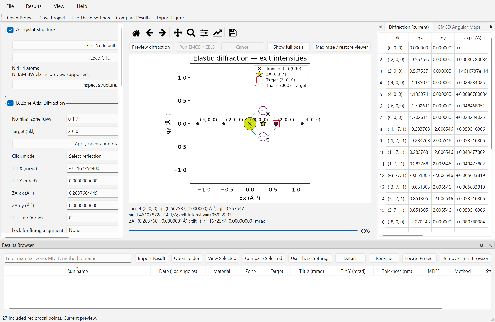
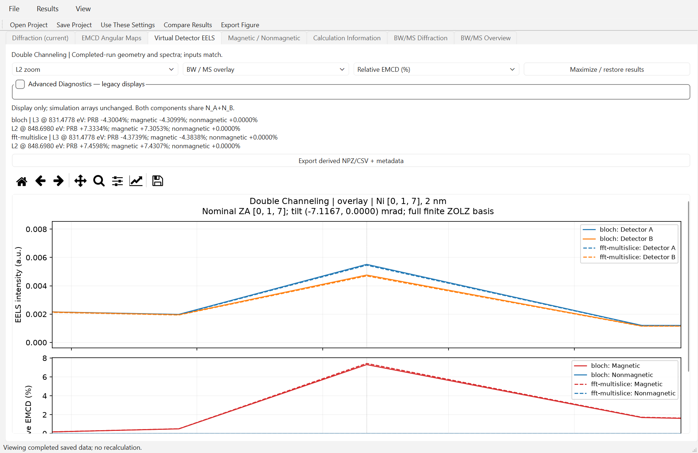

# EMCD-Sim Windows Quick Start

This is a short reading guide, not a promise of total calculation time.
For installation details see [Install on Windows](INSTALL_WINDOWS.md); for
interpretation and other workflows see the [User Manual](USER_GUIDE.md).
This guide describes the **0.4.5 Windows research Beta**.

## 1. Extract and open

Open the [GitHub Windows Beta release](https://github.com/dingpengem/EMCD-Sim/releases/tag/v0.4.5-beta.1) and download
`EMCD-Sim-0.4.5-Beta-RC-Cancellation-Fix-Windows.zip`. Verify the checksum in
the installation guide and **Extract All**. In the extracted `EMCD-Sim`
folder, double-click `EMCD-Sim.exe`. Keep `_internal` beside it. No Python,
Conda, VS Code or WIEN2k installation is required. Initialization can take
tens of seconds. Do not run inside the ZIP.

## 2. Preview the default Ni reference

1. Choose **File → New**, then **View → Restore Default Layout** if an old
   layout or selection is restored. **FCC Ni default** selects the built-in
   conventional Ni cell, a=3.524 Å.
2. Confirm **Nominal zone [uvw]** `0 1 7`, **Target (hkl)** `2 0 0`,
   **Voltage (kV)** `200`, **Thickness (nm)** `30`. Use **Reset to reference
   geometry** if needed: Tilt X is approximately `-7.11672544` mrad and Y is zero.
3. Click **Preview diffraction**. The initial geometry drawing is replaced
   by calculated elastic intensities. In **Select reflection** click (200),
   then **Align to selected Bragg**. Check `s≈0` below the plot.
4. The cross is transmitted (000); the star is projected **ZA [017]**.
   They differ at this exact-Bragg tilt. The Thales circle has (000)–(200)
   as its diameter. Use **Restore Thales A/B** for the physical apertures.

Actual accepted Beta Windows capture at native 150% scaling, showing the
indexed [017] geometry and physical detector outlines. Labels in **Calculation Information**
distinguish current inputs from the completed-run snapshot.

## 3. Select the bundled spectrum and run BW

1. Expand **D. MDFF Model** and choose **XMCD-constrained (WIEN2k)**.
2. The source normally points to the bundled five-column example. If empty,
   **Browse XMCD...** to `EMCD-Sim\_internal\data\wien2k_ni\Ni_fm.xmcd`.
3. Click **Validate source / native features**. Check L3 `831.271` and L2
   `848.698` eV and **Crystal Cartesian M axis** `0 0 1`. These are native
   calculated features, not calibrated experimental edge energies.
4. For the supplied example, retain eta=beta=1 and check **I declare M axis,
   RP/LP convention and edge assignments**. Bundled numerical data have no
   companion audit; the declaration is deliberately not automatic.
5. Choose **Channeling Model → Single Channeling** for entrance-only, or
   **Double Channeling** for incoming and reduced-energy outgoing propagation.
   Choose **Propagation Method → Bloch-wave**, **FFT Multislice**, or **Both**.
   Leave the default numerical
   settings. For corrected curves, explicitly check **Enable post-edge A/B
   correction** and retain its separate `878–882 eV` window. Validation of an
   unaudited source can leave correction off; do not mistake that for failure.
6. For full energy coverage, choose **Spectral coverage** → **Full native
   energy-resolved spectrum**; selected L3/L2-only results are two points,
   not complete curves.
   Click **Run EMCD / EELS** once. **Cancel** immediately shows **Cancelling...**,
   then **Calculation cancelled.** after cooperative cleanup. It preserves the
   last completed result and restores controls. An individual native numerical
   call must finish before it can acknowledge cancellation.
   Changing display options later does not rerun the solver.

## 4. Read maps and EELS

- In **EMCD Angular Maps**, choose **L3** or **L2**. **Magnetic odd** is the
  reversal-odd signal; **Nonmagnetic even** is reversal-even intensity.
  Raw and corrected paired A−B maps are different observables.
- In **Virtual Detector EELS**, the upper panel shows +M A/B EELS on the
  original shared intensity scale. The lower panel shows signed magnetic and
  nonmagnetic components. Select **Raw EMCD (a.u.)** or **Relative EMCD (%)**;
  both relative components share N_A+N_B. PRB difference/sum is a separate
  readout. Choose **Full spectrum**, **L3 zoom** or **L2 zoom**.
- **Advanced Diagnostics** retains four reversal spectra, post-edge correction
  and optional legacy peak normalization. Corrected contrast is not intrinsic
  magnetic EMCD. Two-energy saved results remain points, not white-line curves.
- The locked production benchmark uses **831.4778 / 848.698 eV**, distinct
  from the auto-audit L3 extremum **831.271 eV**. At the validated [001] row,
  8 nm Double profile the PRB values are -13.2278% / +22.4154%; these are
  model-specific calculated percentages, not expected results for every GUI
  default. See the [full-spectrum report](DOUBLE_CHANNELING_FULL_SPECTRA.md).

Actual accepted Beta BW/MS Double comparison at a manageable dispatch-test
profile, not a production convergence benchmark. The lower panel uses the
common nonmagnetic sum for both signed components; it is not peak-normalized.
Post-edge-corrected A−B is **not automatically intrinsic magnetic EMCD**.

## 5. Save and reopen

1. **File → Save Project As...**: choose a writable research folder outside
   the application, then a new name such as `Ni017_BW_reference`.
2. Keep the entire resulting folder, including `project.json` and NPZ/JSON
   companions. **Save Project** updates the selected saved project; use
   **Save Project As...** to preserve a new condition separately.
3. **Open Project** and select that complete folder, or select it in the
   **Results Browser** and use **View Selected**. Maps and spectra reopen
   without a calculation.
4. **Use These Settings** restores inputs separately. Rerunning needs the
   original matching source; viewing saved data does not. A stale-result
   banner means current inputs differ from the completed result, not that
   its arrays have changed.

Next: use the [manual's mistilt comparison](USER_GUIDE.md#compare-two-conditions)
and export tutorials. Check [release readiness](STAGE_G_RELEASE_READINESS.md)
for historical checks, and the [release notes](RELEASE_0_4_5_BETA.md) and
[cancellation acceptance](DOUBLE_CHANNELING_CANCELLATION.md) for the current Beta.

## Limits to keep with your figures

Projected IAM; Single entrance-only or Double incoming/outgoing channeling;
no atomic-3D electrostatic multislice; branch-frozen longitudinal transfer.
The XMCD-effective
tensor is not a full complex DFT MDFF; the atomic model is non-DFT. There is no
absolute experimental cross-section or native-energy calibration. GUI FFT is
verified for FCC Ni [017] and the explicit [001] (200) row model, not arbitrary
CIFs. Potential/basis/FFT/depth controls passed for selected reference settings;
that does not certify every geometry, thickness or the older low-cutoff survey.

Earlier default XMCD BW/MS/Both runs took about 49–119 seconds and peaked
near 297 MiB on the tested host; larger Double/full-energy jobs can take much
longer and require more RAM. These historical observations are not guarantees
or minimum hardware requirements. Keep your selected numerical settings;
memory admission rejects oversized jobs without silently reducing them.
