# macOS ARM64 Quick Start — Ni EMCD spectrum and momentum-space maps

[Home](../README.md) · [macOS Installation](INSTALL_MACOS.md) · [macOS Research Beta](https://github.com/dingpengem/EMCD-Sim/releases/tag/v0.9.0-beta.1-macos-arm64.1) · [Windows Quick Start](QUICK_START.md) · [MDFF Workflows](MDFF_WORKFLOWS.md)

This walkthrough uses a **normal-size, illustrative FCC Ni Bloch-wave Single Channeling request**, with **a sampled L₂,₃ spectrum and 97×97 momentum-space maps at the selected L₃/L₂ energies**. It is a more representative introduction than the earlier 2-energy, 9×9 packaged smoke test.

**Validated packaged workflow (11 November 2026): PASS.** This exact case completed in the published ARM64 app, including raw CIF/XMCD configuration, Done → Apply and Close, calculation, figure/data export, and project close/reopen. This was **automated native Qt acceptance**, not direct human inspection. See the [acceptance record](MACOS_QUICK_START_ACCEPTANCE.md) for application identity, measurements and remaining GUI limitations. Neither this recipe nor the optional [minimal installation diagnostic](INSTALL_MACOS.md#5-optional-minimal-packaged-ni-diagnostic) establishes physical convergence, experimental calibration or quantitative magnetic moments.

You need an Apple Silicon Mac with macOS 15+ and the [standalone ARM64 Research Beta](https://github.com/dingpengem/EMCD-Sim/releases/tag/v0.9.0-beta.1-macos-arm64.1). [Install it with Finder](INSTALL_MACOS.md#2-download-and-install-using-finder). No Python, Conda, Terminal or developer tools are required. The package is ad-hoc signed, not Apple notarized; see the [first-launch guidance](INSTALL_MACOS.md#3-first-launch-and-troubleshooting).

## 1. Copy the bundled input files

Create **Documents → EMCD-Sim Examples** in Finder. In Applications, Control-click **EMCD-Sim** → **Show Package Contents**, and **copy** (do not move or edit) these files into that folder:

- `Contents/Resources/examples/Ni_FCC_a3.52.cif` — four FCC Ni atoms, `a=3.520 Å`.
- `Contents/Resources/data/wien2k_ni/Ni_fm.xmcd` — example five-column Ni XMCD source.

Keep the original files in the app. Save simulation projects separately in Documents.

## 2. Import Ni and accept its MDFF

1. Open **File → New Project**. Under **Material → Open CIF…**, select your `Ni_FCC_a3.52.cif` copy. **Inspect structure…** should show four Ni atoms and a 3.520 Å cubic cell (not the built-in 3.524 Å reference).
2. Open **3D Structure Viewer… → Site groups**, select **Global Magnetization Mode**, and set **Global Material M (x y z) = 0 0 1**.
3. Choose **Configure MDFF…** and check that the context is **Global Material configuration**. Select **XMCD-constrained MDFF** and browse to your `Ni_fm.xmcd` copy.
4. Browsing checks the source automatically; **Recheck source (optional)** repeats that check. Use the actual selected features **L₃ = 831.271 eV** and **L₂ = 848.698 eV**; set **eta = beta = 1**. These are source-specific features, not universally tabulated Ni edges.
5. Complete the visible declarations truthfully:

| MDFF field | Value for this example |
| --- | --- |
| Declared element / core-loss edge | `Ni` / `L2,3` |
| Source / provenance | `Ni_fm.xmcd; supplied five-column Ni source` |
| Physical assumptions / limits | `Effective axisymmetric XMCD-derived Ni diagnostic; not quantitatively calibrated for this CIF` |
| Relative tensor reference | `1` (relative, not an absolute cross section) |
| Scientific status | `physical_source_unvalidated` |
| Convention acknowledgement | Review and check **Confirm RP−LP about Material +M and the displayed L3/L2 assignments** |

6. Click **Done** to return to the 3D Viewer. Then click **Apply and Close** in the Viewer. Both are required to accept the configuration; preview alone does not make it active.

## 3. Set a representative Ni calculation

Select **General settings (editable)** where necessary. Use the following case; it retains the documented 3.520 Å Ni [017]/(200) geometry, rather than the deliberately unphysical 0.1 nm thickness and ideal 2-beam-only basis used by the old smoke test.

| GUI section / control | Input |
| --- | --- |
| Material → elastic scattering provider | **Adaptive Dirac–Padé 2026** (default) |
| Material → Debye–Waller B | **0** |
| Microscope & Sample | **200 kV**, **10 nm** thickness |
| Zone Axis & Diffraction → orientation | **[0 1 7]**, target **(2 0 0)**, **Full finite ZOLZ**; click **Apply orientation / target** |
| Zone Axis & Diffraction → tilt | **X = −7.124812628 mrad**, **Y = 0 mrad** for the actual 3.520 Å CIF at 200 kV |
| Propagation Method | **Bloch-wave**, **Single Channeling** |
| Propagation Method → explicit target systematic-row approximation | **Off** |
| Shared Calculation Settings → numerical settings | **General settings (editable)** |
| Elastic Potential and Beam Support | **Beam / MDFF cutoff 2.5 Å⁻¹**, **potential Fourier cutoff 2.0 Å⁻¹** (21 retained beams in the validated run) |
| Inelastic and Angular Sampling → depth | **64 integration nodes** |
| Inelastic and Angular Sampling → aperture boundary | **64 subpixels per direction at boundary** |
| Inelastic and Angular Sampling → map halfwidth | **1.0 Å⁻¹** |
| Inelastic and Angular Sampling → Angular Map Resolution | **Standard – 97×97** (or set angular/detector grid points to **97**) |
| Inelastic and Angular Sampling → Energy sampling | **Entire energy range → uniform sampling** |
| Inelastic and Angular Sampling → energy points | **241 points per modeled source window**, with exact selected L₃/L₂ energies included |
| Inelastic and Angular Sampling → angular evaluation | **Full angular maps at selected energies: ON**; **Full angular field at every energy (advanced): OFF** |
| Compute Resources | **CPU workers: Auto**; **Memory budget: Auto** |
| Virtual Detectors | **Restore Thales A/B** for this geometry; **radius = 0.09 Å⁻¹** |

**Retained scientific limitation:** the requested 2.0 Å⁻¹ potential cutoff is below the first off-row ZOLZ harmonic (about 2.029 Å⁻¹). The app warns that no off-row potential harmonics are retained. Full finite ZOLZ remains the selected basis mode; this example does not establish a full 2D potential or off-row convergence.

For this bundled Ni source, the validated merged array contains **243 distinct energies**: 241 uniform samples over **823.625–882.521 eV**, plus the exact **831.271 eV** and **848.698 eV** features. Neither feature coincides with a uniform sample. Confirm the actual count; the summary can be clipped in a narrow settings panel. Do not shift the source energy scale without evidence.

Use the **97×97 physical momentum-space grid** for angular maps. At a map halfwidth of 1.0 Å⁻¹, the nominal spacing is approximately **0.0208 Å⁻¹** between adjacent samples along each axis. These q-space coordinates are **not** the multislice FFT mesh or a real-space 4D-STEM scan grid. Aperture boundary subpixels refine integration weights, not the underlying 97×97 map.

Only the **two selected L₃/L₂ energies** request full 97×97 maps. The other spectral energies evaluate the detector-support coordinates needed for the A/B EELS/EMCD spectra. Leave **Full angular field at every energy (advanced)** **off**; it would request much more work without supplying more displayed selected-energy maps. Do not confuse the **number of spectral samples** with the **number of q pixels**.

After selecting Standard 97×97, inspect the effective grid and **map halfwidth**; changing presets can update more than one control. Do not choose another preset merely to alter a caption.

## 4. Run and inspect both kinds of result

1. Review **Compute Resources**: effective Auto workers, effective memory budget, predicted peak and **Admission**. Auto selections depend on the actual Mac and workload; no single worker count or budget applies to every machine. **Ready** means resource admission, not scientific convergence.
2. Click **Preview diffraction** if you want to inspect the retained full finite ZOLZ beam basis and [017]/(200) alignment; this is a separate elastic preview. Then select **Run EMCD / EELS**.
3. Inspect **Virtual Detector EELS** to see the sampled energy dependence across the modeled Ni L₂,₃ range. Inspect the two detector signals and the chosen magnetic/nonmagnetic or reversal-derived observables using their actual definitions. An extended simulated spectrum is not experimental energy resolution or a calibrated cross section.
4. Inspect **EMCD Angular Maps** at **831.271 eV** and **848.698 eV**. These should be **97×97 q-space maps**. Raw difference/asymmetry views and the fixed A/B aperture overlays are different quantities; a high-resolution display zoom does not create additional computed samples.
5. Export both the **spectral data** and **angular maps**, using **Results → Export Results…** and the relevant **Export Figure…** toolbar actions.
6. Use **File → Save As…** for a new project folder, then **Close Project → Open Project…** to check that accepted settings, the spectra and maps restore without recalculation.

If Run is unavailable, check the **Done → Apply and Close** acceptance transaction, selected source-energy coverage, diffraction settings and the complete resource-admission reason. Do not change beam, energy, momentum grid or physics values silently just to obtain a pass.

## 5. Understand the two independent sampling dimensions

| Sampling dimension | What is calculated | Why it matters |
| --- | --- | --- |
| **Energy: 241 uniform + selected L₃/L₂** | Detector-integrated values as a function of energy | Provides a model EELS/EMCD spectrum rather than only two isolated edge samples |
| **Momentum: 97×97** | Two physical qx–qy intensity maps at selected energies | Reveals angular dependence, detector positions and magnetic/nonmagnetic contrast |
| **Other energies: detector-only q support** | A/B detector spectra without a whole angular image at every energy | Controls cost without fabricating the spectral values by interpolating final detector signals |

Both dimensions are real numerical sampling choices, but they address different questions. Increasing energy points does not improve q-space resolution, and increasing q-grid points does not improve energy sampling.

The completed run evaluated **9,409 q pixels at each selected energy** and **162 detector-support pixels at each of the other 241 energies**. Each spectral energy has its own calculated response; final detector intensities are not interpolated between two edge results. This saves full-field work while retaining the requested spectral sampling. It does not establish sampling convergence.

## 6. Verified run and genuine figures

Measured on **Apple M2 Pro, 10 logical cores (6P + 4E), 16 GiB RAM, macOS 26.3.1**, using the unchanged published app from source `03dc8f8d1f0374984c9fc81866eaa32ce48008d0`.

| Recorded quantity | Actual value |
| --- | --- |
| CPU / memory modes | Auto / Auto |
| Effective BW workers | 1; Single Channeling has no detector executor |
| Memory budget at Run | 729 MiB (preview was 723 MiB) |
| Estimated process peak at Run | 396.6 MiB |
| Sampled process RSS peak during Run/display | 299.6 MiB; baseline 261.4 MiB |
| Native process lifetime RSS high-water mark | 401.9 MiB, including startup/configuration |
| Calculation wall time | 93.4 seconds; Run through display 94.4 seconds |
| Spectrum / selected maps | 243 samples / two 97×97 maps |
| Completion, export, project close/reopen | PASS |

Memory readings have different scopes: the conservative Run estimate is not a measured high-water mark. The run/display sample peak used 1,939 readings with a 20 ms target interval; scheduling makes actual intervals nonuniform and short peaks can be missed. Existing system memory pressure was Warning with about 4.6 GiB swap in use; admission was Ready. These are observations from one instrumented run, not a speed or RAM guarantee for other Macs. Auto budgets refresh as available memory changes.

### Structure and accepted MDFF

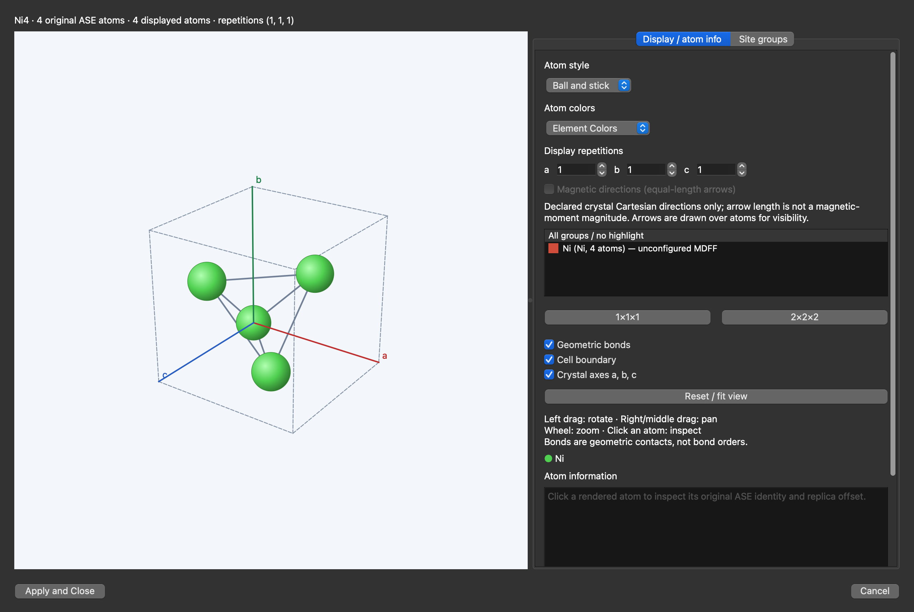

Actual native Viewer showing the imported four-atom, 3.520 Å Ni cell.

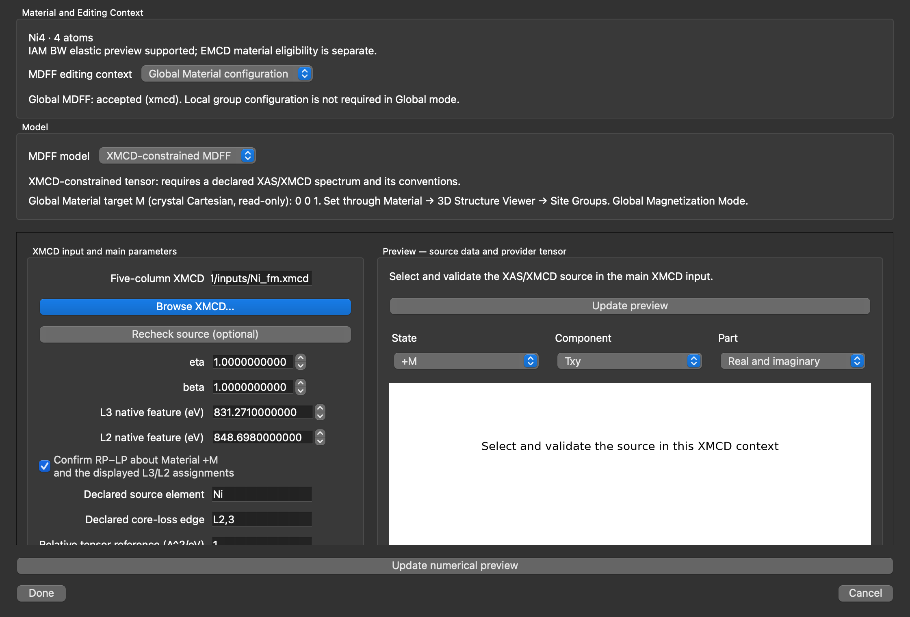

Accepted Global XMCD configuration, M = (0, 0, 1), with the source-specific L₃/L₂ declarations. Done left the Viewer open; Apply and Close accepted the configuration.

### Independent energy and momentum controls

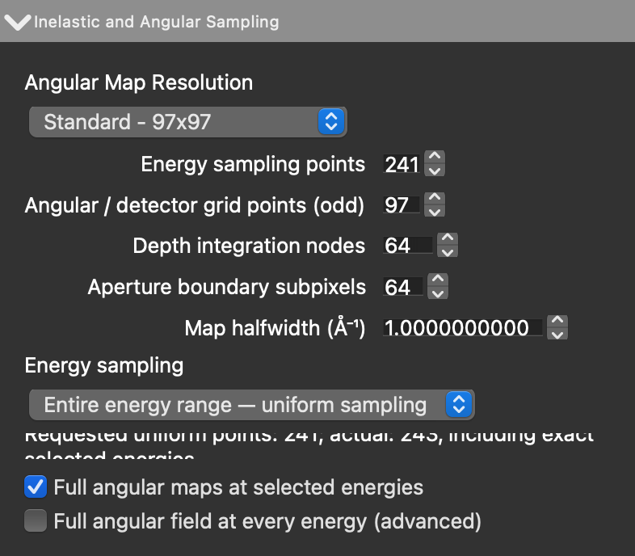

241 uniform energy points, Standard 97×97 angular grid, 64 depth nodes, 64 boundary subpixels and 1.0 Å⁻¹ halfwidth. Selected-energy full maps are on; every-energy full fields are off. The merged-count summary is partly clipped in this native layout; exported arrays independently confirm 243 energies.

### Completed spectra and momentum maps

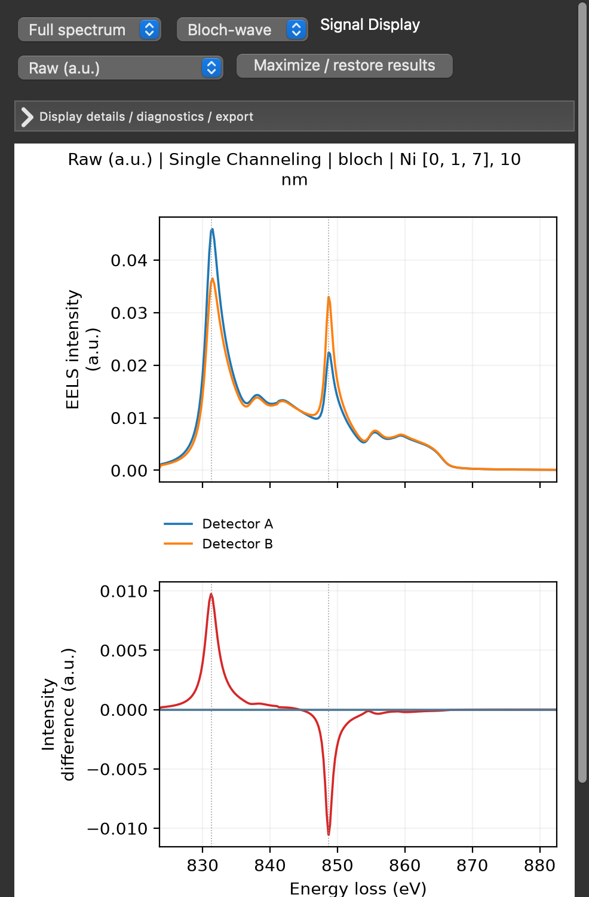

Native Results viewport after completion. For the complete plot, use the app's normal figure export below.

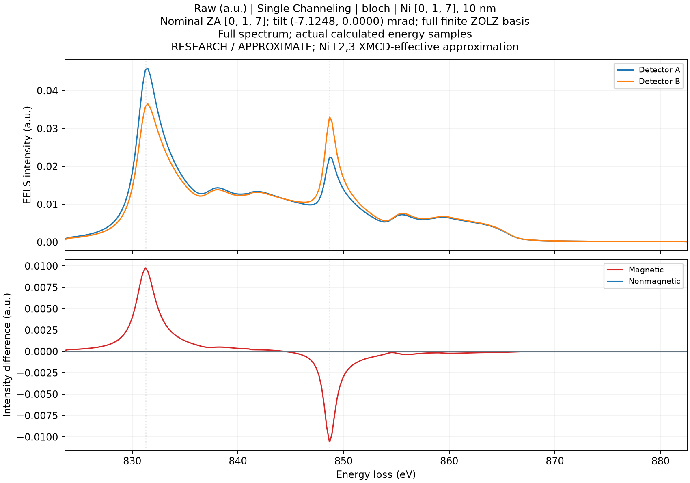

Unmodified figure exported by the app from all 243 calculated energies. Intensities are relative; magnetic reversal definitions are unchanged. The magnetic detector difference changes sign across the source features; the nonmagnetic A/B imbalance is at floating-point roundoff for this symmetric case.

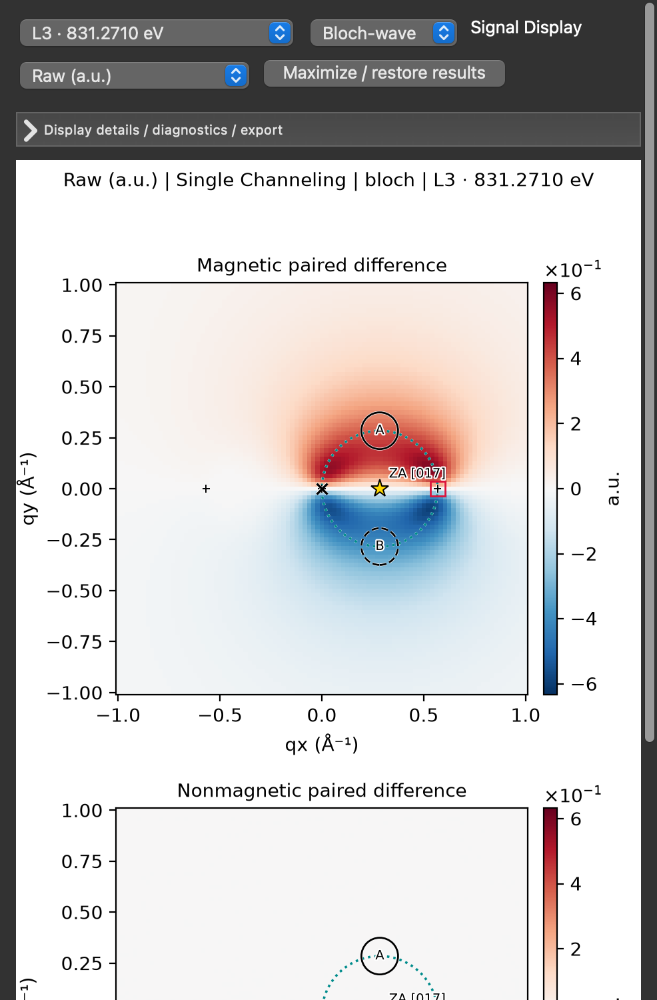

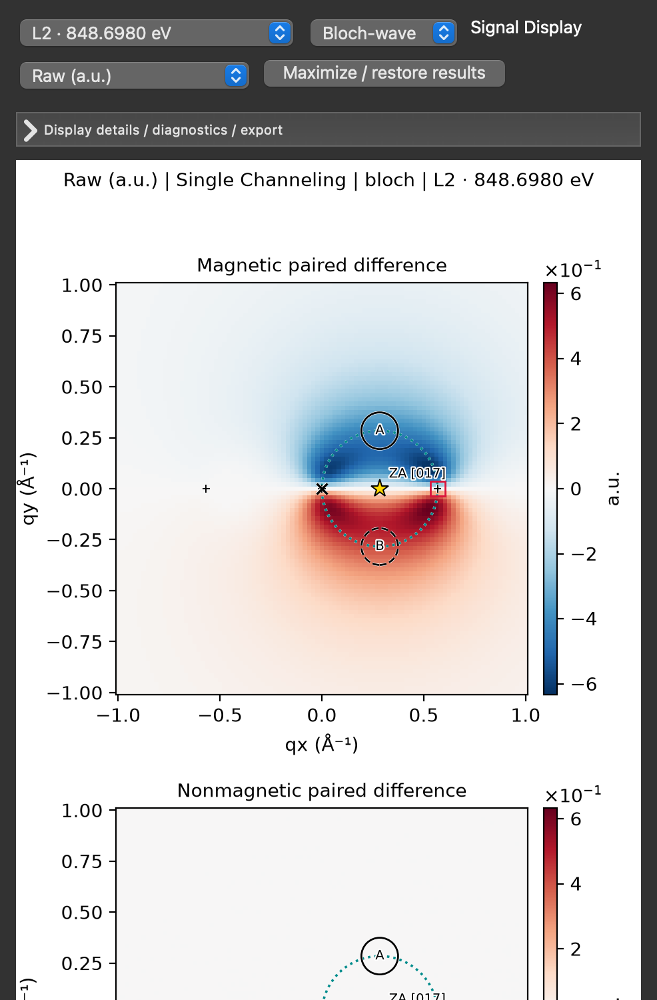

Actual native L₃/L₂ views with A/B overlays. The lower plot extends below the captured viewport; this is a layout limitation, not missing calculated data. Complete app-exported figures follow.

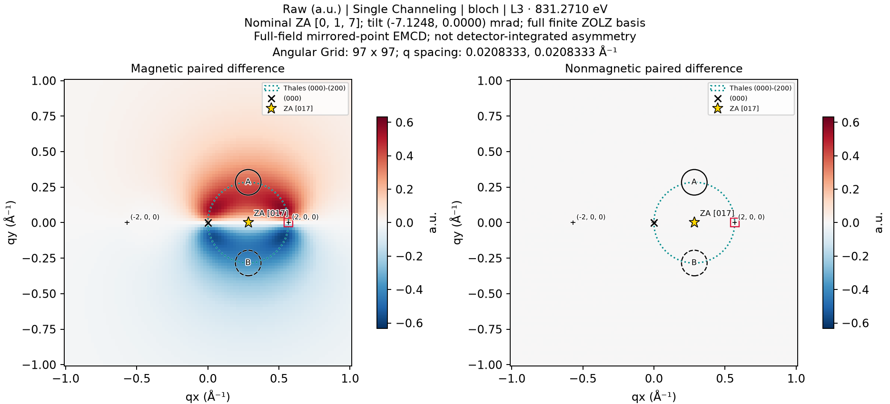

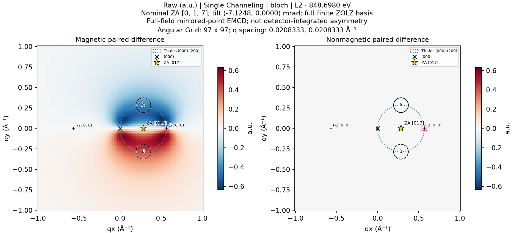

Both physical q grids span **−1 to +1 Å⁻¹**, spaced **1/48 Å⁻¹**. Detector centres are **A = (0.2840909091, +0.2840909091)** and **B = (0.2840909091, −0.2840909091) Å⁻¹**, radius **0.09 Å⁻¹**. Full intensity/parity fields contain 97×97 finite samples. Aperture-supported paired contrasts intentionally use NaN outside their defined support; do not interpret those masked values as failed pixels.

### Auto resource evidence

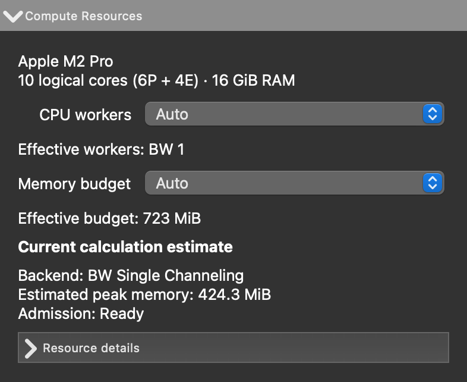

Pre-Run preview: BW 1 worker, 723 MiB budget, 424.3 MiB estimated peak and Ready admission.

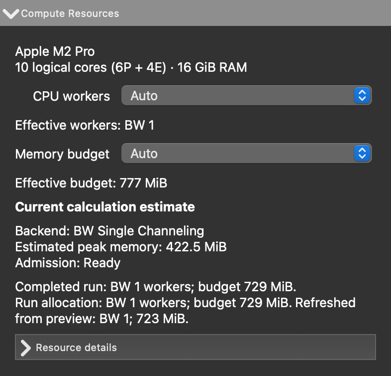

The **Completed run** line records the actual BW 1 / 729 MiB allocation. Above it, **Current calculation estimate** has already refreshed to a prospective 777 MiB budget / 422.5 MiB estimate. Those refreshed values are not the completed run's allocation.

## 7. Reference exports and scope

Download the unchanged production exports: [243-row spectra CSV](examples/macos-ni-quickstart/bloch_spectra.csv), [spectrum arrays](examples/macos-ni-quickstart/virtual_detector_eels.npz), and [L₃/L₂ maps, q coordinates and aperture weights](examples/macos-ni-quickstart/angular_maps.npz). The CSV opens in a spreadsheet; the NPZ archives are optional numerical reference data, not software you need to install. [Export contents and definitions](examples/macos-ni-quickstart/README.md).

**PASS:** the exact published-app numerical workflow, normal MDFF acceptance transaction, result selectors, exports, and restoration of settings/declarations/results. **INCOMPLETE:** direct human trackpad/Retina/file-picker/focus acceptance, independent matched Windows numerical comparison, physical convergence and quantitative source calibration. No app rebuild, scientific-code change, release-tag move or release-ZIP replacement was made. The [acceptance record](MACOS_QUICK_START_ACCEPTANCE.md) separates those scopes.
