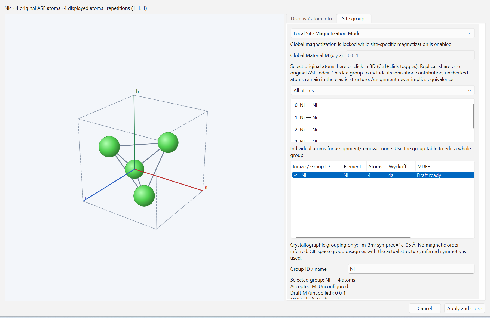
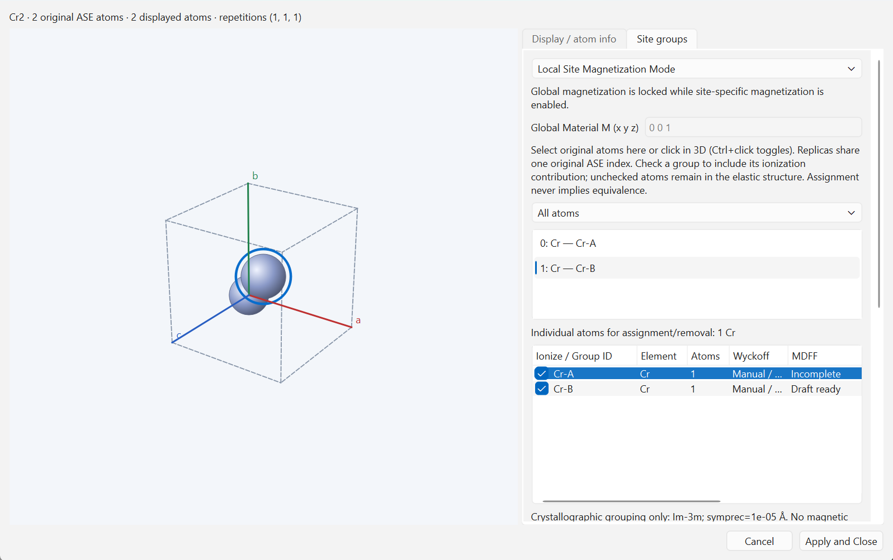
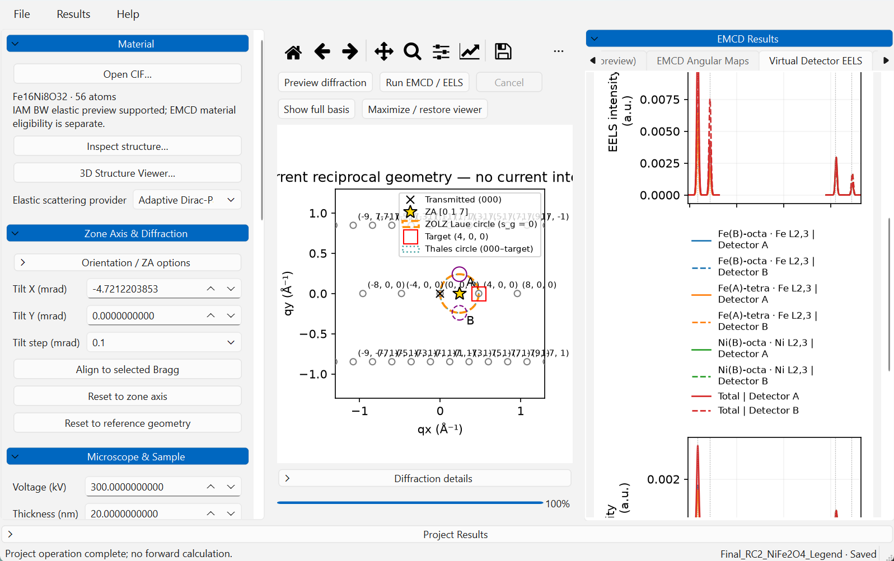

# Tutorial — CIF to saved EELS/EMCD results in Windows beta.2

[Home](../README.md) · [Install](INSTALL_WINDOWS.md) · [Quick Start](QUICK_START.md) · [User Guide](USER_GUIDE.md) · [MDFF models](MDFF_WORKFLOWS.md)

This tutorial follows the verified **FCC Ni, Global M, XMCD-constrained MDFF,
Bloch-wave Single Channeling** workflow. It starts with raw input, not a
serialized provider. The representative request has 243 energies and selected
97×97 maps; it establishes neither convergence nor material calibration.
The beta.2 RC1 packaged acceptance repeated the complete recipe below. Earlier
Windows illustrations retain their diagnostic context; their smaller grids are
not the sampling requested below. Published beta.1 retains its [versioned tutorial](https://github.com/dingpengem/EMCD-Sim/blob/v0.9.0-beta.1/docs/TUTORIAL.md).

The familiar layout is unchanged: Settings upper left, diffraction preview upper center, Results upper right, Project Results/history below. Material and MDFF are reached from Settings, not obsolete Model/Simulation menus.

## 1. Import the verified Ni input

[Install and extract](INSTALL_WINDOWS.md) the complete Windows ZIP. Launch **EMCD-Sim.exe**, then **File → New Project**. In **Material**, click **Open CIF…** and choose:

- Windows package: `_internal/examples/Ni_FCC_a3.52.cif`.
- Source checkout: [packaging/assets/examples/Ni_FCC_a3.52.cif](../packaging/assets/examples/Ni_FCC_a3.52.cif).

**Inspect structure…** should show cubic a=b=c=**3.520 Å**, angles 90°, four fully occupied Ni atoms. The imported ASE indices and fractional positions are 0: (0,0,0), 1: (0,½,½), 2: (½,0,½), 3: (½,½,0). Retain this actual structure; the built-in conventional Ni default is **3.524 Å**, a different input. Example provenance/license is [here](../packaging/assets/examples/README.txt).

Open **3D Structure Viewer…** to inspect the cell, axes and original indices. Supercell repetitions are visualization-only copies. Automatic structural grouping carries crystallographic provenance and does not assign magnetization, oxidation states, magnetic moments or MDFF.

## 2. Set Material Global M and accept its MDFF

In the Viewer's **Site groups** tab:

1. Select **Global Magnetization Mode**.
2. Set **Global Material M (x y z)** to `0 0 1`.
3. Click **Configure MDFF…**. Check that **MDFF editing context** is **Global Material configuration** and the displayed read-only Material target M is `0 0 1`. A selected local row must not silently change this context.
4. Select **XMCD-constrained MDFF**. Click **Browse XMCD...** and choose the raw source:
   - Windows: `_internal/data/wien2k_ni/Ni_fm.xmcd`;
   - source: [data/wien2k_ni/Ni_fm.xmcd](../data/wien2k_ni/Ni_fm.xmcd).
5. Browsing validates the source; **Recheck source (optional)** repeats that check. Inspect the coverage and explicitly confirm **L3 native feature (eV) = 831.271**, **L2 native feature (eV) = 848.698**, **eta=1**, **beta=1**. Do not substitute generic Ni L-edge values, extrapolate missing data, or reuse metallic Ni spectra for an oxide.
6. Complete the declarations below. Expand **Advanced source declarations** for provenance, physical limits and scientific status. New configurations use explicit material declarations automatically; there is no hidden-checkbox or legacy-menu step.

| Control | Declaration used by this diagnostic |
| --- | --- |
| Declared source element | `Ni` |
| Declared core-loss edge | `L2,3` |
| Source / provenance | `Ni_fm.xmcd; supplied five-column Ni source` |
| Physical assumptions / limits | `Effective axisymmetric XMCD-derived Ni diagnostic; not quantitatively calibrated for a=3.520 A` |
| Relative tensor reference (A^2/eV) | `1`, a relative reference after source-max normalization, not an absolute cross section |
| Scientific status | `physical_source_unvalidated` |
| Convention acknowledgement | Check **Confirm RP−LP about Material +M and the displayed L3/L2 assignments** after reviewing those assumptions |

The reversal assumption is the declared axisymmetric XMCD odd contribution with shared XAS. It is not permission to reverse arbitrary tensors by complex conjugation. Material owns M; a complete source tensor frame remains separate.

7. **Update numerical preview** is optional. Preview generates/plots the declared source/model but does not accept Material settings. Missing or incompatible inputs need correction, not a substitute source.
8. Choose **Done** to validate and return the MDFF draft, then the Viewer's **Apply and Close** to accept the complete Material configuration. On a failed Apply, accepted settings remain intact and the draft remains available. **Cancel** discards unaccepted edits.

In Global mode, unconfigured local rows display **Inactive — Global mode**. They do not determine Global Run readiness. Confirm the accepted Global provider; do not configure dummy local sources to silence an inactive row.

## 3. Set geometry, numerics and detectors

Use the existing Settings sections in this order; it avoids carrying geometry from another lattice or voltage.

| Window/section | Action/value |
| --- | --- |
| Microscope & Sample | **Voltage (kV) = 200**, **Thickness (nm) = 10** |
| Zone Axis & Diffraction → Orientation / ZA options | **Nominal zone [uvw] = 0 1 7**, **Target (hkl) = 2 0 0**, **Diffraction basis = Full finite ZOLZ**, then **Apply orientation / target** |
| Zone Axis & Diffraction | **Tilt X (mrad) = −7.124812628**, **Tilt Y (mrad) = 0** |
| Propagation Method | **Channeling Model = Single Channeling**, **Propagation Method = Bloch-wave** |
| Shared Calculation Settings → Numerical Settings | **General settings (editable)**; older saved “Manual (Advanced)” settings restore through this current editable mode |
| Beam / MDFF cutoff; potential cutoff | **2.5 / 2.0 Å⁻¹** |
| Angular grid | **Standard - 97x97**, giving 97×97 selected maps |
| Depth nodes; aperture boundary subpixels | **64; 64** |
| Map halfwidth | **1 Å⁻¹** |
| Energy sampling | **Entire energy range — uniform sampling**, **241** requested points plus exact L3/L2: **243** actual samples |
| Angular evaluation | **Full angular maps at selected energies** on; **Full angular field at every energy (advanced)** off |
| CPU Workers | **Auto (recommended)** |
| Memory Budget | **Auto (recommended)** |
| Virtual detectors | Click **Restore Thales A/B** after setting this geometry; set **Radius (Å⁻¹) = 0.09** |

The **beta.2 Windows candidate** combines resource controls
and estimates in **Shared Calculation Settings → Compute Resources**. For this
representative example choose CPU and Memory **Auto (recommended)**.
Auto CPU considers available physical/hybrid cores, detector task
size and memory; Single Channeling uses one outer worker. Auto memory reserves
half of current physical/commit/address-space headroom, rather than using
installed RAM as free space. The effective budget is a total process-peak limit;
the estimate includes baseline RSS, live reservations, a 25% allocation margin
and 128 MiB reserve without counting resident reserved arrays twice.

Manual requests are retained when switching to Auto and are never silently
reduced or raised. Impossible requests remain blocked with a reason. Run refreshes
the same allocator used by the preview, displays the finalized allocation and
submits it unchanged. Native NumPy/SciPy BLAS limits are controlled internally
and restored after all workers stop; no environment-variable setup is required.
Outer worker count is distinct from observed simultaneous tasks and BLAS threads.
Auto is a conservative heuristic, not a speedup guarantee. These controls are
not present in the published v0.9.0-beta.1 package.

This case has **21 incident beams**, A/B centers approximately
`(0.2840909091, ±0.2840909091) Å⁻¹`, zero B factor and no post-edge correction.
Numerical q is crystallographic `g=1/d`; angular transfer uses `Q=2πg` internally.
The source interval is 823.625–882.521 eV. All 243 detector samples are calculated;
only exact L3/L2 energies retain full 97×97 fields. Spectral points, momentum
grid, depth nodes and aperture subpixels control different sampling operations.

Review effective values before Run; named sampling presets appear only when
their defining values match, otherwise a Custom caption shows the actual grid.
A preset selection changes sampling; caption restoration does not. The memory
budget is a ceiling, the process estimate includes reserves, and measured RSS
is a separate quantity. DC includes outgoing propagation and need not match SC
or have a larger whole-process RSS. No Conda/BLAS environment setup is needed.
The 2.0 Å⁻¹ potential cutoff omits the first off-row harmonic near 2.029 Å⁻¹;
neither this example nor cross-platform agreement establishes convergence.

## 4. Local Site Groups and non-ionizing atoms

This is the alternative configuration workflow, not an instruction to replace the verified Global Ni run with an unvalidated material model.

1. Open **3D Structure Viewer… → Site groups → Local Site Magnetization Mode**. Global M locks; its value does not override local directions.
2. Inspect original ASE indices in the atom list and group table. To create magnetic subgroups inside one structural orbit, select the desired original atoms, **Remove selected atoms** from their current group, enter a unique **Group ID / name**, and **Create from selection**. Remove/delete an emptied group if required. Use **Assign selection**, **Rename** and **Delete group** deliberately. Memberships must be disjoint; replicas reference original indices.
3. Select a whole group row once. Its name, count, accepted direction and draft are shown. Set **Direction (Cartesian x y z)** and click **Update direction**; all its member atoms share that draft. Individual atom selection is for assignment/removal, not a requirement for group-wide direction edits.
4. Click **Configure MDFF…** and verify that group's editing context. Select a material-appropriate XMCD, **Atomic Ionization MDFF**, or **Manual tensor** source. Set its actual edges, frame, parameters, provenance, relative scale and required acknowledgements; inspect the preview, choose **Done**, then outer **Apply and Close**.
5. For oxygen or other atoms not ionized by this calculation, **uncheck their Ionize / Group ID checkbox**. Keep the atoms and structural groups. They still contribute to the full elastic potential, need no ionizing MDFF, and do not enter the selected-ionizing-atom normalization denominator.
6. Check every enabled group has compatible accepted M/MDFF. Structural-only groups may remain unconfigured; incomplete participating groups cannot silently fall back to Global settings. Cancel preserves accepted settings and discards drafts.

This retained native image shows an intermediate **draft**, not calculation readiness: the verified synthetic Cr example splits original indices {0}/{1} into +z/−z groups. Crystallographic equivalence does not imply magnetic equivalence. The opposite group uses an explicitly validated provider reversal member. No bulk Cr spin-density-wave inference or calibrated Cr spectrum is claimed. The image illustrates group editing; the runnable tutorial here remains the Ni Global case above.

Direction alone does not specify a complete anisotropic tensor frame. Validated reversal pairs are supported; an incompatible fixed-source Z→X change remains rejected. magCIF and general tensor rotation are unsupported. **Flip all local M** reverses the full declared configuration, rather than replacing it with one Global vector.

## 5. Run and inspect the actual result

Return to the Ni Global configuration from sections 1–3 and click **Run EMCD / EELS**. **Preview diffraction** is a separate optional elastic calculation, not an EELS acceptance step. Review any actual readiness reason rather than bypassing it. Progress and elapsed time refer to the current worker; Cancel is cooperative.

After completion, use **EMCD Angular Maps** and **Virtual Detector EELS** in Results. Select the actual saved energy; the requested maps are 9×9. The two detector samples should be finite and nonzero where supported. The earlier native verification completed this exact physical/numerical case; this documentation update ran no new calculations.

For a Local result, the same Results panel offers **Total Results**, element/group selection and **Group Comparison**. **Group Contribution** is `n_s I_s/N` and adds to Total using fixed selected-atom N; **Group Mean** is nonadditive. Provider amplitudes are retained. For Fe(A) multiplicity 1 and Fe(B) multiplicity 2, Total is `(I_A+2 I_B)/3`; excluded oxygen does not change N.

This saved synthetic NiFe₂O₄ example illustrates three groups plus Total and dedicated legend rows; it is not output from the two-energy Ni tutorial. Scroll for lower rows; click a legend handle/text to hide/show the complete curve. Full legend identification is retained in figure exports.

Raw I(+M)/I(−M), reversal-even `[I(+M)+I(−M)]/2`, reversal-odd `[I(+M)−I(−M)]/2`, and conventional detector A−B are different observables. Magnetic/nonmagnetic A−B components use those reversal definitions. Do not infer a required net sign or cancellation from AFM labels alone. Distinct energy windows remain separate; omitted channels are not measured physical zeros.

## 6. Save, reopen and export

1. **File → Save As…**: choose a separate project folder, for example `Ni352_Global_XMCD_BW_SC`. The application creates its own configuration, source attachments where supported, metadata and calculated arrays. No JSON editing/import is needed.
2. Use **Keep New** when retaining another calculation; preserve the original. The lower **Project Results** panel manages runs. **Restore Settings from Selected Run…** restores settings, while **View Results** displays saved arrays.
3. **File → Close Project → Open Project…**: select the complete saved project folder. Inspect the restored structure, Global mode, provider/source, settings and calculated result without rerunning. Missing/changed required external sources may block rerun while existing saved arrays remain viewable.
4. Export numbers with **Results → Export Results…** or, for the displayed Local selection, **Display details / diagnostics / export → Export selected spectra CSV + metadata**. Preserve the accompanying metadata, exact energies/masks, units and normalization.
5. Export a figure with **Display details / diagnostics / export → figure toolbar → Export Figure…**. In narrow panels open the toolbar's **…** overflow. Exported figures include legends outside the plotting axes. A figure/CSV export is separate from saving a project.

The complete comparison dialog is **Results → Compare Calculations…**, for exactly two distinct runs in the active project. It does not rerun either calculation.

## Limits and historical examples

This is functional configuration/results verification. General basis/FFT/depth/detector convergence remains incomplete; finite ZOLZ, projected IAM and continuous-depth localized events are approximations. Synthetic/effective MDFF is not quantitatively calibrated Fe₃O₄/NiFe₂O₄ spectroscopy, absolute cross-element intensity or magnetic-moment accuracy. Clean-PC/VM acceptance and historical broad regression/source-guard gaps remain unverified/incomplete.

The historical Ni 9/30 nm scientific case study, its figures, definitions and original controls remain unchanged in the [v0.8.1-beta.2 tagged tutorial](https://github.com/dingpengem/EMCD-Sim/blob/v0.8.1-beta.2/docs/TUTORIAL.md#part-vii-practical-ni-017-case-study). Those numerical records are not a current-GUI recipe or a new convergence claim. See [current release evidence](RELEASE_NOTES_0_9_0_BETA_1.md), [physics](PHYSICS.md) and [units](PHYSICAL_UNITS.md).
