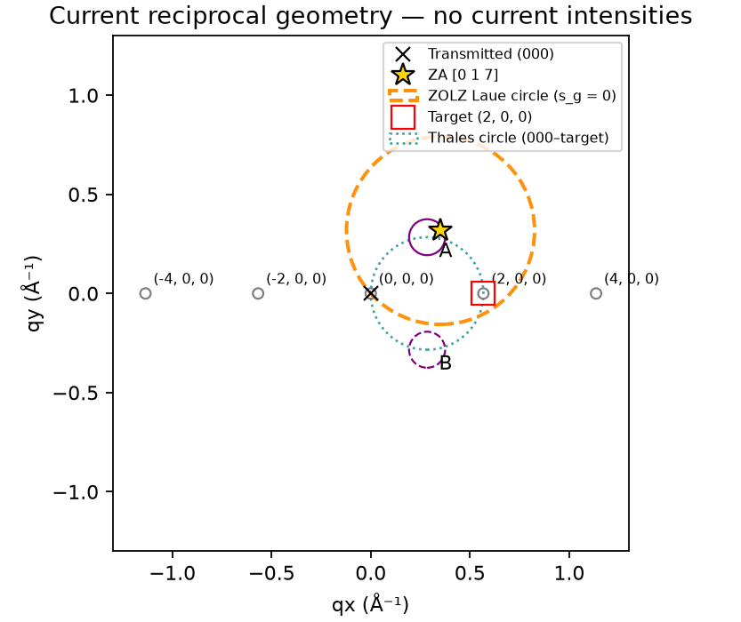
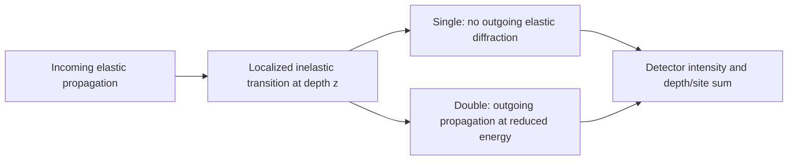
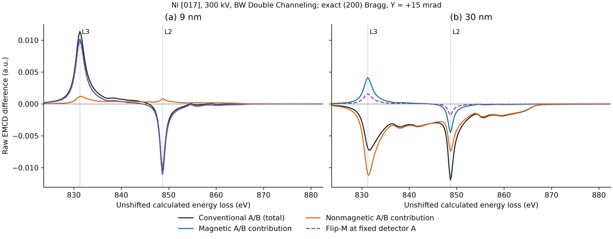
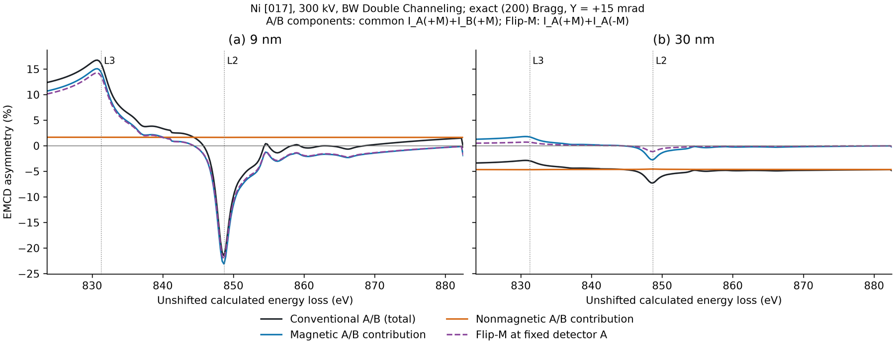
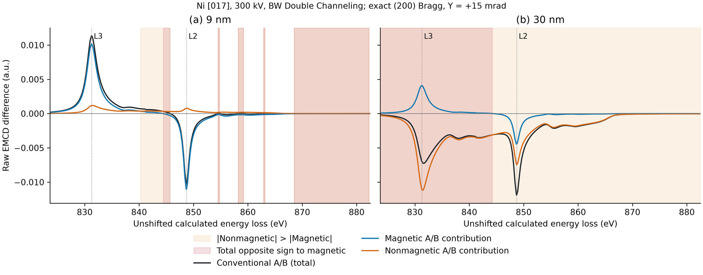

# EMCD-Sim Tutorial: From Crystal Structure to EMCD Spectra

[Home](../README.md) · [Install](INSTALL_WINDOWS.md) · [Quick Start](QUICK_START.md) · [User Manual](USER_GUIDE.md) · [Physics](PHYSICS.md)

This tutorial describes the public **v0.7.0-beta.1 Windows Research Beta**, whose binary source is `97b2220e`. It explains the small [Quick Start](QUICK_START.md), then interprets a completed research case. You do **not** need to rerun the expensive case study to learn the workflow.

Native Windows acceptance is not universal numerical or experimental validation. Older v0.6.1 signed magnetic results use a superseded convention and need revalidation; opening them does not update their physics.

## Part I: Crystal and diffraction geometry

### Start from a known structure

Use **A. Crystal Structure → FCC Ni default** for the verified conventional cell (a = 3.524 Å, four equivalent FCC sites). **Load CIF…** imports a CIF through ASE; **Inspect structure…** shows the cell, species and fractional positions. Structure inspection is broader than EELS support: the present inelastic GUI requires this verified conventional FCC Ni structure. Arbitrary materials, occupancies or equivalent-looking nonconventional cells are not automatically validated for EMCD.

In **B. Zone Axis & Diffraction → Orientation / ZA options**, set a direct-lattice direction **Nominal zone [uvw]**, a reciprocal **Target (hkl)**, then **Apply orientation / target**. Enter signed indices separated by spaces, for example `1 1 7` and `2 -2 0`. The engine builds a proper right-handed, target-aligned local frame; it does not substitute a [001] potential for another orientation.

For cubic Ni [017], target (200), the local frame is:

- x = crystal [100];
- y = [0,7,−1]/√50;
- z = [0,1,7]/√50.

ZOLZ reflections satisfy `k + 7l = 0` as well as FCC selection rules. The target (200) satisfies both. For a new orientation, inspect the actual retained hkl list and warnings rather than assuming every reflection is available.

### Understand coordinates and Bragg alignment

The diffraction display is centered on transmitted **(000)**. Its transverse q coordinates and detector radii use crystallographic Å⁻¹:

```text
|g_hkl| = 1/d_hkl
Q = 2*pi*q   (angular momentum-transfer convention)
```

Both have inverse-length dimensions, but their numerical values differ by 2π. There is no extra conversion to apply to displayed or saved q coordinates.

Set **Voltage (kV)** and **Thickness (nm)** explicitly in panel C. The **Tilt X/Y (mrad)** controls parameterize transverse incidence relative to the nominal zone. They are not an automatic calibration of a microscope's mechanical stage axes. **Tilt step (mrad)** changes the spin-box adjustment increment only; it is not a scan interval and changing it alone does not change the physical tilt.

**Reset to zone axis** sets zero incident tilt. **Reset to reference geometry** restores the built-in **[017]/(200), full finite ZOLZ** preset at the current voltage, sets Y to zero, aligns (200) with Y locked and restores Thales detectors. It is not a generic reset for any selected orientation. For other targets, select an indexed spot (or table row), choose an appropriate **Lock for Bragg alignment**, and click **Align to selected Bragg**. With Y locked, X is adjusted while Y is held. Inspect the target `s_g` in **Diffraction details** / the **Diffraction** table.

For Ni [017]/(200), the reference X tilt is approximately −5.5866881404 mrad at **300 kV**, or −7.1167254400 mrad at **200 kV**. Do not reuse one voltage's tilt at another voltage. In the case study, Y is +15 mrad while X remains the exact target-Bragg value.

### Choose the diffraction approximation deliberately

|Choice|Meaning|
|---|---|
|Full finite ZOLZ|Retain allowed zone-plane beams inside the selected beam cutoff. This is still a finite projected model.|
|Ideal 000 + target|An explicitly idealized two-beam truncation, not a proof that the physical specimen excites only two beams.|
|Explicit target systematic-row approximation|Retain a target row and corresponding potential support. This changes the elastic approximation and is not the same as the ideal two-beam choice.|

Do not enable an explicit row restriction together with the ideal two-beam option. Exact `s_target = 0` says that the target is at Bragg; competing reflections and outgoing waves can still matter. The full 71-beam case below is not artificially restricted to two beams.

### Read the two circles and projected zone axis

The **yellow star** is the crystallographic zone-axis direction projected into the 000-centered coordinates:

```text
k_incident,perp = (Tilt X, Tilt Y) * 0.001 / wavelength
q_ZA = -k_incident,perp
```

The star coincides with (000) only at zero tilt. With the existing relativistic wavelength:

- **Thales circle:** center `G/2`, radius `|G|/2`, diameter from (000) to target G; **teal dotted**, width 1.2, alpha 0.75.
- **ZOLZ Laue circle:** center `q_ZA`, radius `|q_ZA|`; zero-excitation-error locus `s_g = 0`; **darkorange dashed**, width 1.8, alpha 0.95.

At exact target Bragg, the Laue circle passes through (000) and G. It coincides with Thales only when its center is G/2; a nonzero perpendicular mistilt generally prevents coincidence. Neither circle is an intensity contour, a convergence guarantee, or a statement that EMCD is uniform along a circle.



*Actual EXE export after dragging. Gray unfilled diffraction positions and “no current intensities” indicate an invalidated preview; the two circles are intentionally different.*

Choose **Click mode → Set projected ZA** to click or drag the star. Pan/zoom has priority when a Matplotlib navigation mode is active. Dragging updates geometry continuously, preserves detector positions and starts no calculation. Release uses the final valid coordinates; releasing outside the axes retains the last valid position. Click **Preview diffraction** to recompute elastic intensities. If a marker/circle lies outside a zoomed view, inspect ZA qx/qy and pan/zoom; do not move it just to fit the image.

### Place physical detectors

**Restore Thales A/B** places two circular virtual apertures at the target's opposite Thales positions. For [017]/(200), their centers are approximately `(0.283768445, ±0.283768445) Å⁻¹`; radius is independently editable. Use **Move detector A/B** click modes or numeric coordinates to define other apertures. A/B positions are physical integration regions, not samples of a displayed percentage map.

For reversal comparisons, keep both apertures fixed for +M and −M. A valid mirrored display requires the relevant symmetry checks; moving a detector does not create a symmetry of the physical intensity field.

## Part II: Elastic scattering models and numerics

**Bloch-wave (BW)** uses the retained reciprocal beams to solve a finite elastic eigenproblem. **FFT Multislice (MS)** uses real-space split-step propagation through the structure-derived projected ZOLZ potential. **Both (BW / MS comparison)** runs both implementations for one physical configuration and reports differences. It is not a third physical model.

Three supports must not be confused:

|Control|What it changes|
|---|---|
|Beam / MDFF basis cutoff|Retained hkl support used by BW and the MS diffraction/MDFF response.|
|Potential Fourier cutoff|Crystal-potential harmonics used in BW coupling and MS potential construction; it is a cutoff in `norm(g−g′)`, not detector radius.|
|FFT grid|MS propagation mesh. Additional FFT harmonics can participate beyond the retained MDFF beams.|
|Angular / detector grid, map halfwidth|q samples of the inelastic angular field and physical aperture quadrature.|
|Aperture boundary subpixels|Fractional circle-boundary weights; this does not refine a varying intensity field.|
|Depth integration nodes|Sampled depth/coherence quadrature; BW Double uses analytic integration for an explicit row and numerical integration otherwise.|
|Max slice step|MS-only upper bound on propagation substeps between depth planes, not a fixed specimen slice thickness.|

The MS default maximum step is **2 nm**, editable over **0.001–10 nm** in Automatic and Manual modes. With equally spaced depth planes:

```text
interval = thickness / (depth_nodes - 1)
actual_substep = interval / ceil(interval / requested_max_step)
```

The actual substep cannot exceed the requested maximum, within floating-point tolerance. Coarse steps produce a nonblocking accuracy warning; the 0.04 nm advisory reference is not a universal physical threshold. The existing 200,000-substep safety bound remains. BW does not use the FFT mesh or MS slice step.

**Automatic** chooses a starting configuration and checks support; it does not run a convergence study. **View Numerical Parameters** shows resolved values. **Manual (Advanced)** is needed for explicit research/smoke profiles; record the effective values actually used. Resource budgets and worker controls are separate from numerical-mode selection. Start small, then vary basis, potential, FFT, depth, step and detector sampling independently. Accurate aperture area or BW/MS agreement is insufficient by itself.

## Part III: Inelastic scattering and MDFF

The mixed dynamic form factor describes the target's inelastic transition response, including interference between momentum-transfer paths. EMCD-Sim uses a Hermitian Cartesian dipole tensor to connect this response to the incoming/outgoing electron waves.

**XMCD-constrained (WIEN2k)** reads the five-column spectral source and constructs an effective tensor from its nonmagnetic and dichroic intensities. `eta` controls the declared dichroic sign/scale; `beta` parameterizes the unmeasured longitudinal response. Five-column intensity data do not recover all complex core-to-band amplitudes, phases or k/site-resolved transitions. The tensor is therefore **not a complete complex DFT-derived Ni MDFF**, even though the source originated in an electronic-structure workflow.

**Atomic ionization (Ni 2p -> 3d)** supplies a controlled non-DFT atomic-transition approximation with crystal-field, exchange, hole, radial and broadening settings. It is not quantitative metallic Ni and currently supports crystal [001] magnetization only. Its nominal energy parameters are not a calibration of the XMCD source.

With either model, choose the magnetic axis intentionally. **Crystal Cartesian M axis** specifies a vector in crystal Cartesian coordinates; cubic Ni `0 0 1` corresponds to [001]. It does not infer the specimen surface normal, equilibrium domain state, applied field or magnetization magnitude from the crystal orientation. The software reverses the magnetic tensor in the crystal frame and then rotates it into the proper local frame. It does not silently align magnetization to the tilted beam.

The corrected forward convention is **forward_born_dagger_g_minus_h_v1**: `I = Re Tr(RT)`, `T = L L†`, forward modes `L*`, and Double site phase `exp(+2πi(g−h)·u)`. See [current physics](PHYSICS.md#corrected-forward-born-convention). Absolute experimental RP/LP handedness remains uncalibrated.

## Part IV: Single and Double Channeling



Single and Double are different simulation approximations to the same experiment, not two independently switchable experimental processes. Double includes post-ionization diffraction, so the response of a detector can change with transition depth and thickness. “Double” retains one localized inelastic event; plural ionization is not added. A sampled maximum from one method or thickness list is not a universal optimum.

## Part V: Calculate EELS and EMCD spectra

1. Define crystal, orientation, voltage, thickness and fixed detector A/B apertures as in Part I.
2. In **D. MDFF Model**, select and **Validate source / native features**. Declare the axis, RP/LP convention and assignments only after checking the source. Native calculated energies need not equal experimental edge energies.
3. In **E. Propagation Method**, choose Single/Double and BW/MS/Both.
4. Under **F**, choose Automatic or an explicit Manual profile; inspect resolved numerics, support and resource status.
5. Select **Spectral coverage**. **Selected L3/L2 samples only (not full EELS)** evaluates two energies and displays points. **Full native energy-resolved spectrum** evaluates the model at every requested energy over the native range, inserting selected features. Its standard 241-point request usually yields 243 energies; it does not mean all 4,329 original source samples are used.
6. Choose whether to **Calculate angular maps**. Full maps are evaluated at selected L3/L2 energies only. Other spectral energies evaluate the nonzero physical aperture support on the same q grid. Turning maps off avoids computing unneeded full fields; it does not reduce the detector grid or interpolate the scattering response.
7. **Preview diffraction**, then **Run EMCD / EELS**. The calculation produces `I_A_plus`, `I_A_minus`, `I_B_plus`, `I_B_minus` with unchanged detectors. Do not manually move/mirror detectors or rerun a separate altered geometry for reversal.
8. Save the completed project and numerical exports. Raw spectra remain available regardless of the current display mode.

A full spectrum uses the source's tabulated spectral model at each requested loss and recalculates loss-dependent scattering; it is **not** a line shape invented from the two calculated L3/L2 samples. Selecting a full grid is not itself energy-sampling convergence.

## Part VI: Conventional EMCD versus Flip-M

### Define the measurements before comparing them

For energy E, at the same fixed detectors and geometry:

```text
N_A = [I_A(+M) + I_A(-M)] / 2
M_A = [I_A(+M) - I_A(-M)] / 2
N_B = [I_B(+M) + I_B(-M)] / 2
M_B = [I_B(+M) - I_B(-M)] / 2

D_conv   = I_A(+M) - I_B(+M)
D_mag    = M_A - M_B
D_nonmag = N_A - N_B
D_conv   = D_mag + D_nonmag

D_flip,A = I_A(+M) - I_A(-M) = 2*M_A
```

`D_flip,A` is **not** `D_mag`: they are different measurement geometries. Keep the full reversal difference; dividing it by two changes the observable.

The sum-normalized conventional and fixed-detector asymmetries are:

```text
S_AB = I_A(+M) + I_B(+M)
A_conv   = 100 * D_conv / S_AB
A_mag    = 100 * D_mag / S_AB
A_nonmag = 100 * D_nonmag / S_AB
A_conv   = A_mag + A_nonmag

A_flip,A = 100 * D_flip,A / [I_A(+M) + I_A(-M)]
```

Using half of either sum (the mean intensity) as denominator gives **twice the percentage**. That is a different normalization, not a physical enhancement. Raw differences in a.u. cannot be mixed with percentages on the same axis.

Flip-M cancels the magnetization-even part under unchanged geometry and intensity scale in this model. Its magnetic contrast still depends on diffraction, thickness, detector location and magnetization. It is not universally weaker or stronger than magnetic A/B. Drift, dose changes and counting statistics require separate experimental treatment.

### What the released GUI actually shows

- **Signal Display → Raw (a.u.)**: signed `D_mag` and `D_nonmag`.
- **EMCD Asymmetry (%)**: the conventional `A_conv` from raw +M detectors.
- **Advanced Diagnostics → Magnetic-only / Nonmagnetic Asymmetry (%)**: `100*D_mag/(N_A+N_B)` and `100*D_nonmag/(N_A+N_B)`.

The advanced pair uses a **reversal-even denominator**, so it does **not** sum to `A_conv` unless the denominators happen to coincide. The four-curve case-study figure below is a separately derived scientific visualization, **not a new released GUI mode or a fixed-detector Flip-M button**. Derive the common-S_AB components and Flip-M from exported raw arrays when needed.

Undefined percentages must stay masked. The released GUI uses positive finite denominator support and a relative floor based on its positive finite 95th percentile (1e−8 for EELS, 1e−6 for maps). The case study used an explicitly recorded `1e−12 * max(abs(denominator))` criterion for each denominator/thickness. Do not silently substitute one mask policy when comparing exports.

<details>
<summary>Optional NumPy analysis of a saved current-format project</summary>

This is post-processing outside the portable GUI, requiring a separate NumPy environment. It reads arrays, not a solver. Select the method prefix actually saved in the project (`bloch` or `fft-multislice`).

```python
from pathlib import Path
import numpy as np

project = Path("my_saved_project")
method = "bloch"
with np.load(project / "virtual_detector_eels.npz", allow_pickle=False) as z:
    e, ap, am, bp, bm = [z[f"{method}__{k}"] for k in
        ("energy_ev", "I_A_plus", "I_A_minus", "I_B_plus", "I_B_minus")]
na, ma = (ap + am) / 2, (ap - am) / 2
nb, mb = (bp + bm) / 2, (bp - bm) / 2
dmag, dnon, dconv, dflip = ma - mb, na - nb, ap - bp, ap - am

def percent(numerator, denominator):
    # Explicit case-study criterion; this is not the GUI's P95 policy.
    floor = 1e-12 * np.max(np.abs(denominator))
    valid = np.isfinite(numerator) & np.isfinite(denominator)
    valid &= denominator > floor
    out = np.full(denominator.shape, np.nan)
    np.divide(100 * numerator, denominator, out=out, where=valid)
    return out

sab = ap + bp
aconv, amag, anon = [percent(d, sab) for d in (dconv, dmag, dnon)]
aflip = percent(dflip, ap + am)
np.testing.assert_allclose(dconv, dmag + dnon, rtol=1e-12, atol=1e-14)
np.testing.assert_allclose(aconv, amag + anon, equal_nan=True,
                           rtol=1e-12, atol=1e-12)
```

Keep all four raw spectra, the two denominator arrays and the masking rule with derived output. Do not overwrite the saved project.

</details>

## Part VII: Practical Ni [017] case study

This advanced example reuses the completed study at local path `outputs/ni_300kv_exact_bragg_y15_spectra/20261102T232115Z/` in the validated main worktree. The original arrays/checkpoints remain local and unchanged; only compact verified figure previews and selected values are included in the documentation. You need not rerun it.

|Parameter|Actual study configuration|
|---|---|
|Crystal / target|Conventional FCC Ni [017] / (200)|
|Voltage / thicknesses|300 kV / 9 and 30 nm|
|Absolute tilt|X = −5.586688140406263 mrad; Y = +15 mrad; `s200 = 0`|
|Magnetization|±[001] in crystal coordinates; +M local = (0, −0.1414213562, 0.9899494937)|
|Method|BW Double Channeling; corrected `forward_born_dagger_g_minus_h_v1`|
|Beam support|Full finite ZOLZ, 71 incoming/outgoing beams; cutoff 5.0 Å⁻¹|
|Potential / model|Cutoff 6.2 Å⁻¹; XMCD-effective MDFF; eta = beta = 1|
|Detectors|Centers (0.283768445, ±0.283768445) Å⁻¹; radius 0.0908059024 Å⁻¹|
|Sampling|65×65 q grid; halfwidth 0.5 Å⁻¹; 128 boundary subpixels; 129 depth nodes|
|Energy sampling|241 full-range energies + exact L3/L2 samples = 243; 823.625–882.521 eV; no added shift/smoothing|
|Execution|Two detector workers, one native BLAS thread; 8192 MiB selected budget; not GUI defaults|
|Source|`08d04fc35fca2071cc7e73af0aaa1de45e49a3f4`; production source identical to released binary source `97b2220e`|

The source tree's dirty flag reflects two pre-existing untracked documentation reports, not modified physics. The source hashes and original figure/data hashes are recorded in [provenance](images/v070b1/provenance.json).



*Raw differences retain a common a.u. scale across thicknesses. Fixed-detector Flip-M A is `2M_A`, not `M_A−M_B`.*



*A/B magnetic and nonmagnetic percentage-point contributions sum to the conventional percentage. Flip-M A is plotted for comparison, not added to that decomposition.*

|Thickness|Native sample|Conventional (%)|Magnetic contribution (pp)|Nonmagnetic contribution (pp)|Flip-M A (%)|
|---|---|---:|---:|---:|---:|
|9 nm|L3, 831.271 eV|+16.0577|+14.3838|+1.6740|+13.6022|
|30 nm|L3, 831.271 eV|−2.9371|+1.7281|−4.6652|+0.6874|
|9 nm|L2, 848.698 eV|−21.3505|−22.9958|+1.6453|−22.0086|
|30 nm|L2, 848.698 eV|−7.2713|−2.7250|−4.5463|−1.1157|

At 30 nm L3, the magnetic contribution is positive, but negative nonmagnetic imbalance makes the conventional result negative. That apparent conventional sign reversal is **not evidence of a reversed magnetization**. The absolute nonmagnetic/magnetic ratios increase from 0.116 to 2.70 at L3 and from 0.0715 to 1.67 at L2. The two tested thicknesses support cleaner magnetic features at 9 nm under this geometry, not a universal “thinner is better” rule.



*Even the 9 nm spectrum has contamination-dominated inter-edge/post-edge regions. Boundaries are sampled-energy diagnostics, not continuous optimized crossings or experimental detection limits.*

Eight selected-energy depth/detector-grid checks passed the retained raw-intensity relative tolerance **0.1%** and asymmetry tolerance **0.01 pp**. Maximum observed changes were **0.00821%** and **0.005901 pp**. This does not certify every energy, basis/potential cutoff, FFT mesh, specimen thickness or experimental model. The case is BW-only; it does not add a new full-spectrum MS validation.

Selected-energy values are not edge-window integrals. The local study separately integrated L3 [826,840] eV and L2 [843,860] eV by trapezoids over the included evaluated samples and used ratios of integrated numerator to integrated denominator—not averages of percentages. Effective endpoints/counts and full CSV/NPZ arrays remain with the original output. The [small selected-value CSV](images/v070b1/ni017_selected_values.csv) is provided for checking the table; it is not the full dataset or a new release asset.

## Part VIII: Interpret and export results

**Raw a.u. differences** preserve the model's signed intensity scale. **Percentages** report a specific numerator/denominator; state both. A large percentage may come from a small denominator rather than a large magnetic count difference. Post-edge scaling can reduce some A/B mismatch but is not intrinsically magnetic and can change residuals/bias. Keep original spectra.

L3/L2 selections refer to native source features. Do not silently shift them to textbook experimental energies. Absolute handedness, energy calibration, electron counts, dose and efficiency are separate scientific inputs. No experimental shot-noise SNR follows directly from these arbitrary-unit outputs.

For angular maps, distinguish raw magnetization-odd/even intensities from mirrored-point differences. A display constructed by subtracting a mirror is antisymmetric by construction and cannot prove the original magnetic field has that symmetry. To obtain a detector asymmetry, integrate raw intensities over the aperture first, then form the ratio; do not average local percentages.

Use **File → Save Project As...** for a complete checksummed result. Use figure PNG/SVG exports for visualizations and numerical CSV/NPZ exports for analysis. Figure exports are not project backups. Display changes do not recalculate or replace raw arrays. See the [export reference](USER_GUIDE.md#export-figures-and-data) for file names, method prefixes, denominator aliases and sidecars.

## Part IX: Reproducibility checklist

Record these with every scientific figure/table:

- Application version, exact source/build commit, convention and source-file hashes; legacy/dirty-state context.
- Structure/cell, nominal zone, signed target, proper coordinate frame and reciprocal convention.
- Voltage, thickness, **absolute** X/Y tilt, Bragg-offset definition and target excitation error.
- Crystal/local magnetization, eta/beta and reversal procedure; do not infer a surface/equilibrium state.
- Detector A/B coordinates, radius, integration grid/extent and fractional subpixels; unchanged geometry for reversal.
- MDFF model, native energy range/features, energy sampling and any explicitly justified calibration.
- Solver and Single/Double approximation; retained incoming/outgoing hkl, beam/potential cutoffs, B, FFT support, depth nodes, requested/actual MS step where applicable.
- Requested/effective worker counts, native threading, memory budget and warnings.
- Raw arrays, exact numerator/denominator/masking policy, integrated windows and effective endpoint samples.
- Independent numerical controls and unresolved physical/convergence limitations; do not substitute successful execution or BW/MS agreement for them.

**Next:** [User Manual](USER_GUIDE.md) for control-by-control reference, [Physics](PHYSICS.md) for equations, and [Documentation Index](INDEX.md) for validation and historical records.
