# EMCD-Sim Desktop User Manual

Start with [Windows installation](INSTALL_WINDOWS.md) and [Quick Start](QUICK_START.md).

Repository-only research drivers are listed in [`scripts/research/`](../scripts/research/README.md). Their relocated commands and the unchanged installed GUI/CLI boundary are documented in [Source cleanup](SOURCE_CLEANUP.md).

**Current Windows prerelease: v0.6.1-beta.2.** It includes the worker-safety and GUI/performance developments described below. See [Beta 2 release notes and acceptance](RELEASE_NOTES_0_6_1_BETA_2.md). Beta 1 statements and acceptance below document the preserved historical package. Post-release source projects use 300 kV and 3.2/2.5 cycles/Å beam/potential cutoffs; the published Beta 2 ZIP retains 3.0/2.0. Explicitly choose 200 kV for the locked scientific example.

**Current main and Beta 2** include Automatic / Manual settings, the reversible **Show full basis / Restore previous view** control, energy-dependent angular scheduling and MS Double allocation improvements. They are newer than the unchanged historical Beta 1. See [Beta 2 installation](INSTALL_WINDOWS.md) and the historical [integration record](GUI_PERFORMANCE_INTEGRATION.md). New projects use Automatic, 97 x 97 angular sampling and a 2048 MiB process budget; legacy projects retain explicit saved numerical values in Manual. These convenience and execution changes do not establish convergence for arbitrary parameters.
**v0.6.1-beta.1 Windows research Beta.** The [acceptance report](V061_BETA_ACCEPTANCE.md) records the validated executable, unchanged checksum and local test scope. Independent clean-machine installation remains **NOT TESTED**. See [release notes](RELEASE_NOTES_0_6_1_BETA_1.md). Double Channeling already existed in earlier releases; this version adds full-field presentation and actual angular-grid controls without changing the solvers.
For the preserved old executable use the
[0.4.5 manual](https://github.com/dingpengem/EMCD-Sim/blob/v0.4.5-beta.1/docs/USER_GUIDE.md).


## Development source: energy-dependent angular sampling

The source calculation automatically schedules full-field angular evaluation
only at the selected native L3/L2 energies. All other spectral energies evaluate
the union of nonzero fractional A/B aperture weights on the **same q grid**.
Full spectral resolution, raw detector states, magnetic/nonmagnetic components
and detector-integrated EELS are retained. L3/L2 detector integrals use the
already computed full-field values, without repeating detector-support work.

| Spectral coverage | Angular maps | Evaluation |
| --- | --- | --- |
| Full spectrum | On | Full field at L3/L2; detector-only at all other energies |
| Full spectrum | Off | Detector-only at all energies |
| Selected L3/L2 | On | Full field at both selected energies |
| Selected L3/L2 | Off | Detector-only at both energies |

This applies to BW/MS Single/Double and Both. It skips only unrequested,
zero-weight pixels; it adds no interpolation or physical-model approximation.
No non-selected full-field maps are fabricated. Cutoffs, FFT/slice/depth
settings, precision, energy coordinates and the existing symmetry restrictions
remain unchanged. Automatic/Manual parameter selection is unchanged. See the
[bounded performance comparison](ENERGY_ANGULAR_SAMPLING_PERFORMANCE.md).
This development update is not in the published v0.6.1-beta.1 executable.

## Signal definitions in 0.6.1

<a id="signal-definitions-in-060"></a>

The legacy link above is retained for older documentation.

Both Virtual Detector EELS and EMCD Angular Maps have exactly two primary
**Signal Display** choices: **Raw (a.u.)** (default) and **EMCD Asymmetry (%)**.
The upper EELS panel always retains original +M detector A/B intensities on
one shared scale. Raw displays two signed differences below it; Asymmetry
replaces those with one total curve. No individual peak normalization,
factor of two, absolute value or hidden post-edge correction is applied.

For each detector J, N_J=(I_J_plus+I_J_minus)/2 and
M_J=(I_J_plus-I_J_minus)/2. The definitions are:

| Quantity | Formula | Location |
| --- | --- | --- |
| Magnetic raw difference | D_mag=M_A-M_B | Primary Raw |
| Nonmagnetic raw difference | D_nonmag=N_A-N_B | Primary Raw |
| Total raw difference | D_raw=I_A_plus-I_B_plus=D_mag+D_nonmag | Advanced/export |
| EMCD Asymmetry (%) | 100*(I_A_plus-I_B_plus)/(I_A_plus+I_B_plus) | Primary Asymmetry, L3/L2 scalar |
| Magnetic-only Asymmetry (%) | 100*D_mag/(N_A+N_B) | Advanced Diagnostics |
| Nonmagnetic Asymmetry (%) | 100*D_nonmag/(N_A+N_B) | Advanced Diagnostics |

The total ratio can include nonmagnetic diffraction asymmetry. Its denominator
also differs from N_A+N_B when M_A+M_B is nonzero, even if D_nonmag=0.
The scalar **EMCD Asymmetry** group retains native L3/L2 samples, evaluation
energy and energy lock. Rusz et al., PRB 75, 214425 (2007), remains the
historical theoretical reference; matching a normalization does not imply
complete physical equivalence to that calculation.

Raw angular mode shows M(q)-M(q') and N(q)-N(q') on a common signed,
zero-centered scale; total angular Asymmetry is
100*(I_plus(q)-I_plus(q'))/(I_plus(q)+I_plus(q')). Here q'=(qx,-qy) is an
actual validated saved sample. These are angular intensity densities and
point-pair percentages, **not detector-integrated EELS**. Integrate the raw
A/B intensities with physical aperture weights first, then take their ratio;
do not average percentage pixels. Existing denominator floors are retained:
invalid/near-zero samples remain NaN. No scientific values are clipped.
Unavailable mirror coordinates, incomplete intensity arrays or incompatible
grids produce an explanation, not a fabricated reflection. Physical A/B
apertures are overlays only for the primary full-field map: even nonmirrored
manual detectors do not invalidate its mathematical point pairs. They still
change the separately integrated detector EELS. Legacy aperture-restricted
Advanced Diagnostics retain their physical A/B mirror/weight validation. Exact Bragg
alignment alone does not guarantee mirror geometry. Restricted-row and full
finite ZOLZ results remain distinct.

Advanced views preserve magnetic-only/even paired asymmetries, intrinsic
magnetic/nonmagnetic intensities, local magnetic fraction, raw total difference,
four reversal spectra, corrected contrast, residual even signal, legacy fixed
peak normalization, detectability proxy and BW/MS difference diagnostics.
Post-edge correction is a separate observable, not intrinsic magnetic recovery.
Large percentages alone do not establish detectability. Arbitrary-unit
intensity has no electron-count calibration; experimental SNR requires dose,
efficiency, bin width, background and variance propagation for the actual
measurement estimator. The existing proxy is arbitrary-scale only.

Legacy projects and all original scientific NPZ/CSV keys (including PRB names)
remain unchanged. Supplemental `signal_display.npz` and per-method
`*_signal_display.csv` carry explicit descriptive aliases and denominators;
`figure_display.json` records definitions and selected displays. The new
`emcd_asymmetry_percent` aliases historical `prb_relative_dichroism_percent`;
`nonmagnetic_asymmetry_percent` aliases `nonmagnetic_imbalance_percent`.
Angular aliases use edge-qualified method prefixes and never replace old maps.
PNG/SVG follow the chosen mode. Sidecars are derived exports, separate from
the checksummed original project arrays. Exporting never overwrites its source
project. Source hashes, native energies, geometry and numerical settings remain
in original provenance.

Old saved Raw preferences remain Raw. Old `relative` preferences open the
explicit Magnetic-only / Nonmagnetic Asymmetry advanced view with a migration
notice and Raw as primary; they are never silently interpreted as total
asymmetry. New display-state schema 2 records separate EELS/map modes and
preserves energy locking. Presentation changes do not run the solvers.

## What the application calculates

EMCD-Sim combines elastic incident-wave diffraction with a core-loss
ionization tensor, integrating contributions from depths through the foil.
It produces selected-energy magnetic/even/total angular intensities and
full-energy virtual-detector EELS, for both magnetization states. Bloch-wave
(BW) and the independent FFT multislice (MS) support Single and Double
Channeling. Single retains entrance-only propagation; Double includes actual
post-ionization outgoing propagation at the reduced electron energy.
Elastic diffraction, core-loss intensity and detector A−B contrast are
different quantities: a bright elastic spot is not itself an EMCD spectrum.

Two alternative MDFF descriptions are available: an **XMCD-constrained
effective tensor** and an **approximate atomic-ionization tensor**. Neither
provides a fully quantitative experimental metallic-Ni cross section.

## Find your way around

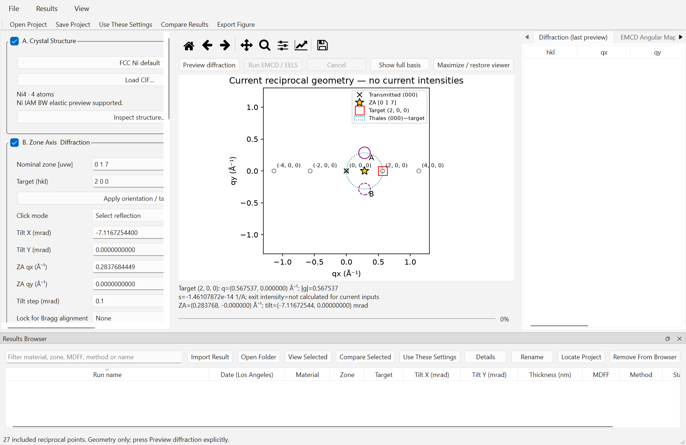

Actual accepted 0.6.0 frozen capture at native 150% scaling, showing the current input
and diffraction controls. Use this numbered reading order:

1. **Left: Inputs.** Expand/collapse **A. Crystal Structure**, **B. Zone Axis
   & Diffraction**, **C. Microscope & Sample**, **D. MDFF Model**,
   **E. Propagation Method**, **F. Calculation Settings**, **Virtual detectors**,
   and **G. Output Settings**. Changing an input does not calculate a new result.
2. **Center: diffraction viewer.** The **Click mode** selects what a click does.
   The toolbar provides pan/zoom; its coordinates belong to the current local
   reciprocal frame in cycles/Å. **Preview diffraction** calculates elastic
   intensities. **Run EMCD / EELS** explicitly starts core-loss calculation.
3. **Right: results.** Tabs include **Diffraction (last preview)**,
   **EMCD Angular Maps**, **Virtual Detector EELS**, **Magnetic / Nonmagnetic**,
   **Calculation Information**, **BW/MS Diffraction** and **BW/MS Overview**.
   Some tabs remain disabled until appropriate data exist. A last-preview or
   stale-result label distinguishes completed data from edited current inputs.
4. **Bottom: Results Browser.** Saved/in-memory completed runs, selection,
   viewing, source reconnection, metadata and comparison. The **Projects**
   toolbar provides Open Project, Save Project, Use These Settings, Compare
   Results and Export Figure.

Use **Maximize / restore results** to expand the result pane, **Maximize /
restore viewer** for the center, or **View → Restore Default Layout**. Input
and plot areas scroll when the window is narrow. Complete exported figures
are more readable than a cramped three-pane window.

## Validated Ni [017], 8 nm Double example

This reproduces the geometry and physical/numerical profile of the representative angular study with **97 x 97** sampling. It does not run the full thickness scan. The source audit may initially select L3 = 831.271 eV; explicitly set **L3 native feature (eV)** to **831.4778** to match this benchmark. Do not shift the source spectrum.

1. **File → New**, then **FCC Ni default** (fcc Ni, a = 3.524 Å). Set **Nominal zone [uvw]** to `0 1 7`, **Target (hkl)** to `2 0 0`, and **Apply orientation / target**. Set **Voltage (kV)** = 200 and **Thickness (nm)** = 8. **Reset to reference geometry** gives **Tilt X (mrad)** = -7.116725439974256 and **Tilt Y (mrad)** = 0. Exact s200 = 0 is the paraxial Bragg reference; competing beams remain in the full finite 2D basis. Leave **Explicit [001] (200) systematic-row approximation** unchecked.
2. Under **D. MDFF Model**, choose **XMCD-constrained (WIEN2k)**. Use the bundled `EMCD-Sim/_internal/data/wien2k_ni/Ni_fm.xmcd`, click **Validate source / native features**, set **Crystal Cartesian M axis** = `0 0 1`, eta = beta = 1, L3 = **831.4778 eV**, L2 = **848.698 eV**, and check **I declare M axis, RP/LP convention and edge assignments** after inspecting the convention. Cubic [001] rotates to local `[0,-1/sqrt(50),7/sqrt(50)]`; it is not local [017].
3. Choose **Channeling Model → Double Channeling**, **Propagation Method → Bloch-wave**, **Spectral coverage → Selected L3/L2 samples only (not full EELS)**, and enable **Calculate angular maps**. Disable **Enable post-edge A/B correction** for these two-energy samples; use full spectra for post-edge diagnostics. Set the controls below explicitly rather than relying on preview defaults.

| Setting | Value |
| --- | --- |
| Beam cutoff | 4.6 cycles/Å, incoming/outgoing matched, 59 beams for [017] |
| Potential cutoff | 6.2 cycles/Å |
| Debye–Waller B | 0 Ų |
| Angular Map Resolution | Standard - 97x97 |
| Map halfwidth | 0.5 cycles/Å |
| Depth integration nodes | 257 |
| Aperture boundary subpixels | 64, fractional integration |
| FFT grid (even), if switching to MS | 48 |
| Max slice step (nm), if switching to MS | 0.04 |
| Estimated process memory budget | 2048 MiB; admission still checks actual available RAM |
| Physical detector A center | (+0.2837684449489217, +0.2837684449489217) cycles/Å |
| Physical detector B center | (+0.2837684449489217, -0.2837684449489217) cycles/Å |
| Aperture radius | 0.0908059024 cycles/Å |
| Optional post-edge A/B correction window | 878–882 eV, a separate observable; use full spectra for post-edge diagnostics |

4. Click **Restore Thales A/B** and confirm detector coordinates/radius. Click **Run EMCD / EELS** once. The budget is a ceiling, not an allocation or promise of admission; a rejection must be resolved explicitly, never by an undocumented physical reduction. MS/Both and full spectra can be substantially slower than this BW selected-energy example.
5. In **EMCD Angular Maps**, choose L3/L2 and **Signal Display → Raw (a.u.) / EMCD Asymmetry (%)**. All valid saved q samples are displayed; circles do not clip the map. In **Virtual Detector EELS**, selected-energy results remain points. Expand **Advanced Diagnostics** for intrinsic magnetic/even fields or magnetic-only percentages. With Both results, the method selector offers **BW-MS numerical difference**; this numerical difference is not a Single-versus-Double model comparison.
6. Use **Export current plot PNG / SVG…**, the figure toolbar, **Export derived NPZ/CSV + metadata** or **Export completed EMCD / EELS...** as appropriate. Save the full project folder with **File → Save Project As...** and reopen using **Open Project**. Results Browser **View Selected** loads arrays; **Use These Settings** restores input controls separately. Display changes do not propagate the wavefield.

The tracked/bundled source SHA256 is `4fd517af3e54db94588a76b7a6ed9c2f9a1b745cd8fe52b9fca0f87fc4938db3`; the study file SHA256 is `a0e28ea6423b6c7832bb3cce6d69d71aa59336a221baeee3d2556b49ba501283`. Their difference is the terminal newline, not numerical spectrum values, verified in this release documentation audit. Preserve the actual hash of the file used; do not rewrite provenance to make hashes agree. The 97-grid saved BW reference detector asymmetry is about -13.0591%, while the 193-grid reference is about -13.0601%; this is a case-specific numerical comparison, not a universal expected output.

See [angular convergence](ANGULAR_MAP_CONVERGENCE.md), [complete thickness analysis](NI_EMCD_THICKNESS_SCIENTIFIC_ANALYSIS.md), [Ni case study](NI_017_CASE_STUDY_GUIDE.md) and [acceptance scope](V061_BETA_ACCEPTANCE.md). The older screenshots below show their original verified releases and are not mislabeled as captures of this new preset interface.

## First simulation: FCC Ni [017], exact (200) Bragg

1. Launch the application; choose **File → New** for a fresh current selection.
   **FCC Ni default** selects conventional FCC Ni, **a=3.524 Å**. **Inspect
   structure…** shows the cell, species, fractional sites, source and hash.
2. Set **Nominal zone [uvw]** `0 1 7`, **Target (hkl)** `2 0 0`, then **Apply
   orientation / target**. Retain 200 kV and 30 nm.
3. Use **Reset to reference geometry** and **Preview diffraction**. The local
   incident tilts are approximately **X=−7.11672544 mrad, Y=0**. In **Select
   reflection** mode click indexed (200), then **Align to selected Bragg**.
   The selection readout should show `s200≈0`; roundoff near 1e-14 Å⁻¹ is zero
   for this purpose. This is exact Bragg incidence, **not** zero-tilt [017].
4. Find transmitted **(000)** (cross), **ZA [017]** (star), target (200), and
   the **Thales** circle. At the reference, ZA is approximately
   `(+0.283768, 0)` cycles/Å relative to transmitted (000). It is not a plot
   displacement in mrad; convert with the electron wavelength.
5. Click **Restore Thales A/B**. The physical apertures are centered near
   `(+0.283768, ±0.283768)` cycles/Å, radius `0.0908059` cycles/Å.
6. Select and validate an MDFF source/model as below. Choose **Propagation
   Method → Bloch-wave** and the default numerical settings. For corrected
   curves, explicitly enable post-edge A/B correction with the 878–882 eV
   window, independently of display peak normalization.
7. Click **Run EMCD / EELS**. The worker reports stages; **Cancel** requests a
   cooperative stop and immediately shows **Cancelling...**, then
   **Calculation cancelled.** when the worker has released its resources.
   A failed/cancelled calculation does not replace a completed result.
   After cancellation, change settings or run again normally. Individual
   native numerical calls must finish before cancellation can be acknowledged;
   see [measured cancellation acceptance](DOUBLE_CHANNELING_CANCELLATION.md).
   Completion enables maps, EELS and comparison information.
8. Inspect L3/L2 and signed metrics, then **File → Save Project As...** into a
   new user research folder. Keep the entire folder.

Why [017]? It is a genuine minor-zone orientation approximately **8.13°**
from crystal [001], the source magnetization direction. Its local axes are
x=[100], y=[0,7,−1]/sqrt(50), z=[0,1,7]/sqrt(50). Cubic M=[001] becomes
local `(0, −1/sqrt(50), 7/sqrt(50))`; it is not reassigned parallel to the beam.
The nominal zone defines crystal orientation; incident tilt defines beam
direction within that frame; the projected ZA star locates the crystal zone
direction relative to the transmitted beam. Exact s200=0 does **not** guarantee
an isolated two-beam wavefield. Propagation retains the full finite 2D basis.

## Change zone axis, Bragg alignment and mistilt

Changing **Nominal zone [uvw]** changes the actual crystal projection. Enter
three integers, such as `0 1 7`, and apply the orientation. Choose a supported
nonzero target (hkl) in the displayed basis. In **Select reflection** mode,
click a spot; the target and excitation error update. **Align to selected
Bragg** solves its paraxial excitation-error condition. **Lock for Bragg
alignment → X** holds X fixed and solves Y; **Y** holds Y fixed and solves X;
**None** permits the nearest adjustment. An impossible locked alignment is
reported, rather than silently violating the lock.

In **Set projected ZA** click mode, clicking changes beam tilt using

```text
q_ZA = −k_incident,perp = −(tilt_x_rad, tilt_y_rad) / lambda
tilt_mrad = −1000 lambda q_ZA
```

The existing relativistic wavelength and cycles/Å convention are used; no
extra 2π factor applies. Editing **ZA qx/qy (cycles/A)** or **Tilt X/Y (mrad)**
performs the same conversion. **Tilt step (mrad)** sets the spin-box increments.
At zero tilt, ZA and transmitted (000) coincide. **Reset to zone axis** gives
that zero tilt; **Reset to reference geometry** restores the built-in [017]
(200) reference, including its nonzero X tilt. Do not use them interchangeably.

For a Ni [017] mistilt, define offsets from the Bragg reference:

```text
theta_x = theta_Bragg,200 + delta_x
theta_y = delta_y
```

For +1 mrad X offset, enter about **−6.11672544 mrad absolute X**, not +1 mrad.
Keep Y=0 for an X scan. Positive/negative X offsets move across s200=0 and
redistribute the wavefield. Y offsets can excite off-row reflections and
break detector mirror balance. Because g200 has local gy=0, changing Y alone
can leave s200=0 in this convention while changing other beams substantially.
Predicting an EMCD sign or useful intensity requires calculation, not the
target excitation error alone. Existing larger-mistilt examples are in the
[Ni case-study guide](NI_017_CASE_STUDY_GUIDE.md).

## Import a CIF

1. Click **Load CIF…**, select the CIF, then **Inspect structure…**.
2. Check lattice lengths/angles, sites, occupancies, supplied space group,
   import warnings and SHA256. The importer uses ASE; it does not infer a new
   space group for an arbitrary input.
3. Set nominal zone and target, apply, and inspect reciprocal indexing.
4. Read availability messages before starting a numerical calculation.

Import success is not an assertion of validated EMCD support. The bundled
elastic IAM factors support Ni; other species can be inspected in reciprocal
geometry without numerical Ni scattering. Partial/disordered occupancies are
unsupported. MDFF calculations require the verified conventional FCC Ni cell
(a=3.524 Å and equivalent sites); arbitrary Ni structures are not automatically
accepted. Current GUI FFT support is restricted to verified FCC Ni [017].

## XMCD-constrained effective MDFF

Expand **D. MDFF Model**, select **XMCD-constrained (WIEN2k)**, then **Browse
XMCD...** if necessary. The portable example is
`_internal/data/wien2k_ni/Ni_fm.xmcd` beside the application resources. Click
**Validate source / native features**. The reader checks the five-column
format and native energy range, reports a source SHA256 and finds candidate
L3/L2 magnetic features. The bundled example contains calculated spectra,
not WIEN2k executable/source code or the original companion calculation.

For that Ni example use **Crystal Cartesian M axis** `0 0 1`, eta=beta=1,
**L3 native feature (eV)** `831.271`, **L2 native feature (eV)** `848.698`.
Check **I declare M axis, RP/LP convention and edge assignments** after
reviewing these conventions. An original local companion audit can supply
additional provenance; ordinary five-column validation does not claim it.
Bundled validation therefore does not automatically check the declaration or
guarantee that post-edge correction is on.

With N=(RP+LP)/2 and D=(RP−LP)/2, the axis-aligned proxy is
Txx=Tyy=N, Txy=+i eta D, Tyx=−i eta D, Tzz=beta N, with the existing source
maximum normalization. Eta controls magnetic sign/scale; beta describes the
unmeasured longitudinal response. They are assumptions, not fitted absolute
cross sections. Excessive |eta| can fail positive-semidefinite tensor checks.
Magnetization reversal is performed in the source/crystal frame before the
tensor is rotated into the selected local crystal frame.

**Preview source / tensor spectrum...** shows RP+LP (XAS), RP−LP (XMCD), edge
markers, and Full spectrum/L3/L2 zoom. A magnetic extremum need not coincide
with the XAS maximum or the saved detector-even EELS maximum. The selected Ni
features are calculated energies on the **unshifted native WIEN2k axis**,
not experimentally calibrated absolute edge positions. Do not replace them
with 852.7/870 eV merely because those are atomic-model defaults.

The effective axisymmetric tensor is not a complete complex Cartesian
core-to-band DFT-derived MDFF. RP/LP intensities alone do not recover missing
complex transition amplitudes or arbitrary longitudinal response.

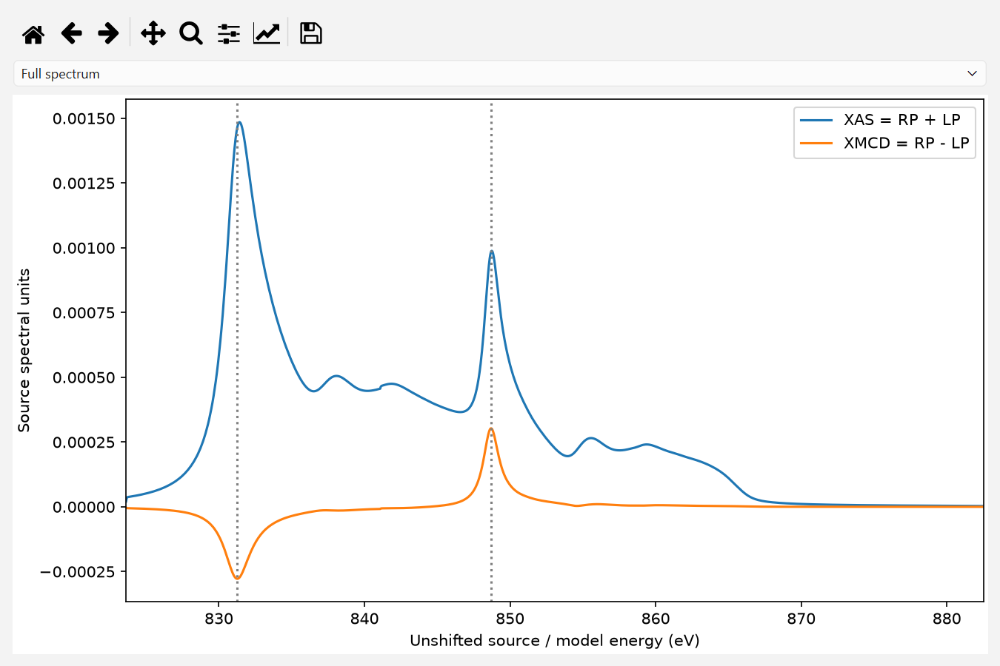

Actual native Stage G source-preview capture of the bundled example. The two
curves use source spectral units; these are not detector-integrated EELS and
are not percentages. Dashed markers locate selected magnetic feature samples.

## Atomic-ionization MDFF

Choose **Atomic ionization (Ni 2p -> 3d)**. This non-DFT model combines 2p
core spin–orbit coupling (L3 j=3/2, L2 j=1/2), cubic 3d orbitals, **10Dq (eV)**,
**Exchange (eV)** and spin-dependent **eg/t2g up/down holes**. **Gaussian sigma
(eV)** broadens the transitions. **Advanced atomic radial controls** expose
screened-hydrogenic effective charges or an explicit effective radial dipole.
They do not install a self-consistent metallic-Ni electronic structure or
many-body multiplet solver. The GUI currently restricts this model to cubic
crystal [001] magnetization.

Reversal exchanges spin-hole populations and reverses exchange shifts in the
fixed core-SOC basis; tensors are then transformed into the local frame.
**Preview source / tensor spectrum...** plots tensor components rather than an
imported XMCD file. Defaults L3=852.7 and L2=870 eV belong to this separate
approximation. Atomic and XMCD-effective magnetic amplitudes/signs can differ
because their electronic populations, spectral assumptions and conventions
differ. Successful execution is not experimental validation of either model;
their relative intensity units are not an absolute cross-model calibration.

## Development source: shared and solver-specific settings

### Automatic and Manual numerical settings

New source projects default to **Numerical Settings → Automatic** in Panel F.
Expand **View Numerical Parameters** to inspect the actual read-only cutoffs,
depth nodes, angular grid and memory budget passed to the calculation. MS/Both
also shows FFT mesh and maximum slice step; BW omits those unused entries.
Memory estimates and admission failures remain visible. Automatic selection
does not propagate waves, evaluate MDFF, run trial calculations or establish
convergence. Pressing Run starts only the requested calculation.

The deterministic `automatic-starting-v3` policy normally uses the development
starting values: beam 3.2 Å⁻¹, potential 2.5 Å⁻¹, depth 64, maximum MS step
0.04 nm, angular grid 97, 64 aperture subpixels, halfwidth 1 Å⁻¹, 241 energy
samples and 2048 MiB budget. It retains the selected physical geometry, B,
systematic-row approximation, source, magnetization and detector positions.
These settings are labeled **Automatic starting settings — convergence not
established**. An unavailable geometry is reported without substituting a solver.

The narrowly matched [Ni reference](DOUBLE_CHANNELING_UNIFORM_BASIS.md) uses
beam 4.6 Å⁻¹, potential 6.2 Å⁻¹, FFT 48, depth 257 and 0.04 nm maximum step.
Matching requires the conventional Ni cell, [017], full finite ZOLZ, exact (200)
Bragg with zero vertical tilt, 200 kV, B=0, thickness exactly 8/12/30/100 nm,
the archived source SHA256, declared crystal [001] magnetization, eta=beta=1,
native 831.4778/848.698 eV samples, original Thales detectors/radius and no radial
override. Both supported channeling models and all three propagation choices
can use this profile. Changed conditions fall back to starting values, with no
inherited convergence claim. A match refers to representative native-edge
detector observables, **not** certification of arbitrary angular maps, full
spectra, other thicknesses or global extrema. The summary always states that
Automatic settings do not guarantee numerical convergence.

MS mesh selection starts at 32 (48 for the matched reference), then checks even
meshes through 128 using the existing geometry-specific exact-hkl, reciprocal
coordinate and Nyquist checks. It additionally requires a two-index boundary
guard band for physical support. It never increases potential bandwidth or
truncates the beam basis to fit. Passing these checks establishes representation,
not FFT/slice convergence. Memory admission is unchanged and may reject even a
reference profile; Automatic never reduces settings to fit a budget.

Choose **Manual (Advanced)** to edit all existing numerical controls and budget
choices. The first switch copies the resolved values. Later switches back to
Manual restore the session's last overrides; returning to Automatic resolves
against current physical conditions. Physical B and systematic-row controls stay
accessible in either mode. The existing independent solver, energy-coverage,
map and post-edge controls retain their meanings.

Saved result metadata includes mode, actual numerical values, manual overrides
and selection policy/source. Old projects with no mode are **Manual**, retaining
their original values. Viewing any saved result performs no recalculation.
**Use These Settings** restores the saved mode and exact values; restored
Automatic values remain intact until a relevant input changes. New Project
returns to Automatic. The published v0.6.1-beta.1 ZIP is unchanged.

This UI organization is the next **source development update after v0.6.1-beta.1**. No Windows binary is rebuilt, no version changes, and the published ZIP retains its original Panel F layout. Scientific configuration keys and explicit Manual values are unchanged; Automatic follows the policy above. Panel E remains **E. Propagation Method**; Panel F becomes **F. Shared Calculation Settings**.

Panel E retains **Channeling Model** (Single/Double) and **Propagation Method** (Bloch-wave / FFT Multislice / Both). In Manual mode, **Multislice numerical settings** appears and is enabled only for MS or Both; expand it for **FFT grid (even)** and **Max slice step (nm)**. Automatic displays these values in Panel F's summary. BW currently has no additional BW-only numerical controls. Manual solver switching preserves stored settings; Automatic reruns its inexpensive selection policy. Invalid MS geometries still fail rather than falling back to BW.

Panel F groups Manual controls into **Elastic Potential and Beam Support**, **Inelastic and Angular Sampling**, and **Computational Resources**. B and the explicit [001] systematic-row checkbox stay accessible in both modes because they affect the physical potential/basis. The row approximation remains inappropriate for [017]. Physical A/B detector positions and radius remain in **Virtual detectors**.

| Actual control | Classification and effect |
| --- | --- |
| Channeling Model / Propagation Method | Shared model/solver selection, not sampling; Both runs the independent engines for the same selected model. |
| Beam / MDFF basis cutoff (Å⁻¹) | Shared support: BW retained elastic basis and MS common diffraction/MDFF basis. MS propagation may retain additional FFT harmonics; projection does not renormalize away their population. |
| Potential Fourier cutoff / Debye–Waller B (A²) | Shared projected-IAM Fourier support and damping, used by both solvers. Potential support is not the beam radius or EELS collection limit. |
| Explicit [001] (200) systematic-row approximation | Shared physical approximation, not a BW-only numerical option. Excludes off-row basis/potential support in the supported [001] path. |
| Depth integration nodes | Shared sampling with path-dependent use; see the depth explanation below. |
| FFT grid (even) / Max slice step (nm) | **MS-only** propagation mesh/harmonic support and maximum split-step distance; not angular q resolution or a BW substep. |
| Spectral coverage / Energy sampling points | Shared energy sampling. Full mode uses the stored count plus locked native features; selected-edge mode uses the two locked energies while retaining the count for later full-mode use. |
| Angular Map Resolution / Angular / detector grid points (odd) / Map halfwidth (Å⁻¹) | Shared actual q samples/extent for angular maps and detector-EELS quadrature. Presets map to the same serialized `grid` key. |
| Aperture boundary subpixels | Shared fractional circular-aperture boundary integration, not FFT refinement or new intensity samples. |
| Calculate angular maps | Shared evaluation support: full q field at selected L3/L2, nonzero A/B detector-support union elsewhere; when off, detector-only at every energy. The q grid and fractional weights are unchanged. |
| Advanced post-edge diagnostics / Enable post-edge A/B correction / Window start/end | Derived diagnostics/postprocessing: affects corrected/residual contrasts, not propagation, MDFF or original raw detector states. |
| Estimated process memory budget | Shared execution/admission resource, **not a physical-model parameter or required allocation**; stored unchanged and checked against current available RAM. |
| Memory estimate and solver explanation | Diagnostics-only presentation; estimates reflect the currently selected engines, basis/sampling, retained allocations and RAM. |

The physical-model and angular/integration categories affect both engines; memory admission and worker scheduling are separate resources rather than scattering parameters. Only FFT mesh and maximum slice step are MS-only. New development-project defaults are **300 kV**, beam **3.2 cycles/Å**, potential **2.5 cycles/Å**, B = 0, 64 depth nodes, FFT 32, maximum step 0.04 nm, energy count 241, halfwidth 1 cycle/Å, aperture subpixels 64, angular grid **97** and budget **2048 MiB**. New-project reference alignment follows the selected voltage; loading a saved project preserves its explicit voltage, tilt, cutoffs and sampling. Production reference settings are not substituted as ordinary defaults.

### Parallel Workers and pre-Run risk

Panel F's **Computational Resources** stays visible in both numerical modes.
**Parallel Workers → Automatic (Recommended) / Manual** is independent of
Automatic/Manual numerical settings. Manual requests are preserved, including
when blocked; the preview distinguishes requested and effective counts for
BW/MS/Both. Single Channeling currently uses one serial detector contraction;
Double supports 1–4 detector workers subject to runtime/resource checks.

The calculation QThread keeps Qt responsive. Its Python detector workers are
separate from the native BLAS/LAPACK threads shown by runtime introspection.
CPU count or an environment variable alone is not used as a BLAS-thread reading.
An unidentified runtime is **Unknown**, not verified safe. Beam-basis cost can
grow sharply: analytic BW Double includes N⁴ temporaries; MS estimates include
FFT/depth/batch arrays. Peak admission also considers current RSS, active
reservations and available RAM. Automatic may reduce detector workers to fit;
Manual is rejected rather than silently changed. Scientific inputs are retained.

Windows BW Double defaults to the bounded-tested single-detector-worker policy.
Multiple Windows BW workers are allowed only when native BLAS is verified to
have one thread; the GUI never mutates its process-global thread limit. Start a
fresh source process with `OPENBLAS_NUM_THREADS=1` if you intentionally want to
test that execution strategy. It is not assumed faster. MS retains its separate
worker policy. Effective counts are rechecked before Run and pinned for the job.

**KNOWN UNSAFE** blocks matching crash evidence. **RESOURCE REJECTED** blocks
memory-budget/RAM violations. **UNVERIFIED COMBINATION** warns, or blocks an
unsupported parallel strategy; acceptable memory alone is not stability proof.
**VALIDATED POLICY** refers only to matching bounded tests, not an impossible-to-
crash promise or physical convergence. There is no universal unsafe cutoff at
3.0 Å⁻¹. See [worker safety and diagnostic EXE](BW_PARALLEL_WORKER_SAFETY.md).

**Depth treatment:** BW evaluates elastic amplitudes analytically at the requested planes, but the GUI's Single-channeling coherence is formed by trapezoidal integration of those samples. MS Single likewise integrates sampled coherence, with propagation subdivided between planes according to the maximum slice step. BW Double uses analytic depth response for the explicit systematic row and numerical depth integration for the general path (including full [017]); the node count still supports preparation, stored amplitudes/coherence, diagnostics and memory estimates in the analytic path. MS Double samples incoming/outgoing/inelastic depth contributions and uses MS substeps. Therefore depth nodes must not be labeled universally analytic for BW or exclusively MS-specific.

Values flow through unchanged `Settings` / `ForwardSettings` keys to the existing geometry/potential, propagation, coherence/MDFF contraction and saved metadata. The current-to-saved mapping and `settings_from_dict` / `config_from_dict` schemas do not change. Opening saved data does not run propagation; **Use These Settings** restores the original values and applicable-control visibility separately.

## Bloch-wave, FFT Multislice and numerical settings

Select **Bloch-wave**, **FFT Multislice** or **Both (BW / MS comparison)**.
BW evolves amplitudes in a finite diffraction basis; MS alternates real-space
potential and reciprocal-space propagation in the oriented projected IAM.
Choose **Channeling Model → Single Channeling / Double Channeling** separately
from the solver. Both integrate localized ionization throughout foil depth,
retaining complex tensor interference and fractional physical apertures.
Double also propagates the outgoing electron at E_incident minus the actual
energy loss. Both runs independent BW/MS calculations for the selected model;
it never substitutes Single spectra for Double. FFT supports FCC Ni [017]
and the explicitly selected [001] (200) systematic-row approximation.
The [001] checkbox excludes off-row support; [017] retains its full finite
ZOLZ disk. Exact Bragg alignment does not establish physical two-beam isolation.

| Control | Meaning and care |
| --- | --- |
| Beam / MDFF basis cutoff (Å⁻¹) | Shared retained BW and MS/MDFF basis, not a two-beam restriction. MS may propagate additional FFT harmonics. Increasing the common basis also enlarges the inelastic contraction. |
| Potential cutoff (cycles/A) | Fourier harmonics of the elastic projected IAM potential. It is a separate physical/numerical convergence question. |
| Debye–Waller B (A²) | The existing potential damping parameter; record any change. |
| Multislice numerical settings → FFT grid (even) | Real/reciprocal sampling mesh, default 32. Must include the exact common hkl basis; even 12–128 is the supported control range. |
| Max slice step (nm) | Maximum propagation substep, default 0.04 nm; distinct from the ionization depth nodes. |
| Depth integration nodes | Ionization/coherence depth sampling, default 64. |
| Angular Map Resolution / Angular / detector grid points (odd) / Map halfwidth | Actual reciprocal sampling and field of view: Quick Preview 33, Standard 97 (default), High 193, or odd Custom 9–193; halfwidth defaults to 1 cycle/Å. Shared with detector-EELS quadrature. |
| Aperture boundary subpixels | Boundary sampling for fractional circular area weights, default 64. It does not refine a spatially varying intensity field itself. |
| Energy sampling points | Saved spectral sampling, with selected edge points additionally included; default 241 can yield 243 saved energies. |

**Calculation Information** reports current/saved settings and memory estimates.
Select a process-memory budget of **512, 1024, 2048 (default), 4096 or
8192 MiB**. Admission includes current process RSS, concurrent allocations,
retained arrays, 25% allocation margin and a 128 MiB reserve. It separately
reports the dense kernel and rejects estimates above either the selected
budget or 50% of currently available RAM. Parameters are never silently reduced.
The estimate is conservative, not a measured peak-memory guarantee.
The validated Ni reference profile uses beam 4.6 Å⁻¹, potential Fourier
cutoff 6.2 Å⁻¹, FFT 48, 257 depth nodes, maximum step 0.04 nm and
float64/complex128. These are reference settings, not mandatory GUI defaults.
Both reciprocal cutoffs use crystallographic g=1/d, without an extra 2π.
Good agreement of BW/MS amplitudes, coherence, elastic intensities, EELS and
maps checks numerical propagation at matched settings. It does not establish
physical Fourier-cutoff convergence, full DFT accuracy or absolute calibration.

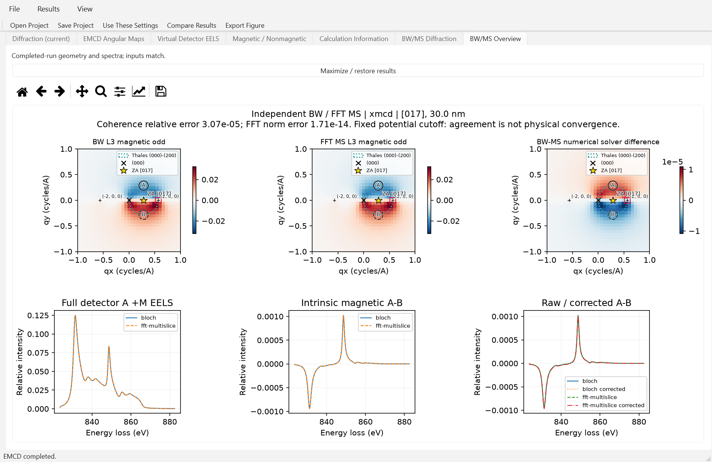

Reused native Stage E capture at 150% scaling. Numerical solver discrepancy
values always refer to original arrays, regardless of display normalization.

## Read angular maps

The primary **Full-field mirrored-point EMCD** display uses the complete
calculated intensity grid, independently of A/B aperture locations or weights.
The default **Raw (a.u.)** view shows magnetic and nonmagnetic mirrored
point-pair differences on a common signed original-intensity scale. Select
**EMCD Asymmetry (%)** for one total +M difference/sum map. The saved samples
at (qx,qy) and (qx,-qy) must be valid mirrors; these are not finite-aperture
integrated EELS percentages. Read the exact definitions above.
The actual ZA, transmitted beam, hkl, target, Thales circle and physical A/B
apertures retain their saved geometry in either solver/model.

Choose L3/L2 and method (or BW-MS numerical difference). Expand
**Advanced Diagnostics** for intrinsic fields and legacy paired/corrected maps;
**All six fields** restores the legacy multi-panel view described below.

| Field | Interpretation |
| --- | --- |
| Magnetic odd | Intrinsic I_mag(q)=[I_plus(q)−I_minus(q)]/2; signed local magnetic intensity. |
| Nonmagnetic even | Intrinsic I_nonmag(q)=[I_plus(q)+I_minus(q)]/2; not itself detector imbalance. |
| Total +M | I_plus=I_nonmag+I_mag. |
| Magnetic / Nonmagnetic paired | D_mag or D_nonmag comparing q with reflect_y(q), only on original A support. |
| Raw paired A−B | Single-state paired difference, containing magnetic and even terms. |
| Corrected paired A−B | A−alpha B after the separately chosen post-edge scaling. |
| Residual even | Even contribution remaining after that same alpha; not intrinsic magnetic intensity. |

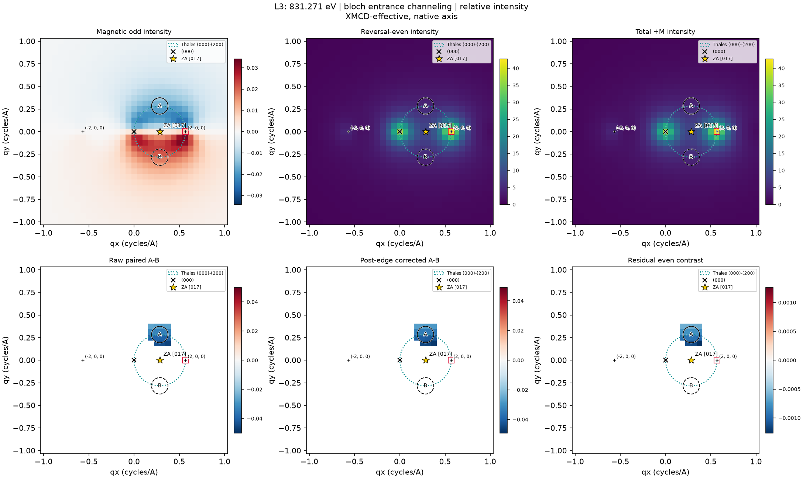

Actual exported L3 intensity maps at 831.271 eV. The physical A/B circles,
indexed hkl, transmitted (000), projected ZA and Thales circle refer to saved
geometry. L2 is selected at 848.698 eV for this native example. Maps are
reciprocal intensity densities; detector spectra are area-weighted integrals.

The Thales circle has the diameter (000)–target. Its symmetric off-row A/B
positions sample opposite magnetic handedness in the intended geometry;
the circle alone does not guarantee a pure magnetic signal. Mistilt can
produce reversal-even A/B imbalance. **Move detector A/B** click modes or
the numeric aperture centers change the physical integration. If they cease
to be validated nonoverlapping y mirrors, paired angular subtraction and
paired percentages are unavailable with an explanation. Physical integrated
A/B EELS can still be meaningful. Use **Restore Thales A/B** to restore the
standard pair, not an artificial reflected signal outside the actual support.

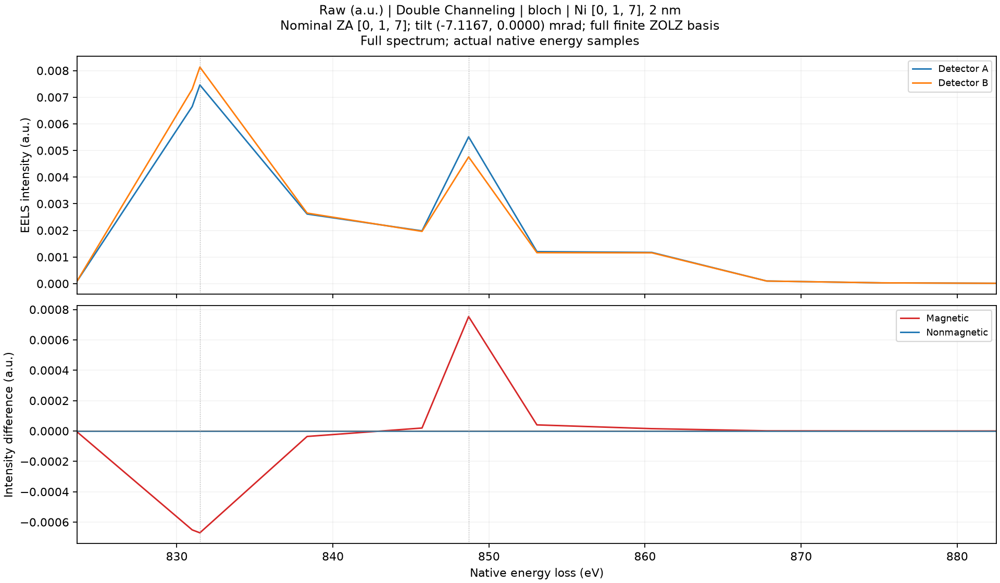

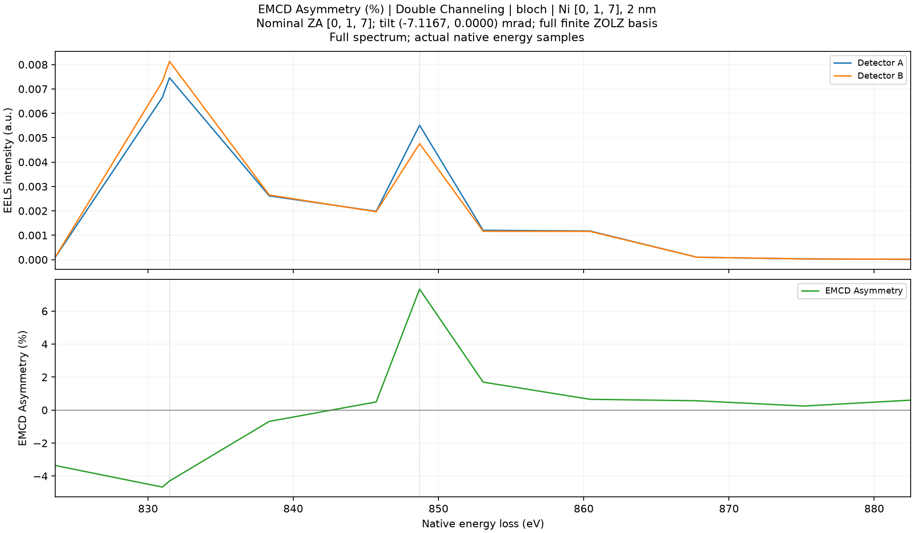

Actual source-GUI figures from the same saved 2 nm Double BW [017] dispatch
reference. All native saved samples and intensity scales are retained. This
small numerical profile illustrates controls, not production convergence.

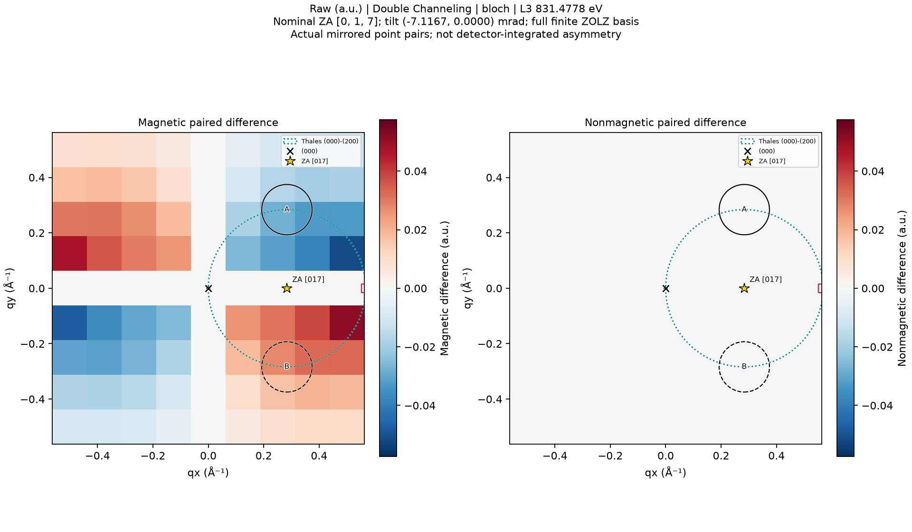

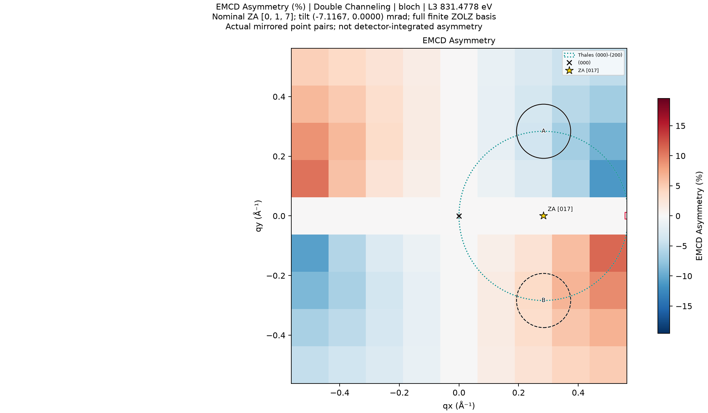

Actual saved 9x9-grid L3 point-pair maps; block structure reflects the original
grid, without interpolation. Magnetic and nonmagnetic raw panels share a scale.
The total percentage panel is a different observable. Physical target (200)
lies at the edge of this saved field of view; it is not relocated.

## Read virtual-detector EELS and post-edge correction

**Virtual Detector EELS** offers Full spectrum, L3 zoom, L2 zoom and
BW/MS/overlay choices. The primary Raw / EMCD Asymmetry presentation follows
[the definitions above](#signal-definitions-in-060). Saved two-energy results
remain points; partial native coverage is labelled a subset. No continuous
spectrum is invented from selected-energy results.

For detector J=A or B:

```text
N_J = (I_J_plus + I_J_minus)/2
M_J = (I_J_plus − I_J_minus)/2
D_mag = M_A − M_B
D_nonmag = N_A − N_B
D_raw = I_A_plus − I_B_plus = D_mag + D_nonmag
Sigma_ref = N_A + N_B
```

Raw contrast can therefore be dominated by diffraction-induced even
imbalance. In **F. Calculation Settings**, **Enable post-edge A/B correction**
and its **Window start/end (eV)** define a separate observable:

```text
alpha = integral_window I_A_plus(E)dE / integral_window I_B_plus(E)dE
D_corrected = I_A_plus − alpha I_B_plus
            = (M_A − alpha M_B) + (N_A − alpha N_B)
              processed magnetic      residual even
```

The fit uses observed +M A/B spectra, not an oracle magnetic subtraction.
Nonzero magnetic post-edge tails can bias alpha. Correction may reduce an
even imbalance and still distort the magnetic term or leave a residual.
The reference window, alpha and disabled/undefined reasons are recorded;
changing this window requires an explicit new calculation of the observable,
whereas changing a **display peak window** only reprocesses saved arrays.

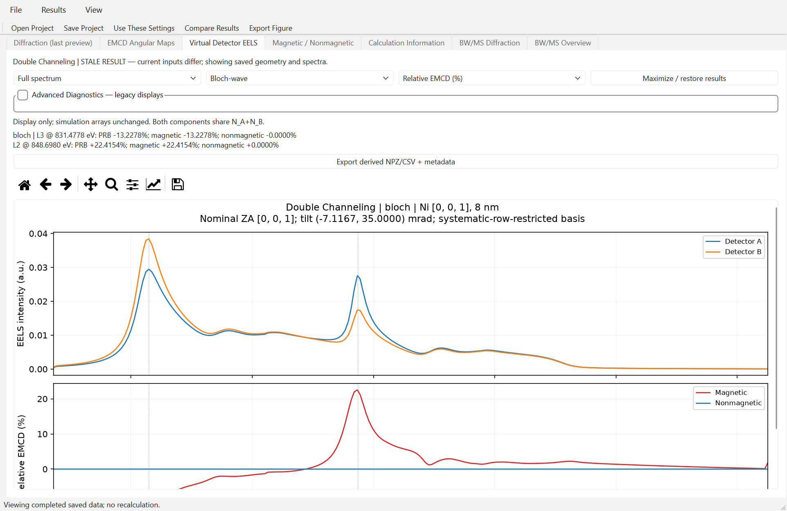

Actual accepted GUI capture of a genuine saved full-energy Double BW result.
It preserves native energies and the raw detector intensity scale.

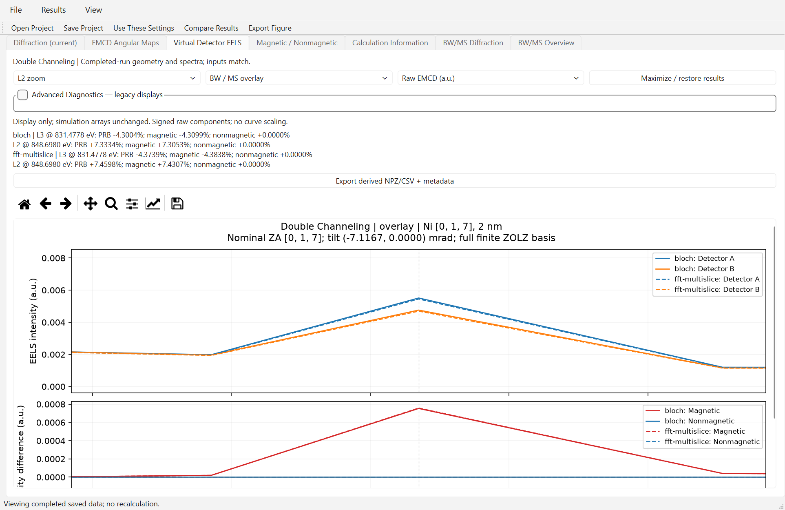


These historical 0.4.5 Beta BW/MS Double captures use the same small dispatch-test
profile in Raw and Relative modes. They illustrate signed component definitions,
not production BW/MS convergence. The shared raw EELS scale above is unchanged;
the separate PRB readout is not the lower-panel component normalization.

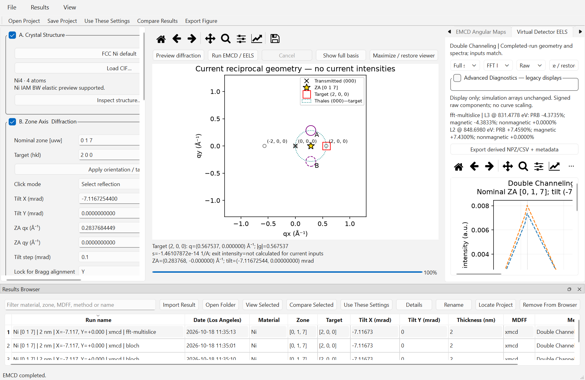

Actual cancellation-fixed frozen GUI after successful restart. Cancelled work
did not add incomplete browser entries; only completed results are registered.

## Interpret percentages

The primary spectral selector offers Raw and total EMCD Asymmetry with the
definitions above; the scalar group uses that same total definition. The following **Intensity
Display** modes remain available in **Advanced Diagnostics** and saved-run
comparisons. They are optional legacy displays, not additional primary modes:

| Mode | Denominator for a signed difference D |
| --- | --- |
| Raw (a.u.) | None; original relative calculated units. |
| Asymmetry (%) | 100 D(E)/(N_A(E)+N_B(E)); energy-dependent. |
| EELS Peak (%) | 100 D(E)/P_edge; one fixed positive P_edge=max_window(N_A+N_B). |

Every selected magnetic, even, raw, corrected, processed and bias curve uses
the same chosen reference. A/B spectra also use that sum reference, not
independent detector maxima. **Auto: Full/L3 -> L3; L2 -> L2** keeps one L3
denominator over the entire full spectrum; a L2-zoom default uses P_L2.
Explicit **Peak reference: L3/L2** overrides it. The L2 feature in a full
L3-referenced spectrum is not divided by P_L2 partway through the line.

Expand **Peak windows (native eV)** to edit L3/L2 bounds, **Auto-detect peaks
in windows** or **Reset source/model defaults**. Bounds must lie in the saved
range, stay in the appropriate side of the L3/L2 midpoint, contain at least
two finite samples and have a positive finite maximum. Peak extraction uses
saved samples, not shifted/interpolated source peaks. Post-edge alpha windows
and EELS reference-peak windows serve different purposes.

Shared BW P_edge is the default for direct BW/MS comparison, even when MS
alone is visible. Independent method peaks are labeled presentation-only
because they can hide amplitude changes. Saved-run comparisons default to a
selected shared run peak; **Per-run peak reference** is explicit. Incompatible
models/source normalizations/units cannot share a quantitative peak. Qualitative
independent overlays retain warnings and do not bypass map-difference gates.

In the historical Stage F saved profile, the BW magnetic peak contrasts
are **−0.37556% (L3, P_L3=0.2508784247)** and **+0.61516% (L2,
P_L2=0.1662582163)**. They are simulated relative contrasts, not measured Ni
EMCD. The L3 energy-dependent asymmetry is instead about **−0.37966%**.
**Magnetic / Nonmagnetic** lists signed scalar metrics, peak windows and the
separate historical raw-plus denominator I_A_plus+I_B_plus. Relative detectability
|D_mag|/sqrt(Sigma_ref) remains a distinct proxy, not calibrated experimental SNR.

Angular display modes mean different quantities:

- **Local magnetic fraction (%)** = 100 I_mag(q)/I_nonmag(q), intrinsic local
  fraction, not paired-detector EMCD asymmetry.
- **Paired angular asymmetry (%)** = 100 D(q)/[N(q)+N(reflect_y(q))], retaining
  only original A support and validated mirrored apertures.
- Integrated EELS P_edge is not divided directly into an angular density;
  those units differ, so that peak-percent map is intentionally unsupported.

Denominators must be positive and finite, greater than 1e-8 (spectra) or 1e-6
(maps) times their positive finite 95th percentile. Undefined pixels remain
NaN and appear grey; they are not true zero. Signed maps use zero-centered
diverging colors and default shared BW/MS scales. **Independent color scales**
are available but must be stated when comparing magnitudes.


Actual Stage F acceptance tab combines saved paired magnetic/even maps and
BW/MS EELS with a fixed BW L3 reference. It is a verification layout; normal
map/EELS tabs provide the selectors described above. The reference even map
is numerical zero, not evidence that all mistilts have zero even imbalance.

Percentage normalization changes only the displayed derived quantities. It does not modify the simulated cross section, MDFF, dynamical scattering or underlying numerical data.

## Save, reopen and reconnect inputs

**File → Save Project As...** chooses a parent and a new project folder name.
**Save Project** updates a selected existing project; a new condition should
normally have a new name. Replacing an existing project through Save As asks
for explicit confirmation. Spectral Raw/Relative mode, view/method selection,
selected PRB energy and its lock are saved in an optional checksummed
`display_state.json`. Legacy projects without it still load. These are
presentation settings and never rescale saved scientific arrays.
Keep each project folder complete:

```text
Ni017_reference/
    project.json
    structure.cif
    structure.json
    input_parameters.json
    metadata.json
    comparison_metadata.json
    validity.json
    angular_maps.npz
    virtual_detector_eels.npz
    diffraction_pattern.npz
```

`project.json` records schema, completeness, provenance and file checksums;
do not edit it to bypass a failed load. **Open Project** selects this folder,
not an NPZ. Reopening reads saved numeric data and does not propagate or
recompute tensors. **Results → Import Existing Result** accepts older Stage
B/C exports read-only; missing legacy structure metadata can limit restoration.

**Results Browser → View Selected** displays a selected completed run.
**Use These Settings** restores its inputs separately and never starts a run.
Changing inputs leaves old results visible with **STALE RESULT**; plots
continue to use the completed geometry and spectra. **File → New** clears the
current completed selection and resets inputs; it does not delete browser
entries or files. **Remove from Browser** removes its index entry, not the
scientific project folder.

Original external XMCD/CIF files need not be available for viewing or export.
Rerunning requires the original SHA256-matching source. Use **Results → Locate
Original Source...**, reconnect the matching file, and **Use These Settings**.
Do not substitute a same-named but different spectrum. Copying projects to a
colleague transfers saved results, not automatically every external input.

## Compare two conditions

Use the existing exact-Bragg and +1 mrad X projects if provided. Full numerical
Stage D/E project folders are local validation artifacts, **not bundled in the
portable ZIP or downloadable from the screenshot gallery**. Alternatively:

1. Save the tutorial reference separately.
2. Set X to `−6.11672544` mrad, Y=0, keep the same model/source, detector,
   numerical and potential settings, then explicitly run and **Save Project
   As...** under a second name. This is one mistilt, not a parameter sweep.
3. Ctrl-select the two completed rows in **Results Browser**, click **Compare
   Selected** or the toolbar **Compare Results**. Select the method for each run.
4. Choose L3/L2, **Magnetic odd**, **Nonmagnetic even**, or a paired field.
   The spectrum selector offers **D_mag**, **A/B +M**, **D_nonmag**, **D_raw**,
   **D_corrected**; select zoom and normalization independently.
5. For quantitative within-model changes retain **Shared reference peak**
   and choose the reference run. Inspect **Signed scalar metrics** and the
   map difference only when the compatibility note permits it.

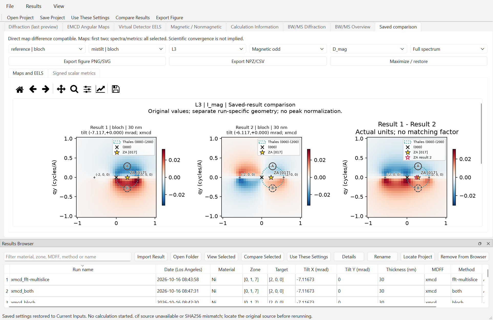

Reused native comparison of saved reference and mistilt. Stage F adds the
percentage controls to this same comparison workflow. First two selected
results supply maps; spectra/metrics include all selections.

Direct map differences require compatible reciprocal grids, local frames,
selected native energies, models/source hashes, intensity units and magnetic
sign conventions. Paired fields also require matching supports/integration;
correction windows matter for corrected fields. No interpolation, energy
alignment or sign fitting is silently applied. Incompatible runs can remain
side-by-side/qualitative; a percent label does not make their scales equivalent.
Use **Both** within a run for BW/MS numerical solver comparison; comparing
different mistilts is a physical-condition comparison, not a solver error.

## Export figures and data

- **Export Figure** / **Results → Export Current Figure** saves the active
  result plot as PNG or SVG. The center plot also has **Export current plot
  PNG / SVG…** under Output Settings. Select the intended tab first.
- **Export derived NPZ/CSV + metadata** in the result views, or **Export
  NPZ/CSV** in a saved comparison, writes a **new** export folder. It includes
  derived spectra, scalar percentages, original raw spectra/maps/coordinates/
  weights, and normalization metadata JSON. Undefined values remain NaN.
- **Export completed EMCD / EELS...** writes one checksummed project bundle,
  per-method CSV and PNG/SVG spectral/map figures. CSV/NPZ retain all four
  reversal spectra, raw differences, common denominators, magnetic/nonmagnetic
  percentages and PRB values in either primary display mode (legacy component fields retain their definitions).
  No independent detector peak normalization or redundant default difference
  figure is added. Advanced derived exports retain their explicit definitions.

PNG is convenient for previews; SVG preserves vector lines/text for editing
and publication preparation. Always verify font sizes and complete axes.
NPZ preserves typed numerical arrays; CSV is convenient for tabular plotting.
JSON/figure sidecars identify denominator, reference run/method, native window,
mask policy and provenance. Keep them with the figure/data. Derived percentages
do not overwrite original physical arrays. Record geometry, energy/model,
units, sign conventions, aperture integration and shared/independent color
scales in a scientific caption; reciprocal indices alone are insufficient.

## Scientific limitations and responsible interpretation

The elastic field uses a **projected independent-atom potential**. Single is
entrance-only; Double includes incoming, depth-distributed ionization and
reduced-energy outgoing channeling. The GUI has **no atomic-3D electrostatic
multislice**. Longitudinal transfer varies with loss energy but remains frozen
across branches; no new branch/angular correction is included.
The XMCD-effective tensor is not a complete complex DFT-derived
MDFF; the atomic-ionization model is non-DFT. Absolute experimental cross
sections/dose are uncalibrated, and native WIEN2k energies are not absolute
experimental calibration. Current GUI FFT support covers FCC Ni [017] and
the explicit [001] row model. Representative numerical controls do not
establish convergence at every thickness, geometry or energy. Full-[001]
elastic off-row scattering is substantial in the tested geometry; its saved
row-restricted EMCD is not a full-ZOLZ [001] prediction. See the
[full-spectrum](DOUBLE_CHANNELING_FULL_SPECTRA.md) and
[geometry](NI_TWO_BEAM_GEOMETRY_COMPARISON.md) reports for the numerical scope.
Neither arbitrary CIF import nor good BW/MS agreement establishes quantitative
experimental EMCD. Keep raw, intrinsic magnetic, even imbalance, corrected,
asymmetry and peak-normalized signals distinct.

See [physics](PHYSICS.md), [GUI technical reference](EMCD_GUI.md),
[installation troubleshooting](INSTALL_WINDOWS.md#troubleshooting) and
[Beta acceptance status](WINDOWS_BETA_RELEASE_ACCEPTANCE.md) for further detail.

## Complete 200 kV thickness workflow

The separate [full-field/thickness study](FULL_FIELD_EMCD_THICKNESS_200KV.md)
uses fixed native L3/L2 energies and the validated enlarged profile. Run
`python scripts/ni_emcd_complete_thickness.py` for the read-only checkpoint
audit/runtime estimate; add `--run` to resume only missing cases. Each MS job
calculates Single and Double jointly, saves atomically and releases temporary
fields. Use the completion/progress files to distinguish a complete curve
from an unfinished scan. No full-energy EELS, voltage scan or GUI scan framework
is added. Large numerical outputs remain local.


### v0.6.1-beta.1 acceptance

Full-field angular maps use physical qy-reflected point pairs independently of detector overlays. Total asymmetry can contain reversal-even diffraction. Detector-integrated EELS remains a separate observable. See [200 kV scientific audit](NI_EMCD_THICKNESS_SCIENTIFIC_ANALYSIS.md) for raw magnetic intensity, contamination, explicit denominator definitions and the full saved thickness study. Original checkpoints are not bundled.
# Angular-map resolution update

New calculations default to **Standard 97 x 97** and **2048 MiB**. Quick Preview
33 x 33, High 193 x 193 and odd Custom sizes remain available. The angular grid
currently shares detector-EELS quadrature; it is separate from the multislice
FFT grid and circular-aperture boundary subpixels. Saved maps show their actual
dimensions and spacing; larger PNG/SVG exports do not add calculated samples.
Saved explicit memory budgets are preserved; New Project resets the budget.
See [sampling and memory guidance](ANGULAR_MAP_RESOLUTION.md), including runtime
limits and why High can be rejected under 2048 MiB. These controls are included
in the fresh local candidate described in [release acceptance](V061_BETA_ACCEPTANCE.md).
