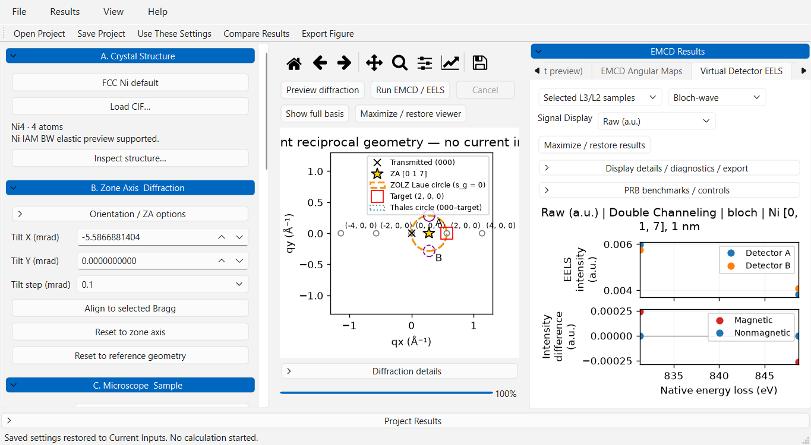
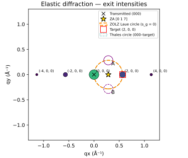
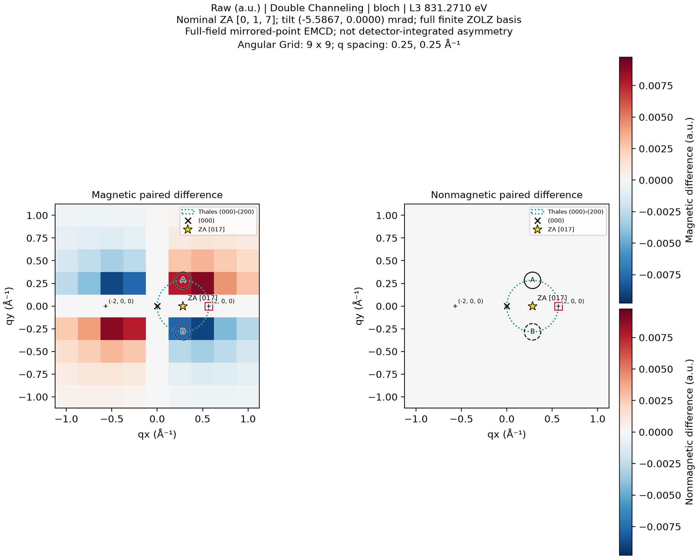

# EMCD-Sim User Manual

[Home](../README.md) · [Installation](INSTALL_WINDOWS.md) · [Quick Start](QUICK_START.md) · [Tutorial](TUTORIAL.md) · [Index](INDEX.md)

This manual combines retained control/physics references with the current-main MDFF update. The new editor is prepared for unpublished v0.8.1-beta.2; the tested development EXE remains 0.8.1b1 / aaa69a1. See [current MDFF workflows](MDFF_WORKFLOWS.md) and [publication/validation status](RELEASE_NOTES_0_8_1_BETA_2.md). For the published beta.1 binary, use its tag-specific documentation. Independent clean-machine installation and Linux/macOS packaged support remain unverified.

> **Legacy magnetic results:** earlier released v0.6.1 packages used a superseded Born/MDFF convention. Preserve their raw arrays, source and convention; revalidate signed magnetic results before comparison. Loading a project does not update its physics. Missing convention metadata is unknown/legacy-unverified.

Use the [Quick Start](QUICK_START.md) for a small first run and the [Tutorial](TUTORIAL.md) for the physical workflow and equations. This manual is a reference, not a request to run a large study.

<a id="find-your-way-around"></a>
## 1. Interface and layout

The main window has three adjustable regions: **Settings**, the central **Diffraction viewer**, and **EMCD Results**. The bottom **Project Results / Results Browser** lists runs. Blue headers and chevrons collapse sections; scroll Settings to reach controls. Use **Maximize / restore viewer**, **Maximize / restore results**, splitter handles and **View → Restore Default Layout** to adapt to the monitor. Layout preferences are independent of scientific project parameters.

|Settings section|Purpose|
|---|---|
|A. Crystal Structure|Select FCC Ni, load/inspect CIF|
|B. Zone Axis & Diffraction|Orientation, target, tilt, Bragg alignment and interaction mode|
|C. Microscope & Sample|Voltage and thickness|
|D. MDFF Model|Source, magnetic axis, model parameters and validation|
|E. Propagation Method|Single/Double, BW/MS/Both and MS-only controls|
|F. Shared Calculation Settings|Automatic/Manual numerics, physical support, sampling and resources|
|Virtual detectors|A/B positions, radius and visibility|
|G. Output Settings|Current-figure, preview and completed-result exports|

Results include **Diffraction**, **EMCD Angular Maps**, **Virtual Detector EELS**, **Magnetic / Nonmagnetic**, **Calculation Information**, and additional saved diffraction/comparison views when available. Disabled views generally lack calculated data; enabling a display cannot manufacture missing maps or spectra.



*Actual native packaged EXE, using a deliberately small 1 nm, selected-energy acceptance profile. The plot shows two energy samples, not a full spectrum.*

## 2. Structure import

**FCC Ni default** creates the conventional cubic Ni reference, a = 3.524 Å. **Load CIF…** reads a CIF through ASE; **Inspect structure…** reports source hash, cell, sites and warnings. The GUI file-import route is CIF, not a general browser for every ASE-supported format.

Reciprocal geometry can be inspected more broadly than inelastic scattering. The bundled Adaptive provider supports neutral Z=1–118; unsupported provider/species combinations produce explicit geometry-only messages. Disordered/partial occupancies and unsupported cells are not silently replaced. The original Ni providers require the verified conventional FCC Ni structure. Opt-in imported tensors and declared approximate atomic sources additionally support eligible single-element, full-occupancy, translation-equivalent ionization sites. Importing an arbitrary CIF does not construct a material-specific MDFF or validate its magnetic response.

## 3. Diffraction settings

This Windows release bundles Adaptive Dirac–Padé 2026 neutral Z=1–118 factors for ordered multi-element **elastic** diffraction: see [neutral-atom elastic providers](ELASTIC_ATOMIC_FACTORS.md). The provider selector defaults to Adaptive for new calculations, including Ni; select **Ni Lobato 2014 (legacy compatibility)** to reproduce historical Ni studies. Old projects without a provider field restore Lobato explicitly. Only the external legacy option requires `EMCD_SIM_LEGACY_ATOMIC_TABLE`; its absence does not break bundled-provider calculations. The previous v0.7.0-beta.1 binary is preserved and does not contain this feature. The historical Ni providers retain their Ni eligibility gates; generalized sources require the separately declared element, edges, state, frame and eligible equivalent sites.

In this release, signed three-index hkl labels refer to the ASE-imported CIF cell shown in the structure summary. No automatic primitive reduction is performed. A transformed cell needs an explicit index-basis transformation; four-index Miller–Bravais input is unsupported. [001] hexagonal patterns use the actual nonorthogonal reciprocal metric. BCC Fe (110) belongs to [001] by the zone law; CsCl (100) survives because its species factors differ. Partial/disordered occupancies remain unsupported. Oversized reciprocal searches fail with a diagnostic rather than silently truncating support.

**File > Save Elastic Project** saves the current elastic preview to a new checksummed directory with its provider, numeric structure and diffraction arrays. **File > Open Elastic Project** opens those saved arrays in a read-only diffraction window without changing current input controls or running a solver. Full EMCD projects retain their existing separate workflow. Applying saved EMCD settings restores the recorded provider; missing or mismatched provider provenance blocks rerunning but leaves saved results viewable. Changing providers invalidates a preview. Existing verified automatic Ni convergence profiles apply only to Lobato; the new provider requires configuration-specific convergence checks.

**Tilt X/Y (mrad)** are absolute local transverse incidence parameters relative to the nominal zone. Actual voltage and tilt determine excitation errors. They are not a calibrated mechanical holder-angle transformation. **Tilt step (mrad)** selects spin-box increments (0.01, 0.1 or 1 mrad); changing the step alone neither changes tilt nor starts a scan/solver. Record the actual X/Y values for reproducibility.

- **Reset to zone axis** sets zero X/Y tilt.
- **Reset to reference geometry** restores **[017]/(200), Full finite ZOLZ**, zero Y, Y-locked target Bragg alignment and Thales apertures at the current voltage. It is not a generic reset for another orientation.
- **Align to selected Bragg** aligns the current target subject to **Lock for Bragg alignment → None/X/Y**. Use Y lock to preserve a specified perpendicular mistilt.
- **Preview diffraction** computes elastic intensities for current inputs. It is separate from **Run EMCD / EELS**.

Inspect `s_g`, retained hkl, q and exit populations in **Diffraction details**, the **Diffraction** table and **Calculation Information**. The table can describe the last completed preview while new geometry is stale. An exact target `s_g = 0` is not evidence that other beams are absent.

<a id="change-zone-axis-bragg-alignment-and-mistilt"></a>
## 4. Zone axis and reflection indexing

Expand **Orientation / ZA options**; enter three signed integers in **Nominal zone [uvw]** and **Target (hkl)**, then **Apply orientation / target**. The target must be nonzero, satisfy the zone condition and belong to the allowed retained basis. For cubic Ni, FCC reflections have all-even or all-odd indices. A too-small cutoff can exclude a valid target.

|Diffraction choice|Interpretation|
|---|---|
|Full finite ZOLZ|Finite allowed zone-plane basis within the beam radius|
|Ideal 000 + target|Explicit ideal two-beam truncation|
|Explicit target systematic-row approximation|Row-restricted beams/potential; distinct from the ideal two-beam choice|

Do not combine ideal two-beam and explicit row restriction. The general orientation engine supplies signed indexing and the same physical crystal frame to BW/MS. Five orientations have bounded acceptance: [001], [017], [117], [111], [710]. Other supported directions remain subject to finite-search, target, resource and FFT-support checks; unsupported configurations raise errors rather than falling back to another crystal orientation.

<a id="research-ni-117--2-20"></a>
### Ni [117] and other research orientations

Use zone `1 1 7`, target `2 -2 0`; do not substitute (220). The target lies in the ZOLZ and is FCC-allowed. Default potential cutoff 2.5 Å⁻¹ retains no off-row [117] harmonics, so the visible basis alone does not imply a full multibeam potential. Read the potential-support warning and inspect actual harmonics. Coarse [117] angular sampling can produce significant errors. [111] lower-support quantitative convergence remains uncertified. See the [117 validation](NI_117_FINAL_SYMMETRY_VALIDATION.md) and [generalized merge review](GENERALIZED_MULTISLICE_MERGE_READINESS.md) before interpreting research cases.

## 5. Interactive diffraction visualization

The origin cross is **transmitted (000)**. The yellow star is the **projected crystallographic ZA**, `q_ZA = −tilt_rad/λ`, in the 000-centered coordinates. It generally differs from the origin under tilt. Read **ZA qx/qy (Å⁻¹)** for off-screen coordinates.

|Overlay|Definition|Style in the live viewer|
|---|---|---|
|Thales|Center G/2, radius norm(G)/2; diameter 000–target|Teal dotted, width 1.2, alpha 0.75|
|ZOLZ Laue|Center q_ZA, radius norm(q_ZA); zero-excitation-error locus|Darkorange dashed, width 1.8, alpha 0.95|

The Laue circle is above Thales but below diffraction spots/markers/apertures. Use **Show ZOLZ Laue circle** to toggle it. At exact target Bragg both circles pass through 000 and G, but they need not coincide when there is off-row tilt. Zero incident tilt gives a zero-radius Laue locus. Neither overlay is an intensity contour or a guarantee of magnetic symmetry.



*SVG exported by the accepted EXE before dragging, with trailing whitespace cleaned in the documentation copy only. Geometry/styles are unchanged. This is an actual elastic preview, not an experimental diffraction pattern.*

**Click mode** offers **Select reflection**, **Set projected ZA**, **Move detector A**, **Move detector B**. Set-ZA mode supports click and continuous drag. Release uses the final valid position; an out-of-axes/invalid release keeps the last valid position. Dragging removes cached intensity coloring and marks the prior preview stale; it starts no computation worker and does not change detectors. Request **Preview diffraction** to obtain current intensities.

Matplotlib Pan/Zoom takes priority over geometry clicks. **Show full basis** expands to the selected beam-cutoff bounds and changes to **Restore previous view**; the second click restores saved limits. Geometry changes invalidate incompatible stored views. This is a view operation, not a numerical-setting reset. A large Laue circle can extend beyond the basis bounds; pan/zoom or inspect numeric ZA coordinates rather than moving it artificially.

## 6. Detector positioning

Numeric A/B qx/qy and **Radius (Å⁻¹)** define physical circular apertures. **Restore Thales A/B** uses `G/2 ± (−G_y,G_x)/2` in target-aligned coordinates. A is drawn solid, B dashed. **Show physical A/B apertures** changes visibility only; it does not disable integration.

Integration is `sum(weights * intensity) * dq²` using fixed fractional circle/pixel weights. All reversal states share the same physical apertures. Boundary subpixels improve circle area weighting but not the resolution of a varying intensity field. Fully contain both apertures inside **Map halfwidth**. A manually moved non-mirrored pair is valid for detector spectra but can disable symmetry-dependent diagnostics.

## 7. Magnetization settings

**Crystal Cartesian M axis** is a finite nonzero direction, normalized internally. For cubic Ni, `0 0 1` specifies crystal [001]. Its local components change with the proper orientation transform; it is not implicitly beam-aligned. This prescription does not establish the specimen surface normal, magnetic domain structure or equilibrium orientation.

The XMCD model reverses eta in the crystal frame before `R T Rᵀ`. Atomic reversal uses its transition/spin convention. Each calculation retains +M/−M spectra at unchanged detectors. Absolute experimental polarization/magnetic handedness is not independently calibrated; declare source conventions intentionally.

<a id="xmcd-constrained-effective-mdff"></a>
## 8. MDFF models

Current main uses **Model > Configure MDFF...** with **XMCD-constrained MDFF**, **Atomic Ionization MDFF**, and **Manual tensor**. The [MDFF workflow guide](MDFF_WORKFLOWS.md) describes each implemented construction method, inputs, units/defaults, assumptions, previews, and completed-project persistence, with an existing-input synthetic Fe example.

The Atomic editor implements the declared cubic Sc-Zn 2p-to-3d L2,3 model with element-specific drafts and explicitly synthetic electronic defaults. Manual tensor includes constant density, an L2,3 Lorentzian spectrum from integrated strength matrices, and advanced imported source exchange. General single-element/equivalent-site eligibility remains separate from menu visibility or CIF import. None supplies arbitrary multi-element or complex magnetic structures.

For ambiguous XMCD, select both native L3/L2 energies explicitly; default or inherited numbers do not count. A validated JSON selection initializes the visible fields, whose later edits remain authoritative. Source changes clear previous selection state; verified saved declarations restore the intended energies. Update preview after relevant edits. The provider shown by XMCD preview is the calculation provider, not a separate source.

Use **File > Save Project** after a successful calculation to create a new complete project folder; an existing project JSON is not required. Open the whole folder and choose **Use These Settings** before rerunning. Preserve external sources and all project files; saved arrays can remain viewable when rerunning is blocked by a missing source.

### Historical Ni controls (compatibility reference)

The following descriptions concern the retained historical Ni route, not the full current Atomic editor or Manual models. They do not restrict the generalized editor to Ni or imply that historical implementation-era acceptance applies to every new workflow.

**XMCD-constrained (WIEN2k):** select a **Five-column XMCD** file, then **Validate source / native features**. This reports source SHA256, range/features and available audit information. Check **I declare M axis, RP/LP convention and edge assignments** only for a verified source. `eta` controls dichroic sign/scale; `beta` controls the unmeasured longitudinal response. Invalid/non-positive tensor configurations are rejected.

The bundled source has native range **823.625–882.521 eV** and selected magnetic samples **831.271/848.698 eV**. These calculated energies are not experimentally calibrated Ni thresholds. The five-column source does not supply the complex site/band/k-resolved transitions needed for full DFT MDFF. **Preview source / tensor spectrum...** inspects the model; it is not an EMCD calculation.

<a id="atomic-ionization-mdff"></a>
**Atomic ionization (Ni 2p -> 3d):** non-DFT approximation with L3/L2 energies, 10Dq, exchange, hole counts, Gaussian width and advanced radial settings. Crystal [001] magnetization only is supported in this model. It is not a quantitative metallic-Ni spectral model. Its nominal L3/L2 parameters do not shift or calibrate the XMCD source.

## 9. Single and Double Channeling

|Model|What is included|
|---|---|
|Single Channeling|Incoming elastic propagation followed by localized inelastic scattering; no outgoing elastic diffraction|
|Double Channeling|Incoming propagation, depth-distributed localized inelastic transitions and outgoing elastic propagation at incident energy minus actual energy loss|

They are distinct approximations, not independent experimental switches. Both retain a single inelastic event; Double is not double ionization/plural scattering. Their thickness trends can differ because post-loss propagation changes the depth-dependent detector response. Maxima observed at sampled thicknesses are not automatically continuous/global optima.

<a id="bloch-wave-fft-multislice-and-numerical-settings"></a>
## 10. BW and FFT Multislice

**Propagation Method** selects **Bloch-wave**, **FFT Multislice** or **Both (BW / MS comparison)**. BW uses a finite reciprocal eigenproblem; MS uses a structure-derived projected ZOLZ potential and FFT propagation. Single/Double apply to both. BW/MS comparisons require matched physical structure, frame, support, detector, MDFF, energy and depth conventions.

MS-only controls are in panel E; they hide/disable appropriately for BW and retain their values for MS/Both. Invalid FFT bandwidth/support produces an explicit error. MS may propagate additional FFT harmonics beyond the retained diffraction/MDFF basis. Agreement is neither independent basis convergence nor experimental validation. Atomic-3D potential propagation is not a released backend.

<a id="development-source-shared-and-solver-specific-settings"></a>
<a id="automatic-and-manual-numerical-settings"></a>
## 11. Automatic and Manual numerical settings

**Automatic** selects deterministic starting values and performs configuration/FFT-support checks without trial scattering calculations. Inspect **View Numerical Parameters**; do not assume a literature/research profile was matched merely because the material or zone name agrees. **Manual (Advanced)** exposes explicit support/sampling controls. Preserve and report actual effective values, including numerical-selection metadata.

|Control|Released starting value|Role|
|---|---:|---|
|Voltage / thickness|300 kV / 30 nm|Physical inputs; set explicitly for each study|
|Beam / MDFF basis cutoff|3.2 Å⁻¹|Shared retained hkl support|
|Potential Fourier cutoff|2.5 Å⁻¹|Shared elastic potential harmonics, norm(g−g′) cutoff|
|Debye–Waller B|0 Ų|Shared IAM damping parameter; not comprehensive TDS|
|Angular / detector grid|97×97|Physical q samples, independent of FFT mesh|
|Map halfwidth|1 Å⁻¹|Inelastic q extent; must contain apertures|
|Energy sampling points|241|Full-spectrum request, with native feature insertions|
|Depth integration nodes|64|Shared depth/coherence sampling; not “64 propagation steps”|
|Aperture boundary subpixels|64|Fractional boundary-area approximation|
|FFT grid|32×32 starting mesh|MS only; Automatic can enlarge to support geometry|
|Max slice step|2 nm|MS upper bound, editable 0.001–10 nm|
|Memory budget|2048 MiB|Estimated process-peak admission allowance|

Automatic can resolve different values for a narrowly matched reference or required FFT support. Existing saved configurations and explicit slice overrides must be inspected; starting values are not a universal production recommendation. Old projects without a numerical-mode field restore explicit settings in Manual.

**Max slice step remains editable in Automatic and Manual.** Explicit user overrides are retained across mode selection. Actual propagation distance between depth planes is split into `ceil(interval/max_step)` equal substeps, where `interval = t/(N_depth−1)`. Record requested and actual step when applicable. A warning above the 0.04 nm advisory reference does not claim a universal convergence threshold or force a smaller step. The actual interval may already be smaller; inspect metadata. The 200,000-step safety bound still applies.

Research refinement must separate beam support, potential cutoff, FFT sampling, depth integration, MS step, q grid/extent, aperture weighting and energy sampling. This manual changes none of them.

<a id="parallel-workers-and-pre-run-risk"></a>
## 12. Worker parallelism and resource safety

**Parallel Workers** is independent of Automatic/Manual Numerical Settings. **Automatic (Recommended)** applies the existing evidence-scoped resource policy. **Manual** requests 1–4 detector workers; native BLAS/LAPACK threading is separate from that count and the calculation QThread. Unsupported/unsafe manual requests are blocked rather than silently replaced.

Budgets are **512, 1024, 2048, 4096 or 8192 MiB**. **Resource estimate** separates dense-kernel and estimated process memory, additional allocations, retained results and worker concurrency. It checks available physical RAM and a conservative 50% available-RAM limit, with margin/reserve. The budget is neither a required allocation nor a guarantee of native stability. A rejected configuration is not automatically run with fewer beams, lower precision, a coarser grid or a different solver.

Read statuses such as **UNVERIFIED COMBINATION**, support errors or **Memory admission rejected** before Run. A caution is not a convergence certificate; successful admission is not a universal crash guarantee. Close competing memory-heavy jobs or explicitly revise supported settings, recording every scientific change. Do not enlarge memory limits merely to hide a missing convergence check.

<a id="development-source-energy-dependent-angular-sampling"></a>
<a id="energy-sampling"></a>
## 13. Energy sampling

**Spectral coverage** offers:

- **Selected L3/L2 samples only (not full EELS):** evaluate exactly the selected energies; display points, not a fabricated white-line shape.
- **Full native energy-resolved spectrum:** use the native source range with the requested number of evenly spaced samples, inserting selected L3/L2 energies if absent. A 241-point request normally becomes 243 evaluated energies. This is not necessarily every original source sample.

For each requested loss, the model/source and scattering response are evaluated; full Double spectra are not interpolated from two selected-edge calculations. The source tensor uses interpolation of the **original tabulated spectral input**, a different operation. Extrapolation beyond its source range is not allowed. There is no silent experimental energy shift or extra smoothing.

**Calculate angular maps** requests full fields only at selected L3/L2 samples. Other spectral energies integrate nonzero physical detector support on the unchanged q grid. With maps off, detector-only support is used at every energy. No non-selected full-field maps are manufactured or exported. These savings do not establish energy/grid convergence.

<a id="first-simulation-fcc-ni-017-exact-200-bragg"></a>
## 14. EELS and EMCD calculation

The [Quick Start](QUICK_START.md) supplies a small Manual Ni example. In general: set crystal/frame and physical geometry → set fixed apertures → validate model/axis → choose channeling and propagation → review effective numerics/resources → **Preview diffraction** → **Run EMCD / EELS**.

Both reversal tensors are computed using the same geometry, not by moving detectors. Raw `I_A_plus`, `I_A_minus`, `I_B_plus`, `I_B_minus` are retained. In Both mode, finish one solver before preparing the other; do not treat an interrupted/failed run as completed evidence. Numerical selection, source verification, memory and unsupported-configuration errors are reported rather than bypassed.

**Cancel** requests cooperative interruption. Wait for idle/acknowledgement before another Run. Large native operations can bound responsiveness; the packaged acceptance has specific active-worker evidence, not a universal timing guarantee. Closing while busy requests cancellation and defers closure; close again after idle if needed. Previously completed results remain separate from the interrupted calculation. The GUI does not promise automatic resumption of arbitrary unsaved jobs from per-energy research checkpoints.

<a id="read-angular-maps"></a>
## 15. Angular maps

The maps use stored physical q samples; display zoom and nearest-pixel rendering do not add numerical resolution. **Angular Map Resolution** offers **Quick Preview - 33x33**, **Standard - 97x97**, **High Resolution - 193x193**, and **Custom**. In Manual, inspect **Angular / detector grid points (odd)** and halfwidth. Refining a saved map requires a new explicitly configured calculation, not image enlargement.

The primary **Raw (a.u.)** angular view shows magnetic and nonmagnetic **mirrored-point differences** at `q=(qx,qy)` and `q′=(qx,−qy)`. **EMCD Asymmetry (%)** uses `100*[I_plus(q)−I_plus(q′)]/[I_plus(q)+I_plus(q′)]`. Detector outlines are overlays; they do not limit the full field. These are not finite-aperture detector ratios.

Advanced fields distinguish `I_mag=(I_plus−I_minus)/2`, `I_nonmag=(I_plus+I_minus)/2`, total +M intensity, paired differences and post-edge diagnostics. An antisymmetric paired difference is not evidence that the **original raw magnetic map** obeys mirror antisymmetry. Crystal magnetization, mistilt and multibeam geometry matter.



*Deliberately coarse 9×9, 1 nm packaged acceptance result. It demonstrates field/coordinate presentation, not research-quality sampling or physical convergence. Current full maps retain their actual sample count.*

Missing full-field data disables/unavailable fields; it is not reconstructed from detector spectra. Unsupported mirror coverage produces a diagnostic instead of fabricated values. Undefined percentage pixels remain masked/gray. To calculate a detector ratio, integrate raw A/B intensities first; never average pixel percentages.

<a id="signal-definitions-in-060"></a>
<a id="signal-definitions-in-061"></a>
<a id="interpret-percentages"></a>
## 16. Raw and normalized signal definitions

Let `ap=I_A(+M)`, `am=I_A(−M)`, `bp=I_B(+M)`, `bm=I_B(−M)` at one energy:

```text
N_A=(ap+am)/2; M_A=(ap-am)/2
N_B=(bp+bm)/2; M_B=(bp-bm)/2
D_mag=M_A-M_B; D_nonmag=N_A-N_B
D_conv=ap-bp=D_mag+D_nonmag
D_flip,A=ap-am=2*M_A
```

|Observable|Definition and actual scope|
|---|---|
|GUI Raw components|Signed `D_mag`, `D_nonmag` in original a.u.; not separately peak-normalized|
|Conventional / PRB-compatible asymmetry|`100*(ap−bp)/(ap+bp)`; default **EMCD Asymmetry (%)**; may include nonmagnetic imbalance|
|GUI advanced magnetic/nonmagnetic diagnostics|`100*D_mag/(N_A+N_B)` and `100*D_nonmag/(N_A+N_B)`; common even denominator, **not** the conventional denominator|
|Conventional percentage contributions, tutorial case|`100*D_mag/(ap+bp)` and `100*D_nonmag/(ap+bp)`; these sum to the conventional percentage|
|Fixed-detector Flip-M A, derived from exports|`100*(ap−am)/(ap+am)`; own denominator; raw signal is full `2*M_A`|
|Mean-normalized contrast|Replacing a sum denominator with half that sum doubles the percentage; label as a different convention|

The main **Signal Display** offers **Raw (a.u.)** and **EMCD Asymmetry (%)**. Extra legacy/relative views are under **Advanced Diagnostics**; there is no default four-curve common-denominator/Flip-M panel. The [tutorial](TUTORIAL.md#part-vi-conventional-emcd-versus-flip-m) shows how to derive the requested measurement quantities from raw data without changing physics.

The PRB scalar benchmark is a separately labeled raw +M A/B readout with selected-energy/edge controls. It does not establish quantitative reproduction of a literature figure; geometry, source, energy/collection settings and approximations must match independently.

Legacy advanced **EELS Peak (%)** is another presentation normalization: a fixed `max_E in edge window [N_A+N_B]` reference, not an energy-by-energy difference/sum asymmetry. Its shared versus independent reference choices and **Peak windows (native eV)** must be recorded; independent peaks can conceal real amplitude differences. These controls do not alter raw arrays or solver-comparison metrics and are not used in the tutorial's case-study figures.

The released EELS percentage helper masks nonpositive/nonfinite denominators and those below `1e−8 × positive-finite P95(denominator)`; maps use `1e−6`. Invalid support remains NaN/gray. Record actual export metadata. The advanced 9/30 nm study used a separately documented maximum-based `1e−12` mask; do not imply that criterion is a new GUI default. Percentages alone are not detectability or shot-noise SNR.

<a id="read-virtual-detector-eels-and-post-edge-correction"></a>
## 17. Magnetization reversal and decomposition

Reversal-even and reversal-odd are defined by the four raw spectra; preserve the identity `D_conv=D_mag+D_nonmag`. Fixed-detector Flip-M A has magnetic contribution `2*M_A` and exactly zero nonmagnetic residual under identical geometry and nonmagnetic conditions within the ideal model. The underlying `N_A(E)` remains nonzero. It is a different measurement from magnetic A/B; its magnitude can be larger or smaller. Real drift/background/counting variance requires separate experimental modeling.

**Advanced post-edge diagnostics → Enable post-edge A/B correction** derives a +M A/B scaling from **Window start/end (eV)**. It does not change the MDFF, propagation or raw spectra. Its corrected contrast is **not intrinsically magnetic**; processed magnetic bias and residual even terms must be inspected separately. A selected-energy run may not contain the post-edge window and can report correction unavailable. Record the window, scale factors and definitions instead of calling every corrected signal magnetic.

<a id="project-management"></a>
## 18. Project management

**File → New** clears the selected result and restores released starting controls; explicitly review physical/MDFF values for the next job. **Save Project / Save Project As...** acts on a **completed selected result**, not arbitrary uncalculated Current Inputs. Choose a parent directory and new folder name. Replacing an existing project requires explicit confirmation and verified save logic; make independent backups.

A project contains `project.json`, `input_parameters.json`, `metadata.json`, `structure.json`, `comparison_metadata.json`, `validity.json`, the three NPZ bundles and optional structure/display files. Keep the complete folder. Source paths/checksums, configuration, coordinate frame, original arrays and method labels are preserved. Save/view does not silently regenerate science.

**Open Project...** loads saved plotting context without the original source or a new solver run. Missing/changed external sources can disable **rerunning** while saved arrays remain viewable. **Results → Locate Original Source...** requires the recorded SHA256. **Import Existing Result** handles supported legacy exports read-only. Unsupported/corrupt/checksum-mismatched data produce errors rather than trusting arrays as a current calculation.

<a id="save-reopen-and-reconnect-inputs"></a>
Current Inputs and saved results are separate. **Use These Settings** explicitly restores configuration; viewing alone does not replace controls. Editing Current Inputs makes previews/results stale relative to those inputs, but does not modify a completed result's original settings or arrays. Save that result under its actual provenance, then run a new case if new inputs are intended.

## 19. Results Browser and comparisons

The bottom **Project Results / Results Browser** can filter and select runs. **View Selected** or double-click displays saved data. **Use These Settings** restores controls; **Compare Selected** / **Compare Selected Results** compares compatible saved contexts without rerunning. The compact layout moves secondary commands into **More actions**.

**Import Result**, **Open Folder**, **Details**, **Rename**, **Locate Project** and **Remove From Browser** manage references/display identity. Removing a browser entry does not delete its scientific folder. The index stores paths to saved runs, not an independent backup; unsaved in-memory results should be saved before exit.

<a id="compare-two-conditions"></a>
Use separate project names for thickness/tilt/model changes. Review recorded differences, denominators and shared-scale options before comparing. There is no released one-click general thickness/mistilt sweep or automatic convergence campaign. Source-only research drivers and their checkpoints are not GUI controls.

<a id="export-figures-and-data"></a>
## 20. Export formats

|Action|What is written|
|---|---|
|Export current plot PNG / SVG…|The current live diffraction figure, including visible overlays|
|Results → Export Current Figure / Export Figure|Displayed result figure; supported result exports include display metadata/JSON sidecars|
|Save elastic preview…|A new subfolder containing the last completed elastic preview, not EELS|
|Export completed EMCD / EELS...|A new complete project/numerical/figure bundle with raw/percentage spectra retained|
|Export derived NPZ/CSV + metadata|Derived result views together with preserved raw arrays, definitions, masks and provenance|

Current project arrays are:

- `virtual_detector_eels.npz`: method-prefixed spectra, for example `bloch__energy_ev`, `bloch__I_A_plus`, `bloch__I_A_minus`, `bloch__I_B_plus`, `bloch__I_B_minus`.
- `angular_maps.npz`: q grids, fractional weights, calculated edge fields and coherence with method/edge prefixes.
- `diffraction_pattern.npz`: retained hkl/frame, excitation errors, ZA coordinates, depths and amplitudes, with applicable FFT data.

Ordinary completed-result exports additionally include `<method>_spectra.csv`, `<method>_signal_display.csv`, `signal_display.npz`, `figure_display.json`, EELS figures and calculated L3/L2 figures. Method IDs include `bloch` and `fft-multislice`. The raw four spectra, raw differences and percentage definitions survive display switching. Derived-export bundles use their own explicit `run0__raw__...` / derived prefixes and metadata; inspect keys rather than assuming formats are interchangeable.

Conventional aliases such as `prb_relative_dichroism_percent` / `emcd_asymmetry_percent` use the raw +M sum. `magnetic_only_percent` / even-imbalance diagnostics use `N_A+N_B`. Use the tutorial's separately defined common-S_AB contributions when exact reconstruction of conventional percentages is needed. Do not rename a denominator or infer it solely from “%”.

PNG/SVG files are visualizations, not full scientific backups. Preserve CSV/NPZ, source hashes and configuration. Exporting a figure does not change underlying arrays, solver settings or saved research results. No automatic experimental electron-count conversion is performed.

## 21. Troubleshooting

|Message/symptom|Interpretation and next step|
|---|---|
|Run disabled / source changed|Read source validation/declaration and rerun requirements; restore the checksum-matching source or configure a new verified source explicitly.|
|Unsupported material/geometry|CIF inspection does not supply a Ni MDFF for arbitrary structures. Check zone/target selection and supported model bounds.|
|FFT mesh does not contain common hkl / support error|The mesh/bandwidth is inconsistent. Review explicit FFT and potential/basis settings; no [001] or row fallback is applied.|
|No off-row potential harmonics|The chosen potential cutoff omits those couplings; merely displaying off-row basis positions does not add them.|
|Coarse sampling / [111] warning|Configuration-specific numerical uncertainty remains. Refine independently and preserve failed checks.|
|Coarse maximum slice step warning|Advisory split-step accuracy risk, not a forced clamp or proof of failure; inspect actual step and test smaller values.|
|Memory admission rejected / unsafe workers|Budget/available RAM or execution policy prevents admission. Do not silently alter physical settings to call the same case successful.|
|Stale preview / gray geometry|Inputs changed; request a new **Preview diffraction**. The last table/result is not automatically current.|
|Angular maps unavailable|Maps were not computed or mirror support is invalid; genuine full-field calculation is required.|
|Legacy convention warning|Preserve old arrays; opening is not sign/convention revalidation.|

For startup/security/log paths, use [installation troubleshooting](INSTALL_WINDOWS.md#i-troubleshooting). Runtime logs default to `%LOCALAPPDATA%\EMCD-Sim\logs`. Include version, source/convention, requested/effective settings and the exact error when reporting a problem.

<a id="scientific-limitations-and-responsible-interpretation"></a>
## 22. Scientific limitations and convergence

The implemented model uses projected real IAM, finite ZOLZ support, localized single inelastic events and the documented energy-dependent but branch-frozen longitudinal transfer approximation. It is not a genuine atomic-3D potential, full HOLZ, comprehensive TDS/absorption, physical CBED/convergent-probe scan, complete DFT MDFF, domain/equilibrium-magnetization or calibrated detector/noise model.

Check actual structure, frame, signed hkl, magnetization and detector geometry first. Then separate beam-basis, potential-cutoff, FFT, depth/step, angular/aperture and energy-sampling sensitivity. BW/MS agreement tests matched approximations, not every independent convergence direction. Existing [111] lower-profile and historical detector-grid failures remain explicit; no threshold is relaxed by this documentation. A successful run is not a claim of quantitative Ni EMCD at untested conditions.

Keep raw reversal-even/odd fields separate from paired maps and normalization. Exact target Bragg is not physical beam isolation; a Thales circle does not enforce uniform signal or raw magnetic antisymmetry. Native energies, absolute handedness and arbitrary intensities require independent experimental calibration. Mean- and sum-normalized percentages differ by a factor two. Experimental SNR requires a count/dose/efficiency/background/noise model and correct variance propagation for the measurement estimator.

Independent clean-machine Windows installation remains untested. Linux CI has unresolved hash/line-ending and interpreter-shutdown issues; macOS is not certified by this release. These do not erase the bounded passed native Windows acceptance.

<a id="what-the-application-calculates"></a>
<a id="forward-born-convention-correction-and-historical-results"></a>
## 23. Version compatibility and provenance

Current convention is **forward_born_dagger_g_minus_h_v1**, with `Re Tr(RT)`, conjugated forward transition modes and corrected Double site phase. Earlier same-index signed results cannot automatically be combined with it. Some intermediate corrected source commits still had old version labels, so exact commit/convention metadata takes precedence. Keep unknown metadata unknown; never relabel old arrays as corrected.

|Identity|Current public Windows package|
|---|---|
|Display / Python / Windows numeric version|v0.8.1-beta.1 / 0.8.1b1 / 0.8.1.1|
|Release tag target|Exact accepted Windows build-source commit; see release notes/About|
|Binary source|Same commit as v0.8.1-beta.1 tag target|
|Windows acceptance|See version-specific release acceptance and source manifest|
|Portable ZIP SHA256|See v0.8.1-beta.1 SHA256SUMS.txt and release acceptance|
|Physics compatibility|Ni event kernels unchanged; new calculations use Adaptive elastic factors|

Five native orientations, eight exact scientific comparisons, eighteen worker/cancellation scenarios and native overlay/export tests passed within their recorded profiles. These are bounded, partly overlapping inventories, not universal certification. Those earlier inventories refer to v0.7.0. See the [v0.8.0 release](https://github.com/dingpengem/EMCD-Sim/releases/tag/v0.8.0-beta.1), [release notes](RELEASE_NOTES_0_8_0_BETA_1.md) and [Windows acceptance](https://github.com/dingpengem/EMCD-Sim/blob/main/docs/WINDOWS_0_8_0_BETA_1_ACCEPTANCE.md); the [v0.7.0 acceptance](WINDOWS_ZOLZ_97B2220_CANDIDATE_ACCEPTANCE.md) is preserved. Historical acceptance/release notes retain their milestone-specific “not published” statements; the public release entry is authoritative for current publication state.

<a id="validated-ni-017-8-nm-double-example"></a>
<a id="complete-200-kv-thickness-workflow"></a>
### Historical study walkthroughs

The earlier 8 nm, 200 kV walkthrough remains in the [pre-overhaul manual at its immutable source revision](https://github.com/dingpengem/EMCD-Sim/blob/08d04fc35fca2071cc7e73af0aaa1de45e49a3f4/docs/USER_GUIDE.md#validated-ni-017-8-nm-double-example). It is not the small current Quick Start. The completed 200 kV thickness and corrected 300 kV studies are separate datasets; neither is recalculated or relabeled here. The [new tutorial case study](TUTORIAL.md#part-vii-practical-ni-017-case-study) reuses verified existing 9/30 nm spectra with explicitly different percentage definitions.

Historical development, validation reports and older galleries remain linked in the [Documentation Index](INDEX.md). Planned/experimental features must not be treated as available merely because a source or architecture document exists.

## Generalized sources in v0.8.1-beta.1

The following describes the Part 1B source/candidate workflow. Its acceptance
status and exact candidate identity are recorded in
[the consolidation report](GENERALIZED_CODE_CONSOLIDATION_0_8_1.md); it does not
alter the historical published binary or scientific examples.

The three MDFF choices remain visible for every crystal. **XMCD-constrained MDFF**
reads the original five-column XAS/XMCD file directly. Outside historical Ni,
declare the file's element/edge, native selected energies, axis, RP-minus-LP
handedness, relative reference scale, provenance and assumptions. Two reliable
L3/L2 features may populate native energies; ambiguous assignments remain user
declarations. No WIEN2k installation or separate tensor JSON is required. The
bundled Ni source cannot substitute for another element.

**Atomic Ionization MDFF** accepts explicit atomic parameter JSON directly;
validate its checksum, then acknowledge the approximate cubic 2p-to-3d model.
The bundled synthetic Fe example is software test data, never physical Fe constants.
With no parameter file, historical Ni controls retain their original interpretation.

**Imported Complex MDFF Tensor** reads declared complex 3x3 tensors with explicit
nonmagnetic or magnetic-state inputs. XMCD/import adapters support L2,3 and the
end-to-end-tested K-edge declaration; other edge families remain rejected. K-edge
maps, selected samples and exports keep their K label. L3/L2-specific peak
normalization and L3 white-line diagnostics are unavailable for other edges.
All declared providers use Manual numerics and supported equivalent sites in a
fully occupied single-element crystal. Approximately 1.6% detector-refinement
sensitivity remains a limitation; no broad convergence or experimental accuracy
is established. Missing/altered inputs block rerun and invalidate acknowledgement
while saved arrays remain viewable.

### Historical Part 1 workflow

Select the imported-MDFF provider for an explicitly declared Hermitian PSD complex
3x3 dipole tensor source. Review element/L2,3 selection, frame, magnetic axis, units,
explicit opposite states and SHA256; acknowledge the declarations and use Manual
numerics. Source replacement or a missing source blocks rerun while saved arrays
remain viewable. Multi-element/site-resolved ionization and AFM/SDW remain unsupported.

The same panel's **Generate approximate atomic tensor from declared parameters**
button accepts a complete parameter JSON and a fresh output path. The portable ZIP
includes `_internal/examples/synthetic_fe_atomic_parameters.json`. This is an original
synthetic software fixture, not measured/fitted Fe constants. The model supports
2p-to-3d transitions in a declared cubic field, explicit radial integrals and spin
holes, local +z spin and proper rigid frame rotations; material inputs are physically
unvalidated. No quantitative Fe, Co or Cr model, many-body multiplet accuracy,
general crystal-field symmetry or complete DFT MDFF is supplied. The original Ni
provider/project behavior is unchanged. See [parameters and limits](GENERALIZED_ATOMIC_IONIZATION.md)
and [import contract](GENERALIZED_SINGLE_ELEMENT_EMCD_DESIGN.md).

Generalized XMCD-effective conversion is a Python API with explicit declarations;
the portable GUI imports its generated tensor JSON, not an automatic Fe XMCD model.
Intensities remain relative. Approximately 1.6% detector-refinement sensitivity in
the reviewed finite cases remains a limitation; BW/MS agreement is not general
convergence or experimental accuracy. [Release notes](RELEASE_NOTES_0_8_1_BETA_1.md).
