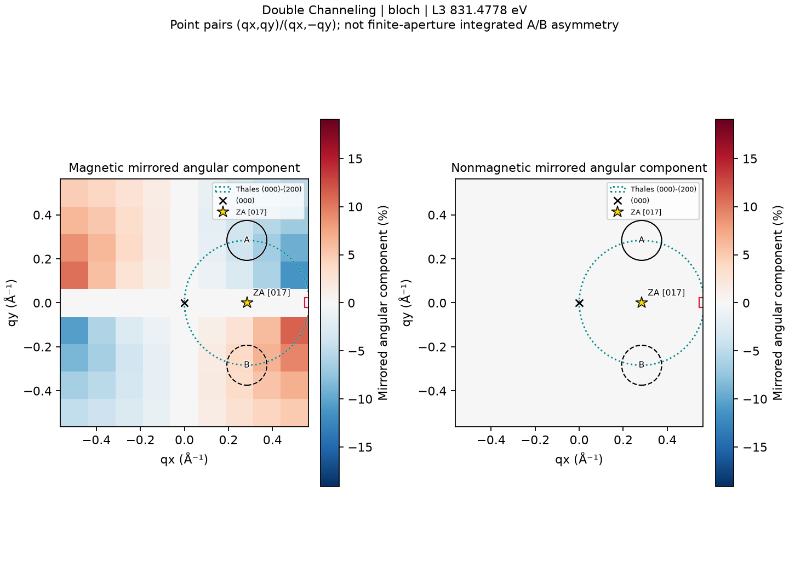

# Windows Beta Release Acceptance

**Cancellation follow-up:** the original package documented below predates the
Double-Channeling cancellation fix. Its previous cancellation check requested
Cancel immediately after startup and did not establish responsiveness inside
long numerical stages. It must not be treated as cancellation-certified.
See [Double-Channeling cancellation acceptance](DOUBLE_CHANNELING_CANCELLATION.md)
for the replacement candidate, measured active-work tests and current package
status. The original artifacts and their checksums below remain historical.

**Decision: READY FOR BETA RELEASE**, as a local, unsigned research Beta RC.
No push, public release or tag was created. Independent clean-machine acceptance
is **NOT TESTED**; this decision covers the development-host tests below.

## Candidate and environment

Application version remains **0.4.5**. Branch: `feat/atomic-3d-multislice`.
Build source: `4a5f88fc6f6b03c8f7bba6bff2f2e8b647b9165b`.
The subsequent documentation commit does not change the packaged runtime.
Build provenance records a dirty tree because unrelated user-owned scientific
files remained present; runtime source hashes identify the actual build inputs.

Test host: Windows 11 Enterprise, NT build **10.0.26200.9457**, 25H2, x64;
native Windows display scaling **150%**, Qt device-pixel ratio **1.5**.
Python 3.11.17; PySide6 6.12.0; NumPy 2.4.6; SciPy 1.17.1;
Matplotlib 3.11.2; ASE 3.29.0; PyInstaller 6.22.3.
The existing PyInstaller one-folder build method was retained in an isolated
directory. Previous release candidates and scientific outputs were preserved.

## Checkpoint outcomes

| Checkpoint | Outcome | Evidence and scope |
| --- | --- | --- |
| A: source and physics audit | PASS | Actual incoming/outgoing BW and MS dispatch, reduced outgoing energy, complex MDFF, depth and aperture integrations; no physics changes |
| B: scientific references | PASS | Saved full-precision raw reversal states and derived quantities compared at unchanged tolerances |
| C: source GUI | PASS | Six real solver/model routes, native 150% windows, interaction and full-spectrum checks |
| D: projects and exports | PASS | Checksummed save/open, display state, browser, CSV/NPZ and inspected PNG/SVG |
| E: packaging | PASS | Isolated standalone folder and ZIP, runtime/resources/licenses, manifest and checksums |
| F: frozen application | PASS | Fresh extraction outside repository, sanitized PATH, actual GUI and matched source comparison |
| G: documentation | PASS | Installation, quick start and user manual updated; actual figures below |
| H: local release decision | PASS | No outstanding blocking failures in tested scope |
| Independent clean machine or VM | NOT TESTED | Fresh extraction was on the same development host |
| Native 100%/125%, other Windows versions, ARM/32-bit | NOT TESTED | No compatibility claim for these environments |
| Fresh production-size full-spectrum run inside EXE | NOT TESTED | Existing production results reopened; fresh dispatch used a smaller profile |

The current source test inventory has **115 passed, 0 unresolved failures**.
This is the union of targeted runs, not a single 115-test green invocation:
the initial run had 109 passes and five failures plus an associated teardown
error. Stale test fixtures for preview arguments, historical 512 MiB behavior,
primary/advanced figures and sandbox temporary-directory permissions were
corrected; all five targeted rechecks passed. A new display-state round-trip
test passed. The relevant application fix preserves Raw/Relative mode and
locked energy through project save/open without changing scientific arrays.

Machine-readable evidence is in
[`outputs/windows_beta_acceptance/`](../outputs/windows_beta_acceptance/):
`checkpoint_AB.json`, `source_test_summary.json`, `source_native/acceptance.json`,
`frozen_native/acceptance.json`, `frozen_comparison.json`,
`package_integrity.json`, `package_privacy.json` and
`scientific_preservation.json`. These local generated artifacts are not all
distributed through Git. The preservation audit verified **1,574 original
files** unchanged, including prior numerical outputs and the active source.

## Scientific reference comparisons

All references use fcc Ni, 200 kV, XMCD-constrained MDFF, eta=beta=1,
native locked L3 **831.4778 eV** and L2 **848.698 eV**. They are distinct from
the **831.271 eV** native source-audit extremum. No energy shift was applied.
The full native range is 823.625–882.521 eV with 242 actual samples.

| Geometry/model | Thickness (nm) | Saved GUI L3 PRB (%) | L2 PRB (%) | Maximum PRB difference from full-precision reference (pp) | Maximum raw relative error |
| --- | ---: | ---: | ---: | ---: | ---: |
| [001] row, Single | 12 | -11.8571957846 | 20.1131529445 | 0.0001172381 | 1.34502e-6 |
| [001] row, Double | 8 | -13.2277730397 | 22.4154410582 | 3.553e-14 | 2.12032e-15 |
| [017], Single | 12 | -11.6555750121 | 20.0977829931 | 0.0001160280 | 1.37685e-6 |
| [017], Double | 8 | -13.0600829714 | 22.5449235495 | 6.928e-14 | 1.38704e-15 |

Unchanged acceptance tolerances are **0.01 percentage points** for dichroism
and **0.001 relative raw-intensity error** (0.1%). Rounded displayed reference
values were not used as exact targets.

| Saved Double BW/MS comparison | Actual energy coverage | Maximum PRB difference (pp) | Maximum raw relative difference |
| --- | --- | ---: | ---: |
| [001] row, 8 nm | 242 native samples | 0.0000228810 | 1.87573e-6 |
| [001] row, 12 nm | Five selected energies | 0.0002785902 | 4.30957e-6 |
| [017], 8 nm | Five selected energies | 0.0016782313 | 7.40714e-5 |

The maximum magnetic-only percentage discrepancy is 0.0016311707 pp.
Raw magnetic-difference discrepancy is at most 2.18788e-7 a.u.; reversal-even
difference discrepancy is at most 4.16e-17 a.u. Checks include all four
A/B magnetization states, not percentages alone.

The [001] spectrum uses **17 systematic-row beams**, tilt approximately
(-7.11672544,+35) mrad. It is not a full-ZOLZ calculation. The [017] geometry
audit uses **59 full finite ZOLZ beams**, tilt (-7.11672544,0) mrad.
Both satisfy the implemented s200=0 condition. The separate **213-beam [001]
elastic audit** did not generate the row-restricted EELS reference. Exact
Bragg alignment does not establish a strictly isolated physical two-beam field.

Recommended representative production settings remain potential cutoff
6.2 cycles/Å, beam cutoff 4.6 cycles/Å, FFT48, depth257, maximum MS step
0.04 nm, float64/complex128. These are reference settings, not compulsory
GUI defaults or proof of convergence at every thickness and orientation.
Reciprocal vectors use crystallographic g=1/d, without a 2π conversion.

## GUI, exports and frozen verification

All six combinations of Single/Double and BW/MS/Both were calculated through
the real GUI worker and independent kernels. The fresh package-dispatch
profile was explicitly set to Ni [017], 200 kV, 2 nm, beam0.9, potential1.8,
FFT24, depth9, detector grid9, half-width0.5 and subpixels16, with 11 actual
energy samples including locked anchors. This small profile tests packaging
and dispatch; it does not certify production BW/MS convergence.

Matched source versus frozen spectra, maps, amplitudes and coherence
fingerprints are **bitwise identical** for all six routes (eight method
entries). Maximum raw absolute/relative differences and PRB differences
are **zero**. All **128 CSV numerical columns** checked against NPZ match
exactly. Both saved 242-energy BW and MS Double results reopened unchanged
in the frozen GUI without recalculation.

Validated interactions include CIF import, orientation and Bragg controls,
physical detectors, indexed diffraction, model labels, Full/L3/L2 zoom,
energy selection and lock, reversal diagnostics, cancellation, stale results,
invalid parameters, window resizing, Results Browser, legacy Single defaults,
compatible/incompatible comparisons, project round-trip and PNG/SVG export.
Memory choices 512/1024/2048/4096/8192 MiB and admission diagnostics were
checked. Failed/cancelled jobs retain the last valid result.

Top-panel A/B spectra retain a common raw arbitrary-unit scale. With
N=(I(+M)+I(-M))/2 and M=(I(+M)-I(-M))/2, the lower panel shows either signed
Dmag=MA−MB and Deven=NA−NB in a.u., or 100 times each divided by the **same**
NA+NB. Toggling does not alter source arrays. The separate PRB readout is
100*[IA(+M)−IB(+M)]/[IA(+M)+IB(+M)]. It can differ from magnetic-only percent
even when Deven vanishes, because MA+MB may be nonzero. Post-edge-corrected
contrast is not a substitute for intrinsic magnetic-odd signal.
Both raw and percentage arrays remain in numerical exports in either mode.
Two-energy legacy results are points, not invented full spectra. Advanced
diagnostics remain available.

The actual ZIP was extracted into a fresh temporary directory outside the
repository. The EXE ran there with only Windows system directories on PATH,
without Python/Conda activation or PYTHONPATH/PYTHONHOME/Qt development paths.
Normal startup and the default elastic preview also passed outside the
special acceptance entry point. Isolated LOCALAPPDATA/workspaces protected
existing user state: access to the preexisting user-profile runtime log was
denied by the sandbox, so that profile's ACL behavior is not independently
certified. Native 150% views support scrolling; exported figures were inspected
complete for labels, legends, units, signed scales and solver distinctions.


Actual packaged default Ni [017] geometry and diffraction view: indexed spots,
transmitted beam, projected zone axis, Thales circle and physical A/B apertures.


Genuine saved 242-energy Double BW result reopened in the frozen GUI, preserving
the native energy axis, common raw EELS scale and separate component/PRB readouts.
This screenshot is a viewport, not evidence of a new production calculation.



Actual frozen angular export with physical markers and signed components.
The angular mirrored-point-pair diagnostic is not the finite-aperture-integrated
detector asymmetry. No map values or marker positions were altered for display.

## Local distribution and provenance

Relative paths below are from the repository root. Keep EXE and `_internal`
together; do not run inside the ZIP.

| Artifact | Location |
| --- | --- |
| Application folder | `build/windows-beta-rc-20261018/dist/EMCD-Sim/` |
| Executable | `build/windows-beta-rc-20261018/dist/EMCD-Sim/EMCD-Sim.exe` |
| ZIP | `build/windows-beta-rc-20261018/EMCD-Sim-0.4.5-Beta-RC-Windows.zip` |
| Manifest | `build/windows-beta-rc-20261018/build_manifest.json` |
| ZIP checksum | `build/windows-beta-rc-20261018/SHA256SUMS.txt` |
| Per-file checksums | `build/windows-beta-rc-20261018/dist/EMCD-Sim/SHA256SUMS.txt` |
| Installation notes | Bundled `README.txt`; [Windows installation](INSTALL_WINDOWS.md) |

ZIP: **108,673,907 bytes** (103.64 MiB). Extracted application:
**262,028,127 bytes**, **610 files** (249.89 MiB).

ZIP SHA256:
```text
0c1eaec31dd09a4eed75b1500e02ef5baf86910d2aa1a5a9b9d15e3670533751
```

EXE SHA256:
```text
b64d11f1fbc729d0d987c08fb929c10b8d9a43e3b573ff201d9c610840f53fa3
```

Manifest and fresh extraction hashes match. Package includes Python, Qt,
scientific libraries, Matplotlib assets/fonts, ASE tables, licenses and required
runtime resources. The sole bundled scientific input is the tracked Git
example `data/wien2k_ni/Ni_fm.xmcd`, SHA256
`4fd517af3e54db94588a76b7a6ed9c2f9a1b745cd8fe52b9fca0f87fc4938db3`.
Production comparisons and matched fresh source/frozen tests explicitly import
the external active source, SHA256
`a0e28ea6423b6c7832bb3cce6d69d71aa59336a221baeee3d2556b49ba501283`.
These distinct sources are not interchangeable references. Bundled-default
import and calculation were tested separately. Missing external source blocks
calculation with a diagnostic; no spectra are invented or silently substituted.

No licensed WIEN2k code, archives, binaries or companion calculation files,
private outputs, credentials, Conda environment or caches are bundled. The
54 bundled application modules were inspected for relative code filenames;
build metadata uses relative source paths. The archive is **unsigned**.

## Remaining limits and usage

The MDFF is XMCD-constrained, not a complete DFT-derived transition MDFF.
The GUI uses projected IAM potentials; atomic-3D electrostatic multislice is
not implemented in this GUI. Frozen longitudinal-transfer assumptions remain,
with energy-dependent transfer within the implemented branch. Finite ZOLZ
support neglects HOLZ. Absolute cross-section/count calibration and experimental
SNR are unavailable; intensities remain a.u. No experimental energy calibration
is implied. Sampled maxima and representative convergence do not establish
global maxima or full-curve convergence.

No new thickness/voltage study, empirical magnetic rescaling, threshold change,
physics refactor or release publication was performed. Installation and usage
continue in [Quick Start](QUICK_START.md) and the [User Manual](USER_GUIDE.md).
