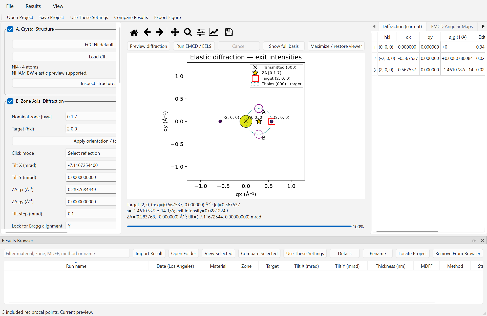
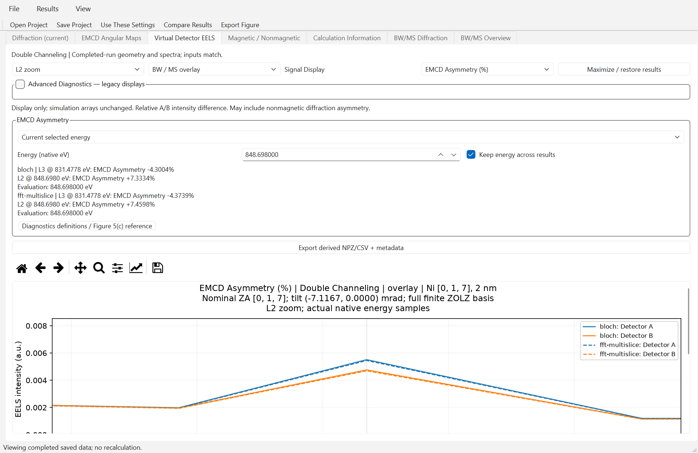

# EMCD-Sim v0.6.0 Windows Beta acceptance

Date: 2026-10-18. Identity: **Double-Channeling EMCD Simulation**.
Application/package version **0.6.0**; target annotated tag **v0.6.0-beta.1**.
Double Channeling already shipped in 0.4.5; this milestone consolidates that
framework and unifies Raw / EMCD Asymmetry interpretation without new physics.

## Release gates

| Acceptance area | Status | Evidence/scope |
| --- | --- | --- |
| A: focused source tests | PASS | 107 tests (81 source + 26 saved-data diagnostics), 8 layout warnings |
| A: genuine Single/Double x BW/MS/Both dispatch | PASS | Six small real native worker cases |
| A: scientific integrity against accepted 0.4.5 | PASS | 356 fingerprints and 432 original NPZ arrays bitwise equal |
| A: raw components, total asymmetry and mirrored maps | PASS | Independent hand references, signs, floors/NaN, overlays, no rescaling |
| A: legacy projects and display preferences | PASS | Original keys/arrays preserved; Relative migrates explicitly to Advanced |
| B: source and frozen Windows GUI | PASS | Native Qt Windows, screen DPR 1.5, no artificial scaling override |
| B: source/frozen scientific outputs | PASS | 356 matching fingerprints; 726 NPZ arrays bitwise equal |
| B: startup/CIF/diffraction, Browser, save/open, CSV/NPZ, PNG/SVG | PASS | Actual extracted executable workers and exports |
| B: cancellation, preserved results and restart | PASS | Nine source and nine frozen cases; completed-solver fingerprints equal |
| B: archive/manifest/reference integrity | PASS | CRC; 609 file hashes; AMD64 PE; tracked example only |
| C: current documentation/screenshots/links | PASS | Current definitions and real source/frozen captures; old records retained |
| Independent clean-machine test | NOT TESTED | Extracted on the development Windows host; not another machine |
| Linux/macOS acceptance | NOT PASSED | Known previous CI failures; not certified by Windows acceptance |

A and B passed before merge/publication. Source acceptance used Windows
10.0.26200, Python 3.11.17, NumPy 2.4.6, SciPy 1.17.1, Matplotlib 3.11.2,
ASE 3.29.0, PySide6 6.12.0. PyInstaller 6.22.3 built a windowed x64 folder
bundle in a separate directory. Application version/commit are verified in
bundled build metadata and the running executable's acceptance report;
the EXE is unsigned (`NotSigned`).

## Build and package provenance

Development signal commit: `94ea025455a18ff77f0a54e6dcf596ce0803a6cc`.
Build source: **c2caf4247a350e28a38b79cd402954d0c1ab2509**, clean detached
worktree at `build/windows-v060-beta-rc/source/`; `dirty=false`.
Later documentation and release merge commits are newer than the executable.
The original working tree's modified Ni file and private companions were not
copied into this checkout or distribution. Runtime implementation hashes,
versions and UTC build time are in `build_manifest.json`/`build_info.json`.

- EXE: `build/windows-v060-beta-rc/dist/EMCD-Sim/EMCD-Sim.exe`.
- ZIP: `build/windows-v060-beta-rc/EMCD-Sim-0.6.0-Beta-Windows.zip`.
- Size: **108,697,224 bytes** (103.66 MiB).
- Public assets: ZIP, `SHA256SUMS.txt`, `build_manifest.json`,
  `release_provenance.json`.

```text
6adda35a3b52ac35a06681a8cf5fca753aae2f03387feda57373c78ad8be2b5e
```

The new ZIP was CRC-tested and all 609 manifest files hashed.
The PE machine is AMD64; Python runtime, Qt Windows plugin and required runtime
libraries are present. Exactly one Ni reference is bundled, with SHA256
`4fd517af3e54db94588a76b7a6ed9c2f9a1b745cd8fe52b9fca0f87fc4938db3`. No user research outputs, WIEN2k companions,
credentials or test caches were included. The explicitly selected external Ni
source used to match old acceptance arrays has SHA256
`a0e28ea6423b6c7832bb3cce6d69d71aa59336a221baeee3d2556b49ba501283`;
it is distinct from the tracked bundled example. Both load/calculate; their
results are not conflated as matched-input references.

Extraction was into a fresh folder outside the repository under Windows Temp.
The EXE ran from there with a system-only PATH and Python/Conda environment
variables removed. `frozen=true` and `development_python_paths_removed=true`
are recorded. All six new source/frozen mini profiles use the same external
source, eta/beta, energy samples, beam/potential cutoffs, grid, depth and FFT.
No completed production thickness/voltage study was rerun.

The PowerShell wrapper returned nonzero after relaying PyInstaller's
informational/warning stderr as a NativeCommandError record. PyInstaller's log
records successful EXE/COLLECT completion and the script produced the archive,
manifest and checksum. Rather than reusing old binaries or assuming success,
CRC, every file hash, actual extracted execution and source/frozen arrays were
validated independently. The optional SciPy hook warning did not prevent any
covered solver/import/export workflow. No package was rebuilt to hide it.

## Scientific reference results

All eight accepted 0.4.5 comparisons (six dispatch profiles plus two saved
full-spectrum projects) retain bitwise-equal scientific-array fingerprints.
The 432 unchanged original NPZ arrays additionally cover coordinates, frame,
aperture weights and diffraction arrays. Source/frozen supplemental aliases,
denominators and original arrays also agree bitwise.

The fresh dispatch profile is Ni [017], exact (200), 200 kV, 2 nm,
beam cutoff 0.9, potential cutoff 1.8 cycles/Angstrom, 9x9 reciprocal grid,
FFT 24, 9 depth samples and 16 aperture subpixels. It tests dispatch/UI, not
production convergence. The following reused **[001] restricted-row**, 8 nm
Double reference contains 242 genuine native energy samples; it is not a full
2D [001] wavefield or a new calculation:

| Solver | Native L3 831.4778 eV, total (%) | Native L2 848.698 eV, total (%) |
| --- | ---: | ---: |
| BW | -13.227773039662427 | +22.415441058220710 |
| MS | -13.227786531375498 | +22.415463830222660 |

The small BW/MS differences in that saved reference are **between solvers**,
not changes introduced by 0.6.0; source/frozen and old/new comparisons are
bitwise equal. Their scope does not certify other geometries or thicknesses.
Full/L3/L2 views preserve original A/B EELS and native energies. Saved two-point
projects remain points; no fabricated continuous spectrum is introduced.

Raw EELS uses M_A-M_B and N_A-N_B. Total Asymmetry is exactly
100*(I_A_plus-I_B_plus)/(I_A_plus+I_B_plus), including possible even imbalance.
Magnetic-only/even advanced components retain N_A+N_B as common denominator.
No factor of two, independent peaks or hidden post-edge correction is applied.
Maps use actual validated saved qy-reflected samples; undefined denominators
remain NaN. Aperture intensities are integrated first before forming a detector
ratio; averaging percentage pixels is not equivalent. Core MDFF, propagation,
depth quadrature, cutoffs, weights, precision, memory and cancellation code are
unchanged from the accepted baseline.

## Cancellation and GUI behavior

| Run | Cases | Worst request-to-idle |
| --- | ---: | ---: |
| Source | 9 | 0.320491 s |
| Extracted frozen EXE | 9 | 0.273504 s |

The existing harness uses 180 ms controlled work blocks at real checkpoints
plus uninstrumented cancellation, Single and Double paths, Both stopping
before the second solver, repeated/late cancellation, queued completion,
restart and save/reopen. Completed arrays and existing project hashes remain
unchanged. These are measured small-profile latencies, not upper bounds for
all native numerical calls. No partial result replaces the last completed one.

Actual 150% captures:







Figures/axes/colorbars were inspected. The existing maximized view and
scrollbars preserve readable minimum plot sizes at 150%; the default narrow
split pane is cramped and large EELS figures require vertical scrolling.
The manual also embeds complete exported two-panel figures. No science arrays
were changed for presentation or screenshots.

## Evidence and CI boundaries

Local evidence: `outputs/v060_release/focused.xml`, `advanced.xml`, `source_native/`,
`source_cancellation/`, `frozen_native/`, `frozen_cancellation/`,
`old_source_comparison.json`, `old_source_npz_comparison.json`,
`source_frozen_comparison.json`; package evidence in
`build/windows-v060-beta-rc/integrity.json` and `build_manifest.json`.

The first 81 focused tests cover v0.6 signals/presentation, legacy components/PRB,
version consistency, cancellation, energy-resolved Double, GUI Double and
Stage D persistence. Another 26 Stage F tests check retained advanced
normalization, local/paired maps, NaN support and saved-data exports without
calling any solver. All 107 passed. Counts overlap earlier inventories and must not be added
to them as unique scientific coverage. Local tests use host permissions for
Windows pytest temporary-directory ACL compatibility.

Prior remote CI [run 39159953271](https://github.com/dingpengem/EMCD-Sim/actions/runs/39159953271)
had Windows PASS, Linux FAIL (native interpreter-shutdown abort) and macOS FAIL
(unavailable /proc RAM adapter). These failures are not passes or resolved
by this Windows acceptance. No cross-platform engineering rewrite or physical
model change was attempted. Current release-commit CI is recorded in the
publication provenance/verification; Windows-only support remains explicit.

## Publication and preserved release

The release is a GitHub **Pre-release**:
[release page](https://github.com/dingpengem/EMCD-Sim/releases/tag/v0.6.0-beta.1),
[Windows ZIP](https://github.com/dingpengem/EMCD-Sim/releases/download/v0.6.0-beta.1/EMCD-Sim-0.6.0-Beta-Windows.zip).
Only after the gates above pass is the branch merged and the annotated tag
created. Final merge/tag target and public download verification are recorded
in `release_provenance.json` and the post-publication record. The executable
continues to identify its actual earlier clean build source, not the merge SHA.

The old annotated v0.4.5-beta.1 tag still targets
`4185080dfb76c5dcce051b43511969caf9181548`; its ZIP remains SHA256
`309438c4a049773a6e99948477c8d52051cd8f1de632a762c795656e6c5a2216`.
Its GitHub release ID, asset IDs/digests and tag target are checked separately.
No unwanted Ni companion files are staged or uploaded.

## Remaining scientific limitations

Approximate XMCD-constrained MDFF; no complete DFT-derived transition tensor;
projected potentials and frozen longitudinal transfer; uncalibrated absolute
EELS/counts and source-energy calibration; limited tested materials/geometries
and representative numerical convergence. Raw arbitrary units and the optional
detectability proxy are not experimental counts or SNR. Corrected contrast is
not intrinsic magnetic recovery. This release adds no global convergence or
thickness/voltage optimum claim. The executable is unsigned; independent
clean-machine and non-Windows acceptance remain outside the certified scope.

## Post-publication verification (completed)

**READY AND PUBLISHED.** Public GitHub release ID `416771569` is
marked Pre-release (`prerelease=true`, `draft=false`). The annotated
`v0.6.0-beta.1` tag targets the intended merge commit
`10065f2c048c631fe66479ff8795ed2fae15f9eb`; pushed main includes that merge.
Release acceptance documentation commit: `d23ded6`; original signal
implementation: `94ea025455a18ff77f0a54e6dcf596ce0803a6cc`.

The actual public ZIP was downloaded in full: **108,697,224 bytes**. Its
SHA256 is identical to the local validated candidate:

```text
6adda35a3b52ac35a06681a8cf5fca753aae2f03387feda57373c78ad8be2b5e
```

All four public asset sizes/digests match their local files. The public
README, installation filename, Raw/Asymmetry manual and all six current
frozen screenshot paths were checked at the release commit. The old 0.4.5
release ID, asset IDs/sizes/digests and annotated tag target are unchanged.
No user-owned Ni companion data was added to git or the release archive.
Local machine-readable evidence: `outputs/v060_release/publication_verification.json`.

Actual release-commit [CI run 39176489525](https://github.com/dingpengem/EMCD-Sim/actions/runs/39176489525):

| Platform | Result | Details |
| --- | --- | --- |
| Windows / Python 3.11 | PASS | 353 passed, 49 skipped, 30 warnings; CLI smoke/output checks completed |
| Linux / Python 3.11 | FAIL | 353 passed, 49 skipped, then native `bool_dealloc` interpreter-shutdown abort, exit 134 |
| macOS / Python 3.11 | FAIL | 47 failed, 263 passed, 49 skipped, 43 errors; unavailable `/proc/meminfo` RAM adapter and cascading fixture failures |

The overall cross-platform workflow is **failed**, not green. Those known
portability failures are explicitly outside this Windows-only Beta's certified
scope; they were not relaxed, masked or represented as successful. Windows
CI and the separate 107 focused local acceptance tests overlap in coverage
and are not additive unique test counts. A later documentation-only main
commit records these observations without changing the tagged binary/source.
