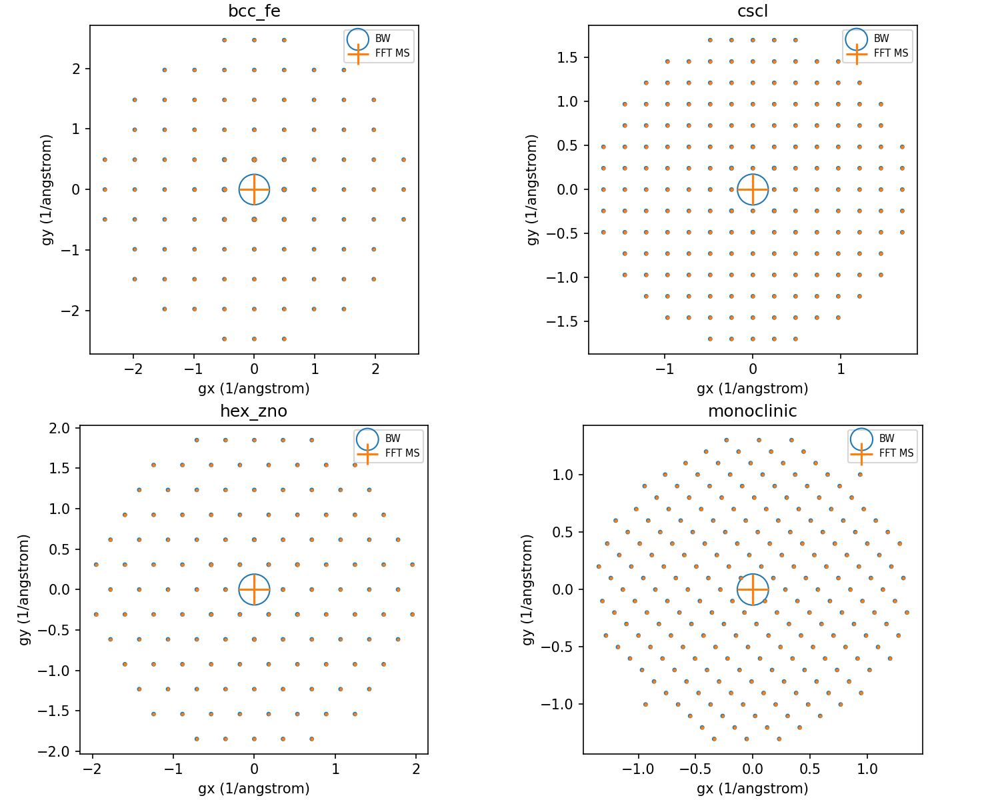

# Multi-element BW/MS acceptance

PASS for these bounded 200keV, 1nm, zero-tilt elastic configurations. Both methods use the same finite neutral-atom potential; BW support is 2.5 times the listed potential cutoff. FFT Fourier coefficients are independently compared to the IAM structure factors with the SI interaction prefactor.

| case | potential cutoff (1/angstrom) | BW beams | mesh coarse/fine | slice coarse/fine (nm) | max intensity error coarse/fine | fine norm error | Fourier coefficient error |
|---|---|---|---|---|---|---|---|
| bcc_fe | 1.05 | 89 | 24/32 | 0.02/0.005 | 1.771e-07/1.106e-08 | 2.33146835e-15 | 7.22522128e-18 |
| cscl | 0.72 | 177 | 24/32 | 0.02/0.005 | 5.867e-08/3.646e-09 | 4.4408921e-16 | 7.27225434e-18 |
| hex_zno | 0.85 | 121 | 24/32 | 0.02/0.005 | 3.415e-08/2.141e-09 | 1.77635684e-15 | 8.28374429e-18 |
| monoclinic | 0.55 | 205 | 32/48 | 0.02/0.005 | 5.18e-11/3.181e-12 | 5.55111512e-14 | 1.73472348e-18 |

The initial monoclinic 24x24 mesh was explicitly rejected by the Nyquist/support check. The accepted 32/48 pair includes the full requested support; no beam/harmonic was silently discarded. This limited mesh/step refinement checks these thin finite-potential cases. It is not universal BW/MS convergence, a full 3D atomic potential, absorptive/TDS validation, or a quantitative experiment benchmark.

Additional new-provider Ni[001] control: 200keV,1nm, 1.4 potential cutoff,32x32 FFT,.005nm step, 121 BW beams. Maximum intensity error 2.87002123e-08, norm error 2.44249065e-15. Full arrays/settings are in [ni_bw_ms.json](ni_bw_ms.json).
