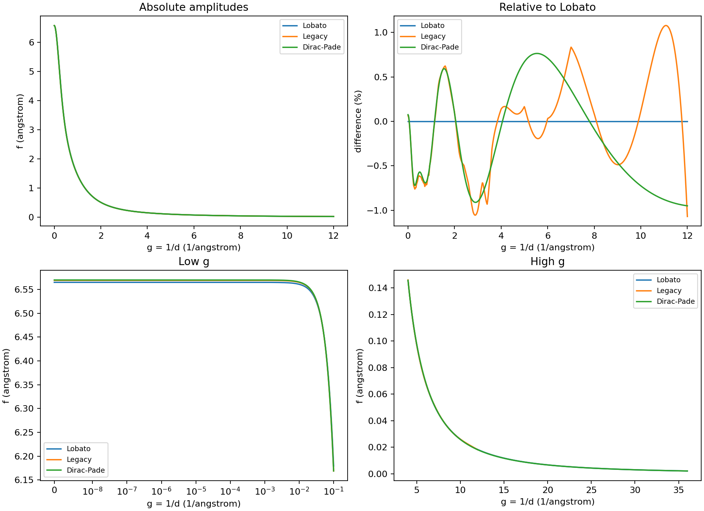
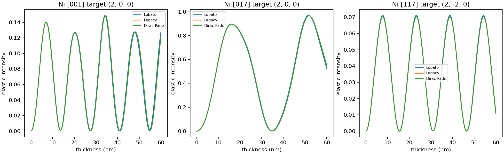

# Ni scattering-provider comparison

PASS for local elastic acceptance. All amplitudes below are in angstrom, with g=1/d. Legacy factors are converted from source potential scaling exactly once; Adaptive factors need no such conversion.

| reflection | g | Lobato | external legacy | Dirac-Pade | new vs Lobato (%) |
|---|---|---|---|---|---|
| 000 | 0 | 6.5649 | 6.569 | 6.5698387 | 0.0752289393 |
| (1, 1, 1) | 0.491501364 | 2.9757581 | 2.9574453 | 2.95878167 | -0.570490716 |
| (2, 0, 0) | 0.56753689 | 2.62074115 | 2.6041599 | 2.60523151 | -0.59180354 |
| (2, 2, 0) | 0.802618367 | 1.86489151 | 1.85153868 | 1.85229711 | -0.675342506 |
| (3, 1, 1) | 0.941153459 | 1.55673993 | 1.5492989 | 1.54919537 | -0.484638094 |
| (4, 0, 0) | 1.13507378 | 1.22543797 | 1.22514357 | 1.22530478 | -0.0108684296 |
| g=6 | 6 | 0.0689770423 | 0.069 | 0.0694669799 | 0.710290859 |
| g=12 | 12 | 0.0181948992 | 0.018 | 0.0180218888 | -0.950872829 |
| g=24 | 24 | 0.00462994831 | outside source range | 0.00461292573 | -0.367662436 |
| g=36 | 36 | 0.00206509048 | outside source range | 0.00206273153 | -0.114229793 |

| zone | provider | beams | two-beam xi (nm) | max eigenvalue shift (1/nm) | max intensity difference over 0–60nm |
|---|---|---|---|---|---|
| 001 | nickel-lobato-2014 | 21 | 41.9742399 | 0 | 0 |
| 001 | legacy-atomicscatfact-neutral-v1 | 21 | 42.2414989 | 0.00206973053 | 0.0632220159 |
| 001 | adaptive-dirac-pade-2026 | 21 | 42.2241238 | 0.00191571346 | 0.0588089315 |
| 017 | nickel-lobato-2014 | 71 | 41.9742399 | 0 | 0 |
| 017 | legacy-atomicscatfact-neutral-v1 | 71 | 42.2414989 | 0.00069333497 | 0.0297220581 |
| 017 | adaptive-dirac-pade-2026 | 71 | 42.2241238 | 0.00064368707 | 0.0276520312 |
| 117 | nickel-lobato-2014 | 21 | 58.9866042 | 0 | 0 |
| 117 | legacy-atomicscatfact-neutral-v1 | 21 | 59.4120007 | 0.000420018255 | 0.00279411321 |
| 117 | adaptive-dirac-pade-2026 | 21 | 59.3876744 | 0.000396220793 | 0.0026355195 |

Configurations and all metrics are in metrics.json; ni017_71_beams.csv lists all 71 beams and ni017_coupling_factors.csv every distinct evaluated pair-difference magnitude inside the 6.2 cutoff. Curves use matched finite beam/potential support; differences are parameterization sensitivity, not instability. Extinction distances use pi/abs(H_0G) for isolated exact-Bragg two-beam coupling, not the multibeam oscillation period. Incoming channeling is represented by the saved target amplitude/intensity curves.

The original source function and coefficients are unchanged. Original pre-extension scattering, beam and BW implementations were loaded independently from 859870c2; all three Lobato controls have bitwise-identical Hamiltonians and amplitudes at 0,9,30 nm. Existing reference assertions retain their numbers and explicitly request Lobato. No large EMCD calculation or old study was rerun. Changing elastic potentials can change EMCD; no quantitative new-provider EMCD certification is claimed.
