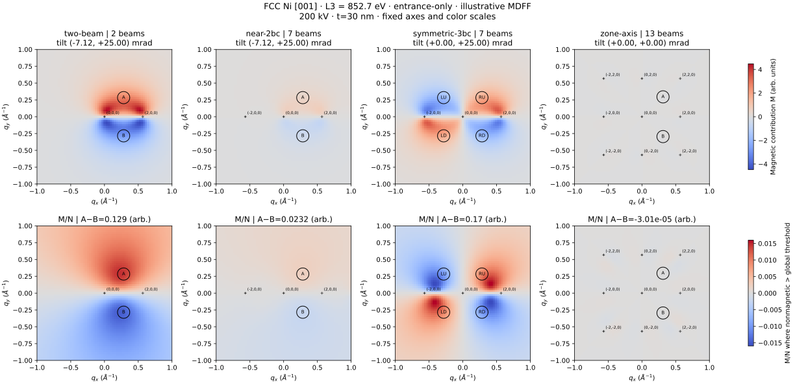

# FCC Ni L3 EMCD reciprocal maps — comparison by diffraction condition

This example contrasts **two-beam**, **near-2bc**, **symmetric-3bc**, and **zone-axis** for the same crystal, accelerating voltage (200 kV), thickness (30 nm), L3 energy (852.7 eV) and reciprocal-space grid. The diffraction **beam basis and preset incidence tilt intentionally differ**; this is a comparison of condition-specific geometries, not a controlled tilt scan.



Regenerate on Windows/macOS/Linux:

```bash
python -m pip install -e ".[dev]"
python -m emcd_sim.compare_conditions --output outputs/ni_condition_maps
```

Outputs: `emcd_diffraction_conditions.png`, `emcd_diffraction_conditions.svg`, `emcd_condition_maps.npz` (magnetic and nonmagnetic arrays, local ratio, hkl and beam positions) and `comparison_metadata.json` (apertures, tilt, integrated A−B and model assumptions).

**Read carefully:** Top row is the magnetic additive term, not a measured difference between spectrometer aperture settings. Bottom row is the local magnetic/nonmagnetic ratio, equal to the idealized magnetization-reversal asymmetry in this phenomenological model when the nonmagnetic term is sufficiently large. It is **not** the detector-integrated 2BC/3BC EMCD asymmetry. The color ranges are identical across all conditions, so low contrast may look almost gray. The +25 mrad y tilts for 2BC/3BC are nominal presets but do not activate omitted off-row beams. This is an **entrance-only, finite-beam, IAM, illustrative Gaussian MDFF** result; neither 13 beams nor the outgoing-free model has been established to converge quantitatively.
